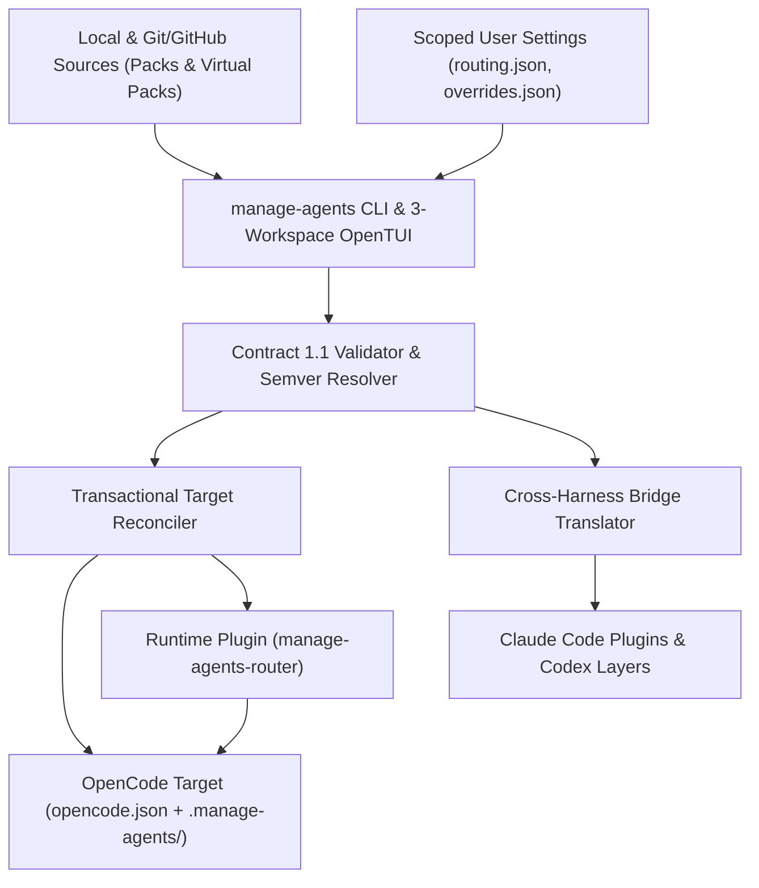

# manage-agents

[](https://github.com/lorecanc/manage-agents/actions/workflows/ci.yml)


Catalog-agnostic CLI and 3-workspace OpenTUI engine for validating, onboarding, resolving, editing, routing, and installing **OpenCode V2 agent packs** from local directories or Git/GitHub repositories.

A **pack** mirrors an OpenCode configuration directory (`agents/`, `commands/`, `skills/`, `plugins/`, `themes/`, `tools/<pack>/`, optional `opencode.json(c)` and `AGENTS.md`) plus an `opencode-pack.json` manifest. `manage-agents` resolves requested packs and their SemVer `requires` dependencies, merges managed entries into `<target>/opencode.json` without touching your own keys, installs a runtime router plugin (`manage-agents-router`) for dynamic `IF / OR` model and policy routing, customizes read-only Git sources non-destructively via scoped user overrides, and translates packs into **Claude Code plugins** and **Codex layers**.

The engine and pack catalogs are strictly independent: the engine embeds zero catalog-specific pack names or rules, and pack repositories require no build step or engine dependency beyond the contract.

- **Pack Contract `1.1`:** [`contract/CONTRACT.md`](contract/CONTRACT.md) · JSON Schema [`contract/opencode-pack.schema.json`](contract/opencode-pack.schema.json) · Reference pack [`contract/examples/minimal-pack`](contract/examples/minimal-pack)
- **Pack Authoring Skill:** [`contract/skills/opencode-pack-authoring/SKILL.md`](contract/skills/opencode-pack-authoring/SKILL.md)
- **Project Wiki:** [`wiki/index.md`](wiki/index.md) (architecture, module internals, CLI/contract references, security model)
- **Guida in italiano:** [`GUIDA.md`](GUIDA.md)

---

## How It Works & Core Concepts



| Concept | Definition |
|---|---|
| **Pack** | Self-contained unit laid out like `~/.config/opencode/` and governed by `opencode-pack.json` ([Contract `1.1`](contract/CONTRACT.md), backward-compatible with `1.0`). |
| **Virtual Pack** | In-memory pack view (`0.0.0-virtual`) synthesized automatically from manifest-free `.md` agent folders or project `.opencode/` directories before formal onboarding. |
| **Workspace** | Local multi-pack catalog (manifests up to four directories deep) or single pack edited by the TUI and workspace commands (`--workspace <dir>`, `$MANAGE_AGENTS_WORKSPACE`, or ancestor auto-discovery). |
| **Source** | Named local directory or Git/GitHub repository registered in `$XDG_CONFIG_HOME/manage-agents/sources.json`. Git checkouts live read-only under `$XDG_CACHE_HOME/manage-agents/sources/<name>`. |
| **Target** | OpenCode config directory (default `$XDG_CONFIG_HOME/opencode`, i.e. `~/.config/opencode`). Tracks `desired.json`, `lock.json`, and `installed.json` inside `<target>/.manage-agents/`. |
| **Archetype & `IF / OR` Flows** | Caller-driven routing where primary agents (`archetype.callers` or custom `$callers`) dynamically assign subagent models and narrowable `tools`, `permissions`, and `delegations` policies based on the active caller model (`*`, `provider`, or `provider/model`). |
| **User Settings** | Scoped `routing.json` and `overrides.json` files in `$XDG_CONFIG_HOME/manage-agents/` (global `default` + per-target `targets.<realpath>`). Applied at `reconcile` without modifying pack sources. |
| **Bridge** | Deterministic, closure-aware translation of a pack and its `requires` into a Claude Code plugin (`bridges/claude-code/<name>`) or Codex layer (`bridges/codex/<name>`). |

---

## Requirements & Installation

### Runtime & External CLIs

- **JavaScript runtime (one required):**
  - **Node.js `>=26.4.0`** — `@opentui/core` uses native FFI; `manage-agents.mjs` checks the Node version and automatically re-executes with `--experimental-ffi` and `--no-warnings=ExperimentalWarning` (pinning UTF-8 `chcp 65001` on Windows).
  - **Bun `>=1.3.0`** — supported natively without extra flags.

| CLI | Requirement | Used For |
|---|---|---|
| `git` | Required | Cloning/pulling Git sources, commit-pinned cache snapshots, release ancestry checks, and optional scoped workspace `--auto-commit`. |
| `opencode` | Optional | Queries `opencode models` to populate the live `provider/model` and variant catalog in the TUI picker, `create`, and `tune`. |
| `gh` | Optional | `source login`, `source auth`, GitHub repo discovery in the TUI, and token-free HTTPS pulls via `gh auth git-credential`. |
| `claude` | Optional | Runs `claude plugin validate --strict` and user-scope plugin registration during `bridge --target claude`. |

### Install from Source

```bash
git clone https://github.com/lorecanc/manage-agents.git manage-agents && cd manage-agents
npm ci            # or: bun install
npm link          # optional: exposes `manage-agents` on PATH
```

Run with `manage-agents` (if linked), `./manage-agents.mjs`, `node manage-agents.mjs`, `bun manage-agents.mjs`, or `npm start`.

**Self-bootstrapping launcher:** When launched from a source checkout, `manage-agents.mjs` verifies `node_modules` against `package.json` (installing with `--ignore-scripts` if out of sync unless `MANAGE_AGENTS_SKIP_AUTO_INSTALL=1` is set) and automatically rebuilds `dist/index.js` via `esbuild` whenever `src/` or `package.json` is newer.

### Self-Update from GitHub Releases

Tagged `v*` GitHub Releases ship prebuilt `manage-agents-<tag>.tar.gz` bundles (`dist/` included, no build step needed):

```bash
manage-agents version                # inspect version, channel, and bundle hash (--json supported)
manage-agents self-update --check    # check for newer v* releases without modifying disk
manage-agents self-update            # verify SHA-256 + bundleHash (+ Ed25519 sig), update, and reconcile router
```

---

## Quick Start & Common Workflows

### 1. Attach a Source, Install, and Update Packs

```bash
manage-agents source login                              # optional: authenticate GitHub CLI for private repos
manage-agents source add lorecanc/agents --pull         # GitHub owner/repo[#ref], git URL, or local directory
manage-agents pack list                                 # list available packs (including virtual .md folders)
manage-agents install flow pipeline                     # transactional install into ~/.config/opencode
manage-agents install --codex pipeline flow artcraft    # personal Codex plugins, MCP servers and namespaced agent roles
manage-agents status                                    # prints "In sync." when target matches lock.json
manage-agents update                                    # pull Git sources and upgrade within SemVer ranges
```

### 2. Onboard, Validate, and Maintain a Pack

```bash
manage-agents pack onboard ./my-agents --authoring-kit  # migrate V1->V2, infer archetype, add skill + CI workflow
manage-agents pack validate ./my-agents --git           # enforce Contract 1.1 + stricter git-source rules
manage-agents pack doctor ./my-agents --fix --bump minor
manage-agents pack add agent mypack-reviewer --dir ./my-agents --mode subagent
```

### 3. Customize Models & Conditional `IF / OR` Flows (Including Read-Only Git Sources)

```bash
# Route subagents when a caller in `pipeline` runs on anthropic or openai/gpt-5.4
manage-agents models set pipeline anthropic,openai/gpt-5.4 pipeline-explorer=anthropic/claude-haiku-4-5 pipeline-executor=inherit

# Add a conditional IF/OR policy rule narrowing tools, permissions, and delegations
manage-agents models rule-set pipeline openai/gpt-5.4 --tool webfetch=allow --perm edit=ask --delegate pipeline-fast_lane=deny

# Pin or unpin a subagent's model, or patch frontmatter fields at reconcile time
manage-agents models pin pipeline/pipeline-security_auditor anthropic/claude-opus-4-6#max
manage-agents models unpin pipeline/pipeline-explorer
manage-agents override set pipeline/pipeline-executor steps=30 hidden=true
```

### 4. Translate Packs to Claude Code & Codex

```bash
manage-agents bridge --pack flow --target claude        # emits bridges/claude-code/<name>, validates & registers
manage-agents bridge --pack flow --target codex         # emits bridges/codex/<name> (.codex-plugin + TOML agents)
manage-agents bridge check --pack flow                  # CI byte-for-byte drift check on committed bridges
```

---

## Interactive TUI

Running `manage-agents` without a subcommand opens the full-screen React 19 + OpenTUI interface. Startup resolves in order:
1. `--workspace <dir>` or `$MANAGE_AGENTS_WORKSPACE`
2. `--source <name>` (pulls uncached Git sources automatically and marks `<name>` active)
3. Nearest pack or conventional `packs/` catalog, then manifests inside the current Git repository, then a virtual pack in the current directory
4. Active registered source in `sources.json`, or **Sources & Target** if none is attached yet

In **Sources & Target**, press `/`, enter a local directory or Git repository, and press `Enter` to open its catalog. Select a pack and press `E` to preview the target changes. `Esc` cancels the preview. Packs containing only commands, tools, or skills also appear here.

### Three Switchable Workspaces

Switch workspaces anytime with `Tab` / `Shift+Tab`, clickable top-bar pills, or the Command Palette (`Ctrl+K` / `Ctrl+P`):

1. **`1 Catalog` (Catalog Tree & 6-Tab Inspector):** Left collapsible pack/agent tree with status badges (`● installed`, `↑ update`, `◌ virtual`, `✎` overrides, `⇄` flows), `/` live filter, and multi-agent batch selection. Right 6-tab inspector: **1 Info** (`Pack`, `Model`, `Variant`, `Mode`, `Steps`), **2 Prompt** (sanitized, cell-accurate Markdown view), **3 Name**, **4 Sec** (permission risk & `"*": "deny"` order), **5 Graph** (inbound/outbound `@subagent` calls), and **6 Res** (skills, custom tool families, MCP server states).
2. **`2 Flows & Graph`:** Flat pack and agent call-graph explorer paired with a live `Topology & IF/OR Rules` inspector flagging unresolved `@subagent` dead references and opening the interactive `IF / OR` flow editor (`M`) or delegation checklist (`G`).
3. **`3 Sources & Target`:** Unified source manager (`gh` web login, GitHub repo browser, URL/path attach, Git pull, trust toggle) and live OpenCode target health/drift dashboard with one-key reconcile (`R`) and engine self-update (`Shift+U`).

**Local vs. Read-Only Git Write Path:** On a local workspace or local source, TUI edits write directly to pack files (with optional scoped Git auto-commits). On a Git/GitHub source, edits save cleanly to `$XDG_CONFIG_HOME/manage-agents/overrides.json` and `routing.json` and immediately reconcile your installed OpenCode target without modifying the cached Git checkout.

### Keybindings & Mouse Controls

| Key / Input | Action | Scope |
|---|---|---|
| `Ctrl+K` / `Ctrl+P` | Open fuzzy **Command Palette** (workspaces, actions, `Jump to Agent`) | Global |
| `?` / `Esc` | Open 4-tab **Keyboard & Mouse Guide** / close active modal or filter | Global |
| `Tab` / `Shift+Tab` | Cycle workspaces (`Catalog` → `Flows & Graph` → `Sources & Target`) | Global |
| `O` | Jump directly to `Sources & Target` | Catalog / Flows |
| `↑`/`↓` (`j`/`k`), `PgUp`/`PgDn` | Navigate rows (or scroll focused Inspector pane on tabs `2`, `4`, `5`, `6`) | Global |
| `←`/`→` (`h`/`l`), `Enter` | Collapse/expand pack folders in Catalog; jump or open flow editor in Flows | Tree / Flows |
| `[` / `]` | Focus left list pane or right Inspector pane | Catalog |
| `1` – `6` | Switch Inspector tabs (`Info`, `Prompt`, `Name`, `Sec`, `Graph`, `Res`) | Catalog |
| `/` | Live-filter Catalog agents (`Enter` keeps filter, `Esc` clears) or focus Source input | Catalog / Sources |
| `Space` | Select the focused pack for installation or mark the focused agent for batch edits | Catalog |
| `Ctrl+A` | Select or deselect all packs matching the current Catalog filter | Catalog |
| `A` / `S` | Mark all agents in the pack or agents sharing the focused model in that pack | Batch |
| `M` | Assign LLM model (on agent/batch) or open **Conditional `IF / OR` Flows** (on pack) | Catalog / Flows |
| `T` | Tune `steps`, Thinking/Effort `variant`, `mode` (`primary`/`subagent`/`all`), `hidden` | Agent / Batch |
| `P` / `C` / `Shift+T` | Apply safety permission preset / pick badge color / assign bridge translation tier | Agent / Batch |
| `U` / `G` | Manage allowed/denied skills, tool families & MCP servers / edit `@subagent` delegations | Agent |
| `V` | Batch-repair missing or invalid catalog models | Pack |
| `I` | Onboard virtual `.md` folder (or clone & onboard remote Git source) to Contract `1.1` | Virtual Pack |
| `D` / `N` | Open **Pack Doctor** (`F` fix, `A` authoring kit, `1/2/3` semver bump) / scaffold resource | Local Pack |
| `R` / `Shift+F` | Rename agent & update references / fix `"*": "deny"` permission order (Tab 4) | Local Pack |
| `E` | Preview the selected Catalog packs, or the focused pack when there is no selection. `Y` confirms installation into OpenCode. | Catalog / Flows |
| `B` / `Shift+B` | Open **Claude Code** (`B`) or **Codex** (`Shift+B`) bridge modal with tier preview | Catalog / Flows |
| `P` / `G` / `T` / `X` | Pull Git source / `gh` web login / toggle source trust / remove source | Sources |
| `R` / `Ctrl+R` | Reconcile installed OpenCode target now / refresh sources & target drift | Sources |
| `Shift+L` / `Ctrl+E` | Adjust list/inspector split (`0.60`–`0.75` in `ui.json`) / toggle reduced motion | Global |
| `Shift+U` / `Ctrl+C` | Check or apply `manage-agents` release self-update / quit TUI | Global |
| `Click` / `Drag │` / `Wheel` | Click rows, tabs & footer chips / drag center divider to resize / wheel-scroll | Mouse |

> **OpenCode V2 routing note:** A static `deny` in an agent's frontmatter cannot be widened at runtime by a plugin. Keep `allow` or `ask` on the caller in frontmatter and narrow access dynamically via conditional `IF / OR` flows (`U` for tools/MCP, `G` for delegations inside the flow editor; `W` exports local pack flows to `opencode-pack.json`).

---

## CLI Reference

```bash
manage-agents [<command>] [options] [--workspace <dir>] [--source <name>] [--auto-commit | --no-auto-commit]
```

Every command supports `--help` (`-h`). Machine-readable commands emit control-safe JSON with `--json` on `stdout` and write errors to `stderr`.

### Pack, Source & Target Commands

| Command | Summary |
|---|---|
| `pack validate <dir>... [--git] [--json]` | Validate layout, `opencode-pack.json`, namespaces, `opencode.json` keys, cross-pack references, archetypes, and executable surface. |
| `pack list [--json]` | List all packs across registered sources, including synthesized virtual packs and discovery warnings. |
| `pack init\|onboard [<dir>] [flags]` | Onboard a folder or `--clone-source <name>` into Contract `1.1` (`--name`, `--version`, `--description`, `--layout auto\|root\|subpack`, `--no-organize`, `--authoring-kit`, `--json`). |
| `pack doctor [<dir>] [flags]` | Diagnose and repair contract drift (`--fix`), install CI/skill kit (`--authoring-kit`), and bump version (`--bump patch\|minor\|major`, `--json`). |
| `pack add <agent\|skill\|command> <id>` | Scaffold a compliant OpenCode V2 resource (`--dir`, `--description`, `--mode primary\|subagent\|all`, `--json`). |
| `source list\|add\|remove\|pull\|login\|auth\|trust\|untrust\|prefer` | Manage `$XDG_CONFIG_HOME/manage-agents/sources.json`, `gh` auth, read-only Git cache pulls, source trust, and multi-source `<pack>` preferences. |
| `resolve <[source/]pack[@range]>...` | Dry-run SemVer dependency resolution, contract validation, lock diff, and confirmation report (`--target <dir>`, `--json`). |
| `install <[source/]pack[@range]>...` | Transactionally install packs and transitive `requires` into `--target` (`--adopt`, `--yes`, `--dry-run`, `--json`). |
| `uninstall <pack>...` | Remove root packs from `desired.json` and prune unreferenced dependencies/empty created config sections (`--target`, `--dry-run`, `--json`). |
| `update [<pack>...]` | Pull Git sources and upgrade installed packs within version ranges (`--target`, `--adopt`, `--yes`, `--dry-run`, `--json`; `--self` aliases `self-update`). |
| `reconcile` | Rebuild `<target>` from `desired.json`, `lock.json`, `routing.json`, and `overrides.json` (`--target`, `--adopt`, `--dry-run`, `--json`). |
| `status` | Read-only drift check comparing `<target>` files and `opencode.json` against `lock.json` and `installed.json` (`--target`, `--json`). |
| `restore <backup-id>` | Restore files and `opencode.json` entries backed up by `--adopt` under `<target>/.manage-agents/backups/<backup-id>/` (`--target`). |

### User Settings, Workspace Editing, Bridges & Release Commands

| Command | Summary |
|---|---|
| `models show\|set\|unset\|callers\|rule-set\|rule-unset\|export-pack\|pin\|unpin` | Configure subagent model routes, custom callers, conditional `IF / OR` policy rules, model pins/unpins, or export flows to `opencode-pack.json` (`--target`, `--global`, `--no-reconcile`, `--yes`, `--json`). |
| `override show\|set\|unset` | Patch installed agent or `--command` YAML frontmatter fields via `<pack>/<id> <field>=<yamlValue>` (`null` deletes a field; `--target`, `--global`, `--no-reconcile`, `--yes`, `--json`). |
| `create` | Interactive wizard creating `[<family>-]<pack>-<role>.md` with V2 frontmatter and live `opencode models` lookup. |
| `lint` / `fix-names [--dry-run]` | Audit workspace agent filenames against naming conventions / batch-rename files and rewrite cross-references. |
| `audit` | Report wildcard `"*": "deny"` ordering errors and classify workspace agents into High / Medium / Low risk tiers. |
| `tune [flags]` | Batch-update `--steps`, `--variant`/`--effort` (`--clear-variant`), `--mode`, `--hidden`/`--no-hidden` across `--pack <pack>` or `--all`. |
| `bridge` / `bridge check` | Translate `--pack <name>` + `requires` to `--target claude\|codex` (`--output`, `--name`, `--prefix`, `--config`, `--model src=dst`, `--map-all`, `--no-validate`, `--no-register`, `--wizard`) or verify committed bridges byte-for-byte. |
| `version` (`--version`, `-v`, `-V`) | Print engine version, channel, dirty state, and bundle hash (`--json`, `--engine-root`, CI `--write-manifest`). |
| `self-update` | Check (`--check`) or install latest `v*` GitHub Release (`--yes`, `--force`, `--reconcile`/`--no-reconcile`, `--repo`, `--target`, `--json`). |
| `release keygen\|sign` | Maintainer tooling for Ed25519 key generation (`release-signing.json`) and signed `release-metadata.json` assets. |

**Exit codes:** `0` success / in sync · `1` validation error, drift, conflict, or declined/failed operation · `2` CLI usage / flag syntax error · `128 + N` signal termination.

---

## Bridges & OpenCode V2 Compatibility

### Native OpenCode V2 Normalization

Agents are read in both legacy V1 and native V2 formats and always written back in native OpenCode V2 form:
- `steps` (from `max_steps`), `disabled` (from `disable`), `system` (from `prompt`), ordered `permissions` arrays (`[{ action, resource, effect }]`), and `provider/model#variant`.
- Deprecated agent-level sampling keys (`temperature`, `top_p`, `top_k`) are stripped on write; configure sampling on model variants instead. Agents discovered under `mode/` or `modes/` default to `mode: primary`.

### Cross-Harness Translation (`claude` & `codex`)

Bridge settings persist in `bridges/translation-config.json` (or `$XDG_CONFIG_HOME/manage-agents/translations/<source>/translation.json` for read-only Git sources). Models resolve in five steps: per-agent override → `modelMap` (`provider/model`, bare `model`, `"*"`) → capability tier (`planning`, `execution`, `light`, plus Codex `reasoningEffort`) → role inference → `defaultTier`.

| Construct | OpenCode V2 Pack | Claude Code Plugin (`bridges/claude-code/<name>`) | Codex Layer (`bridges/codex/<name>`) |
|---|---|---|---|
| **Manifest** | `opencode-pack.json` + `opencode.json(c)` | `.claude-plugin/plugin.json`, local `marketplace.json`, `icon.png` | `.codex-plugin/plugin.json` and local `.agents/plugins/marketplace.json` |
| **Agents** | `agents/<id>.md` (`@pack-role` mentions) | `agents/<kebab>.md` (`maxTurns`, `tools`, `@<plugin>:<kebab>`) | `.codex/agents/<kebab>.toml` (`developer_instructions`, `sandbox_mode`) |
| **Commands & Skills** | `commands/<id>.md` (`$ARGUMENTS`), `skills/<id>/SKILL.md` | Commands become `skills/<cmd>/SKILL.md` (`$request`); skills copied | Agent workflows emitted as `.agents/skills/<agent>/SKILL.md` wrappers |
| **MCP & LSP** | `mcp.servers`, `lsp` in `opencode.json` | `.mcp.json` (`mcp__<server>__*` grants) and `.lsp.json` | `.codex/config.toml` for the project and `.mcp.json` for plugin installs |
| **Plugins & Custom Tools** | `plugins/*/index.ts`, `tools/<pack>/**` | Documented in generated `README.md` with prompt fallback notes; tool names adapted (`todowrite` → `TodoWrite`, Task → `Agent`) | Prompt runtime notes document CLI/git fallbacks; tool names adapted (`update_plan`, `@subagent`) |

Run Codex with `codex -C bridges/codex/<name>` using the output directory and trust the project when prompted. Ask Codex to delegate to the exported primary agent by name. The generated README gives the local marketplace commands for installing the packaged skills and MCP servers into Codex. Custom subagents load from the project's `.codex/agents/` directory.

Granular OpenCode permissions such as command and path globs are reported as translation warnings. Codex applies explicit MCP tool denies across the session and rejects a required server when its deny patterns cannot be represented.

---

## State Files, Environment Variables & Security

### Persistent Directories & State Files

| Path | Purpose |
|---|---|
| `$XDG_CONFIG_HOME/manage-agents/sources.json` | Registered `local` and `git` sources (`0o600`), trust flags, active source, and `prefer` map. |
| `$XDG_CONFIG_HOME/manage-agents/routing.json` | Global (`default`) and per-target (`targets.<realpath>`) callers, model routes, and `IF / OR` `$rules`. |
| `$XDG_CONFIG_HOME/manage-agents/overrides.json` | Global and per-target YAML frontmatter overrides (`null` deletes/unpins fields on reconcile). |
| `$XDG_CONFIG_HOME/manage-agents/ui.json` | TUI horizontal `listShare` (`0.60`–`0.75`) and `reducedMotion` preference (`O_NOFOLLOW` + lockfile guarded). |
| `$XDG_CACHE_HOME/manage-agents/{sources,revisions,bridges}/` | Read-only detached Git checkouts, immutable commit-pinned snapshots, and Git-source bridge outputs. |
| `<target>/.manage-agents/{desired,lock,installed}.json` | Requested roots, SHA-256-pinned dependency lock (`contentHash`, `executableHash`), and owned files/config keys. |
| `<target>/.manage-agents/{journal.json,txn/,backups/,install.lock}` | Crash-recovery swap journal, atomic staging tree, `--adopt` backups (`restore <id>`), and PID concurrency lock. |
| `<target>/plugins/manage-agents-router/` | Synthesized OpenCode V2 runtime plugin (`index.ts`, `router.js`, compiled `routing.json`) under `:engine` ownership. |

### Environment Variables

| Variable | Default | Effect |
|---|---|---|
| `XDG_CONFIG_HOME` / `XDG_CACHE_HOME` | `~/.config` / `~/.cache` | Relocate user settings (`manage-agents/`), default target (`opencode/`), and Git/bridge caches. |
| `MANAGE_AGENTS_WORKSPACE` | Auto-detected from `cwd` | Default catalog or pack workspace when `--workspace <dir>` is omitted. |
| `MANAGE_AGENTS_SKIP_AUTO_INSTALL` | Unset (`0`) | Set to `1` to disable automatic `npm`/`bun` dependency synchronization in `manage-agents.mjs`. |
| `AGENT_MANAGER_AUTO_COMMIT` | `0` | Set to `1` to wrap local workspace mutations in scoped, hook-free Git commits (overridden by `--[no-]auto-commit`). |
| `AGENT_MANAGER_UI_CONFIG` | `<configDir>/ui.json` | Load TUI layout config from a custom regular file in read-only mode. |
| `AGENT_MANAGER_REDUCED_MOTION` | `0` (or `ui.json`) | Set to `1` or `true` to disable TUI timeline animations and spinners. |
| `MANAGE_AGENTS_REPO` / `GITHUB_TOKEN` | `lorecanc/manage-agents` | Override release repository or supply API bearer token during `self-update` HTTP fallback. |

### Security & Target Safety Guarantees

- **Transactional target writes:** `install`, `uninstall`, `update`, and `reconcile` detect conflicts against user-owned files and modified managed files before touching disk, stage writes on the target filesystem, record `journal.json`, and roll back automatically on failure or crash recovery. `--adopt` backs up replaced content to `.manage-agents/backups/<id>/` for `restore`.
- **Personal MCP servers:** When an unmanaged `mcp.servers.<name>` already exists with a different definition from a pack's same-name server, the personal entry wins and install/reconcile continue with a warning naming the server and pack. The full entry stays personal; managed drift and pack-to-pack conflicts retain their existing conflict behavior. Explicit `--adopt` replaces and backs up the personal entry, then takes ownership. If the pack has already been approved, removing the personal entry and running `reconcile` adds the pack definition.
- **JSONC preservation:** Ordinary install, update, reconcile, uninstall, and entry-level restore preserve comments in an existing target `opencode.jsonc`. Comments from removed entries remain as standalone comments, and routine writes do not create backups just to preserve comments. Restoring a historical whole-file backup restores its saved bytes.
- **Untrusted pack confinement:** Symlinks are rejected across pack validation, workspace discovery, and target scopes (`lstat` + `O_NOFOLLOW`). Git URLs carrying embedded credentials or query strings are refused.
- **Executable-surface consent:** Installing executable surfaces (plugins, custom tool modules, skill scripts, MCP servers, formatter/LSP commands) from untrusted sources—or updating any pack whose `executableHash` changed—requires interactive confirmation or `--yes`.
- **Terminal & JSON sanitization:** External strings pass through `terminalSafeText()` (stripping CSI, OSC, C0, DEL, and 8-bit C1 sequences) and `--json` output escapes `\u007f`–`\u009f` so untrusted metadata cannot hijack terminal emulators.
- **Hardened Git & signed updates:** Subprocess Git/GitHub calls strip ambient `GIT_*` overrides; `--auto-commit` runs hook-free (`core.hooksPath` isolated, `--no-gpg-sign --only`) after clean-worktree and blob-fingerprint checks; `self-update` verifies SHA-256 archive digests, inner bundle hashes, and Ed25519 signatures (`release-signing.json`) while installing dependencies with `--ignore-scripts`.

---

## Documentation, Development & License

### Deep-Dive Documentation (`wiki/` & `contract/`)

- **Start & Architecture:** [Getting Started](wiki/getting-started.md) · [Project Overview](wiki/overview.md) · [System Architecture](wiki/architecture.md) · [Glossary](wiki/glossary.md)
- **Reference:** [CLI Command Reference](wiki/api/cli-reference.md) · [Pack Contract `1.1` Reference](wiki/api/pack-contract-reference.md) · [Normative `CONTRACT.md`](contract/CONTRACT.md) · [User Settings, Target State & Env Vars](wiki/config/user-and-target-files.md)
- **Concepts & TUI:** [Pack Lifecycle & Target Safety](wiki/concepts/pack-lifecycle-and-target-safety.md) · [Conditional Routing & Archetypes](wiki/concepts/conditional-routing-and-archetypes.md) · [Security & Trust Model](wiki/concepts/security-and-trust-model.md) · [Cross-Harness Translation](wiki/concepts/cross-harness-translation.md) · [TUI Shell & Catalog](wiki/components/tui-shell-and-catalog.md) · [Full Wiki Index](wiki/index.md)

### Repository Layout & Contributor Verification

```text
manage-agents/
├── manage-agents.mjs                  # Launcher (Node >=26.4.0 FFI bootstrap, dep sync, mtime auto-build)
├── src/
│   ├── build.mjs                      # esbuild bundler (src/index.tsx -> dist/index.js)
│   ├── index.tsx                      # CLI dispatcher (20 commands) & OpenTUI entry
│   ├── App.tsx                        # Root OpenTUI shell, Catalog tree & 6-tab Inspector
│   ├── ui/                            # Workspaces (Flows, Sources) & modals (Palette, Help, Onboarding, Doctor, Bridge, Tuning)
│   └── utils/                         # Engine modules + colocated *.test.ts suites
├── runtime/plugins/manage-agents-router/ # OpenCode V2 router plugin & *.test.mjs suite
├── contract/                          # CONTRACT.md (1.1), JSON Schema, minimal-pack, authoring SKILL.md
├── wiki/                              # Architecture, module, component, API, and config documentation
└── test/helpers.ts                    # Shared pack/repo fixtures for node:test suites
```

```bash
npm ci
npm run typecheck   # tsc --noEmit
npm test            # typecheck + node:test (src/utils/*.test.ts, runtime/**/*.test.mjs)
npm run build       # esbuild -> dist/index.js
npm run validate    # full pre-commit gate: test + build + minimal-pack contract validation
```

### License

MIT. Third-party dependencies and external services retain their own licenses and terms.
