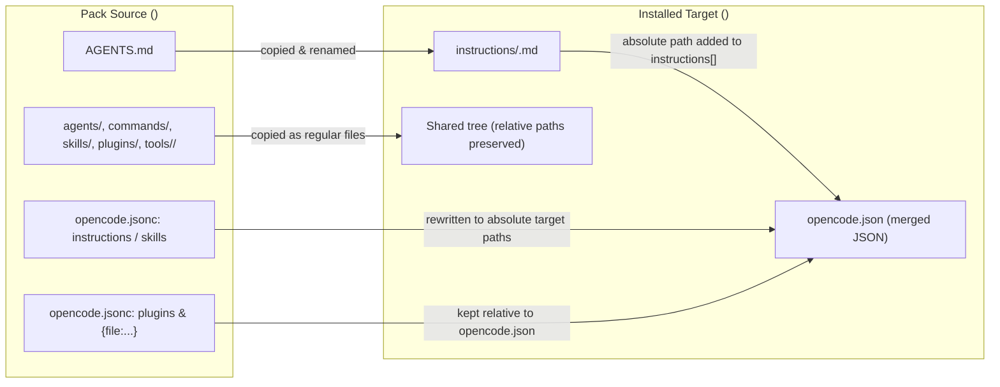

# OpenCode Pack Contract 1.1 Reference

An OpenCode *[pack]* (see [Glossary](../glossary.md)) is a self-contained directory structured like an [OpenCode V2](../modules/agent-editing-and-v2-compat.md) configuration root (`~/.config/opencode/`) paired with an `opencode-pack.json` manifest. Packs require no internal build step or engine code; `manage-agents` [validates](../modules/pack-validation-and-virtual-packs.md), [resolves](../modules/resolver-and-lock.md), [routes](../concepts/conditional-routing-and-archetypes.md), and [installs](../concepts/pack-lifecycle-and-target-safety.md) them into a shared target directory solely through this versioned contract (`contract/CONTRACT.md`, `contract/opencode-pack.schema.json`, and `src/utils/packs.ts`).

---

## 1. Contract Versioning & Compatibility

### Contract Version (`MAJOR.MINOR`)

The engine implements contract version **`1.1`** (`CONTRACT_VERSION = { major: 1, minor: 1 }` in `src/utils/packs.ts`). Every pack declares the contract version it targets in `opencode-pack.json`:

- **Format**: `"MAJOR.MINOR"` string matching `^(0|[1-9][0-9]*)\.(0|[1-9][0-9]*)$` (no leading zeroes, no patch component).
- **Major version mismatch**: If `MAJOR !== 1`, validation fails immediately with error code `contract-unsupported` and halts filesystem scanning.
- **Newer minor version**: Minor revisions may only introduce optional features. If `MAJOR === 1` and `MINOR > 1`, validation continues and emits warning `contract-newer-minor` (`newer optional features are ignored`).
- **`"1.0"` vs. `"1.1"`**:
  - All `"1.0"` packs remain valid without modification.
  - Contract `"1.1"` adds the optional `flowDefaults` array on `opencode-pack.json` for [conditional multi-trigger `IF / OR` policies](../concepts/conditional-routing-and-archetypes.md) over models, tools, permissions, and delegations. Declaring `flowDefaults` in a pack with `"contract": "1.0"` fails validation (`"flowDefaults" requires contract "1.1" or newer`).

### Pack Versioning & Naming Constraints

| Identifier | Constraint / Pattern | Source |
|---|---|---|
| `name` (`PACK_NAME_RE`) | `^[a-z0-9](?:[a-z0-9-]{0,62}[a-z0-9])?$` | `contract/opencode-pack.schema.json`, `src/utils/packs.ts:85` |
| `version` | `^(0|[1-9]\d*)\.(0|[1-9]\d*)\.(0|[1-9]\d*)(?:-[0-9A-Za-z.-]+)?(?:\+[0-9A-Za-z.-]+)?$` | `contract/opencode-pack.schema.json:24`, `semver.valid()` |
| `contract` | `^(0|[1-9][0-9]*)\.(0|[1-9][0-9]*)$` | `contract/opencode-pack.schema.json:14`, `src/utils/packs.ts:88` |

- **`PACK_NAME_RE`**: Must consist of lowercase ASCII letters (`a-z`), digits (`0-9`), and internal hyphens (`-`), starting and ending with an alphanumeric character, with a total length of 1 to 64 characters. The pack `name` acts as both the global [resolver](../modules/resolver-and-lock.md) identity and the mandatory namespace directory segment.
- **Semver `version`**: Must be a canonical full semantic version (`1.2.0`, `2.0.0-beta.1`) accepted by `semver.valid(version) === version` (via [`semver`](../dependencies/runtime-and-tooling-stack.md)). Shorthand ranges or `v`-prefixed strings (`v1.0.0`) are rejected.

---

## 2. `opencode-pack.json` Manifest Schema Reference

`opencode-pack.json` must sit at the pack root as a regular UTF-8 JSON file (not a symlink or directory, at most `2 MiB`). Both `opencode-pack.schema.json` (`"additionalProperties": false`) and `readManifest()` (`MANIFEST_KEYS`) reject any unknown top-level property with error code `manifest-invalid`.

### Top-Level Fields

| Field | Type | Required | Rule & Validation |
|---|---|---|---|
| `$schema` | `string` | No | Optional JSON Schema URI or relative path (e.g., `"https://github.com/lorecanc/manage-agents/contract/opencode-pack.schema.json"`). |
| `contract` | `string` | **Yes** | `"MAJOR.MINOR"` (`"1.0"` or `"1.1"`). |
| `name` | `string` | **Yes** | Global pack identity matching `PACK_NAME_RE`. |
| `version` | `string` | **Yes** | Full semver version string. |
| `description` | `string` | **Yes** | Non-empty string (`minLength: 1` in schema; `description.trim().length > 0` in `packs.ts`). |
| `requires` | `Record<string, string>` | No | Dependency map from required pack `name` to semver range. Defaults internally to `{}`. |
| `archetype` | `object` | No | Declares primary caller agents that delegate to routable subagents. |
| `routingDefaults` | `Record<string, Record<string, string>>` | No | Requires `archetype`. Maps provider/model triggers to subagent model targets. |
| `flowDefaults` | `ConditionalRule[]` | No | Requires `archetype` and `contract >= 1.1`. Conditional `IF / OR` routing and policy rules. |

### `requires`

```json
"requires": {
  "dev-tools": "^2.0.0"
}
```

- Must be a JSON object mapping valid pack names (`PACK_NAME_RE`) to valid `semver` ranges (`semver.validRange(range) !== null`). Arrays are rejected.
- **No self-dependency**: A pack cannot list its own `name` in `requires`.
- **Local-only wildcard**: The range `"*"` is accepted when validating a local directory source (`sourceKind !== "git"`), and rejected for [git sources](../modules/sources-and-github.md) (`"*" is allowed only in local sources`) because git sources lock deterministic revisions.

### `archetype`

Declares the pack as a routable multi-agent [archetype](../concepts/conditional-routing-and-archetypes.md):

```json
"archetype": {
  "callers": ["flow-build", "flow-plan"],
  "reference": "flow-build"
}
```

- Closed object (`additionalProperties: false`); both `callers` and `reference` are required.
- **`callers`**: Non-empty array of unique, non-empty strings (`minItems: 1`, `uniqueItems: true`). Semantic validation (`checkArchetype` in `src/utils/packs.ts:550`) verifies that every caller ID is defined as an agent in the same pack and does **not** set `mode: "subagent"` (callers must be primary agents).
- **`reference`**: Non-empty string that must appear in `archetype.callers`. Used by the engine and UI as the canonical primary agent representing the archetype.

### `routingDefaults`

Provides suggested subagent model assignments keyed by caller runtime provider or model (`dependentRequired: ["archetype"]`):

```json
"routingDefaults": {
  "mistral": {
    "flow-explore": "mistral/deepseek-v4-1-flash-1017#high",
    "flow-review": "inherit"
  }
}
```

- **Outer keys (triggers)**: Must match `^(?!\$)[^\s/#]+(?:/[^\s#]+)?$` (`isTrigger` in `src/utils/values.ts:12`), representing either a provider ID (`"mistral"`) or an exact `"provider/model"` pair (`"openai/gpt-5.4"`). Note that `"*"` is **not** valid in `routingDefaults` (use `flowDefaults` for `"*"`).
- **Inner keys (subagent IDs)**: Must identify an agent belonging to this pack that is neither listed in `archetype.callers` nor configured with `mode: "primary"` (otherwise validation fails with error `archetype`). If the target subagent specifies a fixed `model` in its frontmatter or config, validation emits warning `archetype-pinned` because pinned subagents bypass routing unless explicitly [unpinned by the user](../modules/routing-and-user-settings.md).
- **Inner values (model targets)**: Either `"inherit"` or `"provider/model[#variant]"` matching `^(?:inherit|[^\s/#]+/[^\s#]+(?:#[^\s#]+)?)$`.

### `flowDefaults` (Contract `1.1+`)

Provides conditional `IF / OR` rules (`dependentRequired: ["archetype"]`, `contract: "1.1"` or newer). Each array element is validated by `opencode-pack.schema.json` (`lines 52-75`) and `validateConditionalRule()` (`src/utils/values.ts:62-115`):

```json
{
  "contract": "1.1",
  "name": "flow",
  "version": "2.1.0",
  "description": "Archetype pack with conditional flow rules",
  "archetype": { "callers": ["flow-build", "flow-plan"], "reference": "flow-build" },
  "flowDefaults": [
    {
      "callers": ["flow-build"],
      "triggers": ["anthropic", "openai/gpt-5.4"],
      "then": {
        "models": { "flow-explore": "anthropic/claude-haiku-4-5" },
        "tools": { "bash": "allow" },
        "permissions": { "edit": "allow" },
        "delegations": { "flow-review": "allow", "*": "deny" }
      }
    }
  ]
}
```

- **Strict rule keys**: Each rule object has `"additionalProperties": false` (`RULE_KEYS = {"callers", "triggers", "then"}`). Extra metadata fields such as `id` or `description` are **not** part of the rule schema and fail validation with `unknown rule key`.
- **`callers`** (optional `string[]`): Non-empty array of unique, trimmed agent IDs (`minItems: 1`, `uniqueItems: true`). Every ID must be a non-subagent (`mode !== "subagent"`) defined in this pack. When omitted, the rule applies to all agents in `archetype.callers`.
- **`triggers`** (required `string[]`): Non-empty array of unique flow triggers (`minItems: 1`, `uniqueItems: true`) matching `^(?:\*|(?!\$)[^\s/#]+(?:/[^\s#]+)?)$`. Accepts `"*"` (any model), `"provider"`, or `"provider/model"`. Multiple triggers in the array act as logical `OR`; at runtime, exact `"provider/model"` beats `"provider"`, which beats `"*"`.
- **`then`** (required `object`): Closed object (`additionalProperties: false`, `minProperties: 1`) containing at least one non-empty policy map:
  - **`then.models`**: `Record<string, string>` mapping subagent IDs of this pack (excluding callers and `mode: "primary"` agents; warns `archetype-pinned` if the subagent defines a fixed `model`) to `"inherit"` or `"provider/model[#variant]"`.
  - **`then.tools`**: `Record<string, "allow" | "ask" | "deny">` mapping non-whitespace tool or MCP resource keys (`^[^\s]+$`) to policy effects.
  - **`then.permissions`**: `Record<string, "allow" | "ask" | "deny">` mapping non-whitespace permission keys (`^[^\s]+$`) to policy effects.
  - **`then.delegations`**: `Record<string, "allow" | "deny">` mapping `"*"` or subagent IDs of this pack (excluding callers and `mode: "primary"` agents) to `"allow"` or `"deny"`.

---

## 3. Pack Filesystem Layout & Namespace Rules

```text
<pack-root>/
├── opencode-pack.json                # required manifest (never installed)
├── opencode.json | opencode.jsonc    # optional config contribution (merged, never copied verbatim)
├── AGENTS.md                         # optional pack instructions -> installed as instructions/<pack>.md
├── README[.md|.txt|.rst]             # optional docs (never installed; LICENSE/LICENCE/CHANGELOG too)
├── agents/<id>.md                    # OpenCode V2 agents (nested paths -> slash IDs)
├── commands/<id>.md                  # OpenCode V2 slash commands (nested paths -> slash IDs)
├── skills/<id>/SKILL.md              # OpenCode V2 skills + co-located supporting files
├── plugins/<name>/index.ts           # OpenCode V2 directory plugins
├── themes/<name>.json                # OpenCode themes
├── tools/<pack>/** | tools/_<pack>_* # namespaced helper modules imported by plugins
└── <dir>/<pack>/**                   # namespaced arbitrary pack assets (resources/<pack>/, etc.)
```

### OpenCode-Native Plural Directories

Top-level native directory names are strictly lowercase (`NATIVE_DIRS` in `src/utils/packs.ts:91`):

- **`agents/`**: Holds `.md` files only (non-Markdown files fail with `not-markdown`). Nested relative paths without `.md` become canonical agent IDs (e.g., `agents/team/reviewer.md` -> `team/reviewer`). YAML frontmatter must parse to a mapping:
  - `mode`, when present, must be `"primary"`, `"subagent"`, or `"all"` (error `agent-mode`).
  - Deprecated [OpenCode V1 keys](../modules/agent-editing-and-v2-compat.md) (`tools`, `permission`, `name`) emit warning `agent-deprecated-key` recommending `permissions` or the file path (auto-fixable with [Pack Doctor](../modules/pack-onboarding-and-doctor.md)).
- **`commands/`**: Holds `.md` files only (`not-markdown`). Nested relative paths without `.md` become command IDs.
- **`skills/`**: Every file under `skills/` must reside inside a directory that contains a `SKILL.md` file (matched to the deepest ancestor `SKILL.md`; orphan files fail with `skill-orphan`). The relative directory path under `skills/` is the skill ID (e.g., `skills/minimal-hello/SKILL.md` -> `minimal-hello`).
  - Missing or empty `description` in `SKILL.md` frontmatter emits warning `skill-description`.
  - Supporting files under the skill directory matching `\.(?:sh|bash|zsh|py|rb|pl|ts|mts|js|mjs|cjs)$` (`SCRIPT_RE`) or carrying any executable bit (`mode & 0o111`) are recorded in `executable.skillScripts` (excluding `*.test.*`; see [Security & Trust Model](../concepts/security-and-trust-model.md)).
- **`plugins/`**: Must use OpenCode V2 directory plugins under `plugins/<name>/`. Single-file plugins such as `plugins/foo.ts` fail with `plugin-single-file`. Each `plugins/<name>/` directory must contain at least one root entry matching `^(?:index|server)\.(?:ts|js|mjs)$` or `package.json` (error `plugin-entry`).
- **`themes/`**: Holds flat `<name>.json` files directly under `themes/` (`rest.length === 1`, error `theme-file`).

### Mandatory Namespacing for Non-Native Directories

Because all installed packs share a single target directory tree, every path outside `agents/`, `commands/`, `skills/`, `plugins/`, and `themes/` must be namespaced with the pack's `name` (`error: namespace`):

- **General directories (`<dir>/<pack-name>/**`)**: Any custom top-level directory (such as `resources/`, `office/`, `templates/`) must place all files beneath `<dir>/<pack-name>/...` (`rest[0] === packName && rest.length > 1`).
- **Tool modules (`tools/`)**: Accepts either the directory form `tools/<pack-name>/**` or the flat file prefix form `tools/_<pack-name>_*` (`rest.length === 1 && rest[0].startsWith("_" + packName + "_")`). Code files matching `\.(?:ts|mts|cts|js|mjs|cjs)$` (excluding `*.test.*`) are recorded in `executable.toolModules`.
- **Shared files**: Two packs cannot install the same file path unless its content is identical or one pack owns it and the other declares that pack in `requires` (see [Pack Lifecycle & Target Safety](../concepts/pack-lifecycle-and-target-safety.md)).

### Root Files, Non-Installed Metadata, and Ignored Paths

| Category | Pattern / Paths | Validation & Install Behavior |
|---|---|---|
| Manifest | `opencode-pack.json` | Required regular file; validated, **never installed**. |
| Config contribution | `opencode.json` or `opencode.jsonc` | Optional (providing both fails with `config-duplicate`). Merged into `<target>/opencode.json`. |
| Pack instructions | `AGENTS.md` | Optional; copied to `<target>/instructions/<pack-name>.md` and registered in `instructions`. |
| Documentation | `README`, `LICENSE`, `LICENCE`, `CHANGELOG` (no ext or `.md`, `.txt`, `.rst`, case-insensitive) | Optional (`ROOT_FILE_RE`); **never installed** (`NOT_INSTALLED_RE`). |
| Other root files | Anything else at `<pack-root>/<file>` | **Rejected** with error `root-file`. |
| Ignored entries | `.git*` (any depth), `.DS_Store`, `.opencode/` | Silently ignored during directory walk; never installed. |
| `node_modules/` | `node_modules` (any depth) | Skipped during walk, never installed, and emits **warning** `node-modules` (`vendor plugin dependencies as bundled files`). |
| Co-located tests | `*.test.*` (`/\.test\.[^/]+$/`) | Must obey layout and namespace rules, but **never installed** (`installableFiles`), not counted as executable surface, and skipped by static import checking. |

### Rejected Legacy, Reserved, Symlink, and Collision Paths

- **Legacy singular/alias directories (`LEGACY_DIRS`)**: Rejected with error `legacy-directory`:
  - `agent/`, `mode/`, `modes/` -> must use `agents/`
  - `command/` -> must use `commands/`
  - `skill/` -> must use `skills/`
  - `plugin/` -> must use `plugins/`
  - `tool/` -> must use `tools/`
- **Engine-reserved paths (`RESERVED_DIRS`)**: `instructions/` and `.manage-agents/` at the pack root fail with `reserved-path`. In addition, `plugins/manage-agents-router/` is reserved by the engine for the generated V2 [model router plugin](../modules/runtime-router-plugin.md).
- **Directory case mismatches**: Spelling any native, reserved, or legacy top-level directory with uppercase characters (e.g., `Agents/`, `Instructions/`, `Plugin/`) fails with `directory-case` rather than falling through to custom directory handling.
- **Case and Unicode NFC collisions**: Every walked relative path is normalized with `rel.normalize("NFC").toLowerCase()`. Any two files that fold to the same key (e.g., `agents/Foo.md` and `agents/foo.md`) fail with `case-collision` to prevent silent overwrites on macOS and Windows filesystems.
- **Symlinks**:
  - Broken symlinks fail with `symlink-broken`.
  - Symlinks whose `realpathSync` target resolves outside `realpathSync(packRoot)` fail with `symlink-escape`.
  - Symlinked directories fail with `symlink-directory`, and links to special files fail with `symlink-special`.
  - Valid symlinks pointing to regular files inside the pack are dereferenced during installation: the engine copies the file bytes, never a symbolic link.

---

## 4. `opencode.json(c)` Contribution Rules & Path Rewriting

A pack may include either `opencode.json` or `opencode.jsonc` (supporting `//` line comments, `/* ... */` block comments, and trailing commas via `parseJsonc()` in `src/utils/packs.ts:132`).

### Allowed vs. Prohibited Keys

Packs may contribute **only** shared capability keys (`CONFIG_KEYS` in `src/utils/packs.ts:95`). User-level preferences are strictly prohibited and fail validation with error `config-key`:

| Allowed Pack Keys (`CONFIG_KEYS`) | Validation & Merge Semantics |
|---|---|
| `$schema` | Optional JSON Schema URL string. |
| `plugins` | Array of `"<spec>"` or `{ "package": "<spec>", "options": { ... } }`. Local entries (`./`, `../`, `file:`) must resolve to `./plugins/<name>` (`plugin-path`). Remote/npm specs are tracked in `executable.pluginPackages`. |
| `mcp` | Object containing only `servers` (`mcp.servers.<name>`). Each server must declare `"type": "local"` (with non-empty `string[]` `command`) or `"type": "remote"` (with optional `url`). Local `command[0]` is recorded in `executable.externalCommands`. |
| `skills` | Array of pack-root-relative paths, glob patterns (`*`, `?`, `[`), or `http(s)://` URLs. Absolute and `~` paths fail with `absolute-path`. |
| `instructions` | Array of pack-root-relative paths, glob patterns, or `http(s)://` URLs. Absolute and `~` paths fail with `absolute-path`. |
| `agents` | Object keyed by agent ID. Defining an agent both in `agents/<id>.md` and `opencode.json(c)` emits warning `config-duplicate-id`. |
| `commands` | Object keyed by command ID. Duplicate file + config definitions emit warning `config-duplicate-id`. |
| `formatter` | Object mapping formatter IDs to config objects (`command[0]` added to `executable.externalCommands` when `command` is an array). |
| `lsp` | Object mapping LSP server IDs to config objects (`command[0]` added to `executable.externalCommands` when `command` is an array). |
| `experimental` | Object of feature flags (e.g., `{ "todo": true }`). Owned per flag across packs; two packs setting the same flag to different values cause an install conflict. |

**Prohibited keys** (any key outside `CONFIG_KEYS`, including `model`, `default_agent`, `theme`, `keybinds`, `provider`, `providers`, `permissions`, `autoupdate`, `share`): Rejected with `config-key` (`"<key>" belongs to the user's configuration`). During [target installation and reconciliation](../modules/target-installer.md), unmanaged keys owned by the user in [`<target>/opencode.json`](../config/user-and-target-files.md) are preserved untouched.

### Target Layout & Path Rewriting



All installed packs merge into a single target directory (default `$XDG_CONFIG_HOME/opencode`). The engine rewrites **only** config entries that OpenCode resolves against the process working directory rather than the config directory:

1. **`skills` and `instructions` entries**: Relative pack paths are rewritten to **absolute target paths** (`http(s)://` URLs remain unchanged).
2. **Root `AGENTS.md`**: Copied to `<target>/instructions/<pack-name>.md` and registered as an absolute target path in the merged `instructions` array.
3. **`plugins` and `{file:...}` tokens**: Preserved **relative to `opencode.json`** (e.g., `./plugins/<name>`), because OpenCode resolves them against the config directory and the shared target tree preserves pack-relative paths.
4. **No content mutation**: Markdown files, plugin source files, tool modules, and shell scripts are copied byte-for-byte without path rewriting (except [user frontmatter overrides](../modules/routing-and-user-settings.md) configured via [`manage-agents override` / `models pin`](./cli-reference.md)). If the target originally had an `opencode.jsonc` with comments, the engine writes plain JSON and backs up the original file.

---

## 5. Resource Identity & Reference Validation

### Canonical Resource Identities

Across all installed packs in a target, resource IDs and paths must be unique (conflicts fail before any disk write unless resolved via `requires` or identical shared content):

| Resource Kind | Canonical Identity |
|---|---|
| Pack | `name` in `opencode-pack.json` (global; multi-source ambiguity requires `source/<name>` or a stored [source preference](../modules/sources-and-github.md)). |
| Agent | Relative path under `agents/` without `.md`, plus keys under `opencode.json` `agents`. |
| Command | Relative path under `commands/` without `.md`, plus keys under `opencode.json` `commands`. |
| Skill | Relative directory path of `SKILL.md` under `skills/`. |
| Plugin | `plugins/<name>` (discovered from `plugins/<name>/` or referenced in `opencode.json` `plugins`). Implicit registration of `./plugins/<name>` can be overridden with `options` by a pack that `requires` the owning pack. |
| Theme | Filename under `themes/` without `.json`. |
| MCP server | Key `<name>` under `mcp.servers.<name>`. |
| File | Pack-relative POSIX path folded via `.normalize("NFC").toLowerCase()`. |

### Validated References (Internal & Cross-Pack)

[`validatePack()`](../modules/pack-validation-and-virtual-packs.md) (`src/utils/packs.ts:310-548`) statically resolves four categories of references:

1. **`opencode.json(c)` paths**: Local `plugins` specifiers (`./plugins/<name>`), non-URL/non-glob `skills` paths, and non-URL/non-glob `instructions` paths (all resolved from `.`).
2. **`{file:...}` substitutions**: Matched recursively across all string values in `opencode.json(c)` via `/\{file:([^{}]*)\}/g` (`FILE_REF_RE`), resolved relative to the pack root (`.`). Absolute or `~` paths fail with `absolute-path`.
3. **Static relative JS/TS imports**: Scanned in non-test code files (`\.(?:ts|mts|cts|js|mjs|cjs)$`) under `plugins/**` and `tools/**` after stripping `//` and `/* ... */` comments (`IMPORT_RE = /(?:\bfrom\s*|\bimport\s*\(?\s*|\brequire\s*\(\s*)["']([^"'\n]+)["']/g`).
   - Relative specifiers (`./...` and `../...`) are resolved from `path.posix.dirname(file)`.
   - TypeScript extension mapping: An import ending in `.js`, `.mjs`, or `.cjs` satisfies validation if either that exact file or the corresponding `.ts`, `.mts`, or `.cts` file exists.
4. **Symlinks**: Verified during directory walk to resolve to regular files within `realpathSync(packRoot)`.

**Resolution outcomes for validated references**:
- **Backslashes (`\`)**: Always fail with error `reference-backslash` (references must use POSIX forward slashes `/`).
- **Escaping the pack root**: If `path.posix.normalize(path.posix.join(fromDir, ref))` climbs above `.` (e.g., `../../../outside.js` from `plugins/p/index.ts`), validation fails immediately with `reference-escape`.
- **Cross-pack references via `requires`**: If a path stays within the shared root tree (for example, `../../tools/shared-pack/helper.js` imported from `plugins/my-plugin/index.ts` normalizes to `tools/shared-pack/helper.js`) and does not exist in the current pack:
  - When `requires` is empty, validation fails with error `reference-missing`.
  - When `requires` is non-empty, `validatePack()` records an `UnresolvedReference` (`{ from, kind, target }`), and [`manage-agents resolve` / `install`](./cli-reference.md) (backed by the [Dependency Resolver](../modules/resolver-and-lock.md)) requires one of the declared `requires` packs to provide `target`.
- **Large file guard (`MAX_SCANNED_BYTES`)**: Files exceeding `2 MiB` (`2,097,152` bytes) are not read into memory; validation skips content scanning and emits warning `file-too-large`.

### Opaque References & Heuristic Checks

Content that cannot be statically guaranteed across runtime environments is treated as opaque or checked with non-blocking warnings:

| Reference / Construct | Engine Handling |
|---|---|
| External npm specifiers in `plugins/**` and `tools/**` | `node:*`, Node `builtinModules`, and `@opencode/plugin` (including `@opencode/plugin/*`) are allowed. Any other bare specifier emits **warning** `import-dependency` because OpenCode V2 does not install arbitrary npm dependencies for local plugins; dependencies must be vendored. |
| Plugin package specs in `opencode.json(c)` | Non-local specs (npm or git packages in `plugins`) are allowed, skipped by local file checks, and reported in `executable.pluginPackages` requiring [user trust confirmation](../concepts/security-and-trust-model.md). |
| `@subagent` mentions & Markdown bodies | Opaque; prose references inside `agents/*.md`, `commands/*.md`, and `SKILL.md` are not resolved against `PackIds`. |
| Model IDs (`provider/model#variant`) | Checked syntactically against `^[^\s/#]+\/[^\s#]+(?:#[^\s#]+)?$` in `opencode-pack.json`, never queried against live provider catalogs during `pack validate`. |
| Template literals, dynamic imports, globs | Template-literal non-relative strings (`${...}`) and `skills`/`instructions` globs (`*`, `?`, `[`) are skipped without error. |
| Hardcoded config paths in text files | Best-effort regex scan (`ABSOLUTE_CONFIG_RE`) across non-test text files flags `~/.config/opencode`, `$XDG_CONFIG_HOME/opencode`, and `/.config/opencode/` with **warning** `absolute-config-path`. |

---

## 6. Minimal Pack Walkthrough

`contract/examples/minimal-pack/` is the reference fixture validated as part of [`npm run validate`](../modules/launcher-and-build.md). It exercises every contract primitive in twelve small files:

```text
contract/examples/minimal-pack/
├── opencode-pack.json                    # Manifest (never installed)
├── opencode.jsonc                        # Plugin + instructions config contribution
├── AGENTS.md                             # Rewritten to instructions/minimal-pack.md
├── README.md                             # Documentation (never installed)
├── agents/
│   ├── minimal-lead.md                   # Primary caller agent (archetype reference)
│   └── minimal-scout.md                  # Routable subagent (no fixed model)
├── commands/
│   └── minimal-hello.md                  # Slash command targeting minimal-lead
├── plugins/
│   └── minimal-greeter/
│       └── index.ts                      # V2 directory plugin importing tools/minimal-pack/greet.js
├── resources/
│   └── minimal-pack/
│       └── conventions.md                # Namespaced instruction file
├── skills/
│   └── minimal-hello/
│       ├── SKILL.md                      # Skill definition (ID: minimal-hello)
│       └── scripts/
│           └── hello.sh                  # Bundled shell script (executable surface)
└── tools/
    └── minimal-pack/
        └── greet.js                      # Namespaced helper module (executable surface)
```

### 1. Manifest (`opencode-pack.json`)

`minimal-pack` declares `"contract": "1.0"`, establishes `minimal-lead` as its primary archetype caller, and provides a default route for `minimal-scout` when `minimal-lead` runs on provider `opencode`:

```json
{
  "$schema": "../../opencode-pack.schema.json",
  "contract": "1.0",
  "name": "minimal-pack",
  "version": "1.0.0",
  "description": "Smallest pack that exercises every part of contract 1.0",
  "archetype": { "callers": ["minimal-lead"], "reference": "minimal-lead" },
  "routingDefaults": {
    "opencode": { "minimal-scout": "opencode/example-small-model" }
  }
}
```

### 2. Config Contribution (`opencode.jsonc`)

Uses JSONC comments and trailing commas to pass options to `./plugins/minimal-greeter` and register the namespaced resource `resources/minimal-pack/conventions.md`:

```jsonc
{
  // JSONC is accepted. Paths are relative to the pack root.
  "$schema": "https://opencode.ai/config.json",
  "plugins": [
    { "package": "./plugins/minimal-greeter", "options": { "greeting": "hello" } }
  ],
  "instructions": ["resources/minimal-pack/conventions.md"],
}
```

At install time:
- `"./plugins/minimal-greeter"` remains relative in `<target>/opencode.json`.
- `"resources/minimal-pack/conventions.md"` is rewritten to `<target>/resources/minimal-pack/conventions.md`.
- `AGENTS.md` is installed to `<target>/instructions/minimal-pack.md` and appended to `instructions`.

### 3. Archetype Agents (`agents/minimal-lead.md` & `agents/minimal-scout.md`)

`minimal-lead` sets V2 `mode: primary` and `permissions` (allowing delegation to `minimal-scout`), while `minimal-scout` sets `mode: subagent` without a `model` field so [`manage-agents-router`](../modules/runtime-router-plugin.md) can [route its model dynamically](../concepts/conditional-routing-and-archetypes.md):

```markdown
---
description: Primary agent of the example archetype; delegates read-only questions to minimal-scout.
mode: primary
permissions:
  - action: subagent
    resource: minimal-scout
    effect: allow
---

You lead the work. Delegate narrow, read-only questions to `minimal-scout`.
```

```markdown
---
description: Read-only helper of the example archetype. Its model comes from routing.
mode: subagent
---

Answer the question you are given with file:line references. Do not edit files.
```

### 4. Plugin & Namespaced Tool Import (`plugins/minimal-greeter/index.ts`)

`plugins/minimal-greeter/index.ts` imports `@opencode/plugin` (permitted built-in SDK) and resolves `../../tools/minimal-pack/greet.js` inside the pack root (`tools/minimal-pack/greet.js`):

```ts
import { Plugin } from "@opencode/plugin"

import { greet } from "../../tools/minimal-pack/greet.js"

export default Plugin.define({
  id: "minimal-greeter",
  setup: async (ctx, options = {}) => {
    const greeting = typeof options.greeting === "string" ? options.greeting : "hello"
    const dispose = ctx.tool.hook("execute.before", async () => {
      greet(greeting)
    })
    return () => dispose?.()
  },
})
```

### 5. Validation Output Summary

Running [`manage-agents pack validate`](./cli-reference.md) `contract/examples/minimal-pack --json` produces zero issues (`issues: []`), zero unresolved references (`unresolved: []`), and reports:

- **Discovered IDs (`ids`)**:
  - `agents`: `["minimal-lead", "minimal-scout"]`
  - `commands`: `["minimal-hello"]`
  - `skills`: `["minimal-hello"]`
  - `plugins`: `["minimal-greeter"]`
  - `themes`: `[]`, `mcpServers`: `[]`
- **Executable Surface (`executable`)**:
  - `plugins`: `["minimal-greeter"]`
  - `toolModules`: `["tools/minimal-pack/greet.js"]`
  - `skillScripts`: `["skills/minimal-hello/scripts/hello.sh"]`
  - `pluginPackages`: `[]`, `mcpServers`: `[]`, `externalCommands`: `[]`

---

## Related Pages

- [CLI Command Reference](./cli-reference.md)
- [Pack Validation, Catalog & Virtual Packs](../modules/pack-validation-and-virtual-packs.md)
- [Pack Onboarding, Doctor & Scaffolding](../modules/pack-onboarding-and-doctor.md)
- [Dependency Resolver & Lockfile](../modules/resolver-and-lock.md)
- [Runtime Router Plugin](../modules/runtime-router-plugin.md)
- [Pack Lifecycle & Target Safety](../concepts/pack-lifecycle-and-target-safety.md)
- [Conditional Routing & Archetypes](../concepts/conditional-routing-and-archetypes.md)
- [Security & Trust Model](../concepts/security-and-trust-model.md)
