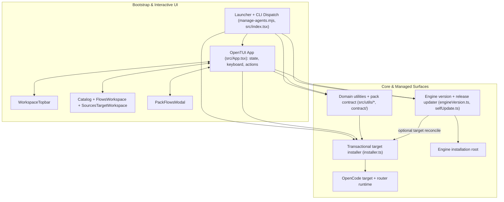

# System Architecture

[`manage-agents`](./overview.md) is a catalog-agnostic package manager, authoring suite, and terminal user interface (TUI) for OpenCode agent packs. Rather than coupling to any specific agent repository, the engine interacts with local directories and remote Git repositories exclusively through the versioned [OpenCode Pack Contract](./api/pack-contract-reference.md) (`contract/CONTRACT.md`, currently version `1.1`) and a *[virtual-pack]* (see [Glossary](./glossary.md)) [adapter](./modules/pack-validation-and-virtual-packs.md) for loose `.md` agent folders.

The system separates build-time/CLI management from OpenCode session execution: `manage-agents` validates, resolves, edits, bridges, and [transactionally installs](./modules/target-installer.md) pack artifacts into an OpenCode configuration target, while a lightweight `@opencode/plugin` runtime router ([`manage-agents-router`](./modules/runtime-router-plugin.md)) executes inside OpenCode host sessions to enforce conditional model, tool, permission, and delegation flows.

## Component Diagram



[`manage-agents.mjs`](./modules/launcher-and-build.md) prepares the runtime and imports the bundled `dist/index.js` entry (`src/index.tsx`), which either executes one of [20 non-interactive CLI subcommands](./api/cli-reference.md) or mounts the [`<App />` OpenTUI interface](./components/tui-shell-and-catalog.md). `App` is the TUI state and action coordinator; `WorkspaceTopbar`, the workspace surfaces, and `PackFlowsModal` separate rendering and input handling behind typed props and callbacks. CLI and TUI pack operations reuse `src/utils/` and converge on [`installer.ts`](./modules/target-installer.md) to materialize verified pack files, merged configuration, and the `manage-agents-router` plugin in the OpenCode target. Engine self-update is a separate path: `engineVersion.ts` and `selfUpdate.ts` replace the `manage-agents` installation itself, then may call the target installer to reconcile an already-populated OpenCode target.

## Five-Layer Architectural Decomposition

### 1. Bootstrap & Build Layer (`manage-agents.mjs`, `src/build.mjs`)

[`manage-agents.mjs`](./modules/launcher-and-build.md) is the executable `bin` entry point. Because [`@opentui/core`](./dependencies/runtime-and-tooling-stack.md) relies on native FFI bindings, the launcher enforces runtime prerequisites before loading application code:

- **Platform & Runtime Gate:** On Windows (`win32`), pins console UTF-8 codepage `65001` (`chcp 65001`). Under Node.js, verifies `>= 26.4.0` (Bun `>= 1.3.0` is supported natively via `process.versions.bun`). If `--experimental-ffi` or `--no-warnings=ExperimentalWarning` is missing from `process.execArgv`, `manage-agents.mjs` synchronously re-executes `process.execPath` with those flags and forwards signals/exit codes (`manage-agents.mjs:17-46`).
- **Dependency Verification & Auto-Install:** When `src/` or `package-lock.json` is present and `MANAGE_AGENTS_SKIP_AUTO_INSTALL !== "1"`, `dependenciesMatch()` checks installed `node_modules/*/package.json` versions against `package.json` specs and runs `npm ci` / `npm install` or `bun install` with `--ignore-scripts` if out of sync (`manage-agents.mjs:97-134`).
- **Mtime-Driven `esbuild` Bundling:** In source checkouts where `src/` exists, `newestSourceMtime()` compares source and `package.json` modification times against `dist/index.js`. When stale or missing, it runs `src/build.mjs`, which bundles `src/index.tsx` into ESM `dist/index.js` while keeping `@opentui/core` and `yaml` external (`src/build.mjs:6-7`). Published npm packages omit `src/` and import prebuilt `dist/index.js` directly.
- **Interrupted Self-Update Recovery:** Before dependency checks and bundle loading, the launcher calls `recoverEngineDirIfInterrupted(scriptDir)`. If a prior engine replacement left `.manage-agents/self-update-journal.json`, it validates the journal's allow-listed targets and restores their saved copies from `.manage-agents/self-update-backup/` before continuing (`manage-agents.mjs:51-56`, `108-197`, `306`).

### 2. Entry & CLI Dispatch Layer (`src/index.tsx`)

`src/index.tsx` parses global flags before dispatching either to a [CLI command handler](./api/cli-reference.md) or to the interactive TUI (`src/index.tsx:1541-1656`):

- **Global Flags:**
  - `--auto-commit` / `--no-auto-commit` (sets `AGENT_MANAGER_AUTO_COMMIT` for git-backed workspace mutations).
  - `--workspace <dir>` (or `$MANAGE_AGENTS_WORKSPACE`, falling back to `findWorkspace(process.cwd())` walking up for `packs/<name>/opencode-pack.json`, `opencode-pack.json`, or a [virtual pack root](./modules/pack-validation-and-virtual-packs.md)).
  - `--source <name>` (opens the TUI directly against a registered source in [`sources.json`](./config/user-and-target-files.md)).
- **20 CLI Subcommands:** Defined in `COMMANDS` (`src/index.tsx:1531`) and grouped into five operational domains:
  - *Pack authoring & contract checks:* `pack` (`validate`, `list`, `init`, `onboard`, `doctor`, `add`).
  - *Source registry & resolution:* `source` (`list`, `add`, `remove`, `pull`, `login`, `auth`, `trust`, `untrust`, `prefer`), `resolve`.
  - *Target lifecycle:* `install`, `uninstall`, `update` (including `update --self`), `reconcile`, `status`, `restore`.
  - *User routing & frontmatter overrides:* `models` (`show`, `set`, `unset`, `callers`, `rule-set`, `rule-unset`, `export-pack`, `pin`, `unpin`), `override` (`show`, `set`, `unset`).
  - *Workspace agent maintenance, cross-CLI bridges & release ops:* `create`, `lint`, `fix-names`, `audit`, `tune`, `bridge` (plus `bridge check`), `version`, `self-update`, `release` (`keygen`, `sign`).
- **TUI Fallback:** Invoking `manage-agents` with no subcommand loads `ui.json`, initializes `@opentui/core`'s `createCliRenderer({ exitOnCtrlC: true, screenMode: "alternate-screen" })`, and mounts [`<App />`](./components/tui-shell-and-catalog.md) via `@opentui/react` (`src/index.tsx:1636-1655`).

### 3. Interactive OpenTUI Layer (`src/App.tsx`, `src/ui/*`)

`<App />` is a single-root React 19 terminal application driven by keyboard hooks (`useKeyboard`), terminal resize hooks (`useTerminalDimensions`), and deterministic cell-budget layout calculators (`calculateLayout`, `calculatePanelWidths`, `calculateModalViewport`).

- **Three Primary Workspaces (`WorkspaceTab`):**
  1. [`Catalog`](./components/tui-shell-and-catalog.md) (`"catalog"`): Split-pane browser showing collapsible pack/category trees and agent rows on the left, paired with a six-tab inspector (`overview`, `prompt`, `naming`, `security`, `delegations`, `resources`) on the right.
  2. [`Flows`](./components/workspaces-flows-and-sources.md) (`"flows"`, `src/ui/FlowsWorkspace.tsx`): Interactive pack/agent call-graph browser. `buildFlowsNavRows()` and `buildFlowsInspectorItems()` derive inbound/outbound delegation edges, dead references, pack rules, and subagent rows; callbacks open flow editing, delegation management, or jump to an agent in Catalog.
  3. `Sources` (`"sources"`, `src/ui/SourcesTargetWorkspace.tsx`): Source registry and GitHub CLI (`gh`) repository browser beside the OpenCode target inspector, which displays installed packs, drift notices, engine version, reconciliation, and the engine-update action.
- **Shared Header and Workspace Boundaries:** `WorkspaceTopbar` (`src/ui/WorkspaceTopbar.tsx`) renders the three tabs plus width-aware source, commit-mode, onboarding, palette, and busy-status indicators. `App` owns active-source/workspace, selection, focus/scroll, and modal state and supplies data and callbacks to the topbar and workspace components; those components report user actions back to the app rather than owning persistence or target mutations.
- **Conditional-Flow Modal:** `PackFlowsModal` (`src/ui/PackFlowsModal.tsx`) renders the `routing-configs`, `routing-editor`, `routing-callers`, `routing-tools`, `routing-permissions`, and `routing-delegations` views. `App` loads the combined pack/user flow view with `describeConfiguredPackFlows()`, owns caller and rule drafts, saves via `saveUserPackFlow()` / `saveUserPackCallers()`, and reconciles the target when installed. Workspace edits for read-only Git sources are written to user settings; local pack flows can also be exported to `opencode-pack.json`.
- **Modal Overlay Architecture:** Over 20 typed `ViewMode` states ([`command-palette`, `help`](./components/navigation-help-and-markdown.md), `model-selector`, `repair-selector`, [`parameter-tuning`, `bridge-prompt`, `install-confirm`, `pack-init`, `pack-doctor`](./components/authoring-and-bridge-modals.md), `self-update`, `routing-editor`, etc.) render bounded viewport overlays without losing underlying workspace selection or scroll state (`src/App.tsx:184-211`).
- **Dual Write Path:** When connected to a local workspace or local source, agent edits execute inside [`repositoryTransaction()`](./modules/agent-editing-and-v2-compat.md) directly on disk (`src/App.tsx:1002-1011`). When inspecting a read-only Git source (`isReadOnlyGitSource`), `applyAgentMutation()` transparently redirects edits through `runWithOverrideWriter()` into `$XDG_CONFIG_HOME/manage-agents/` [`overrides.json`](./modules/routing-and-user-settings.md) and reconciles the active target (`src/App.tsx:1012-1041`).

### 4. Core Domain & Utility Engine (`src/utils/*.ts`)

All business logic lives in `src/utils/` with colocated `*.test.ts` unit suites:

- **Contract Validation & Onboarding ([`packs.ts`](./modules/pack-validation-and-virtual-packs.md), `packOnboarding.ts`, `virtualPacks.ts`, `pathValidation.ts`, `opencodeMcp.ts`, `v2Compat.ts`):** Enforces OpenCode Pack Contract `1.1`, validates V2 frontmatter and MCP server definitions, synthesizes virtual manifests (`0.0.0-virtual`) for uninitialized `.md` agent directories, and [scaffolds/repairs packs](./modules/pack-onboarding-and-doctor.md) (`pack init`, `onboard`, `doctor`, `add`).
- **Source Registry, GitHub & Semver Resolution ([`sources.ts`, `github.ts`](./modules/sources-and-github.md), [`resolver.ts`, `lock.ts`](./modules/resolver-and-lock.md)):** Manages local and Git sources, integrates `gh auth` credentials for HTTPS clones, resolves transitive `requires` SemVer ranges with deterministic source preferences and pins, computes SHA-256 manifest/content/executable hashes, and diffs `PackLock` snapshots.
- **Transactional Target Installer ([`installer.ts`, `changeReport.ts`, `fsWindows.ts`](./modules/target-installer.md)):** Computes conflict-checked `ReconcilePlan` diffs (`planReconcile`), merges pack `opencode.json(c)` contributions while preserving unmanaged user keys, and applies updates atomically with crash-recovery journals (`applyPlan`, `rollbackInterrupted`) and PID lockfiles (`withTargetLock`).
- **Archetypes, Flows & User Settings ([`archetypes.ts`, `userSettings.ts`, `sourceCustomization.ts`, `catalog.ts`, `models.ts`](./modules/routing-and-user-settings.md)):** Evaluates caller/subagent archetypes, manages global (`default`) and per-target (`targets.<absPath>`) `routing.json` and `overrides.json` scopes, queries verified model catalogs from OpenCode, and exports flow definitions back to `opencode-pack.json`.
- **Agent Editing & Repository Transactions ([`agents.ts`, `repositoryTransaction.ts`](./modules/agent-editing-and-v2-compat.md)):** Preserves V1 or V2 frontmatter flavor when editing local files, audits permission rule ordering (`"*": "deny"` first), renames agents with cross-reference updates, and wraps local git workspace mutations in staging/commit transactions when auto-commit is enabled.
- **Claude Code & Codex Bridges ([`bridge.ts`, `codexBridge.ts`](./modules/bridges.md), `bridgeWorkspace.ts`, `bridgeCheck.ts`, `bridgePrompt.ts`, `bridgeToolReferences.ts`, `translationConfig.ts`, `claudePluginCli.ts`, `claudeNextSteps.ts`):** Translates OpenCode packs and their `requires` closure into Claude Code plugins (`bridges/claude-code/<plugin>`) or Codex agent layers (`bridges/codex/<plugin>`), mapping role tiers, tool names, and model presets, and verifying byte-exact committed bridge outputs via `bridge check`.
- **Engine Version, Release Signing & Self-Update ([`engineVersion.ts`, `selfUpdate.ts`](./modules/launcher-and-build.md)):** `engineVersion.ts` resolves the engine install root independently of the pack workspace, hashes the bundled runtime/contract surface, and identifies the version from a validated `.manage-agents/release-manifest.json`, Git state/tags, or package metadata. `selfUpdate.ts` discovers GitHub releases, verifies repository/tag metadata and configured Ed25519 signatures (or explicitly allowed SHA-256-only metadata), checks archive size/digest and bundle manifest, then stages and journal-replaces engine files. The TUI's Sources/Target inspector exposes `[Shift+U]`; CLI exposes `self-update` and `update --self`, while `release keygen` / `release sign` create trust and release metadata.
- **Terminal & Data Hardening (`terminalText.ts`, `layout.ts`, `uiConfig.ts`, `uiTheme.ts`, `markdownLayout.ts`, `values.ts`):** Grapheme-aware cell width measurement, terminal control-sequence stripping, `O_NOFOLLOW` descriptor-verified UI config persistence, and prototype-safe object helpers.

### 5. Contract & Host Runtime Plugin (`contract/`, `runtime/plugins/manage-agents-router/`)

- **Contract Specification (`contract/`):** Houses [`CONTRACT.md`](./api/pack-contract-reference.md) (Contract `1.1` rules), `opencode-pack.schema.json`, `examples/minimal-pack/`, and `skills/opencode-pack-authoring/SKILL.md`.
- **V2 Host Router Plugin ([`runtime/plugins/manage-agents-router/`](./modules/runtime-router-plugin.md)):** When at least one installed pack has active [routing or conditional flow rules](./concepts/conditional-routing-and-archetypes.md), `planReconcile` copies `index.ts` and `router.js` from `runtime/plugins/manage-agents-router/` into `<target>/plugins/manage-agents-router/`, alongside a generated `routing.json` (`src/utils/installer.ts:367-376`), and registers `"./plugins/manage-agents-router"` under the `:engine` owner in `<target>/opencode.json`.
  - Inside OpenCode, `setupRouter()` (`runtime/plugins/manage-agents-router/index.ts:17-121`) lazily caches `routing.json` by text comparison, tracks up to `MAX_SESSIONS = 1000` active primary caller sessions (ignoring internal `"title"`, `"summary"`, and `"compaction"` system agents), and registers four V2 hooks:
    1. `ctx.session.hook("model.request")`: Records `(sessionID -> { agent, model })` for primary requests.
    2. `ctx.session.hook("context")`: Evaluates `decideSessionTools()` and deletes denied tool definitions from `event.tools` before model invocation.
    3. `ctx.permission.hook("evaluate")`: Evaluates `decidePermission()` and mutates `event.effect` (`"allow" | "ask" | "deny"`) and `event.message`.
    4. `ctx.tool.hook("execute.before")`: Evaluates `decideToolExecution()` on subagent/task calls; rewrites `event.input.model` when routed or throws an error when a delegation or tool is explicitly blocked.
  - Unexpected internal exceptions inside hooks fail open so host sessions never crash, whereas explicit `"deny"` / `blocked` policy decisions strictly reject prohibited actions. Setting `OPENCODE_AGENT_ROUTER=off` disables the plugin.

## Non-Negotiable Safety & Security Invariants

### Catalog Independence
The engine contains zero hardcoded pack names, category lists, companion rules, or model routing tables (`AGENTS.md:48-49`). Pack identity, `requires` dependencies, `archetype` caller definitions, `routingDefaults`, and `flowDefaults` are read strictly from [`opencode-pack.json`](./api/pack-contract-reference.md) (or [user-scoped `routing.json`](./config/user-and-target-files.md)).

### Target Safety & Transactional Integrity
Operations against `<target>` (`install`, `uninstall`, `update`, `reconcile`, `restore`) enforce [strict non-destructive invariants](./concepts/pack-lifecycle-and-target-safety.md) ([`src/utils/installer.ts:281-750`](./modules/target-installer.md)):

- **Unmanaged Key & File Preservation:** `planConfig()` clones `<target>/opencode.json(c)`, subtracts only the exact entries recorded in `installed.json` from the previous run, and merges new pack contributions (`plugins`, `skills`, `instructions`, `mcp.servers`, `agents`, `commands`, `formatter`, `lsp`, `experimental`). User-authored entries and user-created empty sections are untouched; sections created solely by `:engine` or packs (`createdSections`) are pruned automatically when emptied (`src/utils/installer.ts:439-548`). If an unmanaged `opencode.jsonc` contains comments or trailing commas that JSON serialization cannot preserve, the original file is automatically backed up before writing (`src/utils/installer.ts:552-556`).
- **Conflict Detection & `--adopt` Backups:** If a target file or config key already exists and is either unmanaged or locally modified relative to its recorded SHA-256 hash in `installed.json`, planning aborts with a conflict unless `--adopt` is passed (`src/utils/installer.ts:398-400`, `486-488`). Adopted files and config entries are saved under `<target>/.manage-agents/backups/<id>/` and can be restored to unmanaged status via `manage-agents restore <id>`. Conversely, if a removed pack's file was edited locally by the user, it is *released* (left in place on disk and dropped from `installed.json`) rather than deleted (`src/utils/installer.ts:410-413`).
- **Journaled Same-Filesystem Atomic Writes:** `applyPlan()` stages every new or modified file into `<target>/.manage-agents/txn/<id>/new/`, verifies SHA-256 hashes against `plan.expected` to detect concurrent edits during confirmation prompts, writes `<target>/.manage-agents/journal.json`, moves existing target files into `txn/<id>/prev/`, and renames staged files into place (`src/utils/installer.ts:611-688`). Any mid-flight error or crash is automatically rolled back by `rollbackInterrupted()` on the current or next target command (`src/utils/installer.ts:586-605`).
- **Inter-Process Target Locking:** `withTargetLock()` acquires `<target>/.manage-agents/install.lock` via atomic exclusive creation (`flag: "wx"`), verifying holder hostname and PID liveness (`process.kill(pid, 0)`) and safely reclaiming stale locks after `STALE_LOCK_GRACE_MS` (10s) (`src/utils/installer.ts:700-750`).
- **Symlink Rejection:** Symlinked `opencode.json(c)`, symlinked pack directories, symlinks escaping a pack root, symlinked `agents/` directories, and symlinked `ui.json` files (checked via `lstatSync` + `O_NOFOLLOW` descriptor `fstatSync` matching) are rejected rather than followed (`contract/CONTRACT.md:57-58`, `src/utils/installer.ts:424-427`, `src/utils/uiConfig.ts:38-46`).

### Untrusted Pack & Input Hardening
Because packs and Git sources may originate from untrusted third parties, `manage-agents` treats pack metadata, filenames, and file contents as [untrusted input](./concepts/security-and-trust-model.md):

- **Terminal Escape Stripping:** `terminalSafeText()` strips OSC sequences, CSI sequences, and all C0/C1 control characters (`\x00-\x1f`, `\x7f-\x9f`) and bounds strings to 100,000 chars before rendering to CLI stderr/stdout or OpenTUI state (`src/utils/terminalText.ts:6-18`). `printJson()` additionally escapes `\u007f-\u009f` so raw C1 controls never reach terminal emulators (`src/index.tsx:705`).
- **Prototype-Pollution Guards:** Dynamic dictionary lookups and mutations over pack names, agent IDs, triggers, and config keys use `own()` (`Object.hasOwn`) and `setOwn()` (`Object.defineProperty`) in `src/utils/values.ts:32-42` so keys like `"__proto__"` or `"constructor"` never read or mutate `Object.prototype`.
- **Credential-Free Git URLs & Protocol Isolation:** `hasUrlCredentials()` rejects HTTPS/SSH URLs containing embedded usernames, passwords, or query tokens so secrets are never persisted in `sources.json` or printed by `source list` ([`src/utils/sources.ts:93-95`](./modules/sources-and-github.md)). Git invocations disable local `file:` transport (`-c protocol.file.allow=never`) outside explicit unit tests and pass credentials ephemerally via `gh auth git-credential` when authenticated (`src/utils/sources.ts:199`).
- **Executable Surface Consent:** [`validatePack`](./modules/pack-validation-and-virtual-packs.md) inventories every executable capability in a pack (`plugins`, `pluginPackages`, `toolModules`, `skillScripts`, `mcpServers`, `externalCommands` in `src/utils/packs.ts:39-46`) and hashes them into `executableHash` in [`lock.json`](./modules/resolver-and-lock.md). Installing executable content from an untrusted source—or updating a pack whose `executableHash` changed—produces confirmation requirements (`confirmationsNeeded`), requiring interactive approval or `--yes` (`src/index.tsx:1071-1082`, `src/utils/installer.ts:786-802`).

### Read-Only Git Source Caches & Pin Isolation
[Remote Git sources](./modules/sources-and-github.md) are cloned detached into `$XDG_CACHE_HOME/manage-agents/sources/<name>` (`src/utils/sources.ts:195-212`) and checked out per commit into immutable shared clones under `$XDG_CACHE_HOME/manage-agents/revisions/<name>/<sha>` (`revisionSnapshot()` in `src/utils/sources.ts:306-324`). `manage-agents` never mutates cached Git checkouts in place: TUI edits against a Git source write frontmatter patches to [`overrides.json`](./config/user-and-target-files.md), flow edits write to `routing.json`, and [bridge generation](./concepts/cross-harness-translation.md) writes to `$XDG_CACHE_HOME/manage-agents/bridges/<source>/`. To author changes directly, [`pack init --clone-source`](./modules/pack-onboarding-and-doctor.md) or the TUI onboarding wizard clones the repository into a fresh user working directory.

### Published Surface Parity
`package.json` `files` (`manage-agents.mjs`, `dist`, `assets`, `contract`, `runtime`, `README.md`, `GUIDA.md`, `LICENSE`) must remain synchronized with every runtime asset resolved from disk, specifically `dist/index.js`, `runtime/plugins/manage-agents-router/{index.ts,router.js}`, and `contract/` (`AGENTS.md:56-57`, `package.json:42-51`).

## Filesystem & State Boundaries

| Boundary | Default Location | Key Files & Directories | Ownership & Mutability |
| :--- | :--- | :--- | :--- |
| **Workspace / Local Catalog** | `--workspace <dir>`, `$MANAGE_AGENTS_WORKSPACE`, or nearest ancestor with `packs/*/opencode-pack.json` or `opencode-pack.json` | `opencode-pack.json`, `packs/<pack>/`, `agents/*.md`, `commands/*.md`, `skills/*/SKILL.md`, `plugins/*/`, [`bridges/translation-config.json`](./config/translation-and-release-config.md), `bridges/<claude-code\|codex>/<plugin>/` | User-owned git checkout. Mutated by authoring CLI commands (`create`, `fix-names`, `tune`, `pack init/doctor/add`, `bridge`, `models export-pack`) and local TUI edits via `repositoryTransaction()`. |
| **Engine User Config** | `$XDG_CONFIG_HOME/manage-agents/` (`~/.config/manage-agents/`) | [`sources.json`](./config/user-and-target-files.md) (source registry & `prefer` map), `routing.json` (global & per-target IF/OR flows), `overrides.json` (global & per-target frontmatter patches), `ui.json` (split ratio & `reducedMotion`), `translations/<source>/translation.json` | Owned by `manage-agents`. Written atomically with restricted permissions (`0600`/`0644` inside `0700` dir); `ui.json` becomes read-only when `$AGENT_MANAGER_UI_CONFIG` is set. |
| **Engine Cache** | `$XDG_CACHE_HOME/manage-agents/` (`~/.cache/manage-agents/`) | `sources/<name>/` (detached Git mirrors), `revisions/<name>/<sha>/` (immutable per-commit checkouts), `bridges/<source>/<claude-code\|codex>/<plugin>/` (generated bridges for read-only Git sources) | Ephemeral cache owned by `manage-agents`. Never edited in place; safe to delete and repopulate via `manage-agents source pull`. |
| **OpenCode Target Root** | `--target <dir>` or `$XDG_CONFIG_HOME/opencode/` (`~/.config/opencode/`) | `opencode.json` (or `opencode.jsonc`), `agents/`, `commands/`, `skills/`, `plugins/`, `themes/`, `tools/<pack>/`, `instructions/<pack>.md`, `plugins/manage-agents-router/{index.ts,router.js,routing.json}` | Shared between user and `manage-agents`. Only hashes/keys tracked in `.manage-agents/installed.json` are managed; unmanaged files and config keys remain user-owned. |
| **Target State Metadata** | `<target>/.manage-agents/` | `desired.json` (root pack requests), `lock.json` (pinned versions, revisions & SHA-256 content/executable hashes), `installed.json` (owned file hashes, config contributions & `createdSections`), `install.lock`, `journal.json`, `txn/<id>/`, `backups/<id>/` | Exclusively owned by `manage-agents` ([`installer.ts`](./modules/target-installer.md) & [`lock.ts`](./modules/resolver-and-lock.md)). Tracks desired vs. actual state, coordinates concurrent processes, and stores crash-recovery journals and `--adopt` backups. |

## End-to-End Data Flow

```mermaid
sequenceDiagram
    actor User
    participant App as "App.tsx (TUI coordinator)"
    participant Views as "Topbar, workspace views, and modals"
    participant Core as "Shared domain utilities"
    participant Installer as "installer.ts"
    participant Target as "OpenCode target"
    participant Host as "OpenCode host/router"
    participant Updater as "selfUpdate.ts"
    participant GitHub as "GitHub Releases"
    participant Engine as "Engine install root"

    User->>App: Start TUI and choose an operation
    App->>Views: Render active workspace/modal with props and callbacks
    User->>Views: Select pack, edit flow, or choose [Shift+U]
    Views-->>App: Invoke typed action callback
    alt Pack install, flow edit, or target reconcile
        App->>Core: Resolve source or save routing/override settings
        App->>Installer: changeTarget(install or reconcile, ...)
        Installer->>Target: Lock, plan, and commit target changes
        Target-->>Installer: Applied state
        Installer-->>App: ChangeResult
        App-->>User: Summary / toast
    else Engine release update (TUI path)
        App->>Updater: checkForEngineUpdate()
        Updater->>GitHub: Fetch latest release and metadata/signature assets
        GitHub-->>Updater: Release and verification assets
        Updater->>Updater: Verify release metadata and compare installed version
        Updater-->>App: Check result (archive not downloaded yet)
        App->>Updater: applyEngineUpdate(checkResult)
        Updater->>GitHub: Download versioned archive
        GitHub-->>Updater: Archive bytes
        Updater->>Engine: Validate, stage, journal, and replace engine files
        Engine-->>Updater: Stamped release and verified version
        opt OpenCode target has installed packs
            Updater->>Installer: Reconcile target
            Installer->>Target: Apply reconciled router/config plan
        end
        Updater-->>App: Version, dependency, and reconcile result
        App-->>User: Update summary; restart to load the new bundle
    end

    opt OpenCode host session
        Host->>Target: Read/cache manage-agents-router/routing.json
        Host->>Host: Apply model, tool, permission, and delegation hooks
        Host-->>User: Run caller/subagent with routing policy
    end
```

The TUI view components return user actions to `App.tsx`; the app and CLI entry (`src/index.tsx`) then call shared domain modules. Flow changes persist to user routing settings and reconcile an installed target when needed. Engine release updates are independent of pack installation: the archive replaces the engine root, and reconciliation is a follow-up only when the target already contains installed packs.

### Phase 1: Resolution, Trust Verification & Planning
1. **Lock Acquisition & Crash Recovery:** [`changeTarget()`](./modules/target-installer.md) (`src/utils/installer.ts:777-807`) acquires `<target>/.manage-agents/install.lock` and runs `rollbackInterrupted(target)` to ensure any prior interrupted transaction is cleanly reverted before reading state.
2. **Discovery & SemVer Resolution:** For `install` and `update`, [`discoverAllPacks()`](./modules/sources-and-github.md) scans registered local paths and cached Git checkouts up to `DISCOVERY_DEPTH` for `opencode-pack.json` manifests (and virtual packs), then [`resolvePacks()`](./modules/resolver-and-lock.md) solves root requests and transitive `requires` ranges while keeping already-locked non-target packs pinned via `pinsFrom()`.
3. **Lock & Executable Surface Check:** `buildLock()` records exact Git commit revisions, `manifestHash`, `contentHash`, and `executableHash` for every pack in the dependency graph. [`confirmationsNeeded()`](./concepts/security-and-trust-model.md) compares the candidate lock against `previousLock` and pauses for explicit confirmation if an untrusted pack introduces or modifies executable surface (`plugins`, `tools`, `skillScripts`, `mcpServers`, `externalCommands`).
4. **Pure Reconcile Planning:** `planReconcile()` (`src/utils/installer.ts:281-419`) loads each pack from its locked source (using immutable `revisionSnapshot()` checkouts for Git sources so subsequent `source pull` runs cannot cause lock drift), applies scoped frontmatter patches from `overrides.json`, compiles active archetype and conditional IF/OR rules from `opencode-pack.json` + `routing.json` into `plugins/manage-agents-router/routing.json`, and computes exact file creates/updates/deletes and `opencode.json(c)` object/array diffs without touching disk.

### Phase 2: Journaled Atomic Commit
5. **Staging & Drift Re-verification:** [`applyPlan()`](./modules/target-installer.md) (`src/utils/installer.ts:611-688`) writes all planned pack files, patched Markdown files, `manage-agents-router` files, updated `opencode.json(c)`, and next `.manage-agents/{installed,lock,desired}.json` into `<target>/.manage-agents/txn/<id>/new/`. It then re-hashes every affected path in `<target>` against `plan.expected` to guarantee no external process altered the target while the user was confirming.
6. **Backup, Journal & Swap:** Any `--adopt` replacements are copied to [`.manage-agents/backups/<id>/`](./concepts/pack-lifecycle-and-target-safety.md). `journal.json` is written atomically, existing target files are moved to `txn/<id>/prev/`, and staged files are moved into `<target>/`. Once complete, `journal.json`, `txn/<id>/`, empty parent directories, and `install.lock` are removed.

### Phase 3: Host Session Routing
7. **Session & Policy Interception:** When OpenCode boots against `<target>`, it loads [`./plugins/manage-agents-router`](./modules/runtime-router-plugin.md) from `opencode.json`. On each hook invocation, `manage-agents-router` checks whether `routing.json` changed on disk (allowing `manage-agents models ...` or TUI flow edits followed by `reconcile` to take effect in running sessions without restarting OpenCode), tracks the caller agent's [active `provider/model` per `sessionID`](./concepts/conditional-routing-and-archetypes.md), filters session tools in `context`, enforces permission overrides in `evaluate`, and rewrites `event.input.model` (or blocks disallowed delegations/tools) in `execute.before`.

## Engine Version & Self-Update Lifecycle

1. **Resolve the Installed Engine:** `resolveEngineRoot()` finds the `manage-agents` package root (including linked installs), independently of the active pack workspace. `resolveEngineVersion()` hashes the bundle surface and chooses a validated `.manage-agents/release-manifest.json`, clean Git tag/commit state, or package version for the displayed identity (`src/utils/engineVersion.ts`). `manage-agents version` reports it; `version --write-manifest` stamps release or CI snapshot metadata.
2. **Discover and Verify a Release:** `checkForEngineUpdate()` gets the latest GitHub release using `gh api` with an HTTP fallback, downloads `release-metadata.json` and (when present/required) `release-metadata.json.sig`, and checks repository, tag, commit, and trust policy. A configured Ed25519 public key requires a valid signature; SHA-256-only metadata is allowed only under the explicit unsigned policy. It compares release tags and checks whether the OpenCode target has installed packs. The versioned `manage-agents-<tag>.tar.gz` is downloaded only when applying the update (`src/utils/selfUpdate.ts`).
3. **Stage and Replace the Engine:** `applyEngineUpdate()` refuses an engine checkout with uncommitted changes or a downgrade unless forced. It checks archive size and SHA-256, extracts into a private temporary directory, rejects symlinks/non-regular entries, and verifies the staged release manifest and bundle hash. If package/lock files changed, dependencies are installed in staging with lifecycle scripts disabled. The updater saves allowed engine targets under `.manage-agents/self-update-backup/`, writes `.manage-agents/self-update-journal.json`, and replaces the engine files; it stamps and re-resolves the installed version before deleting recovery state.
4. **Recover, Reconcile, and Restart:** If replacement fails, `recoverInterruptedSelfUpdate()` restores the journaled backup; the launcher runs its own recovery check before importing `dist/index.js` on the next start. After a successful update, `selfUpdate.ts` reconciles the OpenCode target when installed packs are present (unless disabled by CLI options). The TUI reports that `manage-agents` must be restarted to load the newly installed bundle. The CLI entry supports `self-update` and `update --self`; release tooling exposes `release keygen` and `release sign` for trust configuration and signed metadata (`src/index.tsx`).

## Related Pages

- [Project Overview](./overview.md) — High-level overview of `manage-agents`, core domain vocabulary, and repository structure
- [Getting Started](./getting-started.md) — Runtime prerequisites, installation, CLI/TUI quickstart, and contributor test workflow
- [Pack Lifecycle & Target Safety](./concepts/pack-lifecycle-and-target-safety.md) — Ownership tracking, conflict handling, and crash-recoverable target transactions
- [Security & Trust Model](./concepts/security-and-trust-model.md) — Untrusted pack hygiene, executable surface gating, and release signature verification
- [Conditional Routing & Archetypes](./concepts/conditional-routing-and-archetypes.md) — Layered `routing.json` compilation and runtime V2 hook enforcement
