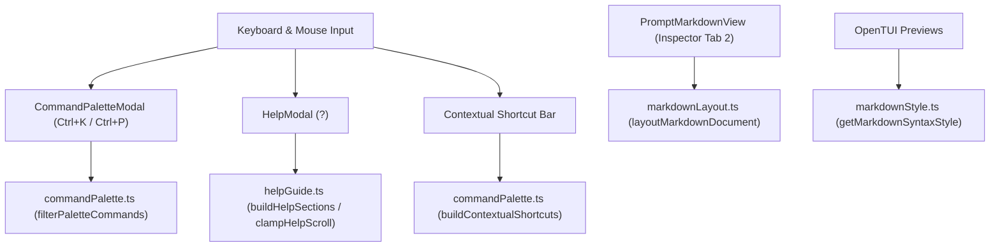

# Command Palette, Help & Markdown View

## Purpose

These UI components and layout utilities provide keyboard- and mouse-driven command discovery, contextual shortcut hints, interactive reference documentation, and cell-exact Markdown rendering inside the [OpenTUI](../dependencies/runtime-and-tooling-stack.md) interface:

- **`CommandPaletteModal` & `commandPalette.ts`** expose every [workspace switch](./workspaces-flows-and-sources.md), [agent mutation](../modules/agent-editing-and-v2-compat.md), [pack workflow](./authoring-and-bridge-modals.md), [target](../modules/target-installer.md)/[bridge](../modules/bridges.md) operation, and agent jump target through a global fuzzy search overlay (`Ctrl+K` / `Ctrl+P`), alongside a slim, context-aware shortcut chip bar in the TUI footer.
- **`HelpModal` & `helpGuide.ts`** render a four-tab interactive shortcut and mouse guide (`?`) that adapts to terminal dimensions, prevents orphaned section headings during scrolling, and dispatches bound TUI actions directly from help rows.
- **`PromptMarkdownView`, `markdownLayout.ts` & `markdownStyle.ts`** sanitize, wrap, and render [untrusted](../concepts/security-and-trust-model.md) agent Markdown bodies (primarily in *[Inspector]* (see [Glossary](../glossary.md)) Tab `2` `Prompt` inside the [TUI Shell](./tui-shell-and-catalog.md)) into terminal-safe, grapheme- and CJK/emoji-width-accurate styled spans without overflowing narrow split panes.



Each visual component in `src/ui/` delegates pure scoring, pagination, and text-wrapping calculations to a companion module in `src/utils/`.

## Source Files

| File | Role |
|------|------|
| `src/ui/CommandPaletteModal.tsx` | Modal overlay rendering the fuzzy search input, categorized command rows, and mouse/scroll handlers |
| `src/utils/commandPalette.ts` | Multi-field fuzzy matcher (`filterPaletteCommands`) and contextual footer chip builder (`buildContextualShortcuts`) |
| `src/ui/HelpModal.tsx` | Four-tab keyboard and mouse guide overlay with responsive chrome, orphan-heading guard, and clickable action rows |
| `src/utils/helpGuide.ts` | Tab definitions (`HELP_TABS`), context-aware shortcut groups, viewport math, and scroll/focus clamping helpers |
| `src/ui/PromptMarkdownView.tsx` | Virtualized OpenTUI Markdown viewer with styled inline spans, mouse-wheel scrolling, and fractional scroll progress bar |
| `src/utils/markdownLayout.ts` | Block and inline Markdown parser, GFM table/code-frame formatter, and grapheme cell-budget word wrapper |
| `src/ui/markdownStyle.ts` | Singleton `@opentui/core` `SyntaxStyle` theme mapping used by unified `<diff>` previews |

---

## Command Palette & Contextual Shortcut Bar

### Opening, Navigation & Modal Chrome

`CommandPaletteModal` (`src/ui/CommandPaletteModal.tsx`) can be toggled from any workspace via **`Ctrl+K`** or **`Ctrl+P`**, or by clicking the header `⌘K` badge or the footer `Ctrl+K Palette` pill. Pressing `Ctrl+K`, `Ctrl+P`, or `Esc` while the modal is open—or clicking outside the modal box—closes the overlay.

Inside the modal:
- Printable ASCII characters append to the live search query; `Backspace` deletes the last character and resets focus/scroll to index `0`.
- `↑` / `↓` wrap around the filtered command list; `PgUp` / `PgDn` jump by `maxRows`; mouse wheel scrolls by `±2` rows.
- Hovering a row (`onMouseOver`) moves focus to it, and pressing `Enter` or clicking a row (`onMouseDown`) executes the command immediately.
- Open animation uses `useAnimatedNumber(1, { duration: 140, ease: "outExpo", reducedMotion })` to expand modal height from `85%` to `100%` of `calculateModalViewport("command-palette", termWidth, termHeight)` and interpolate border color via `lerpColor(THEME.borderIdle, THEME.borderFocus, reveal)`.

Each command belongs to one of six color-coded categories:

| Category | Rendered Badge | Theme Accent | Typical Entries |
|----------|----------------|--------------|-----------------|
| `"Workspace"` | `Workspace` | `THEME.accentCyan` | Switch to [Catalog](./tui-shell-and-catalog.md), [Flows & Call Graph, or Sources & Target](./workspaces-flows-and-sources.md) |
| `"Agent"` | `Agent` | `THEME.accentBlue` | Assign model, tune steps/effort/mode, safety preset, skills/MCP, `@subagent` delegations, badge color, translation tier, rename |
| `"Pack"` | `Pack` | `THEME.accentAmber` | [Conditional IF/OR flows](../concepts/conditional-routing-and-archetypes.md), batch model repair, [virtual pack](../modules/pack-validation-and-virtual-packs.md) onboarding, [Pack Doctor, resource scaffolding](./authoring-and-bridge-modals.md) |
| `"Target & Bridges"` | `Target & Bridges` | `THEME.accentGreen` | [Install/update pack, reconcile OpenCode target](../concepts/pack-lifecycle-and-target-safety.md), [engine self-update](../modules/launcher-and-build.md), [Git pull](../modules/sources-and-github.md), [Claude Code and Codex bridges](../concepts/cross-harness-translation.md) |
| `"View & Motion"` | `View & Motion` | `THEME.accentPurple` | Split-width adjustment, smooth vs. reduced motion toggle, keyboard guide |
| `"Jump to Agent"` | `Agent ↗` | `THEME.accentPink` | Dynamic `jump:<currentPath>` entry generated for every discovered agent, annotated with `<pack> · <model>` in `hint` |

### Props & Interface (`CommandPaletteModalProps` & `PaletteCommand`)

| Prop | Type | Required | Description |
|------|------|----------|-------------|
| `query` | `string` | yes | Current search input string |
| `commands` | `PaletteCommand[]` | yes | Filtered, enabled commands ordered by match score |
| `focusedIndex` | `number` | yes | Absolute index of the highlighted command in `commands` |
| `scrollOffset` | `number` | yes | First visible index in the virtualized list slice |
| `maxRows` | `number` | yes | Upper bound on visible command rows (clamped to `modalHeight - 8`) |
| `termWidth` | `number` | yes | Terminal width in columns |
| `termHeight` | `number` | yes | Terminal height in rows |
| `reducedMotion` | `boolean` | yes | Disables entrance height/border interpolation when `true` |
| `onFocusRow` | `(index: number) => void` | yes | Updates `focusedIndex` on mouse hover or click |
| `onExecute` | `(cmd: PaletteCommand) => void` | yes | Dispatches the selected command |
| `onScrollDelta` | `(delta: number) => void` | yes | Adjusts `scrollOffset` on mouse-wheel scroll (`±2`) |
| `onClose` | `() => void` | yes | Closes the modal overlay |

```ts
export interface PaletteCommand {
  id: string
  label: string
  category: "Workspace" | "Agent" | "Pack" | "Target & Bridges" | "View & Motion" | "Jump to Agent"
  shortcut?: string
  keywords?: string[]
  hint?: string
  disabled?: boolean
}
```

### Multi-Field Fuzzy Scoring & Availability Filtering

`filterPaletteCommands(commands, rawQuery)` in `src/utils/commandPalette.ts` enforces workspace and selection invariants before ranking matches:

1. **Availability filtering**: Commands marked `disabled: true`—such as agent actions when no agents are loaded, `agent-rename` on read-only git sources, `repair-models` when `invalidModelGroups` is empty, `pack-init` on non-virtual workspaces, or `pack-doctor` / `pack-scaffold` on virtual or read-only sources—are excluded whether the query is empty or non-empty.
2. **Input sanitization**: `rawQuery` is stripped of terminal control sequences via [`terminalSafeText`](../concepts/security-and-trust-model.md)`(rawQuery).trim().toLowerCase()`. When empty, all enabled commands are returned in declaration order.
3. **Base string scoring (`scoreMatch`)**: Each candidate string is compared case-insensitively against `query` using six fallback tiers:
   - **Exact match** (`lower === query`): `200`
   - **Prefix match** (`lower.startsWith(query)`): `150 - Math.min(30, lower.length - query.length)`
   - **Space word-boundary match** (`lower.indexOf(" " + query)`): `120 - Math.min(25, wordBoundaryIndex)`
   - **Hyphen boundary match** (`lower.indexOf("-" + query)`): `115 - Math.min(25, dashBoundaryIndex)`
   - **Substring match** (`lower.indexOf(query)`): `95 - Math.min(30, substringIndex)`
   - **Subsequence match**: Scans left-to-right; each matched query character adds `4 + consecutive * 2` (rewarding contiguous runs) if all characters of `query` appear in order, or `0` otherwise.
4. **Weighted field aggregation**: Every enabled command is scored across five fields and ranked by its highest weighted field match (ties broken by original array `index`):

```ts
const labelScore = scoreMatch(cmd.label, query) * 1.3
const categoryScore = scoreMatch(cmd.category, query) * 0.7
const shortcutScore = cmd.shortcut ? scoreMatch(cmd.shortcut, query) * 1.1 : 0
const keywordScore = (cmd.keywords ?? []).reduce((best, kw) => Math.max(best, scoreMatch(kw, query)), 0)
const hintScore = cmd.hint ? scoreMatch(cmd.hint, query) * 0.6 : 0
const best = Math.max(labelScore, categoryScore, shortcutScore, keywordScore, hintScore)
```

### Context-Aware Footer Shortcut Chips

Instead of rendering a static wall of keybindings, `buildContextualShortcuts(ctx: ShortcutContext)` in `src/utils/commandPalette.ts` returns a prioritized `ShortcutChip[]` list (`{ key, label, actionId, accent? }`) tailored to the active workspace and selection state:

| Active Context | Generated Body Chips | Tail Chips |
|----------------|----------------------|------------|
| `workspaceTab === "sources"` | `Enter` Activate · `/` Connect / Filter · `P` Pull / Sync · `R` Reconcile Target · `Shift+U` Engine Update · `G` GitHub Auth | `Ctrl+K` Palette · `?` Help |
| `workspaceTab === "flows"` | `M` IF/OR Flows · `G` Delegations · `Enter` Jump / Open · `E` Install Pack | `Ctrl+K` Palette · `?` Help |
| `workspaceTab === "catalog"` + folder row | `Enter` Toggle Pack · `M` IF/OR Flows · `E` Install / Update · `A` Select Pack · `B` Claude Bridge + (`I` Clone & Onboard / Onboard Pack if `isVirtualPack`, else `D` Pack Doctor · `N` New Resource when writable) | `Ctrl+K` Palette · `?` Help |
| `workspaceTab === "catalog"` + agent row | `Space` Mark / `Mark (<count>)` · `M` Model · (`V` Repair Models when `hasInvalidModels`) · `T` Tune · `P` Safety · `U` Skills/MCP · `E` Install | `Ctrl+K` Palette · `?` Help |

When rendering the footer bar (`src/App.tsx`), width fitting reserves cell space for `tailChips` (`palette` and `help`) first, measuring each pill as `displayWidth(key) + 1 + displayWidth(label) + 2`. Body chips are then appended left-to-right only while `used + chipWidth + reservedTail <= Math.max(20, termWidth - 6)`, guaranteeing that `Ctrl+K Palette` and `? Help` never clip off-screen on narrow terminals. Clicking any pill invokes its `actionId`.

---

## Interactive Keyboard & Mouse Help Modal

### Categorized Tabs & Responsive Viewport

Pressing **`?`** opens `HelpModal` (`src/ui/HelpModal.tsx`), automatically selecting the tab matching the [active workspace](./workspaces-flows-and-sources.md) via `defaultHelpTabForWorkspace(workspaceTab)` (`"catalog"`, `"flows"`, or `"sources"`). Pressing `?`, `Esc`, or `q`—or clicking outside the modal—closes the guide.

`HELP_TABS` (`src/utils/helpGuide.ts`) organizes shortcuts into four color-accented tabs:

| Key / Number | Tab Label (`shortLabel`) | Accent | Groups Covered |
|--------------|--------------------------|--------|----------------|
| `1` | `1 Catalog` (`1 Cat`) | `blue` (`THEME.accentBlue`) | *Agent Configuration* (`M`, `T`, `P`, `U`, `G`, `Shift+T`, `C`, `R`, `Shift+F`) and *Selection & Inspector* (`Space`, `A`, `S`, `/`, `1 – 6`, `[ / ]`) |
| `2` | `2 Flows & Packs` (`2 Flows`) | `amber` (`THEME.accentAmber`) | *[Conditional Flows](../concepts/conditional-routing-and-archetypes.md) & Call Graph* (`M`, `G`, `Enter`) and *[Pack Maintenance & Bridges](./authoring-and-bridge-modals.md)* (`E`, `V`, `I`, `D`, `N`, `B`, `Shift+B`) |
| `3` | `3 Sources` (`3 Src`) | `green` (`THEME.accentGreen`) | *[Sources & GitHub Discovery](../modules/sources-and-github.md)* (`O`, `Enter`, `/ · A`, `P`, `G`, `T`, `X / Del`) and *[OpenCode Target Health](../concepts/pack-lifecycle-and-target-safety.md)* (`R`, `Ctrl+R`, `Shift+U`) |
| `4` | `4 Global & Mouse` (`4 Global`) | `purple` (`THEME.accentPurple`) | *Global Navigation & View* (`Ctrl+K`, `Tab`, `↑/↓ j/k`, `◀/▶ h/l`, `Shift+L`, `Ctrl+E`, `? / Esc`) and *Mouse Interactions* (`Click`, `Drag │`, `Wheel`) |

Users can switch tabs via number keys `1`–`4` (`helpTabByNumber`), `Tab` / `Shift+Tab`, `◀` / `▶` (`h` / `l`) via `cycleHelpTab`, or by clicking tab pills.

`calculateHelpViewport(termWidth, termHeight)` computes modal geometry with up to `TARGET_MAX_LIST_ROWS = 18` content rows and switches to `compactChrome` (`7` chrome rows instead of `9`) when `termHeight < 20`. Inside `HelpModal`, additional width thresholds progressively simplify chrome:
- `innerWidth < 66`: switches tab pills from full `label` to `shortLabel`
- `innerWidth < 72`: hides the `Tab / 1–4 ⇄` hint
- `innerWidth < 58`: hides the clickable `[Ctrl+E] Smooth / Reduced` motion toggle in the footer
- `innerWidth < 42`: hides the right-aligned scope/run indicator column

### Props & Interface (`HelpModalProps`)

| Prop | Type | Required | Description |
|------|------|----------|-------------|
| `activeTab` | `HelpTabId` | yes | Currently selected tab (`"catalog" \| "flows" \| "sources" \| "global"`) |
| `content` | `HelpTabContent` | yes | Built tab metadata, flat `items` list, and interleaved display `rows` |
| `focusedItemIndex` | `number` | yes | Index into `content.items` for keyboard/mouse focus |
| `scrollOffset` | `number` | yes | Starting index in `content.rows` for the visible slice |
| `termWidth` | `number` | yes | Terminal width in columns |
| `termHeight` | `number` | yes | Terminal height in rows |
| `reducedMotion` | `boolean` | yes | Current motion state shown in the `[Ctrl+E]` footer toggle |
| `onSelectTab` | `(tab: HelpTabId) => void` | yes | Switches the active help tab and resets scroll/focus |
| `onFocusItem` | `(itemIndex: number) => void` | yes | Focuses a shortcut item on mouse hover/click |
| `onActivateItem` | `(item: HelpShortcutItem) => void` | yes | Runs or explains the chosen `HelpShortcutItem` |
| `onScrollDelta` | `(delta: number) => void` | yes | Scrolls `content.rows` on mouse-wheel events (`±2`) |
| `onToggleReducedMotion` | `() => void` | yes | Toggles smooth vs. reduced motion when clicking `[Ctrl+E]` |
| `onClose` | `() => void` | yes | Closes the help modal |

### Orphan-Heading Prevention & Scroll Clamping

`buildHelpSections(tabId, ctx)` flattens each tab's groups into `HelpDisplayRow` entries of three kinds: `spacer`, `group` (rendered as `▎ GROUP TITLE ────`), and `item`. Three coordinated guards keep section headings paired with their items during pagination and scrolling:

1. **Bottom-edge orphan guard (`HelpModal.tsx`)**: After slicing `rawVisibleRows = content.rows.slice(safeOffset, safeOffset + viewportRows)`, if the final visible row is a `"group"` header and more rows remain below (`safeOffset + rawVisibleRows.length < totalRows`), `HelpModal` replaces that trailing heading with a blank `spacer` (`${lastRow.id}:tail-pad`). A section heading is never rendered stranded at the bottom border without at least one shortcut row beneath it:

```ts
const visibleRows =
  lastRow?.kind === "group" && safeOffset + rawVisibleRows.length < totalRows
    ? [...rawVisibleRows.slice(0, -1), { kind: "spacer" as const, id: `${lastRow.id}:tail-pad` }]
    : rawVisibleRows
```

2. **Top-edge group-header anchor (`clampHelpScroll` in `helpGuide.ts`)**: When moving focus upward (`↑`/`k`, `PgUp`, `Home`) to an item immediately preceded by a `"group"` row (`rows[rowIndex - 1]?.kind === "group"`), `clampHelpScroll` sets `headerAnchor = rowIndex - 1` whenever `viewportRows >= 2`, pulling the group heading into view together with its first item.
3. **Wheel/resize focus sync (`clampFocusIntoHelpSlice` in `helpGuide.ts`)**: When scrolling with the mouse wheel or resizing the terminal, `clampFocusIntoHelpSlice` keeps `focusedItemIndex` clamped to the nearest `"item"` inside the visible slice so keyboard navigation resumes seamlessly from the viewport.

### Activating TUI Actions from Help Rows

Help rows are interactive launchers rather than read-only documentation:
- **Actionable enabled items** (`Boolean(item.actionId) && !item.disabled`): When focused, the right-hand column switches from `item.scope` to bold green **`↵ Run`**. Pressing `Enter` or clicking the row closes `HelpModal` and dispatches `executeActionById(item.actionId)` directly.
- **Contextually disabled items** (`item.disabled === true`): Rendered with muted key pills and **`n/a`** on the right (for example, `R` Rename and `Shift+F` Fix Permission Order on [read-only git sources](../modules/agent-editing-and-v2-compat.md), `V` Repair Models when all models are valid, or `I` Onboard Pack when [`opencode-pack.json`](../api/pack-contract-reference.md) already exists). Activating a disabled row keeps the user safe and emits a contextual toast explaining what prerequisite is needed.
- **Reference-only items** (no `actionId`, such as `1 – 6` Inspector tabs, `[ / ]` pane focus, or mouse gestures): Activating the row emits an informational toast summarizing the binding (`● [<keyLabel>] <title>`).

---

## Cell-Accurate Markdown Renderer

### PromptMarkdownView & Syntax Styling

`PromptMarkdownView` (`src/ui/PromptMarkdownView.tsx`) renders Markdown bodies inside fixed-width OpenTUI panes. In [`src/App.tsx`](./tui-shell-and-catalog.md), it powers:
- **Inspector Tab `2` (`Prompt`)**: Renders the focused agent's system prompt body (extracted below YAML frontmatter via [`extractFrontmatter`](../modules/agent-editing-and-v2-compat.md)`(rawContent).body.trim()`) with mouse-wheel scrolling (`±3` lines) and a bottom progress footer.
- **Compact previews (`showFooter={false}`)**: Renders agent `description` text in Inspector Tab `1` (`Info`) and pack descriptions when a pack folder is focused.

| Prop | Type | Required | Description |
|------|------|----------|-------------|
| `markdown` | `string` | yes | Raw Markdown source text |
| `width` | `number` | yes | Target column budget (clamped to at least `16` cells) |
| `maxRows` | `number` | yes | Maximum vertical rows available to the component |
| `scrollOffset` | `number` | yes | Zero-based first visible rendered line |
| `onScrollDelta` | `(delta: number) => void` | no | Callback invoked with `±3` on mouse-wheel scroll |
| `showFooter` | `boolean` | no | Defaults to `true`; displays the line range and fractional progress bar when content overflows `maxRows` |

Each `StyledSpan` produced by the layout engine is mapped by `spanVisualProps(style)` to OpenTUI `<text>` (and pill `<box>` when a background color is present) attributes:

| `InlineSpanStyle` | Visual Rendering |
|-------------------|------------------|
| `"heading1"` | Bold `THEME.accentCyan` (`▌ ` prefix) |
| `"heading2"` | Bold `THEME.accentBlue` (`▍ ` prefix; also used for GFM table headers) |
| `"heading3"` | Bold `THEME.accentPurple` (`• ` prefix for `###`–`######`; also used for `[X]` checked tasks) |
| `"bold"` | Bold `#ffffff` |
| `"italic"` | Italic `THEME.accentPurple` |
| `"code"` | `THEME.accentAmber` foreground on `THEME.bgPill` background box |
| `"link"` | Underlined `THEME.accentBlue` |
| `"marker"` | Bold `THEME.accentCyan` (list bullets `• `, `◦ `, `▪ ` and ordered numbers `1. `) |
| `"quoteBar"` | Bold `THEME.accentPurple` (`▎ ` per blockquote depth) |
| `"codeFrame"` | `THEME.borderIdle` (box-drawing borders for code blocks, tables, and horizontal rules) |
| `"muted"` | `THEME.fgSecondary` (blockquote prose, code language tags, unchecked `[ ]` tasks, truncation notices) |
| `"text"` | `THEME.fgPrimary` |

Separately, `getMarkdownSyntaxStyle()` in `src/ui/markdownStyle.ts` lazily constructs a shared [`@opentui/core`](../dependencies/runtime-and-tooling-stack.md) `SyntaxStyle` singleton (`default`, `conceal`, `markup.heading`, `markup.strong`, `markup.italic`, `markup.raw`, `markup.link`, `markup.list`, `markup.quote`) aligned with the same `THEME` palette for OpenTUI's native `<diff>` component during unified diff previews.

### Block Parsing & Reflow

`layoutMarkdownDocument(rawMarkdown, targetWidth, maxLines = 600)` in `src/utils/markdownLayout.ts` converts raw, untrusted Markdown into an array of `RenderedMarkdownLine` rows guaranteed to fit within `Math.max(16, Math.floor(targetWidth))` terminal cells:

1. **Sanitization & line cap**: Tabs are normalized to two spaces, up to `maxLines` (`600`) lines are processed (appending `… (truncated for preview)` if exceeded), and every input line passes through [`terminalSafeText()`](../concepts/security-and-trust-model.md) (`src/utils/terminalText.ts`) to strip CSI, OSC, and C0/C1 escape sequences.
2. **Fenced code blocks** (`` ``` `` or `~~~` of length ≥ 3): Rendered inside a rounded Unicode frame (`╭─ <lang> ───╮` … `│ <code> │` … `╰────╯`, defaulting `<lang>` to `"code"`). Lines exceeding `frameInner` (`width - 4`) are split by grapheme cell budget; continuation lines receive a muted `↪ ` prefix and pad out to the right frame border.
3. **Horizontal rules** (`---`, `***`, `___`): Reset list indentation state and emit a full-width `─` rule in `"codeFrame"` style.
4. **Headings** (`#` through `######`): Preceded by a blank separator line (when non-leading) and wrapped with hanging continuation indentation (`"  "`), using `"heading1"` (`▌ `) for H1, `"heading2"` (`▍ `) for H2, and `"heading3"` (`• `) for H3–H6.
5. **GFM tables**: Detected when a pipe row (`| ... |`) is followed by a separator row (`| --- | :---: |`). Column natural widths are measured with `displayWidth`, scaled proportionally to `width - bordersBudget` (minimum `3` cells per column), and rendered inside `┌─┬─┐` / `├─┼─┤` / `└─┴─┘` borders with `middleEllipsis` truncation per cell.
6. **Blockquotes** (`>` up to depth `3`): Consecutive quote lines at the same depth reflow into soft-wrapped paragraphs (honoring trailing two-space or `\` hard line breaks) prefixed on every line by `"▎ ".repeat(depth)` in `"quoteBar"` style and body text in `"muted"` style.
7. **Nested bullet, numbered & task lists**: `indentStack` tracks leading space offsets up to nesting depth `5`, selecting hierarchical bullets (`• ` at level 0, `◦ ` at level 1, `▪ ` at level 2+) or ordered markers (`1. `) plus optional `[ ] ` / `[X] ` task checkboxes. Indented soft-wrapped continuation lines are absorbed into the item and wrapped with a space-padded hanging prefix matching the exact cell width of the marker + checkbox (`hangingCells`).
8. **Prose paragraphs**: Consecutive plain lines that do not start a new block element are joined (preserving hard breaks ending in two spaces or `\`) and soft-wrapped to `width`.

### Inline Span Tokenization

`tokenizeInlineMarkdown(text, defaultStyle)` scans block segments in a single pass into `StyledSpan[]` tokens, coalescing adjacent spans that share a style:

```ts
const pattern = /`([^`]+)`|\*\*([^*]+)\*\*|__([^_]+)__|\[([^\]]+)\]\(([^)]+)\)|(?<!\w)\*([^*\n]+)\*(?!\w)|(?<!\w)_([^_\n]+)_(?!\w)/g
```

- **Inline code** (`` `code` ``) → `"code"`
- **Strong emphasis** (`**bold**` or `__bold__`) → `"bold"`
- **Links** (`[label](url)`) → extracts `label` in `"link"` style (hiding the raw URL target for compact terminal readability)
- **Emphasis** (`*italic*` or `_italic_`) → `"italic"`, guarded by negative word-character lookbehind/lookahead (`(?<!\w)...(?!\w)`) so snake_case identifiers (`source_files`, `max_steps`) and `@agent` / `@subagent` mentions (such as `@pipeline-explorer` or `@flow_review`, whether written inline or wrapped in backticks) never fracture mid-token into accidental italics.

### Unicode Cell-Width Wrapping & Viewport Progress

Terminal columns do not equal UTF-16 code units. `markdownLayout.ts` relies on `Intl.Segmenter(undefined, { granularity: "grapheme" })` and `displayWidth()` (`src/utils/terminalText.ts`) throughout wrapping:

- **Wide & zero-width graphemes**: `displayWidth` assigns `2` cells to ZWJ sequences (`\u200d`), emoji ranges (`U+1F300`–`U+1FAFF`), Hangul Jamo/Syllables, and CJK Unified/Compatibility Ideographs, `0` additional cells to combining marks (`U+0300`–`U+036F`) and variation selectors (`U+FE00`–`U+FE0F`), and `1` cell to standard graphemes.
- **Word & grapheme wrapping (`wrapStyledParagraph` & `splitByCellBudget`)**: Styled spans are split on whitespace into `WordPiece` tokens with precomputed `displayWidth`. Words wrap onto `continuationPrefix` whenever `used + piece.width > avail`, stripping trailing spaces before flushing. Any single token wider than the entire available column (such as a long URL or CJK run without spaces) is sliced on grapheme boundaries by `splitByCellBudget(piece.text, avail)` so no multi-codepoint emoji or CJK character is ever torn in half or overflows `maxWidth`.
- **Viewport slicing & fractional progress footer**: In `PromptMarkdownView`, `useMemo` caches `layoutMarkdownDocument(markdown, safeWidth)`. When `showFooter` is `true` and `lines.length > maxRows`, `1` row is reserved at the bottom to display the 1-based visible range (`Lines <start>-<end> / <total>`) on the left and a sub-cell Unicode eighth-block progress bar (`fractionalBar(clampedOffset / maxOffset, barWidth, "─")`) on the right.

---

## Related Pages

- [TUI Shell, Catalog Tree & Inspector](./tui-shell-and-catalog.md)
- [Flows & Data Sources Workspaces](./workspaces-flows-and-sources.md)
- [Authoring, Tuning & Bridge Modals](./authoring-and-bridge-modals.md)
- [System Architecture](../architecture.md)
- [Security & Trust Model](../concepts/security-and-trust-model.md)
- [Runtime & Tooling Dependencies](../dependencies/runtime-and-tooling-stack.md)
