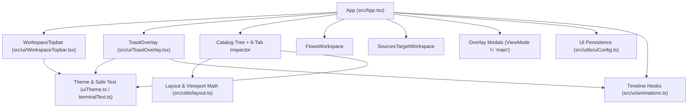

# TUI Shell, Catalog Tree & Inspector

`<App />` (`src/App.tsx`) is the root [OpenTUI](../dependencies/runtime-and-tooling-stack.md) React application for `manage-agents` (see [System Architecture](../architecture.md)). It coordinates the extracted `WorkspaceTopbar`, the contextual footer bar, modal state machine, collapsible *pack* (see [Glossary](../glossary.md)) and agent catalog tree, 6-tab agent inspector, deterministic viewport calculations, hardened UI persistence, timeline-driven animations, and the floating `ToastOverlay`.

## Purpose & Component Architecture

The shell coordinates three primary top-level workspaces (`catalog`, plus `flows` and `sources` in [Flows & Data Sources Workspaces](./workspaces-flows-and-sources.md)) and over twenty [overlay modal and sub-view states](./authoring-and-bridge-modals.md) (`ViewMode`) inside a fixed-budget terminal grid that never overflows or shifts vertically when status banners appear.



## Props / Interface

### `AppProps` (`src/App.tsx`)

| Prop | Type | Required | Description |
|------|------|----------|-------------|
| `workspaceRoot` | `string` | no | Local directory path passed via [`--workspace`](../api/cli-reference.md); initializes `activeDataSource` in `"workspace"` mode. |
| `initialSource` | `Source` | no | Registered local or Git [`Source`](../modules/sources-and-github.md) passed via `--source` or active registry default; initializes `activeDataSource` in `"source"` mode. |
| `startupNotice` | `string` | no | Initial message displayed in `ToastOverlay` and the Sources status bar on launch. |
| `listShare` | `number` | no | Initial horizontal width ratio (`0.60`–`0.75`, default `2 / 3`) allocated to the left panel in two-column mode. |
| `reducedMotion` | `boolean` | no | User preference loaded from [`ui.json`](../config/user-and-target-files.md) to disable smooth animations; also overridden by `AGENT_MANAGER_REDUCED_MOTION`. |
| `uiConfigWarning` | `string` | no | Warning surfaced as a startup `⚠` toast if `ui.json` was unreadable or malformed. |
| `configReadOnly` | `boolean` | no | Marks UI configuration as read-only (true when `AGENT_MANAGER_UI_CONFIG` overrides the config path). |
| `uiConfigRevision` | `string` | no | SHA-256 revision token of `ui.json` (`"missing"` when absent) used for optimistic concurrency on save. |
| `initialModelCatalog` | `ModelCatalog` | no | Pre-loaded verified OpenCode model catalog; if omitted, `<App />` loads it on mount via `loadModelCatalog(true)`. |

### `WorkspaceTopbarProps` (`src/ui/WorkspaceTopbar.tsx`)

| Prop | Type | Required | Description |
|------|------|----------|-------------|
| `activeTab` | `WorkspaceTab` | yes | Currently selected `catalog`, `flows`, or `sources` workspace. |
| `termWidth` | `number` | yes | Terminal width used to choose labels and fit status items. |
| `dimmed` | `boolean` | yes | Selects dimmed surface colors while an overlay modal is active. |
| `spinner` | `string` | yes | Optional activity glyph supplied by the shell animation hook. |
| `workspaceLabel` | `string` | yes | Active workspace/source label, shortened to its available cell budget. |
| `hasActiveSource` | `boolean` | yes | Chooses the connected-source status color. |
| `commitLabel` | `string` | yes | Full or compact commit/override label selected by `App`. |
| `isReadOnlyGitSource` | `boolean` | yes | Controls Git override styling and the onboarding action label. |
| `autoCommitOn` | `boolean` | yes | Controls local commit status coloring. |
| `isWorkspaceVirtualPack` | `boolean` | yes | Enables the onboarding action when the available width permits it. |
| `onSelectTab` | `(tab: WorkspaceTab) => void` | yes | Handles workspace-tab selection. |
| `onOpenSources` | `() => void` | yes | Opens the Sources workspace from the status label. |
| `onOpenOnboarding` | `() => void` | yes | Opens pack onboarding from its status pill. |
| `onOpenPalette` | `() => void` | yes | Opens the command palette from its status pill. |

### `ToastOverlayProps` (`src/ui/ToastOverlay.tsx`)

| Prop | Type | Required | Description |
|------|------|----------|-------------|
| `message` | `string \| null` | yes | Sanitized message string to display; renders `null` when empty or `termWidth < 48`. |
| `toastId` | `number` | yes | Monotonic counter incremented on each `pushToast` call to restart the countdown timer. |
| `termWidth` | `number` | yes | Current terminal column width used to clamp box width (`min(max(32, floor(termWidth * 0.44)), max(32, termWidth - 6))`). |
| `reducedMotion` | `boolean` | yes | Switches countdown expiration from animated `useTimeline` updates to a plain `setTimeout`. |
| `onDismiss` | `() => void` | yes | Callback invoked when the countdown expires or the user clicks the toast (`onMouseDown`). |

---

## `<App />` Shell & Active Data Source State

### Top Workspace Switcher & Header Chrome

`App` renders the extracted 3-row, browser-style `WorkspaceTopbar` (`src/ui/WorkspaceTopbar.tsx`) above the active workspace. It receives the selected tab, source/mutation status, spinner, and callbacks from `App`; the component handles cell-width measurement, visual layout, and click targets:

- **Responsive tabs and brand**: `getTopbarTabs(termWidth)` keeps `Catalog` fixed and uses `Flows & Graph` / `Sources & Target` at `termWidth >= 118`, otherwise `Flows` / `Sources`. The active workspace is drawn as a raised browser-style tab; all tab areas are clickable. The brand includes `manage-agents` at 96 columns or wider and contracts to `◆` below that; the `⇥ Tab` hint appears from 104 columns. The three top-level workspaces are described in [Flows & Data Sources Workspaces](./workspaces-flows-and-sources.md). If neither `workspaceRoot` nor `initialSource` is provided, `App` starts on `sources`; otherwise it starts on `catalog`.
- **Space-aware status area**: The right side displays the async spinner, a cell-truncated active source label (`Workspace: <path>`, `Source: <name> (<path>)`, or `GitHub: <owner/repo>#<ref>@<sha7>`; with no source, `Source: none ([O] connect)`), commit/override state, and optionally the virtual-pack onboarding and `⌘K` palette pills. Connected-source labels use the active-source color; missing-source labels use the warning color. The component shows the commit segment when at least 36 cells remain, the onboarding pill when at least 42 remain, and the palette pill when at least 10 remain; it shows the source label only when its computed budget is at least 10 cells. `App` chooses the full `Mode: OVERRIDES` / `Commit: ON|OFF` label at `termWidth >= 124`, otherwise the compact `OVR` / `C:ON|OFF` form. Clicking the source label opens Sources; the onboarding and palette pills invoke their supplied callbacks.
- **Keyboard workspace switching**:
  - `Tab` / `Shift+Tab` cycles across `catalog` ↔ `flows` ↔ `sources` when `viewMode === "main"`.
  - `O` jumps directly to the `sources` workspace from `catalog` or `flows`.
  - `Esc` inside `flows` (or inside `sources` when `sourcesQuery` is empty and an `activeDataSource` is connected) returns to `catalog`.
  - `Ctrl+K` / `Ctrl+P` (or clicking the `⌘K` pill when it fits) opens the [Command Palette (`CommandPaletteModal`)](./navigation-help-and-markdown.md), exposing `ws-catalog`, `ws-flows`, `ws-sources`, all agent/pack commands, and `jump:<agentPath>` quick-jump entries.
- **Tab selection behavior**: `App` clears modal/search state when a tab is selected and refreshes source status when entering `sources`. `Tab`/`Shift+Tab` also cycles workspaces when the main screen owns keyboard input.

### Local Workspace vs. Registered Local/Git Sources

`<App />` models the connected repository through the `ActiveDataSource` union (`src/App.tsx:180-182`):

```ts
type ActiveDataSource =
  | { kind: "workspace"; root: string }
  | { kind: "source"; source: Source; root: string }
```

1. **Local Workspace (`kind: "workspace"`) and Registered Local Source (`source.kind === "local"`)**:
   - Agents are discovered directly from disk via `findAgentFiles(ds.root)`.
   - File mutations (`applyAgentMutation`, `updateAgentsModel`, `repairAgentModels`, `renameAgent`, `saveTranslationConfig`) execute inside [`repositoryTransaction(...)`](../modules/agent-editing-and-v2-compat.md), writing directly to pack markdown/JSON files and creating an automatic Git commit when auto-commit is enabled.
2. **[Registered Git Source](../modules/sources-and-github.md) (`source.kind === "git"`, `isReadOnlyGitSource === true`)**:
   - The cached Git clone is treated as **read-only**. `loadSourceAgents(ds.root)` loads the pack's agents with user-level overrides merged on top.
   - Supported tuning actions (changing models, repairing invalid models, tuning steps/variant/mode/visibility, changing colors, applying safety presets, editing `@subagent` delegations, toggling skills/tools/MCP permissions) persist non-destructively to [user settings (`overrides.json`)](../modules/routing-and-user-settings.md) via `runWithOverrideWriter`, `overrideAgentsModel`, and `overrideRepairAgentModels`, then automatically run `reconcileTargetIfInstalled("override")` via the [target installer](../modules/target-installer.md) to update the installed OpenCode target.
   - Structural repository edits that require modifying files in-place—renaming agent files (`R`), opening Pack Doctor (`D`), scaffolding resources (`N`), and reordering frontmatter wildcard permissions (`Shift+F`)—are blocked with explanatory warning toasts on read-only Git sources.
3. **[Virtual Packs](../modules/pack-validation-and-virtual-packs.md) (`isVirtualPackRoot`)**:
   - Directories or repositories containing `.md` agent files without an [`opencode-pack.json`](../api/pack-contract-reference.md) manifest are flagged as virtual packs (`◌ virtual`).
   - On first activation of a virtual root (`promptedVirtualRootsRef`) or when pressing `I`, `<App />` opens [`PackOnboardingModal`](../modules/pack-onboarding-and-doctor.md) (`viewMode === "pack-init"`). On a local directory it generates `opencode-pack.json` in place; on a read-only Git source it clones the repository to a local destination (`cloneGitSourceForOnboarding`), registers and activates the new local source, and onboards it to Contract 1.1.

### Global Keyboard Dispatch Priority

All keyboard input flows through a single `useKeyboard` hook (`src/App.tsx:2646-4220`) with strict top-down precedence so active modals and text inputs never leak keystrokes into background trees:

1. **Global Toggles**: `Ctrl+K` / `Ctrl+P` toggles `"command-palette"`; `Ctrl+E` toggles reduced motion (`toggleReducedMotion`) from any screen.
2. **System & Navigation Overlays**: [`"self-update"`](../modules/launcher-and-build.md) (`Shift+U`), `"command-palette"`, and `"help"` (`?`).
3. **Inline Catalog Search (`isSearching`)**: Captures printable ASCII characters into `searchQuery`, `Backspace` to delete, `Enter` to exit typing while keeping the filter active, and `Escape` to clear `searchQuery` and close search.
4. **Split Layout Modal (`viewMode === "layout"`)**: Captures arrow keys, `h`/`l`, `Home`, `End`, `R`, `Enter`, and `Escape` to adjust `listShare` before tree navigation can run.
5. **Active Non-Catalog Workspaces (`viewMode === "main"`)**:
   - `workspaceTab === "sources"`: Checks `Ctrl+G` (GitHub web login), then inline source query input (`sourcesInputFocused`, toggled via `/` or `a`), then source list navigation and target actions (`Enter` activate/attach, `P` pull, `R` reconcile target, `Ctrl+R` refresh, `T` toggle trust, `X`/`Delete`/`Backspace` remove source, `G` GitHub login).
   - `workspaceTab === "flows"`: Handles topology navigation (`↑`/`↓`/`j`/`k`, `PageUp`/`PageDown`), `Enter` (open pack flows on pack rows or jump to agent in Catalog), `M` (pack IF/OR flows), `G` (delegations), `B`/`Shift+B` (Claude/Codex bridge), `E` (install pack), and `I`/`D`/`N` (authoring modals).
6. **Main Catalog Workspace (`viewMode === "main"` and `workspaceTab === "catalog"`)**: Handles pane focus (`[` / `]`), active-pane inspector scrolling, tree folding/navigation, batch marking, inspector tab selection (`1`–`6`), and modal shortcuts.
7. **[Feature Modals](./authoring-and-bridge-modals.md)**: Dispatches exclusively to the active `viewMode` (`"model-selector"`, `"repair-selector"`, `"repair-confirm"`, `"tier-selector"`, `"bridge-prompt"`, `"install-confirm"`, `"routing-*"`, `"pack-init"`, `"pack-doctor"`, `"color-selector"`, `"permission-preset"`, `"delegation-manager"`, `"resource-manager"`, `"parameter-tuning"`, `"rename-prompt"`, or `"action-result"`).

---

## Responsive Layout Engine, Theme & Text Sanitization

### Terminal Layout Modes & Viewports (`src/utils/layout.ts`)

`calculateLayout(terminalWidth, terminalHeight, hasStatus)` computes a deterministic row/column budget (`fixedRows = 17 + (hasStatus ? 1 : 0)`). Because `ToastOverlay` floats absolutely, `<App />` passes `hasStatus = false` (`fixedRows = 17`):

| Mode | Trigger Threshold | Behavior |
|------|-------------------|----------|
| `"too-small"` | `width < 40` or `height < 18` (`fixedRows + 1`) | Replaces the workspace with `"Terminal too small. Please increase terminal size."` |
| `"compact"` | `40 <= width < 100` (with `height >= 18`) | Single-column layout (`showInspector = false`); Catalog list receives `width - 2` columns. |
| `"normal"` | `width >= 100` and `height >= 18` | Two-panel split layout (`showInspector = true`) with a 1-column interactive gutter (`│`) between panels. |

In `"normal"` mode, `calculatePanelWidths(terminalWidth, mode, listShare)` subtracts 2 columns for root horizontal padding and 1 column for the center gutter, then splits `panelSpace` by `listShare` while enforcing minimum panel widths of `52` columns (`48 + 4`) for the list and `28` columns (`24 + 4`) for the inspector whenever `panelSpace >= 80`.

Scrollable inner heights and modal dimensions are computed as exact integers via `calculateWorkspaceViewports`, `calculateModalViewport`, and `clampListScroll` so list slicing never overflows borders:
- Workspace row budgets: `catalogRows = max(1, h - 15)`, `flowsRows = max(1, h - 18)`, `sourcesRows = max(1, h - 21 - (hasSourcesStatus ? 2 : 0))`, `promptRows = max(2, h - 18)`, `securityRows = max(1, h - 23 - (hasSecurityOrderError ? 3 : 0))`, `delegationsInspectorRows = max(1, h - 23)`, `resourcesInspectorRows = max(1, h - 19)`.
- Column cell allocation: `calculateListColumnBudget` assigns a 3-column compact ratio (`[0.12, 0.43, 0.45]` with `Sel` capped at 5 cells and explicit 1-cell gutters) for the Catalog table (`Sel`, `Pack / Agent`, `Status / Model`).

### Resizable `listShare` & Hardened `ui.json` Persistence (`src/utils/uiConfig.ts`)

The horizontal split ratio `listShare` is bounded to `[0.60, 0.75]` (`DEFAULT_UI_CONFIG = { listShare: 2 / 3 }`):

- **Pane Focus vs. Split Resizing**: In the Catalog workspace, `[` focuses the left list pane (`activePane = "list"`) and `]` focuses the right inspector pane (`activePane = "inspector"`). Pressing `Shift+L` opens the **Split Layout & Motion** modal (`viewMode === "layout"`), where `←`/`→` (or `h`/`l`, `↓`/`↑`) step `listShare` by `±0.01` (`adjustListShare`), `Home` jumps to `0.60`, `End` jumps to `0.75`, `R` resets to `2 / 3` (`resetListShare`), `Enter` saves to disk, and `Esc` reverts to the pre-modal snapshot. Users can also drag the center `│` divider directly with the mouse (`onMouseDrag` / `onMouseDragEnd`).
- **Storage & Environment Override**: Persisted as `{ "version": 1, "listShare": 0.67, "reducedMotion"?: true }` in [`<engineConfigDir>/ui.json`](../config/user-and-target-files.md) (`$XDG_CONFIG_HOME/manage-agents/ui.json`, or `~/.config/manage-agents/ui.json`). Setting `AGENT_MANAGER_UI_CONFIG` loads from that path in **read-only** mode (`configReadOnly = true`).
- **Filesystem Safety**: `loadUiConfig` and `saveUiConfig` enforce a `64 KiB` cap (`MAX_CONFIG_BYTES`), open files with `O_NOFOLLOW`, verify `lstatSync`/`fstatSync` device and inode identity (`sameFile`) to reject symlinks or file swaps, coordinate concurrent writers via an exclusive `ui.lock` file (`0o600`) carrying a 32-byte random token, check the SHA-256 `expectedRevision` before writing, and commit via an `fsync`'d temporary file + `renameSync` + directory `fsync`.

### Semantic Color Palette & Visual Helpers (`src/utils/uiTheme.ts`)

`uiTheme.ts` centralizes the dark UI palette and presentation helpers used by `App`, `WorkspaceTopbar`, and `ToastOverlay`:
- **Surfaces**: `bgBase` (`#0f1117`), `bgBaseDimmed` (`#080a0e`), `bgPanel` (`#161922`), `bgPanelDimmed` (`#10131a`), `bgElevated` (`#1c202c`), `bgInput` (`#12151d`), `bgRowHover` (`#1b2130`), `bgRowFocus` (`#1f324a`), `bgRowSelected` (`#172b24`), `bgRowFlash` (`#1e4631`), `bgPill` (`#232a3b`), `bgPillActive` (`#2b4263`), `bgDangerSoft` (`#3a181c`), `bgWarnSoft` (`#362a14`), and `bgSuccessSoft` (`#163323`).
- **Borders, foregrounds, and accents**: `borderSubtle` (`#252b38`), `borderIdle` (`#2d3546`), `borderFocus` (`#58a6ff`), `borderInspectorFocus` (`#a371f7`), `borderModal` (`#79c0ff`), `borderSuccess` (`#3fb950`), `borderWarn` (`#d29922`), and `borderDanger` (`#f85149`). Foregrounds are `fgPrimary` (`#e6edf3`), `fgSecondary` (`#9aa4b2`), and `fgMuted` (`#636e7b`); accents are blue `#58a6ff`, cyan `#39c5cf`, purple `#bc8cff`, green `#3fb950`, amber `#e3b341`, red `#ff7b72`, and pink `#f778ba`.
- **Color and display helpers**: `sanitizeHexColor` accepts only `#RGB` / `#RRGGBB`; `lerpColor` interpolates RGB channels for animated borders and row flashes; `fractionalBar` renders Unicode eighth-block progress; `gaugeBar` renders bounded knob gauges; `buildPreviewUnifiedDiff` formats sanitized text for OpenTUI's `<diff>` component; `terminalSafeMarkdown` sanitizes multiline previews.
- **Shared status styling**: `SPINNER_FRAMES` supplies the activity glyph sequence. `classifyToastTone` and `toastAppearance` map toast messages to success, warning, error, or info presentation using the same semantic palette as the rest of the shell.

### Display Sanitization & Grapheme Truncation (`src/utils/terminalText.ts`)

Under the [security and trust model](../concepts/security-and-trust-model.md), packs and Git sources may contain untrusted filenames, descriptions, or command output, so all external strings pass through `terminalText.ts` before rendering:

```ts
export function terminalSafeText(value: unknown): string {
  let text = typeof value === "string" ? value : String(value ?? "")
  text = text
    .replace(/\x1b\][^\x07]*(?:\x07|\x1b\\)/g, "")
    .replace(/\x1b\[[0-?]*[ -\/]*[@-~]/g, "")
    .replace(/[\x00-\x1f\x7f-\x9f]/g, "")
  if (text.length > MAX_TERMINAL_TEXT_LENGTH) {
    const half = Math.floor(MAX_TERMINAL_TEXT_LENGTH / 2)
    text = text.slice(0, half) + text.slice(-half)
  }
  return text
}
```

- `terminalSafeText` strips OSC sequences (BEL or ST terminated), CSI escape sequences, and all C0/C1 control characters, capping output at `100_000` characters. `terminalSafeMarkdown` (`src/utils/uiTheme.ts`) applies line-by-line `terminalSafeText` while preserving newlines and truncating previews past 400 lines.
- `displayWidth` segments text with `Intl.Segmenter` (`granularity: "grapheme"`), counting ZWJ emoji sequences and CJK/fullwidth codepoints as 2 terminal cells and combining/variation marks as 0 cells.
- `middleEllipsis(text, maxCells)` truncates strings to an exact cell budget in $O(n)$ without splitting multi-codepoint graphemes, breaking ties in favor of the suffix so file extensions and path endings remain visible.

---

## Catalog Tree, Batch Selection & Quick Actions

### Collapsible Pack Folders & Agent Rows

The Catalog tree (`activeItems` in `src/App.tsx:1410-1448`) groups discovered agents by pack (`agent.category`), sorted via [`comparePackCategories`](../modules/pack-validation-and-virtual-packs.md). All folders start collapsed (`expandedCategories` initialized empty) so the TUI opens on a concise pack overview:

- **Pack Folder Rows**: Expand/collapse with `Enter`, `←`/`→` (`h`/`l`), or mouse click. Each folder row displays `📦 <pack> (<agentCount>)` and right-aligned status badges:
  - Installation & format state: `↑ update` (installed Git lock revision differs from `activeRevision`), `● installed` (present in the [target lockfile](../modules/resolver-and-lock.md)), or `◌ virtual` (no `opencode-pack.json`).
  - Customization counters: `✎ <count>` when user overrides exist in `overrides.json`, and `⇄ <count>` when [conditional IF/OR routing flows](../concepts/conditional-routing-and-archetypes.md) are configured.
  - Focusing a pack folder switches the right panel to the **Pack Folder Inspector**, showing the relative pack directory, pack format and installed version (`Format: OpenCode Pack · installed (<version>)` or `Format: Virtual .md Pack`), action links (`[E] Install`, `[M] IF/OR Flows`, `[I] Onboard Pack` / `[I] Clone & Onboard`, or `[D] Pack Doctor` and `[N] New Resource`), and the rendered `description` from [`opencode-pack.json`](../api/pack-contract-reference.md).
- **Agent File Rows**: Display selection state (`[X]` / `[ ]`) plus `⚠` if naming conventions or wildcard permission ordering fail validation, a colored `●` badge (`frontmatter.color`), the agent name (with `✎` when overridden in `overrides.json`), and `<tier> · <model>` (highlighting invalid catalog models in red as `invalid: <model>`).

### Live Search & Multi-Agent Batch Selection

- **Live Filter (`/`)**: Pressing `/` or clicking the search bar enters `isSearching` mode, filtering agents by case-insensitive substring match on `agent.filename` and automatically expanding every pack folder with matching agents. Clicking `[× Clear]` or pressing `Esc` resets the filter.
- **Pack installation**. Click a pack checkbox or press `Space` on its row. `Ctrl+A` toggles all packs matching the filter. The footer shows the total selected across filters. `Esc` clears the pack selection from the list, and `E` previews installation with dependencies.
- **Batch Marking**:
  - `Space` (or clicking `[ ]` on an agent row): Toggles selection for the focused agent (`selectedAgentPaths`).
  - `A`: Toggles selection for **all agents** in the focused item's pack category (`select-category`).
  - `S`: Toggles selection for **all agents in the same pack sharing the focused agent's model** (`select-same-model`).
  - Batch-capable actions (`M` model assignment, `T` parameter tuning, `C` badge color, `P` safety preset, `Shift+T` translation tier) automatically target all marked agents when `selectedAgentPaths.size > 0`, clearing the selection and flashing mutated rows green on completion.

### Pack Scaffolding & Agent Quick Actions

| Shortcut | Action | Scope & Notes |
|----------|--------|---------------|
| `M` / `Enter` | Assign LLM Model or Pack Flows | Opens `model-selector` for focused/marked agent(s), or `routing-configs` when focused on a configurable pack folder with no marked agents. |
| `V` | Batch-Repair Invalid Models | Steps through `invalidModelGroups` (`repair-selector`) with fuzzy suggestions, then previews unified YAML diffs in `repair-confirm` before writing. |
| `T` | Parameter Tuning | Opens [`ParameterTuningModal`](./authoring-and-bridge-modals.md) (`steps`, `variant`, `mode` (`subagent`/`primary`/`all`), and `hidden`) for marked agents, a whole focused pack folder, or a single agent. |
| `Shift+T` | Translation Tier | Assigns role-based bridge tier (`tier-selector`) in [`translationConfig`](../config/translation-and-release-config.md) and reports shared-role impact on sibling agents. |
| `C` | Badge Color | Opens collapsible `COLOR_PALETTE` tree (`Theme Colors`, `Reds`, `Oranges`, `Yellows`, `Greens`, `Blues`, `Purples`, `Pinks`, `Neutrals`). |
| `P` | Safety Preset | Applies a predefined permission sandbox (`SAFETY_PRESETS`) to focused or marked agents. |
| `G` | `@subagent` Delegations | Opens `delegation-manager` to toggle authorized subagents in `permission.task`. |
| `U` | Skills, Tools & MCP | Opens `resource-manager` to toggle wildcard/individual skills, custom tool families, and MCP servers. |
| `R` | Rename Agent | Opens [Rename Assistant](../modules/agent-editing-and-v2-compat.md) (`[family-]category-role.md`) on writable local workspaces and updates cross-agent references (agent file deletion is intentionally omitted from the TUI to prevent accidental data loss; source entries are removed in `Sources` via `X`/`Delete`). |
| `N` | Scaffold Pack Resource | Opens [`PackDoctorModal`](../modules/pack-onboarding-and-doctor.md) (`scaffold` tab) on writable local packs to create a new `agent`, `skill`, or slash `command`. |
| `D` | Pack Doctor | Inspects local pack contract compliance, applies auto-fixes (`F`), refreshes the authoring kit (`A`), or bumps semver (`1` patch, `2` minor, `3` major). |
| `I` | Onboard Virtual Pack | Launches Contract 1.1 onboarding wizard (`PackOnboardingModal`) on virtual packs. |
| `E` | Install Packs | Previews a single change for all selected packs, or the focused pack when there is no selection. The [dry run](../concepts/pack-lifecycle-and-target-safety.md) includes the diff and any required executable-surface confirmation. |
| `B` / `Shift+B` | Bridge Pack | Opens `BridgeModal` to generate a [Claude Code plugin or OpenAI Codex translation layer](../modules/bridges.md) (`B` / `Shift+B`). |

---

## Six-Tab Agent Inspector

When `layout.showInspector` is true (`termWidth >= 100` and `termHeight >= 18`) and an agent file row is focused, the right panel renders an agent header—showing its color dot, name, `✎` override badge, and computed permission risk badge (`HIGH`, `MEDIUM`, or `LOW` from `getAgentPermissionSummary`)—followed by six tabs selectable via number keys `1`–`6` or mouse click (`src/App.tsx:5018-5488`). When `panelWidths.inspector < 46`, numeric prefixes are stripped from tab labels to conserve horizontal space.

### Tab `1`: `Info` (`inspectorTab === "overview"`)
Displays core operational metadata with interactive click-to-edit rows:
- **Pack**: Pack category name.
- **Model `[M]`**: Verified/invalid model display string; clicking opens `model-selector`.
- **Effort `[T]`**: Configured `variant` and `reasoningEffort` (from `frontmatter.reasoningEffort` or `frontmatter.options.reasoningEffort`); clicking opens `ParameterTuningModal`.
- **Mode `[T]`**: Resolved execution mode (`subagent`, `primary`, or `all`) plus `· hidden` indicator when `frontmatter.hidden` is true.
- **Steps**: Visualized with `gaugeBar(min(1, max(0, steps / 100)), gaugeW)` alongside the resolved numeric step count (`resolveAgentSteps`).
- **Description**: Multi-line markdown preview of `ag.description` rendered via [`PromptMarkdownView`](./navigation-help-and-markdown.md).

### Tab `2`: `Prompt` (`inspectorTab === "prompt"`)
Extracts the markdown system prompt body below the YAML frontmatter (`extractFrontmatter(agent.rawContent).body`) and renders it inside a syntax-styled `PromptMarkdownView`. Supports line scrolling (`↑`/`↓` or `j`/`k` when `activePane === "inspector"`), page scrolling (`PageUp`/`PageDown` from either pane), and mouse wheel scrolling (`onMouseScroll`).

### Tab `3`: `Name` (`inspectorTab === "naming"`)
Runs [`analyzeAgentName(agent.filename, allAgentFilenames)`](../modules/agent-editing-and-v2-compat.md) against the `[family-]category-role.md` naming convention:
- Shows compliance status (`✓ Compliant` in green or `⚠ Non-Compliant` in amber).
- Breaks down parsed `Family`, `Pack`, and `Role` segments.
- Displays `Suggested Name` when non-compliant, plus an interactive `[R] Open Rename Assistant` link on writable local workspaces.

### Tab `4`: `Sec` (`inspectorTab === "security"`)
Renders the agent's frontmatter `permission` matrix (excluding `task`, which is shown in `Graph`) with `[P] Preset` shortcut:
- Evaluates `analyzePermissionOrder(agent)` and displays a prominent red warning banner (`⚠ Wildcard "*": "deny" must be first!`) if wildcard ordering violates OpenCode's evaluation rules, offering a one-keystroke `Shift+F` fix (`fixPermissionOrder`) on local workspaces.
- Highlights dangerous grants such as `bash: allow` in `THEME.accentRed`, denied rules in `THEME.fgMuted`, and allowed/ask rules in `THEME.accentCyan`.

### Tab `5`: `Graph` (`inspectorTab === "delegations"`)
Displays the `@subagent` call graph derived from `agent.allowedSubagents` (with `[G] Edit` to open `delegation-manager`):
- Lists each authorized target as `├─▶ @<subName>` in cyan, or flags missing targets in red as `├─▶ ❌ @<subName> (Dead Ref)`.
- Clicking any valid `@subagent` row invokes `jumpToCatalogAgent`, expanding the target's pack folder and focusing the target agent in the Catalog tree.
- Leaf agents with an empty list display `"Leaf agent · no @subagents authorized."`

### Tab `6`: `Res` (`inspectorTab === "resources"`)
Calls `discoverAgentResources(workspaceRoot, agent, agents)` (`src/App.tsx:4267-4289`) to inspect per-agent frontmatter permissions cross-referenced against workspace packs and the OpenCode target configuration (note that [runtime router](../modules/runtime-router-plugin.md) and pack plugins are managed at the pack manifest and [target-reconcile](../modules/target-installer.md) level rather than per-agent frontmatter):
- **`--- SKILLS ---`**: Lists wildcard (`*`) and individual pack skills with `[ALLOW]` / `[DENY]` status and `[Dead Ref]` markers when a referenced skill does not exist on disk.
- **`--- CUSTOM TOOLS ---`**: Lists tool families (`*`) and individual child tools (`-`) with `[ALLOW]` / `[DENY]` status.
- **`--- MCP SERVERS ---`**: Lists MCP server permissions (`[ALLOW]` / `[DENY]`) annotated with live target/pack discovery state: `[MCP: ON]`, `[MCP: OFF]`, `[Declared by its packs]`, or `[Not declared by its packs nor installed]`.
- Includes `[U] Edit Skills, Tools & MCP` to open the interactive [`resource-manager` modal](./authoring-and-bridge-modals.md).

---

## Motion System & Toast Notifications

### Timeline Animation Hooks (`src/ui/animations.ts`)

Micro-animations are built on [`@opentui/react`](../dependencies/runtime-and-tooling-stack.md)'s `useTimeline` hook so state transitions interpolate smoothly without blocking input:

- **Reduced Motion Override (`isReducedMotionPreferred`)**: Returns `true` when `ui.json` sets `reducedMotion: true` or when the environment variable [`AGENT_MANAGER_REDUCED_MOTION`](../config/user-and-target-files.md) is `"1"` or `"true"`. Users can toggle reduced motion live at any time via `Ctrl+E` (`toggleReducedMotion`), which persists the flag back to `ui.json` when writable.
- **`useAnimatedNumber(target, { duration, ease, reducedMotion })`**: Animates numeric transitions and snaps immediately when `reducedMotion` is active or `|current - target| < 0.002`. Used in `<App />` for:
  - `animatedShare`: Smoothly resizes the list/inspector split width (`duration: 150`, `ease: "outExpo"`).
  - `focusPaneBlend`: Blends active border colors between `THEME.borderFocus` (`#58a6ff`), `THEME.borderIdle` (`#2d3546`), and `THEME.borderInspectorFocus` (`#a371f7`) over `140ms` (`ease: "outQuad"`) via `lerpColor`.
- **`useFlashDecay(triggerCount, reducedMotion, duration = 420)`**: Emits a decaying intensity (`1 → 0`, `ease: "outQuad"`) whenever `flashTick` increments after an agent mutation, blending modified agent rows from `THEME.bgRowFlash` (`#1e4631`) back to their resting row background.
- **`usePulseLoop(active, reducedMotion)`**: Runs a `900ms` looping linear timeline when async work is active (`isAsyncBusy`, initial GitHub auth probe, or engine self-update), returning a cosine `phase` wave and cycling Braille `SPINNER_FRAMES` (`⠋⠙⠹⠸⠼⠴⠦⠧⠇⠏`). Under reduced motion it pauses the timeline and returns `{ phase: 0.5, spinner: "◌" }`.
- **`useToastCountdown(toastId, active, durationMs, reducedMotion, onExpire)`**: Animates `remaining` linearly from `1` to `0` over `durationMs` and invokes `onExpire` on completion; under reduced motion it holds `remaining` at `1` and schedules dismissal with `setTimeout`.

### Non-Blocking `ToastOverlay` (`src/ui/ToastOverlay.tsx`)

`App` owns `toastMessage` and the monotonic `toastId`; its `pushToast` sanitizes and trims each message, then increments the id so a repeated message restarts its countdown. The extracted `ToastOverlay` receives that state, terminal width, reduced-motion preference, and a dismissal callback. It renders transient feedback in an absolute floating box (`position="absolute"`, `right={2}`, `top={4}`, `height={4}`, `zIndex={60}`), so notifications never consume vertical rows or cause layout reflow in the workspace below:

- **Tone Classification (`classifyToastTone` & `toastAppearance`)**: Inspects message prefixes and keywords to assign one of four semantic tones and auto-dismiss durations:
  - `"error"` (`✗`, `borderDanger` / `bgDangerSoft`): `5500ms` (matches `✗`, `❌`, `error`, `failed`).
  - `"warning"` (`⚠`, `borderWarn` / `bgWarnSoft`): `4500ms` (matches `⚠`, `warning`, `read-only`, `no invalid`, `cancelled`, `blocked`).
  - `"success"` (`✓`, `borderSuccess` / `bgSuccessSoft`): `3200ms` (matches `✓`, `✅`, `updated`, `applied`, `saved`, `repaired`, `renamed`, `installed`, `reconciled`, `pulled`, `initialized`, `exported`, `switched`).
  - `"info"` (`●`, `borderFocus` / `bgElevated`): `3200ms` fallback.
- **Rendering & Dismissal**: Strips duplicate leading status glyphs before prepending `appearance.icon`, truncates the headline with `middleEllipsis(..., innerWidth)`, draws a live Unicode eighth-block countdown bar via `fractionalBar(remaining, barWidth, "─")`, hides itself completely on narrow terminals (`termWidth < 48`), and dismisses immediately when clicked (`onMouseDown={() => onDismiss()}`).

## Related Pages

- [System Architecture](../architecture.md) — End-to-end overview of how the TUI, CLI, pack catalog, and target installer fit together
- [Flows & Data Sources Workspaces](./workspaces-flows-and-sources.md) — Sibling `2 Flows & Graph` and `3 Sources & Target` top-level workspaces
- [Authoring, Tuning & Bridge Modals](./authoring-and-bridge-modals.md) — Modal dialogs launched from Catalog and Inspector shortcuts (`M`, `T`, `P`, `G`, `U`, `I`, `D`, `B`)
- [Command Palette, Help & Markdown View](./navigation-help-and-markdown.md) — Global `Ctrl+K` command palette, `?` help overlay, and `PromptMarkdownView`
- [Agent Editing, V2 Compatibility & Git Transactions](../modules/agent-editing-and-v2-compat.md) — Frontmatter mutations, naming/permission analysis, and Git auto-commit transactions
- [Archetypes, Conditional Flows & User Settings](../modules/routing-and-user-settings.md) — Non-destructive `overrides.json` customization for read-only Git sources and pack routing flows
- [Security & Trust Model](../concepts/security-and-trust-model.md) — Terminal escape-sequence sanitization, `ui.json` symlink/lock hardening, and untrusted source safeguards
- [User Settings, Target State & Environment Variables](../config/user-and-target-files.md) — `ui.json` format, `AGENT_MANAGER_UI_CONFIG`, and `AGENT_MANAGER_REDUCED_MOTION`
