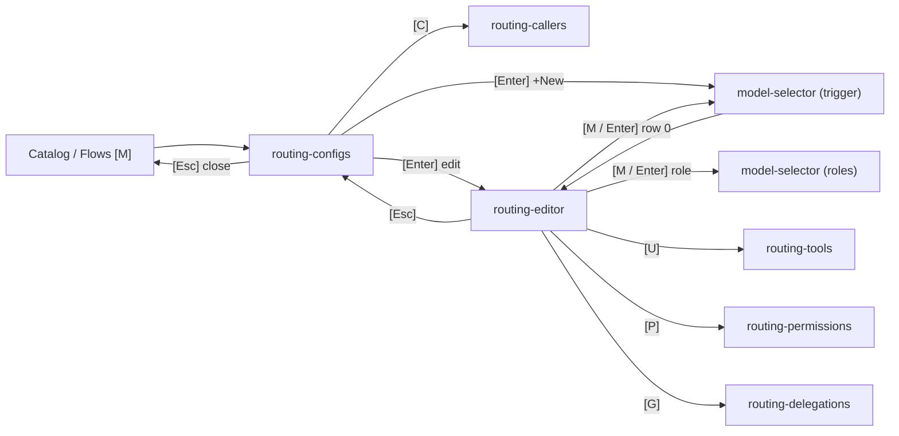

# Flows & Data Sources Workspaces

The `manage-agents` terminal interface is organized into three top-level workspaces under a shared header. `Tab` / `Shift+Tab` cycles between them, the header pills select one directly, and the [Command Palette](./navigation-help-and-markdown.md) (`Ctrl+K` / `Ctrl+P`) also exposes workspace navigation:

1. **[Catalog](./tui-shell-and-catalog.md)** (`workspaceTab === "catalog"`) — Agent tree and 6-tab agent/pack inspector.
2. **Flows & Graph** (`workspaceTab === "flows"`, implemented in `src/ui/FlowsWorkspace.tsx`) — Pack-level [conditional `IF / OR` routing](../concepts/conditional-routing-and-archetypes.md) topology and per-agent inbound/outbound `@subagent` call graphs.
3. **Sources & Target** (`workspaceTab === "sources"`, implemented in `src/ui/SourcesTargetWorkspace.tsx`) — [Local and GitHub repository connection](../modules/sources-and-github.md), `gh` CLI authentication, OpenCode target drift inspection, [target reconciliation](../modules/target-installer.md), and [engine self-updates](../modules/launcher-and-build.md).

`src/App.tsx` owns the shared workspace and pane focus state, data loading, keyboard routing (`useKeyboard`), async mutations, and [overlay modals](./authoring-and-bridge-modals.md) (`routing-*`, `delegation-manager`, `pack-init`, `install-confirm`, `self-update`). A modal overlays the selected workspace; opening or closing the flow editor does not itself change the active workspace or source.

---

## Shared Workspace Shell & Pane Focus

`WorkspaceTopbar` sits above the active workspace and reports the active workspace/source. `App` supplies common responsive list and inspector widths and a shared `activePane` (`"list"` or `"inspector"`) to the Flows and Sources/Target workspaces. When the current layout has no inspector, `effectivePane` falls back to the list. Selecting a pane by mouse or keyboard updates the shared focus state and the corresponding pane border/title.

- **Workspace order**: `Catalog` → `Flows` → `Sources` → `Catalog` with `Tab`; `Shift+Tab` moves in reverse. The header and palette can select workspaces directly. `O` opens Sources from Catalog or Flows. Keyboard navigation applies when a text-input field does not own the keystrokes.
- **Pane focus**: `[` / `Shift+Left` selects the list; `]` / `Shift+Right` selects the inspector when shown. In Flows, arrows navigate the list or inspector items according to the focused pane. In Sources, arrows navigate source rows or scroll installed packs in the target inspector.
- **Startup**: `App` selects Catalog when a local workspace or initial source is supplied; otherwise it starts in Sources so a repository can be connected.

Both split-pane workspaces keep their row list and inspector content separate: Flows pairs pack/agent graph navigation with topology details, while Sources pairs repository discovery with OpenCode target status. The Catalog workspace uses the same responsive shell and pane focus state for its agent tree and inspector.

---

## FlowsWorkspace (`src/ui/FlowsWorkspace.tsx`)

### Purpose

`FlowsWorkspace` renders a split-pane view pairing a flat, keyboard- and mouse-navigable list of packs and agents (`⇄ Packs & Call Graph`) on the left with a live `Topology & IF/OR Rules` inspector on the right. It allows pack authors and users to audit [caller-driven model/policy routing](../concepts/conditional-routing-and-archetypes.md) alongside static `@subagent` delegation edges and broken subagent references at a glance.

### Flat Row Model (`buildFlowsNavRows`)

Rather than requiring manual folder expansion, `buildFlowsNavRows(agents, packFlowsByCategory)` flattens all loaded `AgentInfo` items into a deterministic, lexicographically sorted `FlowsNavData` structure:

```ts
export interface FlowsNavRow {
  kind: "pack" | "agent"
  id: string
  pack: string
  label: string
  agent?: AgentInfo
  flowCount: number
  outboundCount: number
  inboundCount: number
  deadRefCount: number
}

export interface FlowsNavData {
  rows: FlowsNavRow[]
  inboundByAgentName: Map<string, string[]>
  agentByShortName: Map<string, AgentInfo>
}
```

How `buildFlowsNavRows` constructs the graph:
1. **Short-name index (`agentByShortName`)**: Maps each agent's filename without `.md` to its `AgentInfo`.
2. **Reverse call-graph index (`inboundByAgentName`)**: Iterates every agent's `allowedSubagents` list and records which caller short-names invoke each target subagent.
3. **Pack header rows (`kind: "pack"`)**: Emits one row per sorted `agent.category` (`id: "pack:<pack>"`), aggregating `flowCount` from `PackFlowsView.flows.length`, total `outboundCount` across pack agents, and total `deadRefCount` (any entry in `allowedSubagents` absent from `agentByShortName`). Right-hand badge format: `<flowCount> IF/OR · <outboundCount> edges[ · ⚠<deadRefCount>]`.
4. **Agent node rows (`kind: "agent"`)**: Emits one row per sorted agent filename inside the pack (`id: agent.currentPath`), reporting `out:<outboundCount> · in:<inboundCount>[ · ⚠<deadRefCount>]`. Any non-zero `deadRefCount` highlights the row's badge in red (`THEME.accentRed`).

### Props (`FlowsWorkspaceProps`)

| Prop | Type | Required | Description |
|------|------|----------|-------------|
| `agents` | `AgentInfo[]` | yes | All discovered agents in the active workspace or source |
| `navData` | `FlowsNavData` | yes | Precomputed rows and adjacency maps from `buildFlowsNavRows` |
| `packFlowsByCategory` | `Map<string, PackFlowsView \| null>` | yes | Resolved caller and `IF / OR` flow definitions keyed by pack slug |
| `focusedIndex` | `number` | yes | Currently focused index in `navData.rows` |
| `scrollOffset` | `number` | yes | Top visible row index for viewport slicing |
| `listRows` | `number` | yes | Height budget for visible rows (`wsViewports.flowsRows`) |
| `leftWidth` / `rightWidth` / `gutterWidth` | `number` | yes | Split-pane column widths computed from terminal dimensions |
| `showInspector` | `boolean` | yes | Whether terminal width permits rendering the right-hand topology pane |
| `activePane` | `"list" \| "inspector"` | yes | Pane currently receiving keyboard navigation |
| `inspectorFocusIndex` | `number` | yes | Focused flow or subagent row in the topology inspector |
| `focusBorderBlend` | `number` | yes | Animated border interpolation factor (`0..1`) |
| `onSelectPane` / `onFocusInspectorItem` / `onScrollInspectorDelta` | callbacks | yes | Selects the pane, focuses an inspector item, and scrolls the inspector selection |
| `onFocusIndex` | `(index: number) => void` | yes | Updates `flowsFocusIndex` on mouse click |
| `onScrollDelta` | `(delta: number) => void` | yes | Scrolls viewport by `±2` rows on mouse wheel |
| `onOpenPackFlows` | `(pack: string, initialFlowIndex?: number) => void` | yes | Opens `routing-configs` for the pack, optionally focused on a selected flow |
| `onOpenDelegations` | `(agent: AgentInfo) => void` | yes | Opens the [`delegation-manager` modal](./authoring-and-bridge-modals.md) for `agent` |
| `onJumpToCatalogAgent` | `(agentPath: string) => void` | yes | Switches to [Catalog](./tui-shell-and-catalog.md) and focuses `agentPath` |

### Topology Inspector, Filtering & Catalog Jump

When `showInspector` is true, the right-hand `Topology & IF/OR Rules` panel renders two stacked cards for the focused row's pack (`currentRow.pack`):

- **Pack `IF / OR` Card**: Shows active callers and their origin (`Callers (user | manifest | inferred): ...`) plus the flow summaries that fit the card's row budget (`├─ IF <triggers> ──▶ <N> models + <M> policies`), paired with a clickable `[M] Edit Flows` action.
- **Agent Delegation Tree Card**: Resolves `activeAgent` to `currentRow.agent` (or, when a `"pack"` row is focused, the first agent in that pack with outbound subagents, falling back to the first pack agent). Displays:
  - **Inbound callers**: `◀── Called by: @callerA, @callerB`, or `◀── Primary / Entry-point agent` when `inbound.length === 0`.
  - **Outbound `@subagents`**: Up to six branches rendered with `├─▶` / `╰─▶` connectors (`╰─ (leaf agent)` when empty). Valid targets render in cyan as `@<subName> (click)`; unresolved targets render in red as `❌ @<subName> [Dead Ref]`. Clicking `[G] Delegations` opens the interactive `@subagent` checklist (`viewMode === "delegation-manager"`).

**Inspector Navigation, Filtering & Catalog Jumping**:
- `FlowsWorkspace` displays the full sorted call graph across all packs without an inline filter bar. Fuzzy filtering by agent name, category, or model is handled via the global [Command Palette](./navigation-help-and-markdown.md) (`Ctrl+K` / `Ctrl+P`, which indexes every agent as `jump:<currentPath>`) or by pressing `/` in the Catalog tab.
- In the inspector, arrow keys move through the focused pack's flow rows followed by the active agent's outbound subagent rows. `Enter` on a flow opens the editor at that flow; `Enter` on a resolved subagent jumps to it in Catalog. A mouse click first focuses an inspector row; clicking an already focused flow opens it, and clicking an already focused resolved subagent jumps to it.
- Pressing `Enter` (or clicking an already focused row) on an `"agent"` row—or activating a resolved `@subagent` node in the outbound delegation tree—calls `jumpToCatalogAgent(agentPath)` in `src/App.tsx`. This switches `workspaceTab` to `"catalog"`, clears `searchQuery`, expands `targetAgent.category`, focuses the target agent row, and scrolls it into the viewport. Pressing `Enter` on a `"pack"` row opens `openPackFlowsModal(row.pack)`.

### `FlowsWorkspace` Keybindings (`src/App.tsx`)

| Key | Action |
|-----|--------|
| `↑` / `k`, `↓` / `j`, `PageUp` / `PageDown` | Navigate `FlowsNavRow` items |
| `Enter` | In the list, open pack flows on a `"pack"` row or jump to an agent in Catalog; in the inspector, edit the focused flow or jump to a resolved subagent |
| `[` / `]` or `Shift+←` / `Shift+→` | Focus the list / inspector when the inspector is shown |
| `Esc` | Return focus from inspector to list; from the list, return to Catalog |
| `M` | Open Conditional `IF / OR` Flows editor (`routing-configs`) for the focused row's pack |
| `G` | Open `@subagent` Delegation Manager (`delegation-manager`) for the focused agent |
| `E` | Preview & install focused pack into the [OpenCode target](../concepts/pack-lifecycle-and-target-safety.md) (`install-confirm`) |
| `B` / `Shift+B` | Open [Claude Code / OpenAI Codex bridge](../modules/bridges.md) generator pre-scoped to the focused pack |
| `I` | Open [Pack Onboarding wizard](../modules/pack-onboarding-and-doctor.md) (`pack-init`, *[virtual packs]* only; see [Glossary](../glossary.md)) |
| `D` / `N` | Open Pack Doctor / Resource Scaffolder (`pack-doctor`, writable local packs only) |
| `Tab` / `Shift+Tab` | Switch to Sources / Catalog, respectively |
| `O` | Open Sources |

---

## Interactive `IF / OR` Flow & Archetype Routing Editor

Pressing `M` on an unmarked pack folder in [Catalog](./tui-shell-and-catalog.md) or on a row in `FlowsWorkspace` invokes `openPackFlowsModal(pack)` in `src/App.tsx`. `Enter` on a pack row or a focused flow row in the Flows inspector also opens it; the latter passes the flow index so the selected branch is focused. The editor is an overlay above the current workspace, and `Esc` from the configuration list closes it back to that workspace. Any pack or [virtual `.md` folder](../modules/pack-validation-and-virtual-packs.md) with at least one discovered agent (`isConfigurablePack(workspaceRoot, pack)`) can be configured—not only packs with a pre-existing `archetype` block in [`opencode-pack.json`](../api/pack-contract-reference.md).



### Flow List & Caller Selection (`routing-configs` & `routing-callers`)

[`describeConfiguredPackFlows`](../modules/routing-and-user-settings.md) builds a `PackFlowsView` merging pack defaults, global rules, and user overrides into `UnifiedFlowItem[]` (tagged with `origin: "pack" | "global" | "user"`):

- **Caller Configuration (`[C]` -> `routing-callers`)**: Selects which agents act as `OR` callers for the pack (`routingView.callerCandidates`). `Space` toggles `[X]` / `[ ]`, `Enter` persists the caller list via `saveUserPackCallers` to [`routing.json`](../config/user-and-target-files.md) and reconciles the OpenCode target, and `R` resets callers back to manifest or inferred defaults.
- **Creating or Deleting Flows**: Selecting `+ New conditional flow (IF / OR)` opens the model picker in multi-trigger mode (`routingPick = { kind: "trigger" }`). Focusing an existing flow and pressing `D` / `Delete` twice (`routingConfirmDelete`) deletes the flow from `routing.json` and reconciles the target.

### Editing Triggers, Role Models & Variants (`routing-editor` & `model-selector`)

Inside `routing-editor`, rows represent the trigger condition, each routable subagent role (`routingView.related`), and the three runtime policy overrides:

1. **Triggers (`OR` matching)**: Focusing row 0 and pressing `Enter` or `M` opens `model-selector` with `routingPick = { kind: "trigger" }`. Users type to filter providers/models (`modelFilter`), press `Space` (when filter is empty) or `Tab` to toggle multiple triggers in `OR`, and press `Enter` to confirm:
   - `*` (`WILDCARD_TRIGGER`) — matches any provider or model.
   - `<provider>` (e.g., `anthropic`) — matches any model under that provider.
   - `<provider>/<model>` — matches a specific model. Runtime precedence evaluates exact model matches before provider matches, and provider matches before `*`.
2. **Subagent Target Models (`inherit` vs. Concrete Model)**:
   - Subagents with a fixed frontmatter model (`routingView.pinned`) are listed in a read-only notice at the top of the modal and skipped by model routing.
   - Routable subagents (`routingView.related`) can be toggled individually with `Space` or all at once with `A` for batch assignment.
   - Pressing `M` or `Enter` opens `model-selector` (`routingPick = { kind: "roles", roles }`), offering `↺ inherit` (`INHERIT`, reusing the caller's active model) alongside every verified `provider/model` in `ModelCatalog`.
   - Pressing `Tab` or `←` / `→` on roles with a concrete model cycles model-specific variants (`#variant` from `getModelVariants` or `AGENT_EFFORT_VARIANTS`). Pressing `Backspace` / `Delete` resets targeted roles back to `inherit`.

### Conditional Runtime Policies (`then.tools`, `then.permissions`, `then.delegations`)

From `routing-editor`, three dedicated sub-modals configure [runtime V2 router](../modules/runtime-router-plugin.md) overrides when the flow's caller and `OR` triggers match:

- **`[U]` Tools & MCP (`routing-tools` -> `then.tools`)**: Lists `* (All tools fallback)` followed by `routingView.availableTools` (built-in tools, tool families, custom pack tools, and MCP servers). `Space` or `←` / `→` cycles `unchanged` (`undefined`) → `deny` → `ask` → `allow`; `Backspace` / `Delete` clears back to `unchanged`. Denied tools are stripped from prompt context and blocked at execution time.
- **`[P]` Permissions (`routing-permissions` -> `then.permissions`)**: Configures overrides for `*`, `shell`, `edit`, `read`, `webfetch`, `skill`, and `external_directory`, cycling `unchanged` → `deny` → `ask` → `allow`.
- **`[G]` Subagent Delegations (`routing-delegations` -> `then.delegations`)**: Configures `* (All subagents fallback)` and each pack subagent in `routingView.subagents`, cycling `unchanged` → `deny` → `allow`.

### Static-Denial Warnings

OpenCode V2 enforces [static `"deny"` rules](../concepts/conditional-routing-and-archetypes.md) in an agent's own frontmatter above dynamic runtime `"allow"` overrides. Whenever `routingDraft` sets `"allow"` on a tool, permission, or subagent that is statically denied on a caller (`routingView.staticDeniedTools` or `routingView.staticDeniedDelegations`, including `"*"`), the editor displays an inline `⚠ static deny on caller` marker and a top-level warning banner advising the author to relax the caller's base frontmatter permission to `allow` or `ask`.

### User-Scope Persistence vs. `[W]` Manifest Export

```ts
const exportRoutingToManifest = () => {
  if (!routingView || isReadOnlyGitSource) return
  const manifestFile = path.join(routingView.dir, "opencode-pack.json")
  const tx = mutate([manifestFile], "routing", () => exportFlowsToPackManifest(workspaceRoot, routingView))
  setRoutingRevision(revision => revision + 1)
  // ...
}
```

- **User-Scope Default (`routing.json`)**: Every change in `routing-callers`, `routing-editor`, `routing-tools`, `routing-permissions`, and `routing-delegations` saves immediately via `applyRoutingDraft` → `saveUserPackFlow` into user settings (`~/.config/manage-agents/routing.json`) and triggers [`reconcileTargetIfInstalled("models")`](../modules/target-installer.md) so installed OpenCode targets update automatically. Read-only Git sources write exclusively to user settings.
- **Pack Manifest Export (`[W]`)**: On writable local workspaces where `routingView.hasManifest` is true, pressing `W` in `routing-configs` runs `exportFlowsToPackManifest` inside [`repositoryTransaction`](../modules/agent-editing-and-v2-compat.md) (`mutate`), writing callers, `routingDefaults`, and conditional rules back into the pack's `opencode-pack.json`. If the local folder is a virtual pack (`!routingView.hasManifest`), `[I]` opens [Pack Onboarding](../modules/pack-onboarding-and-doctor.md) instead to initialize `opencode-pack.json` first.

### Active Source & Target Integration

The modal loads its pack definition from the active workspace root, including the currently activated local or Git source. It does not switch to Sources while editing. For a read-only Git source, `App` enables source overrides: flow and caller edits remain in user `routing.json`, and the manifest export / pack-init actions are hidden. For a writable local pack, `[W]` exports to its manifest when one exists, while `[I]` offers onboarding for a virtual pack. Saving user-scope changes requests a target reconcile, reported in the modal status; after closing it, Sources provides the target drift/status view and explicit `[R]` reconcile or `[Ctrl+R]` refresh actions.

---

## SourcesTargetWorkspace (`src/ui/SourcesTargetWorkspace.tsx`)

### Purpose

`SourcesTargetWorkspace` manages [external and local pack repositories](../modules/sources-and-github.md) alongside the active [OpenCode target installation](../concepts/pack-lifecycle-and-target-safety.md). When `manage-agents` launches without a local pack workspace or initial active source, `App` defaults `workspaceTab` directly to `"sources"`.

### Row Model (`SourceWorkspaceRow`) & Props

`App.tsx` computes `sourceModalRows` and passes them to `SourcesTargetWorkspace`:

```ts
export type SourceWorkspaceRow =
  | { id: string; kind: "connect-input"; spec: string }
  | { id: string; kind: "registered"; source: Source; revision: string | null; isActive: boolean }
  | { id: string; kind: "gh-repo"; repo: GhRepoSummary }
```

| Prop | Type | Required | Description |
|------|------|----------|-------------|
| `rows` | `SourceWorkspaceRow[]` | yes | Filtered `registered`, `gh-repo`, and `connect-input` rows |
| `focusedIndex` / `scrollOffset` / `listRows` | `number` | yes | List focus, scroll offset, and viewport row count (`wsViewports.sourcesRows`) |
| `query` | `string` | yes | Current filter / repository spec string (`sourcesQuery`) |
| `inputFocused` | `boolean` | yes | Whether keystrokes feed the filter/connect input box |
| `ghAuth` | `GhAuthStatus \| null` | yes | Live `gh` CLI authentication status (`null` while probing) |
| `busySpinner` | `string` | yes | Animated pulse frame displayed during async operations |
| `sourcesStatus` | `string \| null` | yes | Inline status or error banner below the input box |
| `targetStatusInfo` | `TargetStatus \| null` | yes | Read-only health, lock, and drift report for the OpenCode target |
| `leftWidth` / `rightWidth` / `gutterWidth` / `showInspector` | `number` / `boolean` | yes | Responsive split-pane layout measurements |
| `activePane` | `"list" \| "inspector"` | yes | Shared pane focus |
| `inspectorScrollOffset` / `termHeight` | `number` | yes | Target-list scroll position and height used to budget installed-pack rows |
| `focusBorderBlend` | `number` | yes | Animated left-pane border highlight (`0..1`) |
| `onSelectPane` / `onScrollInspectorDelta` | callbacks | yes | Focuses a pane and scrolls the installed-pack list in the inspector |
| `onFocusIndex` / `onActivateRow` / `onScrollDelta` | callbacks | yes | Row focus, row activation (`Enter` / double-click), and mouse scroll handlers |
| `onToggleInputFocus` | `(focused: boolean) => void` | yes | Focuses/blurs the search & connect input bar |
| `onPullSelected` | `() => void` | yes | Pulls focused/active Git source or refreshes repo discovery |
| `onGhLogin` | `() => void` | yes | Suspends TUI and runs interactive `gh` web login |
| `onReconcileTarget` / `onRefreshTarget` | `() => void` | yes | Reconciles OpenCode target (`[R]`) or reloads status (`[Ctrl+R]`) |
| `engineVersionLabel` | `string` | no | Current `manage-agents` engine version string |
| `onOpenSelfUpdate` | `() => void` | no | Opens the `self-update` modal (`[Shift+U]`) |

### Connecting Sources (`connect-input`) & Live `gh` Discovery

1. **Filter & Connect Input (`/` or `A`)**: Pressing `/` or `A` (or clicking the rounded input box) sets `sourcesInputFocused = true`. Typing updates `sourcesQuery`, filtering `registered` sources (by name or path/URL) and `gh-repo` entries (by `owner/repo` or description) while appending a `➕ Connect & activate "<spec>"` (`kind: "connect-input"`) row.
2. **Supported Source Specs (`attachNewSourceSpec`)**: Activating `connect-input` resolves:
   - **Local directories** (absolute or relative paths, resolved via `fs.realpathSync`).
   - **Git URLs** (`https://...`, `ssh://...`, `git@host:path`, with optional `#<ref>` suffix; [URLs containing embedded credentials or query tokens are rejected](../concepts/security-and-trust-model.md)).
   - **GitHub shorthands** (`owner/repo[#ref]`, `github:owner/repo[#ref]`, `gh:owner/repo[#ref]`).
   If not already registered in [`~/.config/manage-agents/sources.json`](../config/user-and-target-files.md), `addSource` registers it under a unique slug (`deriveSourceName`), sets `registry.active`, clones Git repositories into `~/.cache/manage-agents/sources/<name>` via `pullSource`, and calls `switchToDataSource` to load its agents into [Catalog](./tui-shell-and-catalog.md).
3. **GitHub CLI Discovery & Interactive Web Login (`[G]` / `Ctrl+G`)**:
   - `refreshSourcesView` probes `inspectGhAuthAsync()` asynchronously. When authenticated, `listGhReposAsync({ limit: 100 })` populates personal and organization repositories (tagged `🔒 private` or `🌐 public`), automatically hiding repositories whose URL is already registered.
   - Pressing `G` (when input is unfocused), `Ctrl+G`, or clicking `[G] Auth` invokes `runInteractiveGhLogin()`, which suspends the [OpenTUI renderer](../dependencies/runtime-and-tooling-stack.md) (`renderer.suspend()`), executes `runGhWebLogin("github.com")`, resumes rendering in a `finally` block, and reloads `gh` repositories.

### Managing Active Source, `trusted`, `prefer`, Pulling & Pack Onboarding

- **Switching Active Source (`[Enter]`)**: Pressing `Enter` (or double-clicking) on a `registered` row calls `activateRegisteredSource`, pulling the cache first if `.git` is missing, persisting `registry.active = source.name` in `sources.json`, and switching to Catalog. Pressing `Enter` on a `gh-repo` row attaches `github:<nameWithOwner>` and activates it immediately.
- **Toggling Trust (`[T]`) & Source Preferences (`prefer`)**:
  - Pressing `T` on a `registered` row (`toggleFocusedSourceTrust`) flips `source.trusted` in `sources.json` (displayed as `· trusted` in the row badge). Trusted sources bypass untrusted-executable confirmation prompts when installing packs with plugins or custom tools, though changes to a pack's executable hash still require confirmation.
  - Sources created by the workspace begin untrusted; trust is an explicit setting persisted in the source registry.
  - `SourceRegistry.prefer` (`pack -> source` in `sources.json`, configured via [`manage-agents source prefer <pack> <source> [--clear]`](../api/cli-reference.md)) disambiguates multi-source pack names during [target resolution](../modules/resolver-and-lock.md) (`targetStatus`, `reconcile`, `update`). `saveSources` preserves `prefer` sorted on disk, `removeSource` (`[X]`) automatically prunes any `prefer` entries pointing to a deleted source, and TUI installs via `[E]` explicitly qualify requests as `<sourceName>/<pack>` (`installRequest`).
- **Pulling Git Updates (`[P]`)**: Calls `pullSelectedOrActiveSource()`. For a focused (or active) Git source, `pullSource` runs `git fetch --force --tags --prune` (injecting `!gh auth git-credential` automatically when `gh` is authenticated for the HTTPS host) and checks out the configured `ref` or remote `HEAD` detached, refreshing `activeRevision` and reloading agents. On local rows, `[P]` refreshes registered sources and the `gh` repository list.
- **Removing Sources (`[X]` / `Delete` / `Backspace`)**: Calls `removeFocusedSource()`, deleting the entry from `sources.json` and falling back to the next registered source (or clearing `activeDataSource` if none remain).
- **Virtual Pack Onboarding (`[I]` & Proactive Wizard)**: Whenever `switchToDataSource` activates a local folder or Git repository containing agent `.md` files without an `opencode-pack.json` manifest ([`isVirtualPackRoot(root)`](../modules/pack-validation-and-virtual-packs.md)), `App.tsx` automatically opens [`PackOnboardingModal`](./authoring-and-bridge-modals.md) (`viewMode === "pack-init"`) once per root per session—or on demand when pressing `I`. Onboarding a read-only Git source clones it into a writable local working tree (`cloneGitSourceForOnboarding`), generates a [Contract 1.1 `opencode-pack.json`](../api/pack-contract-reference.md), registers the new local source, and switches the TUI to it.

### Source & Target Workspace Interactions

| Key / Gesture | Focus / Scope | Action |
|---------------|---------------|--------|
| `/` or `A` | Sources list | Focus the filter/connect field; typing filters rows and offers a connect action for the entered spec |
| `Enter` | Source list / connect row | Activate a registered source, attach a discovered GitHub repository, or connect the entered spec |
| `Enter` | Target inspector | Reconcile the OpenCode target |
| `T` / `X`, `Delete`, `Backspace` | Registered source row | Toggle trust / remove the source |
| `P` | Sources | Pull the focused Git source (or active Git source); otherwise refresh sources and GitHub discovery |
| `G` / `Ctrl+G` | Sources | Run interactive GitHub CLI web login |
| `R` / `Ctrl+R` | Sources | Reconcile target / refresh source, GitHub, and target status |
| `[` / `]` or `Shift+←` / `Shift+→` | Sources pane | Focus the source list / target inspector when shown |

The target inspector's installed-pack list also scrolls with the inspector pane's arrow or page keys and mouse wheel. With the connect input unfocused, `Tab` / `Shift+Tab` from Sources switches to Catalog / Flows; opening Sources from another workspace refreshes its source and target information. While the input is focused, printable keys edit the query and `Enter` acts on the focused row.

---

## Target Status, Drift Inspection & Engine Update Actions

### Target Health & Drift Inspection (`🎯 OpenCode Target Status`)

The right-hand inspector of `SourcesTargetWorkspace` renders `TargetStatus` produced by [`targetStatus(target, registry)`](../modules/target-installer.md) for `defaultTarget()` (`~/.config/opencode` by default):

- **Sync Banner & Target Metadata**: Shows `● Target In Sync` (green) when `drift.length === 0`, or `⚠ <N> Drift Notices` (amber with `THEME.borderWarn` panel border) alongside total locked pack count, resolved target directory (`Dir: ...`), and engine version (`Engine: <displayVersion>`).
- **Installed Packs (`desired` vs. `lock`)**: Lists as many entries from `targetStatusInfo.lock.packs` as fit the inspector's height budget; the list scrolls when additional packs exist. Pack names requested directly in [`.manage-agents/desired.json`](../config/user-and-target-files.md) (`desired.roots`, parsed via `parsePackRequest`) highlight in cyan; [transitive `requires` dependencies](../modules/resolver-and-lock.md) append `(dep)` alongside `<version> · <source>[@<rev7>]`.
- **Drift Detection**: Cross-checks `desired.json`, `lock.json`, and `installed.json` against on-disk hashes and Git caches, displaying up to four actionable notices in the `Drift / Pending Updates` box:
  - [Pending interrupted transactions](../concepts/pack-lifecycle-and-target-safety.md) (`.manage-agents/journal.json` exists, rolled back automatically on the next target operation).
  - Checked-out or fetched Git source revisions diverging from `lock.packs[name].revision` (prompting [`manage-agents update <name>`](../api/cli-reference.md), mirrored by `↑ update` badges on [Catalog](./tui-shell-and-catalog.md) folders).
  - Managed target files deleted or modified locally (`currentHash !== owned.hash`).
  - Pending `planReconcile` writes, deletes, conflicts, or `opencode.json` updates (such as newly saved user overrides or [`routing.json` flows](../modules/routing-and-user-settings.md)).
  - Desired root packs recorded with no `lock.json` present.

### One-Key `Install`, `Reconcile` & `Update` Workflows

| Key / Trigger | Scope | Operation |
|---------------|-------|-----------|
| `[E]` (`previewInstall` -> `applyInstall`) | Catalog / Flows | Runs dry-run `installChange(registry, ["<source>/<pack>"])`, displays unified diff + [executable-surface confirmations](../concepts/security-and-trust-model.md) in `install-confirm`, and atomically applies if `serializeLock` matches the preview. |
| `[R]` (`runTargetReconcile`) | Sources / Palette | Runs `changeTarget(target, "reconcile", registry, reconcileChange)` to materialize locked packs, user frontmatter overrides, `routing.json` rules, and the [V2 router plugin](../modules/runtime-router-plugin.md) into `<target>`. |
| `[P]` (`pullSelectedOrActiveSource`) | Sources / Palette | Pulls upstream Git commits into the source cache; updated revisions surface `↑ update` badges and target drift notices ready to apply via `[E]` or `manage-agents update`. |
| `[Ctrl+R]` (`onRefreshTarget`) | Sources | Re-evaluates `targetStatus`, `sources.json`, and `gh` repositories without modifying `<target>`. |

### Engine Self-Update (`[Shift+U]` / `viewMode === "self-update"`)

Pressing `Shift+U` in any main workspace, clicking `[Shift+U] Update` inside the Target Status panel, or running `Check / Apply manage-agents Engine Release Update` from the [Command Palette](./navigation-help-and-markdown.md) opens the Engine Update modal (`openSelfUpdateModal()`):

1. **Release Check (`runSelfUpdateCheck`)**: Resolves the running bundle via [`resolveEngineVersion()`](../modules/launcher-and-build.md) (display version, channel, clean/dirty git state) and calls `checkForEngineUpdate` against GitHub Releases, reporting the latest tag, commit SHA, archive size, and [cryptographic verification mode](../config/translation-and-release-config.md) (`Signed Ed25519` or `Verified SHA-256`), plus whether updating also reconciles the OpenCode target's router plugin (`targetReconcileNeeded`).
2. **Applying Updates (`runSelfUpdateApply`)**:
   - `[Y]` or `[Enter]`: Enabled when `updateAvailable && !localGitDirty`; runs `applyEngineUpdate` (`force: false`), synchronizes dependencies if changed, reconciles the OpenCode target when needed, refreshes `targetStatusInfo`, and displays an `action-result` summary advising a session restart.
   - `[F]`: Force-applies (`force: true`) when `localGitDirty` is true (uncommitted changes in the engine checkout) or when `selfUpdateCheck.downgrade` indicates the local build is newer than the latest release.
   - `[R]`: Re-runs `runSelfUpdateCheck()`.
   - `[Esc]` / `[N]`: Closes the modal whenever `selfUpdateBusy` is false.

---

## Related Pages

- [TUI Shell, Catalog Tree & Inspector](./tui-shell-and-catalog.md)
- [Authoring, Tuning & Bridge Modals](./authoring-and-bridge-modals.md)
- [Command Palette, Help & Markdown View](./navigation-help-and-markdown.md)
- [Conditional Routing & Archetypes](../concepts/conditional-routing-and-archetypes.md)
- [Archetypes, Conditional Flows & User Settings](../modules/routing-and-user-settings.md)
- [Sources & GitHub Integration](../modules/sources-and-github.md)
- [Transactional Target Installer](../modules/target-installer.md)
- [Pack Lifecycle & Target Safety](../concepts/pack-lifecycle-and-target-safety.md)
- [Launcher, Build & Self-Update](../modules/launcher-and-build.md)
