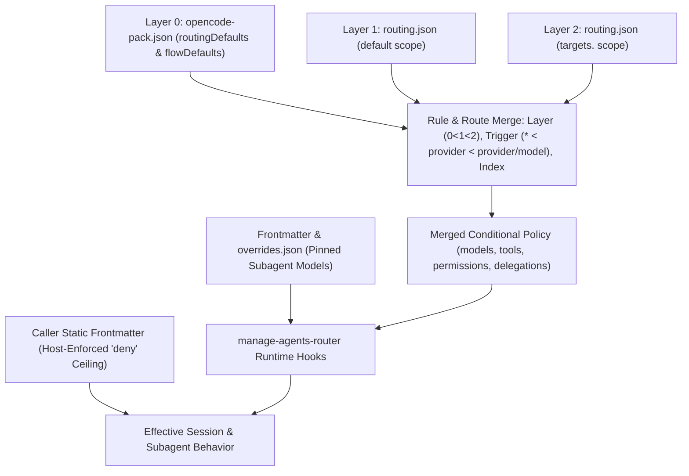

# Conditional Routing & Archetypes

Multi-agent [OpenCode packs](../overview.md) coordinate primary entry-point agents with specialized subagents (explorers, planners, reviewers, testers). Conditional routing and *[archetypes]* (see [Glossary](../glossary.md)) allow a single vendor-neutral pack to adapt subagent models, tool visibility, permission prompts, and allowed delegations dynamically at runtime based on the active model of the primary caller.

## Why Archetype & Conditional Routing Exists

Without runtime routing, supporting multiple LLM providers (Anthropic, OpenAI, Google, Mistral, or local models) forces pack authors either to hardcode model identifiers in every subagent's frontmatter or to duplicate entire multi-agent packs per vendor. Different model families also have different tool-calling reliability and safety profiles—a pack may want full shell or browser tool access on a frontier reasoning model while restricting or prompting for those capabilities on smaller models.

`manage-agents` decouples pack structure from vendor-specific model choices:

1. Pack authors may declare `archetype.callers` and a reference caller in [`opencode-pack.json`](../api/pack-contract-reference.md); manifest `routingDefaults` and contract `1.1+` `flowDefaults` are optional, but require an `archetype`.
2. Users layer global or per-target customizations in [`$XDG_CONFIG_HOME/manage-agents/routing.json`](../config/user-and-target-files.md) without modifying pack files (keeping [read-only git sources](../modules/sources-and-github.md) clean).
3. During [`reconcile`](./pack-lifecycle-and-target-safety.md), `buildRuntimeRouting` ([`src/utils/userSettings.ts`](../modules/routing-and-user-settings.md)) compiles effective rules into `<target>/plugins/manage-agents-router/routing.json` and installs the [`manage-agents-router` V2 plugin](../modules/runtime-router-plugin.md) to enforce them per session.

The TUI flow editor is broader than manifest archetypes: it can configure any workspace pack or virtual `.md` folder with discovered agents. Those edits first live in user routing settings; exporting to a local manifest is a separate action.

## Callers, Subagents, `"inherit"`, and Pinning

### Explicit vs. Inferred Callers

Every routed pack partitions its discovered agents into **callers** (primary session owners whose active model triggers routing) and **subagents** (delegated specialists).

`resolveEffectiveCallers` ([`src/utils/userSettings.ts`](../modules/routing-and-user-settings.md)) resolves callers in priority order, filtering out any agent whose frontmatter sets `mode: "subagent"`:

1. Per-target user override: `targets.<realpath>.<pack>.$callers` in [`routing.json`](../config/user-and-target-files.md)
2. Global user override: `default.<pack>.$callers` in `routing.json`
3. Pack manifest declaration: `archetype.callers` in [`opencode-pack.json`](../api/pack-contract-reference.md)

```json
{
  "contract": "1.1",
  "name": "flow",
  "version": "2.0.0",
  "description": "Build and plan workflow with specialized subagents",
  "archetype": {
    "callers": ["flow-build", "flow-plan"],
    "reference": "flow-build"
  }
}
```

When a pack omits `archetype` in `opencode-pack.json` (or is a [virtual `.md` directory](../modules/pack-validation-and-virtual-packs.md) in a workspace) and conditional rules or user routes are configured, `inferPackCallers` (`src/utils/userSettings.ts`) infers callers automatically:

1. Agents explicitly marked `mode: "primary"`.
2. Otherwise, any agent where `mode !== "subagent"`.
3. By default, inference requires at least one remaining subagent in the pack; if session-level rules (`then.tools` or `then.permissions`) exist, a single primary caller without subagents is also permitted (`allowSingleCallerWithoutSubagents`).

Each caller set designates one `reference` caller (`$reference` or `archetype.reference`, defaulting to the first caller), which `describePackFlows` (`src/utils/archetypes.ts`) orders first and uses to discover available tools and MCP servers. Every agent in the pack that is neither an active caller nor `mode: "primary"` is treated as a subagent.

The TUI's generic flow view (`describePackFlows`) also supports packs without `archetype` and virtual `.md` folders. It selects callers from the per-target or global user setting, then manifest callers, then inferred callers. For this view, inference chooses all `mode: "primary"` agents if any exist; otherwise all agents not marked `mode: "subagent"`; if that set is empty it falls back to the first discovered agent. The caller picker normally excludes `mode: "subagent"` agents, but offers all discovered agents if there are no other candidates. Its source badge identifies `user`, `manifest`, or `inferred` callers. The view selects the reference from the user `$reference`, manifest reference, or first selected caller (in that order), and displays it first. This UI fallback is distinct from runtime `inferPackCallers`, which can leave the caller set empty when it finds no usable primary/subagent combination.

### Editing Callers and Flows

Press `M` on an agent-bearing pack/category folder to open the flow editor; a manifest `archetype` is not required. The editor combines manifest routes with global and per-target user routes into one row per trigger, while conditional rules remain separate rows tagged `PACK`, `GLOBAL`, or `USER`. It can edit caller sets, OR-combined triggers, subagent models, tools/MCP policies, permissions, and delegations.

TUI edits are written to the current target's `routing.json` scope and reconcile the installed target automatically. Caller edits save `$callers` and `$reference`; resetting removes that user override and returns to the next lower-precedence global, manifest, or inferred defaults. Editing a pack- or global-origin rule creates a target-level user override rather than changing the lower layer. The delete action removes target user rules/routes; when a route also exists in the manifest or global settings, it neutralizes those inherited assignments with `inherit`. Pack rules must be changed in the manifest and global rules unset with `manage-agents models rule-unset --global`. Read-only Git sources use the same user-settings path and do not modify the source.

A single non-wildcard trigger with only model assignments and at least one routable subagent is stored as a route map. Wildcard or multi-trigger flows, policy effects, and policy-only cases are stored as conditional rules. On a local pack with a manifest, **Export to pack** writes the current caller selection and flow view—including visible global and user entries—back to `opencode-pack.json`: plain routes become `routingDefaults`, conditional rules become `flowDefaults`, and contract `1.0` is raised to `1.1` when needed. Export validates the manifest and does not clear `routing.json`. For a folder without a manifest, the TUI offers pack initialization instead; read-only Git sources do not offer manifest export.

### `"inherit"` vs. Explicit Model References

Model assignments map a subagent ID to either an OpenCode V2 model string (`"provider/model"` or `"provider/model#variant"`) or `"inherit"`:

```json
{
  "routingDefaults": {
    "mistral": {
      "flow-explore": "mistral/deepseek-v4-1-flash-1017#high",
      "flow-review": "inherit"
    }
  }
}
```

At runtime, `decideSubagentModel` ([`runtime/plugins/manage-agents-router/router.js`](../modules/runtime-router-plugin.md)) evaluates subagent tool invocations (`subagent` or `task`):

- If the caller explicitly passed a `model` argument in the tool input (`requestedModel`), routing leaves the call untouched.
- If the resolved target is `"inherit"` (which fails `isModelRef`) or matches the caller's own `parsedModel.full`, `decideSubagentModel` returns `null` so OpenCode natively reuses the caller's active model.
- Otherwise, the router injects `{ model }` into `event.input.model` before execution.

### Subagent Pinning and `overrides.json`

A subagent whose effective frontmatter defines a string `model` field is **pinned**. `buildRuntimeRouting` records these agent IDs in the `pinned` array of `routing.json`, and `decideSubagentModel` skips any subagent in `policy.archetype.pinned`.

User model routing and frontmatter overrides interact cleanly without mutating pack sources:

| Operation | Storage File | Effect on Installed Agent & Routing |
|-----------|--------------|-------------------------------------|
| [`models set` / `models rule-set`](../api/cli-reference.md) | `routing.json` | Updates dynamic routing tables/rules; never writes agent frontmatter. |
| Pack author sets `model` in `agents/<id>.md` | Pack frontmatter | Subagent is pinned by default and skipped by routing. |
| `models pin <pack>/<agent> <provider/model>` | `overrides.json` | Patches `{ model: "<provider/model>" }` into installed frontmatter at [`reconcile`](../modules/target-installer.md); subagent becomes pinned. |
| `models unpin <pack>/<agent>` | `overrides.json` | Patches `{ model: null }` via [`patchFrontmatter`](../modules/agent-editing-and-v2-compat.md), deleting `model` from installed frontmatter so even a pack-pinned subagent follows dynamic routing. |

## Three-Layer Precedence & Trigger Specificity

### Configuration Layers

During [`reconcile`](./pack-lifecycle-and-target-safety.md), [`buildRuntimeRouting`](../modules/routing-and-user-settings.md) compiles settings from three ordered layers:

| Layer | Source | Scope | Supported Structures |
|-------|--------|-------|----------------------|
| `0` | [`<pack>/opencode-pack.json`](../api/pack-contract-reference.md) | Pack defaults | `routingDefaults` (`provider` or `provider/model`) and `flowDefaults` (`1.1+` conditional rules) |
| `1` | [`$XDG_CONFIG_HOME/manage-agents/routing.json`](../config/user-and-target-files.md) | `default.<pack>` (all targets) | Trigger maps (`*`, `provider`, `provider/model`), `$callers`, `$reference`, `$rules` |
| `2` | `$XDG_CONFIG_HOME/manage-agents/routing.json` | `targets.<realpath>.<pack>` | Trigger maps (`*`, `provider`, `provider/model`), `$callers`, `$reference`, `$rules` |

Plain trigger maps (`routes`) merge subagent assignments field-by-field from Layer `0` through Layer `2`. When any compiled conditional rule defines `then.models`, `buildRuntimeRouting` also mirrors Layer `1` and Layer `2` plain trigger maps into `compiledRules` at `layer: 1` and `layer: 2`. This guarantees that a user's plain [`models set`](../api/cli-reference.md) configuration in Layer `1` or `2` always overrides a lower-layer `flowDefaults` rule from Layer `0`.

The flow editor reflects this distinction: routes are consolidated by trigger, while `flowDefaults`, global `$rules`, and target `$rules` remain individually visible. Editing a route or rule writes a user-layer setting; the source manifest changes only through **Export to pack**.

### Trigger Specificity & Tie-Breaking

`modelOf` ([`runtime/plugins/manage-agents-router/router.js`](../modules/runtime-router-plugin.md)) normalizes the caller's active model into `{ provider, model, full }` (stripping any `#variant` suffix when matching `provider/model`). `matchTriggerSpecificity` scores a rule's `triggers` list against the parsed caller model:

- **`2` (Exact model)**: `triggers` includes `"${provider}/${model}"` (for example, `"openai/gpt-5.4"`).
- **`1` (Provider)**: `triggers` includes `"${provider}"` (for example, `"openai"`).
- **`0` (Wildcard)**: `triggers` includes `"*"` (accepted in `flowDefaults` and `routing.json`, not in manifest `routingDefaults`).
- **`-1` (No match)**: none of the triggers match; the rule is skipped.

In `resolveEffectivePolicy`, base `routes` are applied first (`*` → `provider` → `provider/model`), and matching `rules` are then sorted and applied in ascending order so later rules overwrite earlier keys:

```javascript
const matchedRules = (archetype.rules ?? [])
  .map((rule, index) => {
    const ruleCallers = rule.callers ?? archetype.callers
    if (!ruleCallers.includes(callerAgent)) return null
    const specificity = matchTriggerSpecificity(rule.triggers, parsedModel)
    if (specificity < 0) return null
    return { rule, layer: rule.layer ?? 0, specificity, index }
  })
  .filter(Boolean)
  .sort((a, b) => a.layer - b.layer || a.specificity - b.specificity || a.index - b.index)
```

Precedence therefore resolves strictly by:

1. **Layer (`0 < 1 < 2`)**: A higher configuration layer always wins over a lower layer, even if the higher-layer rule uses a broader trigger like `"*"` and the lower-layer rule uses `"provider/model"`.
2. **Trigger specificity (`0 < 1 < 2`)**: Within the same layer, `"provider/model"` overrides `"provider"`, which overrides `"*"`.
3. **Declaration order (`index`)**: Within the same layer and trigger specificity, rules declared later in the array override earlier rules key-by-key.

## Conditional `IF / OR` Policies

[Contract `1.1`](../api/pack-contract-reference.md) (`flowDefaults` in `opencode-pack.json`) and `$rules` in [`routing.json`](../config/user-and-target-files.md) express multi-trigger `IF / OR` policies validated by `validateConditionalRule` (`src/utils/values.ts`) and `validateRule` ([`runtime/plugins/manage-agents-router/router.js`](../modules/runtime-router-plugin.md)):

```json
{
  "callers": ["flow-build", "flow-plan"],
  "triggers": ["mistral", "openai/gpt-5.4"],
  "then": {
    "models": {
      "flow-explore": "inherit"
    },
    "tools": {
      "chrome-devtools_*": "deny",
      "webfetch": "ask"
    },
    "permissions": {
      "bash": "ask"
    },
    "delegations": {
      "*": "deny",
      "flow-explore": "allow"
    }
  }
}
```

### Condition Matching (`IF / OR`)

- **`callers` (`OR` list, optional)**: Non-empty list of non-subagent agent IDs. If omitted, the rule applies to all effective `archetype.callers` of the pack. The condition holds if the active session agent matches **any** listed caller.
- **`triggers` (`OR` list, required)**: Non-empty list of `"*"`, `"provider"`, or `"provider/model"`. The condition holds if the caller's active model matches **any** trigger; when multiple triggers in the same rule match, `matchTriggerSpecificity` assigns the highest matching score (`2 > 1 > 0`).

### Policy Domains (`then`)

Every rule must specify at least one of four policy maps, merged key-by-key across matching rules:

| Policy Map | Allowed Keys | Allowed Effects | Runtime Hook Enforcement |
|------------|--------------|-----------------|--------------------------|
| `then.models` | Routable subagent IDs | `"inherit"` or `"provider/model[#variant]"` | `tool.hook("execute.before")` rewrites `event.input.model` on unpinned `subagent` / `task` calls. |
| `then.tools` | Exact tool ID, `<prefix>*`, or `"*"` | `"allow"`, `"ask"`, `"deny"` | `session.hook("context")` deletes `"deny"` tools from `event.tools`; `permission.hook("evaluate")` applies `"allow"`/`"ask"`/`"deny"`; `tool.hook("execute.before")` blocks `"deny"` calls. |
| `then.permissions` | Action name, `<prefix>*`, or `"*"` | `"allow"`, `"ask"`, `"deny"` | `permission.hook("evaluate")` sets `event.effect` (checked before `then.tools`); `bash` and `shell` alias each other, and `edit: "deny"` also blocks `write` tool execution. |
| `then.delegations` | Pack subagent ID or `"*"` | `"allow"`, `"deny"` | `tool.hook("execute.before")` blocks denied `subagent` / `task` targets; if `"*"` is `"deny"` with no `"allow"` entry, `session.hook("context")` strips `subagent` and `task` tools completely. |

When evaluating a concrete tool, permission action, or subagent name against a merged policy map, `matchPolicyMap` (`runtime/plugins/manage-agents-router/router.js`) resolves keys in strict specificity order:

1. **Exact key match** (e.g., `"chrome-devtools_click"`).
2. **Longest `<prefix>*` match** (e.g., `"chrome-devtools_*"` beats `"chrome-*"`).
3. **Global wildcard `"*"`**.

Internal hidden OpenCode agents (`title`, `summary`, `compaction`) are ignored when recording session models so background summarization never overwrites the primary caller's active model in router state. Setting `OPENCODE_AGENT_ROUTER=off` disables the router plugin at runtime.

## Static Frontmatter vs. Runtime Narrowing in OpenCode V2

A critical architectural boundary governs how static agent frontmatter interacts with dynamic flows in OpenCode V2:

- Static `deny` rules in a caller's [Markdown frontmatter](../modules/agent-editing-and-v2-compat.md) (`permissions` V2 rule arrays or maps, as well as legacy `permission` maps) are enforced directly by the OpenCode host **before or alongside** plugin hooks.
- A runtime plugin **cannot widen** a static frontmatter `deny` back into `"allow"`. Even if a conditional rule sets `then.tools.bash: "allow"` or `then.delegations["flow-ops"]: "allow"`, the host still blocks the tool or delegation if the caller's installed frontmatter statically denies it.

Consequently, packs designed for conditional access must leave the caller's static baseline permissive (`allow` or `ask` in frontmatter) and [**narrow** capabilities dynamically](./security-and-trust-model.md) through [`flowDefaults`](../api/pack-contract-reference.md) or [`routing.json`](../config/user-and-target-files.md) (for example, denying or prompting for tools under `"*"` and relaxing them to `"allow"` on trusted providers or models).

`collectStaticDenials` ([`src/utils/archetypes.ts`](../modules/routing-and-user-settings.md)) inspects caller frontmatters—including `bash` ↔ `shell` aliases and `subagent`/`task` delegation rules—to populate `staticDeniedTools` and `staticDeniedDelegations` on `PackFlowsView`. When a user or pack author sets `"allow"` in the TUI flow editor on a resource that is statically denied by a caller's frontmatter, the TUI displays an explicit warning advising them to change the caller's base frontmatter permission to `allow` or `ask` (or patch it via [`manage-agents override set`](../api/cli-reference.md)).

## Precedence Diagram



Configuration layers (`0` → `1` → `2`) and trigger specificity (`*` → `provider` → `provider/model`) determine the merged conditional policy, while [subagent model pins](../modules/routing-and-user-settings.md) and the OpenCode V2 host's [static frontmatter `deny` ceiling](../modules/agent-editing-and-v2-compat.md) bound what [`manage-agents-router`](../modules/runtime-router-plugin.md) can override at runtime.

## Related Pages

- [System Architecture](../architecture.md)
- [Archetypes, Conditional Flows & User Settings](../modules/routing-and-user-settings.md)
- [Runtime Router Plugin](../modules/runtime-router-plugin.md)
- [OpenCode Pack Contract 1.1 Reference](../api/pack-contract-reference.md)
- [User Settings, Target State & Environment Variables](../config/user-and-target-files.md)
- [Agent Editing, V2 Compatibility & Git Transactions](../modules/agent-editing-and-v2-compat.md)
- [Pack Lifecycle & Target Safety](./pack-lifecycle-and-target-safety.md)
- [Security & Trust Model](./security-and-trust-model.md)
- [Cross-Harness Pack Translation](./cross-harness-translation.md)
- [CLI Command Reference](../api/cli-reference.md)
