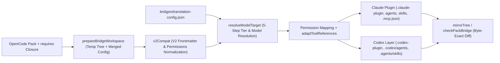

# Cross-Harness Pack Translation

Cross-harness translation allows *[pack]* (see [Glossary](../glossary.md)) authors to write multi-agent workflows once against [OpenCode Pack Contract `1.1`](../api/pack-contract-reference.md) and deterministically generate native **Claude Code plugins** and **Codex project layers** via the [Claude Code & Codex Bridges](../modules/bridges.md). Rather than maintaining divergent prompt trees, model assignments, and MCP configurations per CLI harness, `manage-agents` treats the OpenCode pack as the canonical source of truth and compiles target-specific artifacts into isolated bridge directories without mutating source files.

## Goal and Design Principles

Each AI coding harness makes different structural assumptions about packaging, model identifiers, subagent delegation, tool names, and sandboxing. The translation layer (`src/utils/bridge.ts`, `src/utils/codexBridge.ts`, `src/utils/translationConfig.ts`, and `src/utils/bridgeToolReferences.ts`) bridges those differences under four invariants:

1. **Single canonical source**: Authors maintain standard OpenCode V2 packs (`opencode-pack.json`, `agents/*.md`, `commands/*.md`, `skills/*/SKILL.md`, `opencode.json`). Bridge outputs carry generated headers warning against direct edits.
2. **Closure-aware staging**: A bridged pack is staged together with its transitive `requires` closure (see [Dependency Resolver & Lockfile](../modules/resolver-and-lock.md)) in a temporary workspace (`prepareBridgeWorkspace`). Only the requested pack's `agents/*.md` are emitted as target agents, while `commands/`, `skills/`, `plugins/`, `tools/`, `mcp.servers`, and `lsp` declarations are merged across the entire closure.
3. **Fail-closed security and explicit lossiness**: Aligned with the [Security & Trust Model](./security-and-trust-model.md), whenever a target harness cannot enforce a source restriction per agent (such as path-scoped `edit` rules, command-scoped `bash` patterns, or `ask` prompts), the bridge emits structured warnings and documents unenforceability in the generated `README.md`. Conversely, server-wide MCP denies (`<server>_*: deny`) on required servers abort generation rather than widening access.
4. **Byte-exact determinism**: Regenerating a pack against unchanged sources and [`bridges/translation-config.json`](../config/translation-and-release-config.md) produces identical bytes, enabling CI drift verification via `checkPackBridge` ([`bridge check`](../api/cli-reference.md)).

## Translation Pipeline



During execution, `prepareBridgeWorkspace` validates each pack in the resolved `requires` closure, copies installable files into an OS temporary tree, and rejects duplicate file paths. It parses agents only from the requested pack, while merging MCP and LSP declarations from the closure into a generated `opencode.json` (later entries in closure order replace earlier declarations with the same name). `withGeneratedPackBridge` (see [Claude Code & Codex Bridges](../modules/bridges.md)) refuses untrusted executable content unless explicitly allowed, runs either `bridgeToClaudeCode` or `bridgeToCodex`, and always cleans up the temporary workspace. `bridgePack` mirrors generated files to the destination, rewriting changed files and pruning stale entries; preview/check paths can compare trees without modifying the destination. Interactive previews and exports in the TUI run through the [Authoring, Tuning & Bridge Modals](../components/authoring-and-bridge-modals.md). Output paths are checked for symlink-free containment via `realpathThroughExistingAncestor` and `assertInsideRealWorkspace` (see [Security & Trust Model](./security-and-trust-model.md)).

The Claude CLI helper is a separate post-generation step: `validatePlugin` runs `claude plugin validate <dir> --strict` and reports pass, fail, skipped (CLI missing), or execution error. `registerPlugin` adds the local marketplace and then installs the plugin, tracking “already present” results separately for those two steps. These helpers do not change the canonical pack or generated translation rules.

## Cross-Harness Concept Mapping

The table below summarizes how each OpenCode V2 pack construct maps to Claude Code and Codex artifacts.

| Concept | OpenCode V2 (Canonical Pack) | Claude Code Plugin (`bridge.ts`) | Codex Layer (`codexBridge.ts`) |
|---|---|---|---|
| **Packaging unit** | `opencode-pack.json` manifest ([Contract `1.1`](../api/pack-contract-reference.md)) + shared [`~/.config/opencode/`](../config/user-and-target-files.md) layout | `.claude-plugin/plugin.json`, optional `.claude-plugin/marketplace.json` (`<plugin>-local`), and `.claude-plugin/icon.png` | Codex project with a `.codex-plugin/plugin.json` manifest and optional `.agents/plugins/marketplace.json` |
| **Primary & subagent definitions** | `agents/<id>.md` with YAML frontmatter (`mode: primary \| subagent \| all`, `steps`, `model#variant`, `permissions`) | `agents/<kebab-name>.md` (`name`, `description`, `model`, `maxTurns`, `tools`). First `mode: primary` agent becomes `orchestratorName` (`--agent <plugin>:<name>`) | `.codex/agents/<kebab-name>.toml` (`name`, `description`, `developer_instructions`, `model`, `model_reasoning_effort`, `sandbox_mode`) + optional `.agents/skills/<name>/SKILL.md` |
| **Agent naming & `@` references** | Prefixed filenames (e.g., `pipeline-code_reviewer.md`) and `@pipeline-code_reviewer` mentions | Prefix stripped, normalized to lowercase kebab-case (`code-reviewer`, max 64 chars, `agent-` prepended if leading digit); mentions rewritten to `@<plugin>:code-reviewer` | Prefix stripped, normalized to lowercase kebab-case (`code-reviewer`); mentions rewritten to `@code-reviewer` and listed under `## Delegation targets` |
| **Slash commands** | `commands/<id>.md` supporting `$ARGUMENTS` and `` !`shell` `` command substitutions | Emitted when `claude.emitCommands !== false` as `skills/<command>/SKILL.md` with `disable-model-invocation: true`, `arguments: request`, `$ARGUMENTS` -> `$request`, `` !`cmd` `` -> fenced `bash` blocks, and an orchestrator delegation header | Workflows are exposed via `.agents/skills/<agent>/SKILL.md` when `codex.emitSkills !== false` |
| **Companion skills** | `skills/<id>/SKILL.md` plus sibling scripts/references | Copied recursively into `skills/<id>/SKILL.md` when `claude.emitSkills !== false` (symlink-checked; redundant `name` frontmatter key removed) | `codex.emitSkills` generates `.agents/skills/<agent>/SKILL.md` wrappers around each translated agent's `developer_instructions` |
| **`AGENTS.md` instructions** | Pack root `AGENTS.md` installed into OpenCode target as `instructions/<pack>.md` (see [Pack Lifecycle & Target Safety](./pack-lifecycle-and-target-safety.md)) | Not emitted into the plugin bundle; project/session `CLAUDE.md` remains host-managed | Not emitted into the plugin layer; repository `AGENTS.md` remains host-managed |
| **MCP servers** | `opencode.json` `mcp.servers.<name>` (`type: "local" \| "remote"`, `command` array, `environment` with `{env:VAR}`, `disabled`) | `.mcp.json` `mcpServers.<name>` (`command`/`args` or `{ type: "http", url }`, `env` with `${VAR}`) + per-agent `mcp__<server>__*` and `mcp__plugin_<plugin>_<server>__*` tool grants | `.codex/config.toml` for the project, plus `.mcp.json` for plugin installs |
| **LSP servers** | `opencode.json` `lsp.<name>` (`command`, `extensions`) | `.lsp.json` mapping `command`, `args`, and `extensionToLanguage` (`{ "<ext>": "<name>" }`) | Not translated (no Codex plugin LSP manifest equivalent) |
| **JS/TS plugins & custom tools** | `plugins/<name>/index.ts` lifecycle hooks and `tools/**` custom tools (`pipeline_*`, `dev_*`) | **Not transpiled.** Emits bridge warnings, adds a `README.md` hook-mapping table (`PreToolUse`, `PostToolUse`, `Stop`, `PermissionRequest`), and injects prompt runtime notes | **Not transpiled.** Injects prompt runtime notes listing unavailable `pipeline_*` / `dev_*` tools so agents use documented CLI/git fallbacks |

### V2 Frontmatter Normalization

Before translation runs, `parseAgentFile` (`src/utils/agents.ts`) inspects each Markdown agent with `detectFrontmatterVersion` ([`src/utils/v2Compat.ts`](../modules/agent-editing-and-v2-compat.md)). OpenCode V2 frontmatter fields are normalized into the internal representation expected by both bridges:

- `steps` maps to `max_steps` (which `convertAgent` emits as `maxTurns` in Claude Code).
- `model#variant` splits on `#` into base `model` and `variant` (sampling keys `temperature`, `top_p`, and `top_k` are stripped during V2 normalization).
- `disabled` maps to `disable`, and `system` maps to `prompt`.
- `permissions` (ordered array of `{ action, resource, effect }`) converts via `translatePermissionsV2ToV1` into a structured permission map.

## Capability Tiers and Five-Step Model Translation

OpenCode packs typically reference provider-qualified models with reasoning variants (for example `anthropic/claude-opus-4-6#high` or `openai/gpt-5.4#max`; contrast with OpenCode runtime model selection in [Conditional Routing & Archetypes](./conditional-routing-and-archetypes.md)). Target harnesses expect either family aliases (`opus`, `sonnet`, `haiku`) or harness-specific model and reasoning effort pairs.

`src/utils/translationConfig.ts` (persisted at [`bridges/translation-config.json`](../config/translation-and-release-config.md), `version: 2`) decouples pack models from target models using abstract **capability tiers**.

### Default Capability Tiers and Roles

`DEFAULT_TRANSLATION_CONFIG` defines three capability tiers and ten standard role mappings:

| Tier | Purpose | Default Claude Target | Default Codex Target | Default Mapped Roles |
|---|---|---|---|---|
| `planning` | Reasoning, architecture, planning, and review | `{ model: "opus" }` | `{ model: "gpt-5.6-sol", reasoningEffort: "high" }` | `orchestrator`, `planner`, `reasoner`, `critic`, `code_reviewer` |
| `execution` | General implementation, testing, and refactoring | `{ model: "sonnet" }` | `{ model: "gpt-5.6-luna", reasoningEffort: "max" }` | `refactorer`, `tester`, `fast_lane` (also `defaultTier`) |
| `light` | Fast exploration and focused mechanical edits | `{ model: "haiku" }` | `{ model: "gpt-5.6-luna", reasoningEffort: "max" }` | `executor`, `explorer` |

Claude model strings are validated against `CLAUDE_MODEL_PATTERN`, accepting family aliases (`fable`, `sonnet`, `opus`, `haiku`, `inherit`) or full `claude-*` IDs. Legacy `version: 1` translation configs are automatically upgraded in `migrateV1`.

### Five-Step Resolution Precedence (`resolveModelTarget`)

For each agent in a pack, `resolveModelTarget` determines the target `ModelTarget` (`{ model, reasoningEffort? }`) and records its provenance (`source`) in the [bridge preview](../modules/bridges.md):

1. **Per-agent override (`source: "override"`)**: Strips `.md` and the configured agent `prefix` (e.g., `pipeline-`) via `normalizeAgentName` and checks `config[target].overrides[name]`. If present, that exact `{ model, reasoningEffort }` wins immediately.
2. **Source-model map (`source: "model-map"`)**: Normalizes the agent's OpenCode `model` (lowercased, split from `#variant` during frontmatter parsing) into `full` (`provider/model`) and `bare` (the substring after the last `/`). Checks `config[target].modelMap` in order: `modelMap[full]`, `modelMap[bare]`, and the wildcard `modelMap["*"]`. Dead keys that match no agent in the bridged pack are flagged by `unusedModelMapKeys`.
3. **Explicit role mapping (`source: "role"`)**: Resolves the stripped agent stem (`resolveRole`) against `config.roles[role]`. If the mapped tier exists in `config.tiers`, selects `config.tiers[tier][target]`.
4. **Peer model inference (`source: "inferred"`)**: When `config.inference !== false` and the agent's role is not listed in `config.roles` (common for domain specialists like `frontend_specialist` or `security_auditor`), `buildInferenceIndex` indexes all peer agents in the batch that *do* have both a known `role -> tier` mapping and a `model`. It looks up the unmapped agent's `full` model—and then `bare` model—in that index:
   - If every matching peer belongs to the **exact same tier** (`matches.size === 1`), the agent inherits that tier and records `inferredFrom: sourceModel`.
   - If peers using the same model span multiple tiers (`matches.size > 1`), inference **abstains immediately** (`break`) rather than guessing across ambiguous tiers.
5. **Default tier fallback (`source: "default"`)**: Falls back to `config.defaultTier` (`"execution"` by default, or the first key in `config.tiers` if `defaultTier` is missing).

Whenever an agent resolves via step 4 (`inferred`) or step 5 (`default`), the bridge appends a diagnostic warning (`[<agent>] model assignment source: inferred|default`) so authors can verify or pin the choice in `roles` or `overrides`.

### TUI Draft Editing and Preview

The bridge editor works on a draft rather than mutating the persisted configuration while the user is editing. `applyBridgeDraftToConfig` clones the tier, role, and per-target maps, trims the plugin name, derives the agent prefix from the selected pack, and updates or removes the selected target's wildcard model-map entry. Draft validation requires at least one tier and a non-empty Claude and Codex model for every tier; the Claude model is additionally checked against the Claude model-name rules when Claude is the selected target. Blank Codex reasoning effort is removed from the draft.

`buildPackBridgePreview` filters and sorts agents belonging to the selected pack, then runs the same `resolveModelTarget` logic used by generation. The preview reports each agent's role, tier, target model, resolution source, optional inferred source model, and Codex reasoning effort, plus counts by tier. It is a model-mapping preview for that pack's agents, not a generated artifact or a preview of the entire `requires` closure.

## Permission Granularity and Lossiness Handling

OpenCode V2 evaluates `permissions` as an ordered list of `{ action, resource, effect }` rules where **last match wins**, supporting path globs on `edit`, command globs on `shell`, URL patterns on `webfetch`, subagent dictionaries on `subagent`, and interactive `"ask"` effects.

First, `translatePermissionsV2ToV1` ([`src/utils/v2Compat.ts`](../modules/agent-editing-and-v2-compat.md)) normalizes V2 rules into a V1-shaped map:
- Global `{ action: "*", resource: "*" }` is placed first so subsequent rules override it.
- V2 actions collapse onto canonical V1 keys (`shell` -> `bash`, `subagent` -> `task`, while V2 `edit` covers `write`, `patch`, `apply_patch`, and `multiedit`).
- Unknown or legacy V1 action names inside a V2 `permissions` array return `null` in `resolveV2PermissionKey` and are dropped (fail-closed) so unvalidated spellings cannot smuggle grants into downstream bridges.

Because neither Claude Code plugin agents nor Codex `.toml` agents support per-agent command/path globs or per-agent `ask` prompts, each bridge translates permissions to the closest native enforcement mechanism and surfaces any loss of granularity.

### Claude Code `tools` Allowlists and Warnings

Claude Code plugin agents do not accept `permissionMode` or session-level `Bash(...)` patterns in agent frontmatter (`permissions.allow` in Claude settings applies globally to the session, not per plugin agent). Instead, `buildToolsString` ([`src/utils/bridge.ts`](../modules/bridges.md)) compiles a comma-separated `tools:` allowlist:

- **Read-family tools**: `Read`, `Grep`, and `Glob` are included unless explicitly set to `"deny"` or `false`.
- **Write and execution tools**: Evaluated via `objectAllowsAny`, which walks pattern dictionaries in insertion order—any `"allow"` or `"ask"` enables the tool unless a later catch-all `"*": "deny"` overrides it.
  - `edit` / `write` / `apply_patch` / `patch` / `multiedit` -> `Write, Edit`
  - `bash` / `shell` -> `Bash`
  - `webfetch` -> `WebFetch`, `websearch` -> `WebSearch`, `skill` -> `Skill`, `lsp` -> `LSP`, `question` -> `AskUserQuestion`, `todowrite` -> `TodoWrite`
- **Subagent delegation (`Agent`)**: Scalar `"allow"` emits unrestricted `Agent`. A structured subagent map resolves aliases via `resolveAgentAlias` and emits plugin-scoped targets: `Agent(<plugin>:explorer, <plugin>:executor)`.
- **MCP tool scoping**: OpenCode `<server>_<tool>` and `<server>_*` keys are distinguished from built-ins via `isKnownPermissionKey` and `isOpenCodeCustomToolKey`.
  - If no tool on `<server>` is denied, the bridge emits both user-scoped `mcp__<server>__*` and plugin-scoped `mcp__plugin_<plugin>_<server>__*`.
  - If *any* tool on `<server>` is denied, wildcard emission is suppressed; only explicitly allowed tools (`mcp__<server>__<tool>` and `mcp__plugin_<plugin>_<server>__<tool>`) are emitted, accompanied by a warning listing the omitted denied tools.
  - If an agent requires `<server>` while any bridged agent declares a whole-server `<server>_*: deny`, `buildClaudeMcpConfig` throws an error before writing any files.

`collectWarnings` records every lossy conversion per agent:
- **Collapsed pattern rules**: Non-`*` patterns on `bash`, `shell`, or `edit` warn (`<key> patterns not representable in Claude Code plugin agents; N rules dropped`). In addition, `collectBashAllowlist` and `renderBashAllowlistSection` export all per-agent bash rules into collapsible details blocks in `README.md` so users can copy `Bash(git diff *)`-style rules into project settings.
- **Domain-only URL rules**: Non-`*` `webfetch` patterns warn that Claude Code matches `WebFetch` domains rather than full URL globs.
- **`ask` promotions**: Scalar `"ask"` or `"*": "ask"` on `PROMOTED_ASK_KEYS` (`websearch`, `skill`, `lsp`, `question`, `todowrite`, `edit`, `bash`, `shell`, `webfetch`) or subagent `task` entries are promoted to `"allow"` with an explicit warning.
- **Dropped OpenCode-only permissions and fields**: Grants on `DROPPED_PERMISSION_KEYS` (`doom_loop`, `external_directory`, `artifact`, `file-diff`, `mcp-resource`, `opencode_session_*`, `opencode_worktree_*`), custom tools (`dev_*`, `pipeline_*`), `hidden: true`, and `temperature` emit warnings and are omitted.

### Codex `sandbox_mode` Reduction

Codex `.codex/agents/*.toml` files control filesystem and command privileges through a single `sandbox_mode` enum (`resolveSandboxMode` in `src/utils/codexBridge.ts`):

```ts
return permissionAllows(permissions.write) || permissionAllows(permissions.edit) ||
  permissionAllows(permissions.apply_patch) || permissionAllows(permissions.patch) || permissionAllows(permissions.multiedit) ||
  permissionAllows(permissions.bash) || permissionAllows(permissions.shell) || permissionAllows(permissions.execute)
  ? "workspace-write"
  : "read-only"
```

- Notice that `permissionAllows` checks strictly for `true` or `"allow"` (either scalar or inside a pattern dictionary)—unlike Claude's `objectAllowsAny`, a bare `"ask"` rule without `"allow"` stays `"read-only"` in Codex.
- Because Codex `.toml` agents have no structured subagent allowlist field, `translateAllowedSubagents` resolves delegated agent names and `appendDelegationTargets` appends a `## Delegation targets` section (`- @<agent>`) to `developer_instructions`.
- Per-agent bash allowlists are documented in the generated Codex README. Explicit MCP tool denies apply across the session, and an unrepresentable deny pattern prevents export of the server.

## Prompt Tool Adaptation and Idempotent Runtime Notes

Agent prompts authored for OpenCode refer to built-in OpenCode tools (`todowrite`, `` `question` ``, `Task tool`) and repository custom tools (`pipeline_state`, `pipeline_commit`, `dev_verify`, `dev_smoke`, `dev_serve`, `dev_env`). Deleting or heavily rewriting prompt paragraphs would risk corrupting conditional instructions. Instead, `adaptToolReferences` (`src/utils/bridgeToolReferences.ts`, part of [Claude Code & Codex Bridges](../modules/bridges.md)) combines targeted inline renames with a single, top-of-prompt runtime note.

### Prose-Safe Tool Renaming (`CLAUDE_TABLE` and `CODEX_TABLE`)

Many OpenCode tool names (`read`, `write`, `edit`, `question`, `task`, `skill`, `bash`) are ordinary English words. To prevent mangling natural-language sentences while updating tool references, `bridgeToolReferences.ts` uses `backticked(name)` (`/\`<name>\`/g`) for ambiguous words and word-boundary regexes only for unmistakable identifiers:

- **`CLAUDE_TABLE` renames**:
  - Unbackticked word-boundary matches: `\btodowrite\b` -> `TodoWrite`, and `\bTask (tool|calls?\b|call\(s\))` -> `Agent $1`.
  - Backtick-delimited matches only: `` `question` `` -> `` `AskUserQuestion` ``, `` `task` `` -> `` `Agent` ``, `` `read` `` -> `` `Read` ``, `` `grep` `` -> `` `Grep` ``, `` `glob` `` -> `` `Glob` ``, `` `lsp` `` -> `` `LSP` ``, `` `skill` `` -> `` `Skill` ``, `` `webfetch` `` -> `` `WebFetch` ``, `` `websearch` `` -> `` `WebSearch` ``, `` `bash` `` -> `` `Bash` ``, `` `edit` `` -> `` `Edit` ``, `` `write` `` -> `` `Write` ``.
- **`CODEX_TABLE` renames and guidance**:
  - Renames `\btodowrite\b` -> `update_plan`.
  - Leaves backticked `` `question` ``, `` `task` ``, `` `read` `` / `` `grep` `` / `` `glob` `` / `` `lsp` ``, and `` `edit` `` / `` `write` `` intact in the prompt body, and instead emits target-specific `guidance` bullets in the runtime note:
    - `` `question` ``: ask the user directly in your reply and wait for the answer.
    - `` `task` ``: delegate to the Codex subagents listed under `Delegation targets`.
    - `` `read / grep / glob / lsp` ``: read and search files with shell commands (for example `rg`, `sed -n`).
    - `` `edit / write` ``: change files with `apply_patch`.

### OpenCode-Only Custom Tools and `RUNTIME_NOTE_MARKER`

`adaptToolReferences` scans both non-denied frontmatter permission keys and the prompt text against `OPENCODE_CUSTOM_TOOL` (`/\b(?:pipeline_[a-z][a-z0-9_]*|dev_(?:env|verify|smoke|serve))\b/g`, covering `OPENCODE_ONLY_TOOLS` and any future `pipeline_*` tool).

If any tool was renamed, any `guidance` pattern matched, any `mcpServers` `<server>_` prefix appeared in the body, or any OpenCode-only tool was detected, `insertNearTop` injects a blockquote immediately below a leading `# Heading` (or at the very top of the prompt if no H1 exists):

```markdown
> **Runtime note (OpenCode bridge).** This prompt was written for OpenCode and runs here in Claude Code.
> - These OpenCode tools are **not available** in this environment: `dev_verify`, `pipeline_commit`, `pipeline_state`. Wherever this prompt says to call one of them ("if available"), take the fallback it documents (manual baseline, plain git, test, or build commands) and state in your report that the tool was unavailable. Never invent its output.
> - OpenCode tool names were translated: `todowrite` → `TodoWrite`, `Task tool` → `Agent tool`.
> - MCP tools named `<server>_<tool>` in this prompt are exposed as `mcp__<server>__<tool>` (plugin-scoped: `mcp__plugin_<plugin>_<server>__<tool>`); servers: `codebase-memory-mcp`.
```

Idempotence is enforced by checking `body.includes(RUNTIME_NOTE_MARKER)` (`"Runtime note (OpenCode bridge)"`) at the entry of `adaptToolReferences`. If the marker is already present, `adaptToolReferences` returns the body unchanged with empty `unavailable` and `renamed` lists, ensuring repeated bridge passes never duplicate notes or double-rewrite identifiers. Likewise, `rewriteBodyReferences` in `bridge.ts` skips `@namespace:agent` tokens that already contain `:`, keeping delegation rewrites idempotent.

## Related Pages

- [Claude Code & Codex Bridges](../modules/bridges.md) — Implementation details for `bridge.ts`, `codexBridge.ts`, `bridgeWorkspace.ts`, and `bridgeCheck.ts`
- [Bridge Translation & Release Config Reference](../config/translation-and-release-config.md) — Full schema and configuration reference for `bridges/translation-config.json`
- [Agent Editing, V2 Compatibility & Git Transactions](../modules/agent-editing-and-v2-compat.md) — V2 frontmatter detection and `translatePermissionsV2ToV1` normalization
- [Authoring, Tuning & Bridge Modals](../components/authoring-and-bridge-modals.md) — Interactive TUI workflow for previewing and exporting Claude Code and Codex bridges
- [CLI Command Reference](../api/cli-reference.md) — Non-interactive `bridge claude`, `bridge codex`, and `bridge check` CLI commands
- [OpenCode Pack Contract 1.1 Reference](../api/pack-contract-reference.md) — Canonical OpenCode pack structure, `requires` closure, and MCP/LSP declarations
- [Conditional Routing & Archetypes](./conditional-routing-and-archetypes.md) — How OpenCode packs dynamically route models at runtime before static cross-harness translation
- [Security & Trust Model](./security-and-trust-model.md) — Ancestor-aware symlink guards and fail-closed validation applied during bridge generation
