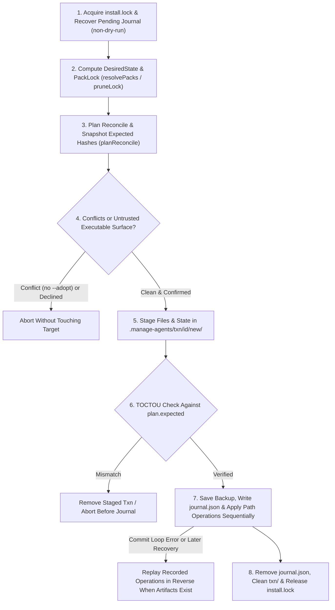

# Pack Lifecycle & Target Safety

`manage-agents` installs OpenCode *[packs]* (see [Glossary](../glossary.md)) directly into a live [OpenCode configuration directory](../config/user-and-target-files.md) (`$XDG_CONFIG_HOME/opencode` by default, typically `~/.config/opencode`) via the [Transactional Target Installer](../modules/target-installer.md) (see [System Architecture](../architecture.md)). Because packs do not run in isolated sandboxes, the engine tracks ownership, preflights conflicts, checks expected hashes, stages writes, and records a journal to support rollback after interrupted applies. Applying a plan is a sequence of filesystem operations, not an atomic multi-path commit; recovery depends on the journal and the required transaction files remaining available.

## Why Target Safety Matters

An OpenCode target directory is a shared tree where multiple actors coexist:

- **Personal user settings** in `opencode.json` (such as `model`, `default_agent`, `providers`, and `permissions`) that packs are forbidden from setting under the [pack contract](../api/pack-contract-reference.md).
- **Hand-written resources** created directly by the user under `agents/`, `commands/`, `skills/`, `plugins/`, or `themes/`, as well as user-configured `mcp.servers` or `lsp` entries.
- **Multiple external packs** from [local directories or git repositories](../modules/sources-and-github.md), which copy their files into the same shared layout so cross-pack relative imports (such as `../../tools/<pack>/x.js`) work natively.
- **Engine-managed runtime assets**, including `instructions/<pack>.md` (rewritten from a pack's `AGENTS.md`) and [`plugins/manage-agents-router/`](../modules/runtime-router-plugin.md).

Without explicit boundaries, installing, updating, or uninstalling a pack could clobber hand-edited prompts, strip JSONC comments without backup, delete files the user created before installing a pack, or leave a half-written tree if the process crashes mid-operation.

Two additional boundary checks protect the target before any file mutation:

1. **Symlinked configuration protection**: `planConfig` inspects `opencode.json` (or `opencode.jsonc`) with `fs.lstatSync`. If the configuration file is a symlink, planning records a conflict rather than replacing the link or writing through it blindly, prompting the user to pass the symlink's destination via `--target` or use a regular file. Similarly, `isSafeRel` rejects any state-recorded path containing `..`, backslashes, NUL bytes, or absolute prefixes.
2. **Executable surface confirmation**: `confirmationsNeeded` in [`src/utils/lock.ts`](../modules/resolver-and-lock.md) compares the incoming `PackLock` against the previous lock. Installing untrusted executable content (plugins, plugin npm/git specs, `tools/**` modules, skill scripts, MCP servers, or external formatter/LSP/MCP commands), or changing executable content while the resulting pack still has an executable surface, requires explicit confirmation interactively or via `--yes` (see [Security & Trust Model](./security-and-trust-model.md)).

## Three-File State Model

For each target, `manage-agents` stores three JSON [state files](../config/user-and-target-files.md) inside `<target>/.manage-agents/`:

| File | Type (`src/utils/`) | Purpose |
|---|---|---|
| `desired.json` | `DesiredState` (`installer.ts`) | Records the user's explicit root pack requests (`roots: string[]`, formatted as `[source/]name[@range]`). |
| `lock.json` | `PackLock` (`lock.ts`) | Pins the exact resolved dependency graph: `source`, `sourceKind`, `path`, `version`, git `revision`, `manifestHash`, `contentHash`, `executable`, `executableHash`, `trusted`, and `requires` per pack. |
| `installed.json` | `InstalledState` (`installer.ts`) | Tracks every managed target path (`files[rel] -> { hash, owner }`), each pack's rewritten `opencode.json` contribution (`config[pack]`), and dotted config objects created by the engine (`createdSections`). |

```ts
// src/utils/installer.ts
export interface DesiredState {
  desiredVersion: 1
  roots: string[]
}

export interface InstalledState {
  installedVersion: 1
  files: Record<string, { hash: string; owner: string }>
  config: Record<string, Contribution>
  createdSections?: string[]
}
```

Separating user intent (`desired.json`), exact resolution (`lock.json`), and materialized target ownership (`installed.json`) makes every [lifecycle command](../api/cli-reference.md) (and the [Sources & Target workspace](../components/workspaces-flows-and-sources.md)) deterministic and idempotent:

- **`resolve <pack>...`**: Runs [`resolvePacks`](../modules/resolver-and-lock.md) (`src/utils/resolver.ts`) to reach a constraint fixpoint across `requires` ranges, checks for dependency cycles (`findCycle`) and unresolved cross-pack references (`providesTarget`), orders packs topologically (`orderByRequires`: dependencies first, ties alphabetical), and diffs against the existing `lock.json` without writing anything. The resolver never guesses between ambiguous sources or versions on its own.
- **`install <pack>...`** (`installChange`): Appends or updates the requested root specs in `desired.json` while passing `pinsFrom(lock, name => !requested.has(name))` to the resolver so already-locked packs keep their exact source and version.
- **`uninstall <pack>...`** (`uninstallChange`): Verifies each named pack is a root in `desired.json` (refusing to directly uninstall a transitive dependency still required by an installed root), removes the root from `desired.json`, and calls `pruneLock` to drop unreachable packs without re-resolving remaining dependencies.
- **`update [<pack>...]`** (`updateChange`): Pulls the [git sources](../modules/sources-and-github.md) of the selected packs (or all locked packs when none are named) and re-resolves `desired.roots`. For resolution, a git source moves as a unit: every pack originating from a pulled git source is unpinned and re-evaluated at the new commit together, while unselected sources stay pinned.
- **`reconcile`** (`reconcileChange`): Rebuilds the target strictly from the existing `desired.json` and `lock.json`, applying current [user model-routing and frontmatter override settings](../modules/routing-and-user-settings.md) (see [Conditional Routing & Archetypes](./conditional-routing-and-archetypes.md)). In `loadLockedPacks`, git packs are read from a snapshot of their locked `revision` (`revisionSnapshot`), and every pack's `manifestHash`, `contentHash`, `executableHash`, and `opencode.json(c)` SHA-256 digest are verified against `lock.json` before planning proceeds.
- **`status`** (`targetStatus`): Performs a read-only check comparing the filesystem and git sources against all three state files. It reports pending crash journals, checked-out or fetched git commits that diverge from `lock.json`, missing or locally edited managed files, conflicts, and pending `reconcile` changes (such as updated global overrides). When `planReconcile` finds zero writes, zero deletes, unchanged config, and identical state files, `changeTarget` returns `status: "unchanged"` without touching disk.

## File & Config Ownership Lifecycle

### Pre-Flight Conflict Detection

`planReconcile` in [`src/utils/installer.ts`](../modules/target-installer.md) computes the entire target transition in memory before `applyPlan` writes a single byte. A conflict aborts the operation whenever:

- **Two packs collide**: Two packs in the lock declare the same resource ID (agent, command, skill, plugin, theme, or MCP server), write to the same NFC-normalized case-folded relative path (`fold(rel)`), or set the same `opencode.json` key to non-equal values.
- **Unmanaged user content is in the way**: A target file or `opencode.json` entry already exists, is not listed in `installed.json`, differs from the pack's content, and `--adopt` was not passed.
- **Managed content was modified locally**: A file in `installed.json` has a current on-disk SHA-256 (`currentHash`) that differs from `owned.hash`, or a managed object entry in `opencode.json` was edited by the user (`changedLocally`), and `--adopt` was not passed.
- **Non-regular filesystem entries block a path**: A directory, socket, or FIFO sits where a pack file needs to be written (`current === "not-a-file"`), or `opencode.json(c)` is a symlink or unparseable JSONC.

As a migration convenience, files and plugins listed in `<target>/.resource-export-manifest.json` (produced by the legacy `manage-agents export` command) are recognized via `readLegacyResources` and replaced without requiring `--adopt`, while still saving a backup when their content differs.

### Adoption Backups and Restore

Passing `--adopt` instructs `planReconcile` and `planConfig` to take ownership of conflicting unmanaged or locally modified files and config keys, recording them in `plan.adopted`:

1. Before mutating the target, `applyPlan` creates `<target>/.manage-agents/backups/<id>/`, copying adopted files (preserving user symlinks verbatim via `fs.readlinkSync` / `fs.symlinkSync` without following them) under `files/` and writing `backup.json` with `{ id, created, configFile, files, config }`.
2. If the target uses `opencode.jsonc` or contains comments or trailing commas (`!isPlainJson(text)`), `planConfig` warns that formatting comments cannot be preserved in serialized JSON and automatically adds `configFile` to `plan.adopted.files` so the original commented file is backed up.
3. Running [`manage-agents restore <backup-id>`](../api/cli-reference.md) invokes `restoreBackup`, which acquires `install.lock`, copies backed-up files and symlinks back into place, restores adopted array or object entries in `opencode.json`, and deletes those paths and config contributions from `installed.json` so the restored items return to unmanaged user ownership.

### Surgical `opencode.json` Merging and `createdSections`

Packs may contribute only to [approved sections of `opencode.json`](../api/pack-contract-reference.md): array sections (`plugins`, `skills`, `instructions`) and object sections (`mcp.servers`, `agents`, `commands`, `formatter`, `lsp`, `experimental`). A dependent pack may also explicitly register a required pack's plugin with `options`, which supersedes the provider pack's implicit `./plugins/<name>` registration (`implicitPlugins` vs. `explicitPlugins`).

During `planConfig`, the engine reconstructs `opencode.json` without disturbing user keys:

1. **Extract unmanaged base**: It clones the current parsed config into `unmanaged` and strips every entry matching `previous.config` (`isDeepStrictEqual`). If a previously managed object key still exists on disk with a different value, it stays in `unmanaged` and is flagged in `changedLocally`.
2. **Claim and merge**: Each pack's `Contribution` (plus `:engine` when [`plugins/manage-agents-router`](../modules/runtime-router-plugin.md) is needed) claims its array items and object keys. Managed entries are appended to `unmanaged` arrays or set on `unmanaged` object paths.
3. **Track and prune `createdSections`**: Whenever the engine materializes a missing dotted object path (for example creating `mcp` and `mcp.servers`), it records each prefix in `createdSections`. When removing a pack leaves a section empty (`emptiedSections`), `planConfig` walks upward from leaf to root (`mcp.servers` -> `mcp`) and deletes empty objects **only** if they appear in `createdSections`. Empty sections originally written by the user are never deleted.

### Identical Unmanaged Content vs. Locally Modified Released Files

`manage-agents` distinguishes between user files that happen to match a pack and managed files that the user customized after installation:

```ts
// src/utils/installer.ts — identical unmanaged files stay the user's
if (current === write.hash) {
  if (owned || legacy.has(write.rel) || options.adopt) files[write.rel] = { hash: write.hash, owner }
  continue
}
```

- **Identical pre-existing content stays unmanaged**: If a target file already has `current === write.hash` and was not previously in `installed.json` (and `--adopt` is not set), `planReconcile` skips writing it and omits it from `installed.files`. Likewise, `claim` in `planConfig` returns `"kept"` when an existing unmanaged config entry is `isDeepStrictEqual` to the pack's value, omitting it from `installed.config`. Uninstalling the pack later leaves both the file and the config entry untouched.
- **Clean vs. modified removal (`released`)**: When an `uninstall` or `update` drops a previously managed path (`previous.files`), `planReconcile` checks its on-disk hash:
  - If `current === owned.hash`, the file is scheduled in `plan.deletes`, removed during `applyPlan`, and any empty parent directories inside `<target>` are cleaned up via `removeEmptyParents`.
  - If `current !== owned.hash`, the user edited the file locally. Rather than deleting user work or blocking `uninstall`, `planReconcile` adds the path to `plan.released`, emits a warning (`"<rel> was changed locally and no pack provides it any more: left in place, no longer managed"`), leaves the file on disk, and removes it from `installed.json`.

## Coordination, Journaled Apply & Recovery

All mutating target operations (`install`, `uninstall`, `update`, `reconcile`, and `restore`) acquire `withTargetLock`; `changeTarget` and `restoreBackup` then use `applyPlan` in [`src/utils/installer.ts`](../modules/target-installer.md) to stage and apply a sequence of path operations. The lock coordinates `manage-agents` processes using the same target. It is not a filesystem-wide lock, and the apply is not an atomic multi-path commit.

### Process Exclusion (`install.lock`)

`withTargetLock` creates `<target>/.manage-agents/install.lock` with `flag: "wx"` containing `{ pid, host, command, started }`:

- If `install.lock` already exists, the engine parses the holder metadata. If the holder runs on another host or `pidAlive(holder.pid)` returns `true` (`process.kill(pid, 0)` succeeds or returns `EPERM`), `withTargetLock` aborts immediately with a descriptive error. If the lock file cannot be parsed yet and its `mtimeMs` is newer than `STALE_LOCK_GRACE_MS` (10 seconds), it assumes another process is still writing it and aborts.
- For a dead same-host holder—or an unparseable lock older than the grace period—`withTargetLock` renames `install.lock` to a unique sibling `.stale-<pid>-<rand>` file, verifies its contents still match the bytes read earlier, and then removes it before retrying `wx` creation. If the contents differ, it attempts to restore the moved file with `fs.linkSync` and aborts so a fresh lock is not discarded.

### Staging and Expected-Hash TOCTOU Checks

`applyPlan` first stages planned writes rather than copying pack source bytes directly over live target files:

1. **Staging (`txn/<id>/new/`)**: Planned pack files, changed config, and the next `.manage-agents/{installed,lock,desired}.json` files are written or copied into `<target>/.manage-agents/txn/<id>/new/`. This puts staging under the target, but a nested mount can still put a destination on another filesystem. For source-backed files, `stage` hashes the staged copy and aborts if it differs from the expected source hash.
2. **Pre-journal TOCTOU verification (`plan.expected`)**: For planned payload paths and a changed config file, `planReconcile` records the expected current hash (`null` if absent, `symlink:<target>` for a symlink). After staging, `applyPlan` re-hashes the recorded paths and aborts before writing the journal if one changed. The staged state files are not entries in `plan.expected`.
3. **Swap-time checks**: When an existing path is moved into `txn/<id>/prev/`, `applyPlan` compares that moved pre-image with the planned hash when the path has an `expected` entry. Before installing a staged replacement, it checks that the destination has not reappeared. A mismatch throws into the journal rollback path.

### Crash Journal (`journal.json`) and Rollback Procedure

Before the commit loop moves any live path, `applyPlan` writes [`<target>/.manage-agents/journal.json`](../config/user-and-target-files.md) through `atomicWriteRestrictedFile` (see [Security & Trust Model](./security-and-trust-model.md)):

```json
{
  "id": "2026-11-13T10-15-30-123Z-a1b2c3d4",
  "ops": [
    { "rel": "agents/reviewer.md", "existed": false, "hash": "9f86d081..." },
    { "rel": "opencode.json", "existed": true, "hash": "4b227777..." }
  ]
}
```

The journal lists operations in the order they will be attempted. The commit loop processes them sequentially:

1. If `op.existed` is true and the live path still exists, it is moved with `movePathWithRetry` to `<target>/.manage-agents/txn/<id>/prev/<rel>`.
2. If the operation has a staged replacement, that file is moved from `txn/<id>/new/<rel>` to `<target>/<rel>`. For a deletion (`staged: null`), moving the old path into `prev/` effects the removal.
3. After all operations succeed, `applyPlan` removes `journal.json`, removes `txn/<id>/`, and then prunes empty parent directories for deleted files.

If the commit loop throws, its catch block calls `rollbackInterrupted(target)`. If the process stops after the journal is written, the next non-dry-run `changeTarget` or `restoreBackup` call also attempts recovery, provided the journal remains readable. The `status` command reports a pending journal but does not roll it back. A damaged journal is not automatically deleted, and the transaction directory is left for inspection.

- It validates the journal's id and operation paths, then iterates `journal.ops` **in reverse order**. If a pre-image exists in `txn/<id>/prev/<rel>`, it removes any current destination and moves the pre-image back. Otherwise, for a path recorded as new, it removes the destination only when its current hash matches the staged hash in the journal.
- It then removes `journal.json` and `txn/<id>/`; `changeTarget` reports `recovered: true` when this recovery ran.

This rollback describes how recorded operations are reversed when their journal and pre-images are available; it is not a guarantee that every multi-path operation is all-or-nothing. The code does not establish power-loss durability. In particular, if a filesystem move uses the Windows copy/remove fallback below and the process stops mid-fallback, that helper's temporary sidecars are not separate entries in `journal.json`.

### Windows Rename and Removal Handling

[`src/utils/fsWindows.ts`](../modules/target-installer.md) centralizes retries for transient Windows file locks. `movePathWithRetry` first tries `renameSync`, retrying `EPERM`, `EACCES`, and `EBUSY` with short delays; it switches to a copy/remove fallback for `EXDEV` or after those retries are exhausted. The fallback copies through a sibling `.stage-<pid>-<random>` path, copies an existing destination to a `.bak-...` path, removes the destination, then renames or copies the staged entry into place. For a caught replacement failure it attempts to restore the backup; if restoration fails, it throws an error naming the retained backup. Symlinks are recreated from their link text, and directory copies use recursive copy with timestamps and verbatim symlinks.

That fallback is not an atomic rename: destination removal and replacement are separate steps. `removePathWithRetry` also retries transient lock errors while using recursive, forced removal with Node's bounded retry options. These helpers improve behavior around transient Windows locks, but they do not turn the whole target update into an atomic operation.

## Lifecycle Diagram



Every mutating [CLI command](../api/cli-reference.md) uses the target lock: `install`, `uninstall`, `update`, and `reconcile` go through [`changeTarget`](../modules/target-installer.md), while restore goes through `restoreBackup`. Pack-managed paths are applied only after [resolution](../modules/resolver-and-lock.md), conflict checks, [user confirmations](./security-and-trust-model.md), staging, expected-hash checks, adoption backups, and journal creation; individual filesystem operations may still use the Windows copy/remove fallback described above.

---

## Related Pages

- [Transactional Target Installer](../modules/target-installer.md)
- [Dependency Resolver & Lockfile](../modules/resolver-and-lock.md)
- [Security & Trust Model](./security-and-trust-model.md)
- [Conditional Routing & Archetypes](./conditional-routing-and-archetypes.md)
- [OpenCode Pack Contract 1.1 Reference](../api/pack-contract-reference.md)
- [CLI Command Reference](../api/cli-reference.md)
- [User Settings, Target State & Environment Variables](../config/user-and-target-files.md)
- [Flows & Data Sources Workspaces](../components/workspaces-flows-and-sources.md)
