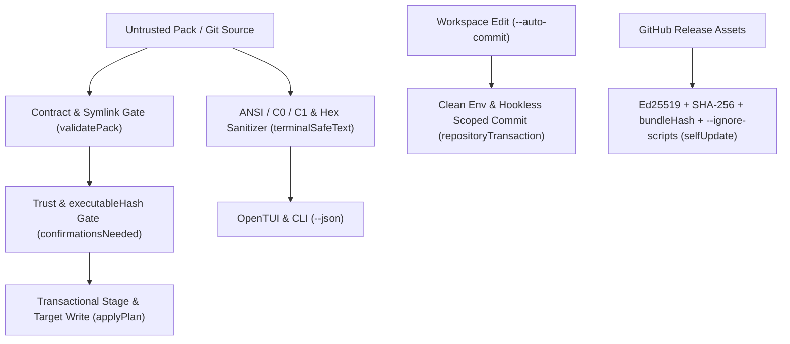

# Security & Trust Model

`manage-agents` treats *[pack]* (see [Glossary](../glossary.md)) repositories, workspace files, Git environments, and network release payloads as untrusted inputs until validated. Rather than relying on a single perimeter check, the [system architecture](../architecture.md) layers [structural contract validation](../api/pack-contract-reference.md), terminal output sanitization, prototype-safe object mutation, [symlink/TOCTOU filesystem guards](./pack-lifecycle-and-target-safety.md), explicit executable-surface consent, hardened Git subprocess execution, and [Ed25519 cryptographic release verification](../modules/launcher-and-build.md).

## Threat Model & Trust Boundaries

The engine operates across six primary trust boundaries:

| Boundary | Untrusted Input / Actor | Primary Risks | Core Mitigations |
|---|---|---|---|
| **External & Local Packs** | Third-party Git sources and local pack directories (`opencode-pack.json`, `opencode.jsonc`, Markdown, plugins, skills) | Path traversal, symlink escape, user config overwrite, oversized files, unreviewed code execution | Strict manifest/config allowlists, 2 MiB content-scan bound, symlink confinement, `executableHash` consent gate |
| **Terminal & JSON Output** | Pack names/descriptions, frontmatter `color`, Git/GitHub error text rendered in [OpenTUI](../components/tui-shell-and-catalog.md) or [CLI](../api/cli-reference.md) | ANSI CSI/OSC clipboard or title hijacking, 8-bit C1 control injection, layout/memory DoS | `terminalSafeText()`, `sanitizeHexColor()`, C1 (`\u007f–\u009f`) escaping in `--json` |
| **Shared Target Filesystem** | Concurrent processes and pre-existing user files/symlinks inside [`$XDG_CONFIG_HOME/opencode`](../config/user-and-target-files.md) | Silent destruction of user edits, symlink redirection outside target, case-folding collisions, TOCTOU races | NFC + case-folded collision detection, `O_NOFOLLOW` + inode checks, `.manage-agents/install.lock`, `plan.expected` hash checks |
| **Local Git Worktrees** | Ambient `GIT_*` environment variables, `.git/hooks`, and concurrent edits during `--auto-commit` | Arbitrary hook/editor/SSH execution, staging unintended files, corrupting in-progress merges | `cleanGitEnvironment()`, empty `0o700` `core.hooksPath`, `--no-gpg-sign --only`, pre/post blob fingerprinting |
| **Pack Bridges** | Pack closures and output directories used to generate Claude Code or Codex plugins | Bridging untrusted executable content, duplicate pack paths, writing through output symlinks, leaving stale generated files | Per-pack validation, source-trust confirmation, temporary merged workspace, output-path checks and controlled mirroring |
| **Remote Engine Releases** | GitHub API metadata and `.tar.gz` archives fetched during `self-update` | Compromised transport/assets, tag/repo replay, downgrade attacks, archive symlinks, malicious npm postinstall scripts | [`release-signing.json`](../config/translation-and-release-config.md) Ed25519 verification, SHA-256 + `bundleHash` checks, symlink-free tree walk, `--ignore-scripts` |

## Defense-in-Depth Overview



Each external input passes through dedicated validation and trust gates before reaching terminal output, the target filesystem, Git history, generated bridge output, or the engine installation directory. Pack validation is structural; it does not sandbox code that OpenCode or a bridged tool later executes.

## Pack Bridge Trust Boundaries

Bridge generation for Claude Code and Codex validates and assembles pack content without treating a pack as trusted merely because it can be parsed. `prepareBridgeWorkspace()` resolves the requested pack's dependency closure, runs `validatePack()` for each pack, copies eligible nested installable files into a temporary merged tree, excludes `node_modules` and `__pycache__`, and rejects duplicate file paths. It builds the merged MCP and LSP configuration there and removes the temporary tree on success or failure.

The bridge workspace reports executable content contributed by each pack. `resolveBridgeWorkspaceTrust()` compares the resolved workspace with registered source roots and chooses the most specific containing source; an unmatched workspace is untrusted. `bridgeConfirmationsNeeded()` reports executable content for untrusted sources. At generation time, `withGeneratedPackBridge()` refuses an explicitly untrusted executable pack unless `allowUntrustedExecutable` is enabled. This is a consent gate, not a sandbox for generated code.

Output paths are also constrained: the output may not contain the catalog or live inside the pack directories; an existing output must be a directory, not a symlink. When output is inside the catalog, every component below the catalog root is checked for symlinks. The generated tree is then mirrored to the output, removing stale or mismatched entries. Review executable content before allowing the target tool to load the generated plugin.


## Terminal Escape & Prototype-Pollution Hardening

Pack metadata, agent frontmatter, file paths, and subprocess `stderr` originate outside the engine and are rendered in both interactive [OpenTUI views](../components/tui-shell-and-catalog.md) and [CLI streams](../api/cli-reference.md).

### ANSI & Control Character Stripping

`terminalSafeText()` in `src/utils/terminalText.ts` strips terminal control sequences from dynamic values before rendering or cell-width calculation:

```ts
export function terminalSafeText(value: unknown): string {
  let text = typeof value === "string" ? value : String(value ?? "")
  // CSI, OSC (BEL or ST terminated), and the remaining C0/C1 controls.
  text = text
    .replace(/\x1b\][^\x07]*(?:\x07|\x1b\\)/g, "")
    .replace(/\x1b\[[0-?]*[ -\/]*[@-~]/g, "")
    .replace(/[\x00-\x1f\x7f-\x9f]/g, "")
  if (text.length > MAX_TERMINAL_TEXT_LENGTH) {
    const half = Math.floor(MAX_TERMINAL_TEXT_LENGTH / 2)
    text = text.slice(0, half) + text.slice(-half)
  }
  return text
}
```

- **OSC & CSI removal**: Full Operating System Command sequences (both BEL `\x07` and ST `\x1b\\` terminated) and Control Sequence Introducer sequences are removed as complete units so their parameter payloads do not leak onto the screen.
- **C0, DEL & 8-bit C1 removal**: Matching `[\x00-\x1f\x7f-\x9f]` strips raw `ESC` (`\x1b`)—neutralizing remaining escape-prefixed sequences such as DCS (`\x1bP`)—along with 8-bit C1 control characters (`\x80–\x9f`, including 8-bit CSI `\x9b`, OSC `\x9d`, and DCS `\x90`).
- **Length bounding**: Output is capped at `MAX_TERMINAL_TEXT_LENGTH` (`100_000` characters) by retaining balanced prefix and suffix halves, preventing memory and grapheme-segmentation DoS. Multi-line previews use `terminalSafeMarkdown()` (`src/utils/uiTheme.ts`), which sanitizes each line via `terminalSafeText()` and caps previews at `400` lines in the [Markdown view](../components/navigation-help-and-markdown.md).

### C1 Escaping in `--json` CLI Output

Standard `JSON.stringify()` escapes ASCII C0 characters (`\u0000–\u001f`) but emits DEL (`\u007f`) and C1 controls (`\u0080–\u009f`) verbatim. In `src/index.tsx`, `printJson()` escapes that range into `\uXXXX` escapes:

```ts
const printJson = (value: unknown) =>
  console.log(JSON.stringify(value, null, 2).replace(/[\u007f-\u009f]/g, char => `\\u${char.charCodeAt(0).toString(16).padStart(4, "0")}`))
```

This guarantees that unpiped `--json` output printed directly to a terminal emulator cannot trigger 8-bit C1 control sequences while remaining valid JSON for machine consumers.

### Frontmatter Color Sanitization

Agent frontmatter may specify a custom UI accent color. `sanitizeHexColor()` (`src/utils/uiTheme.ts`) enforces strict 3- or 6-digit hexadecimal syntax (`/^#(?:[0-9a-fA-F]{3}|[0-9a-fA-F]{6})$/`), falling back to `THEME.accentBlue` if an untrusted file supplies named colors, malformed strings, or escape payloads (such as `#\u001b[2J`).

### Prototype-Safe Dictionary Helpers

Pack manifests, routing tables, frontmatter overrides, and `opencode.json` contributions are keyed by user- or pack-controlled strings (pack names, agent IDs, model triggers, config keys). Plain property assignment (`obj[key] = value`) with `"__proto__"` would mutate an object's prototype rather than defining an entry. `src/utils/values.ts` provides three helpers used throughout [user settings and routing](../modules/routing-and-user-settings.md) and config merging:

- `own(object, key)`: Reads `object[key]` only when `Object.hasOwn(object, key)` is true, preventing lookups of `"__proto__"`, `"constructor"`, or `"toString"` from resolving against `Object.prototype`.
- `setOwn(object, key, value)`: Uses `Object.defineProperty(object, key, { value, enumerable: true, writable: true, configurable: true })` so even `"__proto__"` is stored safely as an own data property.
- `ownChild(object, key)`: Ensures an own nested object exists at `key` via `Object.hasOwn` + `setOwn` before mutating nested maps.

## Filesystem, Symlink & TOCTOU Defenses

Packs are merged into a shared OpenCode configuration directory without overwriting user-owned files or following untrusted symbolic links.

### Pack & Target Symlink Guards

- **[Pack validation](../modules/pack-validation-and-virtual-packs.md) (`src/utils/packs.ts`)**: `opencode-pack.json` must be a regular file (`fs.lstatSync(file).isFile()`). During directory traversal (`walk()`), every symbolic link is resolved with `fs.realpathSync()` and checked against the real pack root:
  - Broken links fail with `symlink-broken`.
  - Links resolving outside the pack root fail with `symlink-escape`.
  - Symlinked directories fail with `symlink-directory`.
  - Links to non-regular files (such as FIFOs or sockets that could block reads indefinitely) fail with `symlink-special`.
  - Valid intra-pack file symlinks are dereferenced on read and installed as regular files, never as links (`contract/CONTRACT.md` §1; see [OpenCode Pack Contract 1.1 Reference](../api/pack-contract-reference.md)).
- **Ancestor-aware realpath containment (`src/utils/pathValidation.ts`)**: When validating output paths whose leaf directories do not exist yet (such as [bridge](../modules/bridges.md)/plugin destinations or CLI targets), `realpathThroughExistingAncestor()` walks up to the nearest existing directory, resolves symlinks via `fs.realpathSync()`, and rejoins the uncreated tail components. `assertInsideRealWorkspace()` then checks `path.relative(fs.realpathSync(workspaceRoot), resolvedCandidate)` to block symlinked parent directories from redirecting writes outside the workspace.
- **Managed target scopes ([`src/utils/installer.ts`](../modules/target-installer.md))**:
  - A symlinked `opencode.json` or `opencode.jsonc` is reported as a conflict and never replaced, preserving dotfile-manager setups.
  - Pre-existing user symlinks in managed paths are fingerprinted via `lstatSync` + `readlinkSync` (`symlink:<target>`). If replaced with `--adopt`, the link text itself is backed up and recreated verbatim on `restore` without ever following its target.
  - Paths read from `installed.json` are accepted only as safe relative paths (`isSafeRel()` rejects absolute paths, `..`, empty components, backslashes, and NUL); state and target paths are resolved through `assertSafeTargetSubpath()` before use.
- **Descriptor-verified config reads (`src/utils/uiConfig.ts`)**: `readConfigBytes()` inspects the path with `lstatSync`, opens the descriptor with `O_RDONLY | O_NOFOLLOW` (where supported by the platform), runs `fstatSync(fd)` on the open descriptor, and verifies `sameFile(pathStat, descriptorStat)` (`dev` and `ino` equality) alongside `MAX_CONFIG_BYTES` bounds.

### NFC & Case-Folded Collision Rejection

Because macOS (APFS default) and Windows (NTFS) merge paths that differ only in casing or Unicode normalization, `validatePack()` normalizes every relative path using `rel.normalize("NFC").toLowerCase()`:

```ts
const foldKey = (rel: string) => rel.normalize("NFC").toLowerCase()
```

Any two files within a pack (for example `agents/Foo.md` and `agents/foo.md`) or across installed packs that produce the same folded key are rejected with a `case-collision` or install conflict error. Top-level native and reserved directory names (`agents/`, `instructions/`, `.manage-agents/`) are also checked case-sensitively so `Agents/` or `Instructions/` cannot bypass directory rules on case-insensitive filesystems.

### File Permissions & Atomic Writes

- `atomicWriteRestrictedFile()` (`src/utils/agents.ts`) defaults to mode `0o600`, refusing non-regular or symlinked targets via `lstatSync`, opening a randomized sibling `.tmp` file exclusively (`"wx"`), enforcing `fchmodSync(fd, mode)`, and atomically renaming it into place. Sensitive files—including `sources.json`, `agent-manager.lock`, and generated Ed25519 private keys—use `0o600`, while public [target state manifests](../config/user-and-target-files.md) (`lock.json`, `installed.json`) explicitly pass `0o644`.
- Temporary staging, backup, extraction, and hook directories in `selfUpdate.ts` and `repositoryTransaction.ts` are restricted to `0o700`.

### Transactional Staging & Expected-Hash Pre-Write Checks

[Pack lifecycle](./pack-lifecycle-and-target-safety.md) target mutations (`install`, `uninstall`, `update`, `reconcile`) execute inside `withTargetLock()` (`.manage-agents/install.lock` opened with `"wx"`; stale-lock recovery waits through a grace period, checks host/PID when the lock parses, and atomically renames then compares the lock contents) and `applyPlan()` (`src/utils/installer.ts`):

1. **Planning snapshot**: `planReconcile()` records `plan.expected[rel]` for every target path that will be created, updated, adopted, or deleted: a SHA-256 digest for a regular file, `symlink:<target>` for a link, or `null` when absent. A directory or special-file obstruction is classified as `not-a-file` and becomes a conflict instead of a planned write. Unmanaged or locally modified files are likewise rejected unless `--adopt` is supplied.
2. **Source integrity on stage**: Files are written into `<target>/.manage-agents/` (same filesystem for atomic `rename`) and hashed immediately; if a staged file's digest differs from the pack's expected `fileHashes` entry (`changed in its source while installing`), staging aborts and cleans up.
3. **Pre-commit TOCTOU re-check**: Because a user or another tool might edit target files while an interactive confirmation prompt is waiting, `applyPlan()` re-computes `currentHash()` for every planned path right before committing and aborts without writing if any path drifted from `plan.expected[rel]`.
4. **Journaled swap & rollback**: Before moving target files, `applyPlan()` writes `.manage-agents/journal.json`, moves each existing target file to `txn/prev/` (verifying `currentHash(previous) === plan.expected[op.rel]` once more after the move), and renames staged files into place. Any error or mid-flight crash is rolled back automatically by `rollbackInterrupted()`.

Before a reconcile plan is built, `loadLockedPacks()` revalidates each locked pack (or virtual pack) at its registered source and locked Git revision. It compares the manifest hash, complete content hash, executable-surface hash, and the pack-config bytes with the lock; a missing source, contract error, or digest drift stops the plan rather than silently installing changed content.

## Executable Surface Consent & Source Trust

Packs are not restricted to passive Markdown prompts; they can ship plugins, helper code, scripts, and external server commands. `manage-agents` inventories all executable vectors, hashes them into `lock.json`, and gates installation on source trust and hash stability.

### Executable Surface Inventory

During `validatePack()` (`src/utils/packs.ts`), the engine populates `ExecutableSurface` across six categories ([OpenCode Pack Contract 1.1](../api/pack-contract-reference.md) §7):

| Category | Source in Pack | Detection Rule |
|---|---|---|
| `plugins` | `plugins/<name>/` | Directory plugins containing `index.{ts,js,mjs}`, `server.{ts,js,mjs}`, or `package.json` |
| `pluginPackages` | `opencode.json` `plugins` | Non-local package specifiers (npm or git plugin packages) |
| `toolModules` | `tools/**` | Non-test code files matching `.ts`, `.mts`, `.cts`, `.js`, `.mjs`, `.cjs` |
| `skillScripts` | `skills/<id>/**` | Non-test supporting files matching `.sh`, `.bash`, `.zsh`, `.py`, `.rb`, `.pl`, `.ts`, `.mts`, `.js`, `.mjs`, `.cjs`, or having any executable mode bit (`mode & 0o111`) |
| `mcpServers` | `opencode.json` `mcp.servers` | Local (`command` array) or remote (`url`) MCP server definitions |
| `externalCommands` | `opencode.json` `mcp.servers`, `formatter`, `lsp` | Deduplicated leading command binary (`command[0]`) from local MCP servers, formatters, and LSP configs |

Pack `opencode.json(c)` files are simultaneously restricted to `CONFIG_KEYS` (`$schema`, `plugins`, `mcp`, `skills`, `instructions`, `agents`, `commands`, `formatter`, `lsp`, `experimental`), preventing a pack from overriding user-owned settings such as `permissions`, `providers`, `model`, or `default_agent`. Files exceeding `MAX_SCANNED_BYTES` (`2 MiB`) are not read into memory during validation, and `{file:...}` scanning uses `/\{file:([^{}]*)\}/g` to stay linear-time on hostile inputs.

### Contract Checks Are Not a Sandbox

The contract rejects unknown manifest keys and unsupported major versions (a newer minor version is warned about, with its optional features ignored). It also constrains root files, reserved and legacy directory names, and requires non-native content to be namespaced under its pack. Pack validation rejects control characters in paths and checks references for path confinement. These checks enforce the install format, not the behavior of prompt or code content. Literal relative imports (including literal `import()` and `require()` specifiers) and configuration references are checked, but computed imports, Markdown prompts, shell content, and permission patterns are best-effort or opaque. Oversized files are not content-scanned; oversized manifest/config files that must be parsed are errors. Treat validation warnings as incomplete analysis, not proof that a pack is safe.

### `executableHash` & Confirmation Rules

`packContent()` in [`src/utils/resolver.ts`](../modules/resolver-and-lock.md) computes two distinct SHA-256 digests per pack:

- `contentHash`: Combined digest over all installable files in the pack.
- `executableHash`: Combined digest over the file hashes of `plugins/**`, `executable.toolModules`, and `executable.skillScripts`, seeded with the canonical JSON of `{ packages: executable.pluginPackages, mcp: executable.mcpServers, commands: executable.externalCommands }`.

Sources registered via [`manage-agents source add`](../modules/sources-and-github.md) default to `trusted: false` unless `--trust` is passed (`src/utils/sources.ts`). During `changeTarget()`, `confirmationsNeeded(nextLock, previousLock)` (`src/utils/lock.ts`) requires confirmation whenever:

1. **Untrusted executable pack**: `!pack.trusted && pack.executable.length > 0`, unless the previous lock already accepted the exact same `(source, trusted, executableHash)` tuple.
2. **Executable surface mutation on update**: `now.executableHash !== old?.executableHash` (when either old or new surface is non-empty)—even if the source is marked `trusted` or the human-readable list of plugin/script names stayed identical while underlying code bytes or MCP arguments changed.

Interactive [CLI runs](../api/cli-reference.md) prompt at the terminal; non-interactive runs decline and write nothing unless `--yes` is explicitly supplied.

## Git Execution Hardening

`manage-agents` invokes `git` in two contexts: cloning/fetching [remote pack sources](../modules/sources-and-github.md) (`src/utils/sources.ts`) and creating optional `--auto-commit` checkpoints for [workspace edits](../modules/agent-editing-and-v2-compat.md) (`src/utils/repositoryTransaction.ts`).

### Sanitized Git Environment

`cleanGitEnvironment()` (`src/utils/repositoryTransaction.ts`) filters `process.env` before spawning `git` (and `gh`):

```ts
const dangerousGitVariables = /^(?:GIT_DIR|GIT_WORK_TREE|GIT_INDEX_FILE|GIT_OBJECT_DIRECTORY|GIT_ALTERNATE_OBJECT_DIRECTORIES|GIT_COMMON_DIR|GIT_NAMESPACE|GIT_CEILING_DIRECTORIES|GIT_DISCOVERY_ACROSS_FILESYSTEM|GIT_OPTIONAL_LOCKS)$/i

export function cleanGitEnvironment(overrides: NodeJS.ProcessEnv = {}): NodeJS.ProcessEnv {
  const safe: NodeJS.ProcessEnv = {}
  for (const [key, value] of Object.entries(process.env))
    if (!dangerousGitVariables.test(key) && !/^GIT_CONFIG(?:_|$)/i.test(key)) safe[key] = value
  Object.assign(safe, overrides)
  return safe
}
```

Stripping `dangerousGitVariables` prevents ambient variables from redirecting operations to a different `.git` directory or index, while stripping `GIT_CONFIG` and `GIT_CONFIG_*` (`GIT_CONFIG_PARAMETERS`, `GIT_CONFIG_COUNT`, `GIT_CONFIG_KEY_*`, `GIT_CONFIG_VALUE_*`) blocks injected `core.sshCommand`, `http.proxy`, `core.fsmonitor`, or credential-helper overrides. Network Git calls also set `GIT_TERMINAL_PROMPT: "0"` and `stdio: ["ignore", "pipe", "pipe"]` so subprocesses never block on interactive prompts.

### Source URL & Transport Restrictions

In `src/utils/sources.ts`:

- **Allowed transports**: `GIT_URL_RE` permits only `https://`, `ssh://`, `git@host:path`, and GitHub `owner/repo` shorthand. `file://` URLs are rejected in normal source registration, and `pullSource()` passes `-c protocol.file.allow=never` on every `clone` and `fetch` to block Git's local-file transport.
- **No stored credentials**: `hasUrlCredentials()` rejects HTTPS user-info, credential-bearing SSH user-info (while allowing the conventional `git` SSH user), and query parameters on HTTPS/SSH URLs, so tokens are not persisted in [`~/.config/manage-agents/sources.json`](../config/user-and-target-files.md) or echoed by `source list`. Authenticated HTTPS access to GitHub uses transient `-c credential.https://<host>.helper=!gh auth git-credential` arguments when `gh` is authenticated.
- **Option-injection guards**: Git refs must match `GIT_REF_RE` (`/^(?!-)(?!.*\.\.)[A-Za-z0-9._/-]+$/`), forbidding leading `-` flags and `..` traversal/range expressions, and `git clone` terminates options with `--` before the URL.

Git source caches and revision snapshots are confined beneath the configured cache root; `assertSafeCachePath()` rejects symlinked or non-directory path components. A pull checks out the selected commit detached, while `revisionSnapshot()` materializes a locked commit for reconcile without fetching, so a moving remote ref does not silently change the already-locked tree. When cloning a source to a user-selected authoring directory, `cloneSourceToWorkingTree()` rejects symlinked destination components (apart from recognized macOS root aliases) and refuses a non-empty destination.

### Hook-Free, Unsigned, Path-Scoped Auto-Commits

When `AGENT_MANAGER_AUTO_COMMIT=1` or `--auto-commit` is active, `repositoryTransaction()` (`src/utils/repositoryTransaction.ts`) isolates checkpoint commits from repository hooks and unrelated worktree activity:

1. **Preflight & locking**: Before mutation, normalizes planned repository-local paths and rejects symlinked path components (`assertNoSymlinkComponents`) or `..` traversal. It then acquires `<git-common-dir>/agent-manager.lock` (`0o600`, `"wx"`), verifies no merge/rebase/cherry-pick/revert markers exist, and requires a clean initial worktree, an attached non-unborn branch, and configured Git identity. If the lock is held or this later preflight fails, the requested mutation still runs, but the checkpoint is skipped with a warning; invalid planned paths are rejected before mutation, and the lock is not a guarantee against unrelated external processes.
2. **Scope & TOCTOU blob verification**: After the mutation runs, only changes inside the planned `localPaths` scopes are permitted (`unexpected-path` aborts the commit). Changed paths must be regular files, and each is hashed into the object database (`git hash-object -w --stdin`) twice to detect concurrent worktree edits prior to commit.
3. **Hookless, unsigned, literal-pathspec commit**: Creates an empty `0o700` temporary directory (`hooksDir`) and commits only the selected NUL-delimited paths:
   ```text
   git --literal-pathspecs -c core.hooksPath=<hooksDir> commit --only --no-gpg-sign --no-edit --cleanup=verbatim --pathspec-from-file=- --pathspec-file-nul -m <message>
   ```
   with `GIT_CONFIG_NOSYSTEM=1` and `GIT_EDITOR=:`. Disabling hooks (`core.hooksPath` pointing to an empty directory), GPG signing (`--no-gpg-sign`), pathspec globbing (`--literal-pathspecs`), and staged-index inclusion (`--only`) prevents `.git/hooks/pre-commit` execution, GPG agent hangs, and accidental commits of externally staged files.
4. **Post-commit audit**: Compares `git diff-tree` and `git ls-tree` of the new `HEAD` against the pre-commit `{ oid, mode }` fingerprints, emitting a `post-commit-fingerprint-mismatch` or `post-verification` warning if any concurrent modification occurred.

## Cryptographic Release Verification (`self-update`)

`src/utils/selfUpdate.ts` implements an end-to-end verified upgrade pipeline for `manage-agents self-update` (see [Launcher, Build & Self-Update](../modules/launcher-and-build.md)):

1. **Trust policy resolution (`resolveReleaseTrustPolicy`)**:
   - Reads `<engineRoot>/release-signing.json` (see [Bridge Translation & Release Config Reference](../config/translation-and-release-config.md); verified to be a regular non-symlink file with `schemaVersion: 1` and `algorithm: "ed25519"`).
   - Parses each SPKI Ed25519 public key and verifies that its declared `keyId` matches `ed25519-<first 12 hex chars of SHA-256(SPKI DER)>` (`computePublicKeyId`), rejecting duplicate IDs or mismatched key material.
   - Supports adding a pinned key via [`MANAGE_AGENTS_RELEASE_PUBLIC_KEY`](../config/user-and-target-files.md) (rejecting key-ID collisions with differing public keys).
   - Any configured public key makes `requireSignature = true`, so stripping `release-metadata.json.sig` cannot force a SHA-256-only fallback. With no keys, signature verification is required by default; an explicit unsigned policy can allow SHA-256-only updates (`--allow-unsigned` or `MANAGE_AGENTS_ALLOW_UNSIGNED=1`).

2. **Detached Ed25519 metadata verification (`verifyEngineReleaseMetadata`)**:
   - Downloads release metadata and signature via bounded `gh api` calls (`GH_TIMEOUT_MS = 120_000`, `GH_MAX_BUFFER_BYTES = 128 MiB`, `cleanGitEnvironment`) or an HTTPS `fetch` fallback.
   - Requires unique metadata, signature (when required), and archive assets; rejects control characters (`[\u0000-\u001f\u007f-\u009f]`) anywhere in metadata keys or values; validates strict schema fields; and binds `metadata.repository` and `metadata.tag` to the configured `owner/repo` and GitHub release `tag_name` to prevent cross-repository or cross-version replay.
   - Validates canonical 64-byte base64 encoding on `.sig` and verifies `crypto.verify(null, rawMetadataBytes, pubKey, sigBytes)` over the exact raw `release-metadata.json` bytes before trusting archive digests. Semantic-version downgrades (`compareReleaseTags < 0`) and dirty local engine checkouts are refused unless `--force` is passed. `--force` does not turn off signature or archive-digest verification.

3. **Archive digest, symlink-free extraction & `bundleHash` verification (`applyEngineUpdate`)**:
   - Verifies that the downloaded `manage-agents-<tag>.tar.gz` byte length and `sha256:<hex>` digest match the signed `metadata.archive` entry before touching `tar`.
   - Extracts into a `0o700` temporary directory (`archiveFile` written with `0o600`) and traverses the extracted tree with `assertNoSymlinkTree()`, rejecting symlink and non-regular entries and checking every extracted path remains within the extraction root. Required engine targets must also be present and non-symlinked.
   - Validates `.manage-agents/release-manifest.json` (`validateStagedEngineManifest`), confirming `tag`, `commit`, `channel === "release"`, and `dirty === false`, then recomputes `computeEngineBundleHash(stagedRoot)` (`src/utils/engineVersion.ts`) across all runtime, contract, asset, lockfile, and source files to confirm exact agreement with `manifest.bundleHash`.

4. **Script-free dependency staging & rollback (`runDependencyInstallSync`)**:
   - If `package.json`, `package-lock.json`, or `bun.lock` changed (or `node_modules` is absent), dependencies are installed inside the staging directory—before modifying the live engine—using `--ignore-scripts` (`npm ci`/`npm install` with `--ignore-scripts`, or Bun with `--ignore-scripts`; frozen lockfiles are used when present; see [Runtime & Tooling Dependencies](../dependencies/runtime-and-tooling-stack.md)) under `cleanGitEnvironment`, blocking lifecycle scripts.
   - Existing engine targets are copied to a `0o700` backup, symlinked top-level targets inside `engineRoot` are refused (`assertSafeEnginePath` + `lstatSync`), and an allowlisted journal supports interrupted-update recovery. After applying, the installed release channel, tag, and clean state are checked; any error with a journal triggers rollback from the retained backup.

## Related Pages

- [System Architecture](../architecture.md) — High-level component boundaries and data flows across the engine
- [Pack Lifecycle & Target Safety](./pack-lifecycle-and-target-safety.md) — Transactional reconciliation, conflict rules, backups, and target locking
- [OpenCode Pack Contract 1.1 Reference](../api/pack-contract-reference.md) — Normative pack manifest, path confinement, and executable surface rules
- [Pack Validation, Catalog & Virtual Packs](../modules/pack-validation-and-virtual-packs.md) — `validatePack()` implementation, symlink checks, and case-folding enforcement
- [Dependency Resolver & Lockfile](../modules/resolver-and-lock.md) — `contentHash`, `executableHash`, and `confirmationsNeeded()` consent evaluation
- [Transactional Target Installer](../modules/target-installer.md) — Staging, `plan.expected` TOCTOU verification, and rollback mechanics
- [Sources & GitHub Integration](../modules/sources-and-github.md) — Source registration, URL transport restrictions, and transient GitHub credentials
- [Bridges](../modules/bridges.md) — Pack validation, executable-surface consent, and bridge output generation
- [Agent Editing, V2 Compatibility & Git Transactions](../modules/agent-editing-and-v2-compat.md) — Scoped `repositoryTransaction()` execution and atomic workspace mutations
- [Launcher, Build & Self-Update](../modules/launcher-and-build.md) — Detached Ed25519 verification, archive staging, and `bundleHash` checks
- [Bridge Translation & Release Config Reference](../config/translation-and-release-config.md) — Schema and trust rules for `release-signing.json` and release metadata
- [User Settings, Target State & Environment Variables](../config/user-and-target-files.md) — File permissions, target state manifests, and security-relevant environment variables
