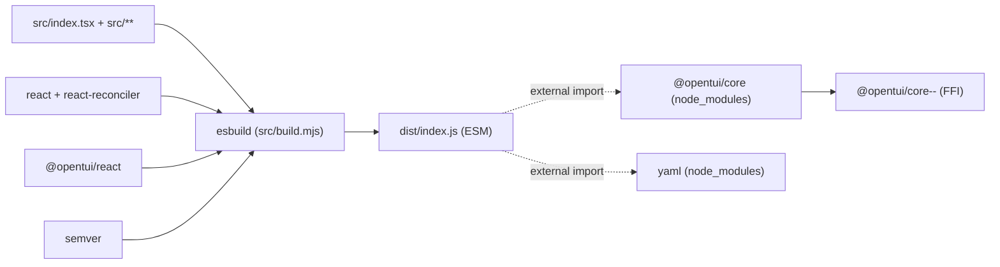

# Runtime & Tooling Dependencies

`manage-agents` runs as an ES module CLI and terminal user interface (TUI) built on OpenTUI, React 19, and a small set of manifest/versioning libraries (see [System Architecture](../architecture.md)). Beyond its npm dependency graph, the engine interacts with an OpenCode V2 host plugin API inside managed *[targets]* (see [Glossary](../glossary.md)) and delegates VCS, model-catalog, GitHub, and Claude Code operations to external CLIs when present on `PATH`.

## JavaScript Runtimes & Native FFI Requirements

OpenTUI (`@opentui/core`) renders terminal frames through a native Zig core loaded via Foreign Function Interface (FFI). Because FFI support differs across JavaScript runtimes, `package.json` declares dual engine floors (see [Getting Started](../getting-started.md) for local setup):

```json
{
  "engines": {
    "node": ">=26.4.0",
    "bun": ">=1.3.0"
  },
  "type": "module"
}
```

### Node.js vs. Bun Execution

| Runtime | Minimum Version | FFI Mechanism | Launcher Behavior (`manage-agents.mjs`) |
|---------|-----------------|---------------|-----------------------------------------|
| **Node.js** | `>=26.4.0` | `node:ffi` (`--experimental-ffi`) | Verifies `process.versions.node` against `[26, 4, 0]`; re-executes `process.execPath` with `--experimental-ffi` and `--no-warnings=ExperimentalWarning` if either flag is missing from `process.execArgv`. |
| **Bun** | `>=1.3.0` | Built-in `bun:ffi` | Detected via `process.versions.bun`; bypasses the Node version check and `--experimental-ffi` re-exec because Bun provides native FFI out of the box and resolves `@opentui/core`'s `"bun"` conditional export. |

On Windows (`process.platform === "win32"`), `manage-agents.mjs` also runs `chcp 65001` best-effort before booting to pin the console codepage to UTF-8 as a fallback alongside OpenTUI's `WriteConsoleW` output path.

### Launcher Bootstrap & Auto-Rebuild

Before importing `./dist/index.js`, `manage-agents.mjs` (detailed in [Launcher, Build & Self-Update](../modules/launcher-and-build.md)) performs two preflight checks when running from a source checkout (or when `package-lock.json` is present):

1. **Dependency verification**: Compares installed `node_modules/<pkg>/package.json` versions against `package.json` `dependencies` (and `devDependencies` when a build is needed). Unless `MANAGE_AGENTS_SKIP_AUTO_INSTALL=1` (see [User Settings, Target State & Environment Variables](../config/user-and-target-files.md)) is set, missing or mismatched packages trigger `npm ci --ignore-scripts --no-audit --no-fund` (or `npm install` / `bun install --ignore-scripts`).
2. **Staleness rebuild**: Recursively checks modification times under `src/` and `package.json`. When `src/` exists and `dist/index.js` is missing or older than the newest source file, the launcher runs `npm run build` (or `bun run build`) prior to dynamic `import()`. Published npm tarballs omit `src/` and ship prebuilt `dist/`, skipping rebuilds.

### Module Format & TypeScript Configuration

The package uses native ESM (`"type": "module"` in `package.json`) with `.mjs` scripts for bootstrap/build tooling and TypeScript (`src/**/*.ts`, `src/**/*.tsx`, `test/**/*.ts`) for application and test code. `tsconfig.json` configures type-checking without emitting files (`esbuild` handles bundling):

```json
{
  "compilerOptions": {
    "target": "ES2022",
    "module": "NodeNext",
    "moduleResolution": "NodeNext",
    "jsx": "react-jsx",
    "noEmit": true,
    "skipLibCheck": true,
    "strict": false
  },
  "include": ["src/**/*.ts", "src/**/*.tsx", "test/**/*.ts"]
}
```

`module` and `moduleResolution` are set to `"NodeNext"`, requiring explicit `.js` extensions on relative TypeScript imports and respecting package `exports` maps. JSX uses React 19's automatic runtime (`"react-jsx"`).

## Production npm Dependencies

All runtime packages declared under `dependencies` in `package.json`:

| Package | Version Spec | Role in `manage-agents` |
|---------|--------------|-------------------------|
| `@opentui/core` | `0.5.7` | Native Zig-backed terminal renderer (`createCliRenderer`), syntax styling (`SyntaxStyle`), animation easing types (`EasingFunctions`), and headless TUI test harness (`@opentui/core/testing` `createTestRenderer`). Ships platform-specific native binaries via `optionalDependencies` (`@opentui/core-darwin-arm64`, `@opentui/core-linux-x64`, `@opentui/core-win32-x64`, etc.). |
| `@opentui/react` | `0.5.7` | React bindings for OpenTUI (`createRoot`, `useKeyboard`, `useRenderer`, `useTerminalDimensions`, `useTimeline`) used by `src/index.tsx`, `src/App.tsx`, and `src/ui/*` components and modals (see [TUI Shell, Catalog Tree & Inspector](../components/tui-shell-and-catalog.md)). |
| `react` | `^19.0.0` | Component state, memoization, refs, effects, and JSX runtime (`react/jsx-runtime`) for the interactive TUI (`src/App.tsx`, `src/ui/*.tsx`) and component tests. |
| `react-dom` | `^19.0.0` | Companion React 19 peer package installed alongside `react` and `react-reconciler` to satisfy React ecosystem peer expectations. |
| `react-reconciler` | `^0.33.0` | Custom fiber reconciler backing `@opentui/react` to mount React component trees onto OpenTUI terminal nodes. Pinned to the `0.33.x` line compatible with React 19. |
| `semver` | `^7.8.6` | Semantic version parsing, validation, range satisfaction, and release tag comparison across [pack manifests](../modules/pack-validation-and-virtual-packs.md) (`src/utils/packs.ts`), [dependency resolution](../modules/resolver-and-lock.md) (`src/utils/resolver.ts`), lockfiles (`src/utils/lock.ts`), [pack onboarding](../modules/pack-onboarding-and-doctor.md) (`src/utils/packOnboarding.ts`), and [engine self-updates](../modules/launcher-and-build.md) (`src/utils/selfUpdate.ts`). |
| `yaml` | `^2.4.5` | Parsing and serializing YAML agent/command/skill frontmatter, [user settings](../modules/routing-and-user-settings.md), virtual packs, [OpenCode V2 compatibility migrations](../modules/agent-editing-and-v2-compat.md), and [Claude Code bridge manifests](../modules/bridges.md) (`src/utils/agents.ts`, `src/utils/packs.ts`, `src/utils/userSettings.ts`, `src/utils/sourceCustomization.ts`, `src/utils/virtualPacks.ts`, `src/utils/bridge.ts`, `src/index.tsx`). |

## Development & Build Dependencies

Packages declared under `devDependencies` in `package.json` support static verification, test execution, and bundling:

| Package | Version Spec | Role in Build, Test & Validation |
|---------|--------------|----------------------------------|
| `esbuild` | `^0.28.1` | Invoked programmatically by `src/build.mjs` (`npm run build`) to bundle `src/index.tsx` and internal modules into `dist/index.js`. |
| `tsx` | `^4.23.1` | Node module loader (`--import tsx`) used by `npm test` to execute `.ts` and `.tsx` unit tests directly on Node's built-in test runner (`node:test`) without a separate test compilation step. |
| `typescript` | `^5.8.2` | Runs `tsc --noEmit` (`npm run typecheck`) to type-check `src/` and `test/` before tests and builds. |
| `@types/node` | `^22.13.10` | TypeScript ambient definitions for Node.js built-in modules (`node:fs`, `node:path`, `node:child_process`, `node:crypto`, `node:test`, `node:assert`, etc.). |
| `@types/semver` | `^7.8.0` | TypeScript type definitions for the `semver` package. |

### Verification Pipeline (`package.json` `scripts`)

- `npm run typecheck`: `tsc --noEmit`
- `npm test`: `npm run typecheck && node --experimental-ffi --no-warnings=ExperimentalWarning --import tsx --test "src/utils/*.test.ts" "runtime/**/*.test.mjs"`
- `npm run build`: `node src/build.mjs`
- `npm run validate`: `npm test && npm run build && node manage-agents.mjs pack validate contract/examples/minimal-pack` (validating against the [OpenCode Pack Contract 1.1 Reference](../api/pack-contract-reference.md))

## Bundling Externals Architecture

`src/build.mjs` (see [Launcher, Build & Self-Update](../modules/launcher-and-build.md)) compiles the [CLI](../api/cli-reference.md) and [TUI](../components/tui-shell-and-catalog.md) entry point (`src/index.tsx`) into a single ESM bundle at `dist/index.js`:

```javascript
import { dirname, join } from "node:path"
import { fileURLToPath } from "node:url"
import { build } from "esbuild"

// Builds dist/index.js from any working directory.
const managerRoot = join(dirname(fileURLToPath(import.meta.url)), "..")
await build({
  bundle: true,
  platform: "node",
  format: "esm",
  external: ["@opentui/core", "yaml"],
  absWorkingDir: managerRoot,
  logLevel: "info",
  entryPoints: ["src/index.tsx"],
  outfile: "dist/index.js",
})
```



The split between bundled packages and `external: ["@opentui/core", "yaml"]` is deliberate:

- **Why `react`, `react-reconciler`, and `@opentui/react` are bundled**: Inlining React and `@opentui/react` together into `dist/index.js` guarantees a single shared React fiber/dispatcher instance between `manage-agents` JSX components and `@opentui/react`'s custom reconciler, avoiding CJS-in-ESM default-export mismatches or duplicate-React hook errors. `semver` is pure JavaScript and treeshakes cleanly into the bundle.
- **Why `@opentui/core` is external**: `@opentui/core` relies on runtime-specific conditional `exports` (`./index.bun.js` on Bun vs. `./index.node.js` on Node), worker script paths (`./parser.worker.js`), and dynamic resolution of OS/CPU-specific native shared libraries (`@opentui/core-darwin-arm64`, `@opentui/core-linux-x64`, etc.). Bundling it with `platform: "node"` would hardcode the Node entrypoint (breaking Bun execution) and sever relative asset/FFI binary lookup paths.
- **Why `yaml` is external**: `yaml` ships as a CommonJS package (`"type": "commonjs"` with Node vs. browser conditional exports). Keeping `yaml` external avoids esbuild CJS-to-ESM dynamic `require` shims in `format: "esm"` output and lets Node and Bun load `./dist/index.js` from `node_modules/yaml` natively.

## Host Plugin API & Optional External CLIs

### `@opencode/plugin` Host Contract (`manage-agents-router`)

During [target reconciliation](../modules/target-installer.md), `manage-agents` installs a V2 [Runtime Router Plugin](../modules/runtime-router-plugin.md) into `<target>/plugins/manage-agents-router/` consisting of two runtime files plus a generated `routing.json` (implementing [Conditional Routing & Archetypes](../concepts/conditional-routing-and-archetypes.md)):

- `runtime/plugins/manage-agents-router/index.ts`: Imports `{ Plugin } from "@opencode/plugin"` and exports `Plugin.define({ id: "manage-agents-router", setup: setupRouter })`. `@opencode/plugin` is **not** an npm dependency of `manage-agents`; it is provided at runtime by the OpenCode V2 host process loading the target directory. `setupRouter` attaches optional fail-open hooks to `ctx.session?.hook` (`"model.request"` and `"context"`), `ctx.permission?.hook` (`"evaluate"`), and `ctx.tool?.hook` (`"execute.before"`), and can be disabled via `OPENCODE_AGENT_ROUTER=off`.
- `runtime/plugins/manage-agents-router/router.js`: Contains `validateRouting`, `decideSessionTools`, `decidePermission`, and `decideToolExecution` written in pure, zero-dependency ESM JavaScript. Separating pure policy evaluation from the `@opencode/plugin` entrypoint allows `runtime/**/*.test.mjs` to test routing rules directly under `node:test` without mocking or installing the OpenCode host SDK.

### External CLI Integrations

`manage-agents` spawns external command-line tools via `node:child_process` (`spawnSync`, `spawn`, `execFile`, `execFileSync`, `execSync`). Only `git` is required for remote source and auto-commit workflows; all other CLIs degrade gracefully when absent.

| CLI | Requirement | Source Modules | Key Invocations & Fallback Behavior |
|-----|-------------|----------------|-------------------------------------|
| `git` | Required for Git sources & workspace auto-commits | `src/utils/sources.ts`, `src/utils/repositoryTransaction.ts`, `src/utils/engineVersion.ts`, `src/utils/selfUpdate.ts` | Clones and fetches Git pack sources (`git clone --quiet --no-checkout`, `git fetch --quiet --force --tags --prune`, `git checkout --quiet --force --detach`) with `GIT_TERMINAL_PROMPT=0`, `-c protocol.file.allow=never`, and sanitized environment variables (`cleanGitEnvironment` strips `GIT_DIR`, `GIT_WORK_TREE`, `GIT_CONFIG*`, etc. — see [Security & Trust Model](../concepts/security-and-trust-model.md)). Also powers atomic workspace auto-commits (`git rev-parse --show-toplevel`, `git status --porcelain=v1 -z`) and checkout dirty-tree inspection. |
| `opencode` | Optional | `src/utils/models.ts` | Queries `opencode models --verbose` (falling back to `opencode models`) to discover verified `provider/model` identifiers and JSON `variants` blocks for TUI model pickers and audits. Returns `{ status: "unavailable", models: [] }` if `opencode` is missing or returns no models. |
| `gh` | Optional | `src/utils/github.ts`, `src/utils/sources.ts`, `src/utils/selfUpdate.ts` | Checks authentication (`gh auth status --hostname <host> --json hosts` without `--show-token`), runs browser login (`gh auth login --hostname <host> --git-protocol https --web`), lists accessible repositories (`gh repo list --no-archived --json nameWithOwner,description,isPrivate,updatedAt,url`), injects transient HTTPS Git credentials (`-c credential.https://<host>.helper=!gh auth git-credential`; see [Sources & GitHub Integration](../modules/sources-and-github.md)), and fetches self-update release assets (`gh api repos/<repo>/releases/...` / `gh auth token`), falling back to direct HTTPS `fetch()` with `GITHUB_TOKEN` / `GH_TOKEN` or unauthenticated requests. |
| `claude` | Optional | `src/utils/claudePluginCli.ts` | Invoked after [Claude Code bridge generation](../modules/bridges.md) to validate emitted plugins (`claude plugin validate <pluginDir> --strict`) and register local marketplaces (`claude plugin marketplace add <pluginDir>` followed by `claude plugin install <plugin>@<marketplace>`). If `claude` is not installed (`ENOENT`), returns `{ kind: "skipped" }` instead of failing the bridge command. |

On Unix/macOS/Windows self-updates from GitHub release tarballs (configured via [Bridge Translation & Release Config Reference](../config/translation-and-release-config.md)), `src/utils/selfUpdate.ts` also invokes `tar -xzf <archive> -C <dest>` to unpack downloaded release archives during atomic engine upgrades.

## Related Pages

- [System Architecture](../architecture.md) — End-to-end architecture across CLI, TUI, pack engine, bridges, and runtime plugin
- [Getting Started](../getting-started.md) — Runtime installation, Node 26.4+ / Bun 1.3+ setup, and verification commands
- [Launcher, Build & Self-Update](../modules/launcher-and-build.md) — `manage-agents.mjs` FFI bootstrap, auto-rebuild, `src/build.mjs`, and `self-update`
- [Runtime Router Plugin](../modules/runtime-router-plugin.md) — Zero-dependency policy evaluator and `@opencode/plugin` V2 integration
- [Sources & GitHub Integration](../modules/sources-and-github.md) — How `git` and `gh` subprocesses are invoked for remote pack sources
- [Claude Code & Codex Bridges](../modules/bridges.md) — Optional `claude` CLI validation and marketplace registration workflow
- [User Settings, Target State & Environment Variables](../config/user-and-target-files.md) — Environment variables affecting launcher auto-install, Git sanitization, and router startup
