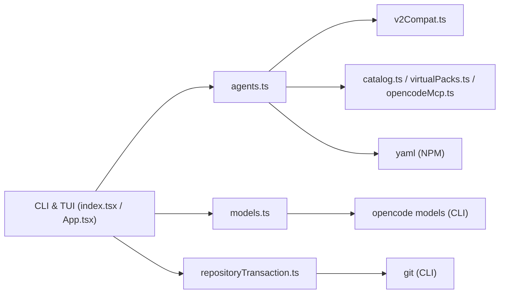

# Agent Editing, V2 Compatibility & Git Transactions

## Purpose

This module group implements [workspace-side authoring](../components/authoring-and-bridge-modals.md), inspection, migration, validation, and atomic persistence of OpenCode *[agent]* (see [Glossary](../glossary.md)) Markdown files. It bridges OpenCode V1 and V2 frontmatter/configuration schemas bidirectionally so existing V1 editing workflows operate seamlessly while always emitting V2-compliant agent files on disk, queries the live OpenCode CLI model catalog for variant and model validation, and wraps multi-file workspace edits in path-scoped, hook-isolated Git auto-commit transactions.

## Key Files

| File | Role |
|------|------|
| `src/utils/agents.ts` | Workspace agent discovery, YAML frontmatter extraction, resource/delegation editing, naming lint, reference-safe renaming, security auditing, parameter tuning, and atomic/CAS file writes |
| `src/utils/v2Compat.ts` | Bidirectional OpenCode V1 ↔ V2 translator for agent frontmatter, command frontmatter, [`opencode.json`](../config/user-and-target-files.md) configurations, and permission rules |
| `src/utils/models.ts` | Live `opencode models --verbose` catalog loader, JSON detail block parser for model variants, explicit-model validation, and token-similarity typo suggestions |
| `src/utils/repositoryTransaction.ts` | Opt-in Git auto-commit coordinator with environment sanitization, lock-file concurrency guards, pre-flight repository checks, blob fingerprinting, and path-scoped hook-free commits |

## Module Dependencies



- **Internal consumers**: [`src/index.tsx`](../api/cli-reference.md) and [`src/App.tsx`](../components/tui-shell-and-catalog.md) drive interactive and CLI workflows; [`lock.ts`](./resolver-and-lock.md), [`installer.ts`](./target-installer.md), [`sources.ts`](./sources-and-github.md), [`userSettings.ts`](./routing-and-user-settings.md), `archetypes.ts`, and [`packOnboarding.ts`](./pack-onboarding-and-doctor.md) reuse `atomicWriteRestrictedFile`, `extractFrontmatter`, `renderAgentFile`, and `cleanGitEnvironment`; [`bridge.ts`](./bridges.md) and `codexBridge.ts` consume `AgentInfo`, `isKnownPermissionKey`, and `translatePermissionsV2ToV1`.
- **External packages and binaries**: [`yaml`](../dependencies/runtime-and-tooling-stack.md) for frontmatter parsing/serialization, `opencode` CLI for live model/variant discovery, and `git` CLI for scoped repository commits.

---

## Agent Discovery, Parsing & Atomic CAS Writes

### Workspace Discovery (`findAgentFiles`)

`findAgentFiles(workspaceRoot, sourceDir?, options?)` locates agent `.md` files without ever following symbolic links:

1. With no explicit `sourceDir`, discovery starts at the workspace root and visits outermost pack manifests up to four levels deep. The pack name comes from the manifest.
2. Each pack contributes Markdown from its `agents/`, `agent/`, `mode/`, and `modes/` directories. Legacy modes default to primary. The Catalog also lists packs with zero agents.
3. Manifest-free workspaces use the virtual-pack scanner. Both discovery paths skip symbolic links.
4. **Category assignment**: Each `AgentInfo.category` resolves to the enclosing pack name via `packNameOf(filePath, workspaceRoot)` (nearest `opencode-pack.json`), falling back to `computeCategories(filenames)`, which picks the longest hyphen-delimited prefix shared by two or more agent filenames (or `"general"`).

### Frontmatter Parsing & Delegation Graph Extraction

`extractFrontmatter(content)` splits raw Markdown using a CRLF-tolerant regular expression:

```ts
const FRONTMATTER_RE = /^---[ \t]*\r?\n([\s\S]*?)\r?\n---(?:\r?\n|$)/
```

`parseAgentFile(filePath, workspaceRoot, contentOverride?)` parses `yamlText` with `YAML.parse()`, verifies it is a non-empty plain object, and detects its schema version via `detectFrontmatterVersion(parsed)` (treating `"unknown"` frontmatter whose `model` string contains `#` as `"v2"`). V2 frontmatter is normalized into the V1 in-memory shape via `translateFrontmatterV2ToV1(parsed)` so internal inspection and editing functions operate on a uniform representation while preserving `frontmatterVersion` on `AgentInfo`.

Subagent delegation edges are extracted from `frontmatter.permission?.task`:
- **Outbound delegations**: Every key in `permission.task` other than `"*"` with value `"allow"` or `true` is collected into `agent.allowedSubagents: string[]`. Updating delegations via `updateAgentDelegations(agent, allowedSubagentNames)` rewrites `permission.task` as `{ "*": "deny", ...allowed }` so `"*"` always precedes explicit `allow` entries.
- **Inbound delegations**: Callers and rename workflows identify inbound edges across the workspace by scanning other agents' `permission.task` maps and `@<agent-name>` mentions in Markdown bodies.

### Atomic Temp-Rename Saves & Compare-and-Swap Rollback

All writes go through `saveAgentFile()` → `renderAgentFile()` → `atomicWriteAgentFile()` (or `atomicWriteRestrictedFile(filePath, bytes, mode = 0o600)` for sensitive config/lock files):

- **V2 write boundary**: `renderAgentFile()` always translates the in-memory frontmatter through `translateFrontmatterV1ToV2()`, trims the serialized YAML, and strips leading blank lines from the prompt body via `normalizeAgentBody()`.
- **Atomic replacement**: `atomicWriteAgentFile()` checks `fs.lstatSync(filePath, { throwIfNoEntry: false })` and refuses to replace symlinks or non-regular files, preserves existing permission bits (`target.mode & 0o7777`, defaulting to `0o666`), creates an exclusive sibling temporary file `.${basename}.${process.pid}.${randomBytes(8).toString("hex")}.tmp` with `fs.openSync(tempPath, "wx", mode)` (retrying up to 8 times on `EEXIST`), writes the full buffer, enforces permissions via `fs.fchmodSync`, closes the descriptor, and [atomically swaps the file into place](../concepts/pack-lifecycle-and-target-safety.md) with `fs.renameSync(tempPath, filePath)`.
- **Compare-and-swap (CAS) & batch rollback**:
  - With its default writer, `updateAgentResources()` re-reads the file before writing and aborts if `originalAgent.toString("utf8") !== agent.rawContent`, skipping disk I/O entirely when the rendered bytes are identical. An injected writer bypasses this on-disk CAS check.
  - Multi-agent model operations (`updateAgentsModel()` and `repairAgentModels()`) pre-validate every target file's raw bytes against `agent.rawContent` and parsed on-disk `frontmatter.model` before touching any file. During execution they record original bytes, file modes, in-memory `structuredClone(agent.frontmatter)` snapshots, and the exact expected post-write `{ bytes, mode }`. If a write fails mid-batch, already-written files are rolled back in reverse order—verifying first that on-disk bytes and mode still match the manager's write (`rollback conflict: file changed after manager write` if an external process modified the file concurrently)—and in-memory `AgentInfo` objects are restored.

---

## OpenCode V1 ↔ V2 Frontmatter Compatibility

`src/utils/v2Compat.ts` translates bidirectionally between legacy V1 files and OpenCode V2 schemas while preserving all unrecognized custom frontmatter keys via shallow object cloning (`{ ...fm }`).

### Version Detection & Field Mapping

`detectFrontmatterVersion(fm)` inspects presence of V2-only keys (`steps`, `disabled`, `system`, `permissions`, `request`) versus V1-only keys (`max_steps`, `disable`, `prompt`, `permission`, `temperature`, `top_p`, `top_k`, `tools`). If `steps` coexists with legacy `permission` or sampling fields (`temperature`, `top_p`, `top_k`) and no other V2-only keys are present, it classifies the file as `"v1"`.

| Concept | OpenCode V1 | OpenCode V2 | Notes |
|---------|-------------|-------------|-------|
| Step ceiling | `max_steps: 50` | `steps: 50` | Mapped in both directions |
| Disable flag | `disable: true` | `disabled: true` | Mapped in both directions |
| System prompt override | `prompt: "..."` | `system: "..."` | Mapped in both directions |
| Model variant | `model: provider/id` + `variant: high` | `model: provider/id#high` | `composeModelVariant()` prevents duplicate `#` suffixes |
| Sampling parameters | `temperature`, `top_p`, `top_k` | *(removed)* | Stripped from top-level and `request.body` in both directions; empty `request` wrappers are pruned |
| Tool/resource access | `permission: { ... }` & `tools: { ... }` | `permissions: [{ action, resource, effect }]` | Boolean or `allow`/`ask`/`deny` `tools` entries are merged first, then `permission` values override them; existing V2 `permissions` takes precedence if present |
| Command delegation | `subtask: true` | `subagent: true` | Handled by `translateCommandFrontmatterV1ToV2` / `V2ToV1` |
| [`opencode.json`](../config/user-and-target-files.md) top-level | `agent`, `mode`, `command`, `subtask`, flat `mcp.<s_id>` (`enabled`) | `agents` (`mode: "primary"`), `commands`, `subagent`, `mcp.servers.<s_id>` (`disabled`) | Handled by `translateConfigV1ToV2` / `V2ToV1`; preserves `mcp.timeout` and explicit `codemode` |

### Permission Vocabulary, Irreversible Collapses & Last-Match-Wins Ordering

OpenCode V2 evaluates `permissions: V2PermissionRule[]` (`{ action, resource, effect: "allow" | "ask" | "deny" }`) using **last-match-wins** semantics. `translatePermissionsV1ToV2()` and `translatePermissionsV2ToV1()` enforce both action vocabulary safety and rule ordering:

1. **Global fallback rule first**: If V1 `permission` defines a top-level `"*"` key, `translatePermissionsV1ToV2()` always emits `{ action: "*", resource: "*", effect }` at index `0` regardless of where `"*"` appeared in the V1 object. Conversely, `translatePermissionsV2ToV1()` places a `{ action: "*", resource: "*" }` rule first in the reconstructed V1 object.
2. **Intentional V1 → V2 action collapses** (derived from OpenCode v2.2.5 runtime assertions):
   - `bash`, `execute` → `shell` (maps back to `bash`)
   - `write`, `edit`, `apply_patch`, `patch`, `multiedit` → `edit` (maps back to `edit`)
   - `read`, `list` → `read` (maps back to `read`)
   - `task` → `subagent` (maps back to `task`)
   - `read_mcp_resource` → `opencode_read_mcp_resource`
   - `list_mcp_resources`, `list_mcp_resource_templates` → `opencode_list_mcp_resources`
   - Legacy shorthand `mcp-resource` expands to both `opencode_read_mcp_resource` and `opencode_list_mcp_resources`, deduplicating identical `{ action, resource, effect }` triples.
3. **Fail-closed key resolution**: Lookup tables use `Object.hasOwn` so prototype properties (`constructor`, `toString`, `__proto__`) never resolve. Unmapped keys only pass through if they belong to the closed `V2_PASSTHROUGH_ACTIONS` set (`todowrite`, `skill`, `websearch`, `mcp-resource`, `artifact`, `file-diff`, `opencode_session_*`, `opencode_worktree_*`), match repository custom tools (`/^(?:dev|pipeline)_[a-z][a-z0-9_]*$/`), or match valid MCP tool wildcards/names (`/^[A-Za-z0-9][A-Za-z0-9._-]*_(?:\*|[A-Za-z0-9][A-Za-z0-9._-]*)$/`) while not appearing in `V1_ONLY_PERMISSION_KEYS` (`doom_loop`, `bash`, `task`, etc.). `isKnownPermissionKey(key)` exposes a single source of truth for distinguishing built-in/custom tool keys from [MCP server keys](./pack-validation-and-virtual-packs.md).

```ts
// V1 frontmatter input
const v1 = {
  model: "anthropic/claude-sonnet-4",
  variant: "high",
  max_steps: 40,
  temperature: 0.2,
  permission: {
    bash: "deny",
    task: { "*": "deny", "flow-explore": "allow" },
  },
}

// Emitted V2 frontmatter via translateFrontmatterV1ToV2(v1)
// {
//   model: "anthropic/claude-sonnet-4#high",
//   steps: 40,
//   permissions: [
//     { action: "shell", resource: "*", effect: "deny" },
//     { action: "subagent", resource: "*", effect: "deny" },
//     { action: "subagent", resource: "flow-explore", effect: "allow" }
//   ]
// }
```

When editing resource permissions via `discoverAgentResources()` and `updateAgentResources()`, tool modules under `tools/<namespace>/<prefix>_<member>.ts` are grouped under `<prefix>_*` family keys (the prefix is the part before the first underscore), and `updateAgentResources()` reorders `<prefix>_*` ahead of specific `<prefix>_<member>` entries so member overrides win under last-match-wins evaluation.

---

## Naming Convention, Reference-Safe Renaming & Security Auditing

### Naming Convention & `analyzeAgentName`

Workspace agents follow the pattern:

```text
[{family}-]{category}-{role_with_underscores}.md
```

`analyzeAgentName(filename, allFilenames?)` strips `.md` and resolves prefixes in two stages:
- When `allFilenames` is provided, `getKnownPrefixes(allFilenames)` counts 1-segment and 2-segment hyphenated prefixes across unique filenames and treats prefixes occurring in at least 2 files as known categories or `family-category` pairs (longest match first, e.g., `slides-html-writer.md` → `category: "slides"`, `role: "html-writer"` → suggested `slides-html_writer.md`).
- Otherwise, 2 hyphen-separated parts parse as `{category}-{role}` and 3+ parts parse as `{family}-{category}-{rawRole}`.
- Filenames with fewer than 2 hyphen-separated segments fail with `"Missing category separator (must be at least {category}-{role})"` (suggesting `general-${rolePart}.md`), and roles containing `-` or spaces fail with `"Multi-word role uses hyphens/spaces instead of underscores ('_' required for role)"`.

### Reference-Safe Renaming (`renameAgent`)

`renameAgent(workspaceRoot, oldPath, newFilename, agents)` renames an agent file and updates cross-agent references in two phases:

1. **Path sanitization & pre-computation**: Ensures `.md` extension, validates the filename with `sanitizeFilename()` (`/^[a-zA-Z0-9._-]+$/`, no leading `.`, `..`, NUL, or path separators), confirms the destination remains inside `path.dirname(oldPath)` and does not overwrite another file, and scans the supplied agent list by reading each existing file before preparing reference updates:
   - Replaces `frontmatter.permission.task[oldNameNoExt]` with `taskPerm[newNameNoExt]`.
   - Rewrites `@<oldName>` subagent invocations in the Markdown body using `new RegExp("@" + escapeRegExp(oldNameNoExt) + "(?![A-Za-z0-9_-])", "g")` so longer agent names sharing a prefix are untouched.
2. **Filesystem commit**: Performs `fs.renameSync(oldPath, newPath)` first, then flushes every modified agent file via `saveAgentFile()`, emitting V2 frontmatter and applying the translator's top-level global-rule ordering. If a reference write fails, the rename remains in place and the function reports that reference updates were only partially flushed so the referencing files can be restored from version control.

### Security Risk Auditing & Safety Presets

`getAgentPermissionSummary(agent)` and `auditSecurityPermissions(agents)` classify every agent across [risk tiers](../concepts/security-and-trust-model.md) and permission-order correctness:

- **Risk levels**:
  - `HIGH`: `permission.bash` is `"allow"`, `true`, or a custom command map object.
  - `MEDIUM`: `bash` is not allowed, and `permission.edit` is `"allow"`, `true`, or a path map object.
  - `LOW`: Read-only or ask/deny-restricted agents.
- **Wildcard order verification (`analyzePermissionOrder` / `fixPermissionOrder`)**: Because OpenCode uses last-match-wins evaluation, any nested permission dictionary (such as `permission.task` or `permission.edit`) that contains `"*"` anywhere other than `Object.keys(val)[0]` silently shadows preceding specific rules. `analyzePermissionOrder()` flags offending categories in `audit.orderErrors`, and `fixPermissionOrder()` rebuilds each dictionary with `"*"` at index `0`.

`applySafetyPreset(agents, presetKey, writer?)` merges one of three built-in `SAFETY_PRESETS` onto `frontmatter.permission` while preserving unrelated keys (such as `task` or MCP server permissions):

| Preset Key | Label | `read` / `grep` / `glob` / `lsp` | `edit` & `write` | `bash` |
|------------|-------|----------------------------------|------------------|--------|
| `readonly_scout` | Read-Only Scout | `"allow"` | `"deny"` | `"deny"` |
| `safe_builder` | Safe Builder | `"allow"` | `{ "*": "allow" }` | `"deny"` |
| `unrestricted_dev` | Unrestricted Dev | `"allow"` | `{ "*": "allow" }` | `{ "*": "allow" }` |

---

## Parameter Tuning & Live Model Catalog

### Batch Parameter Tuning

`inspectTuningTargets()`, `buildTuningUpdateParams()`, [`parseTuneCliArgs()`](../api/cli-reference.md), `updateAgentParams()`, and `updateAgentsColor()` [manage agent execution settings](../components/authoring-and-bridge-modals.md) across single agents, packs, or the entire workspace:

- **`steps`**: Resolved via `resolveAgentSteps()` (`steps ?? max_steps`, defaulting to `50`; numeric strings are accepted for display). Updates change existing `steps` and/or `max_steps` fields, or create `steps` if neither exists. CLI/UI input is validated as a positive safe integer.
- **`variant`** (`--variant` / `--effort`, cleared with `--clear-variant` / `--clear-effort`): Normalized to lowercase (`[a-z0-9._-]+`) via `normalizeAgentVariant()` and checked against supplied `allowedVariants` or `KNOWN_MODEL_VARIANTS` (`"none"`, `"minimal"`, `"low"`, `"medium"`, `"high"`, `"xhigh"`, `"max"`, `"thinking"`). `resolveAllowedTuneVariants()` only derives model-specific choices from a verified catalog: it adds variants shared by all explicitly selected models, or all catalog variants when no explicit model is selected, to the known set. On write, `composeModelVariant()` folds `variant` into `model#variant` (or removes the suffix when cleared).
- **`mode`**: Validated against `AGENT_TUNING_MODES` (`"subagent"`, `"primary"`, `"all"`, defaulting to `"subagent"`).
- **`hidden`**: Boolean toggle (`--hidden` / `--no-hidden`).
- **`color`**: Batch-applied via `updateAgentsColor(agents, color)`.
- **Deprecated sampling guard**: `parseTuneCliArgs()` explicitly rejects `--temp` with a migration error directing users to configure sampling on a model variant instead.

### Live Model Catalog & Fuzzy Typo Suggestions (`src/utils/models.ts`)

`loadModelCatalog(runnerOrRefresh?, refresh?)` queries the local [OpenCode CLI](../dependencies/runtime-and-tooling-stack.md) synchronously (`execSync` with `stdio: ["ignore", "pipe", "ignore"]`, `windowsHide: true`):

1. **Fallback command chain**: Executes `opencode models --verbose` first to capture per-model metadata, falling back to `opencode models` if verbose output fails or returns no models. If both fail, returns `{ status: "unavailable", models: [], error }`.
2. **Verbose JSON block parser (`parseVerboseModelCatalogOutput`)**: Scans lines matching `MODEL_LINE_PATTERN = /^[^/\s]+\/[^\s]+$/` and tracks brace depth (`{` / `}`) outside quoted/escaped strings to parse each model's trailing JSON block. Non-empty keys under `parsed.variants` are recorded in `variants[currentModel]`. Malformed JSON blocks are ignored without aborting catalog loading. `getModelVariants(catalog, model)` strips any `#variant` suffix before looking up supported variants.
3. **Inherited vs. invalid model detection**: `hasExplicitModel()` checks own-property `"model"` on `frontmatter`. Missing `model` displays as `"Inherited"` via `modelDisplayValue()`, whereas explicit `null`, `false`, `""`, other non-string values, or unverified strings are grouped as repair candidates by `collectInvalidModelGroups(agents, catalog)` only when the catalog is verified.
4. **Fuzzy typo suggestions (`suggestModels`)**: Splits `provider/model` on the first `/`, tokenizes model IDs on `/[^a-z0-9]+/`, and computes token overlap similarity:

```ts
function similarity(a: string, b: string): number {
  const aa = new Set(a.toLowerCase().split(/[^a-z0-9]+/).filter(Boolean))
  const bb = new Set(b.toLowerCase().split(/[^a-z0-9]+/).filter(Boolean))
  return [...aa].filter(token => bb.has(token)).length / Math.max(aa.size, bb.size, 1)
}
```

Candidates are ranked by `sameProvider * 2 + similarity`, filtered to `similarity >= 0.4`, and capped at `limit` (default `3`) verbatim catalog entries.

`updateAgentsModel()` accepts only a replacement present in the verified model list and checks each file's current bytes and parsed model before the batch begins. `repairAgentModels()` similarly validates replacement models and unique target paths, then confirms each target still has its expected old model and raw content. Both batch operations snapshot and roll back their file and in-memory state if a write fails; rollback refuses to overwrite a file whose content or mode changed after the manager's write.

---

## Scoped Git Repository Transactions

`src/utils/repositoryTransaction.ts` provides `repositoryTransaction<T>(workspacePath, plan, message, mutation, options?)`, allowing agent creation, renaming, tuning, [bridge generation](./bridges.md), and [routing edits](./routing-and-user-settings.md) (`AUTO_COMMIT_MESSAGES`) to create surgical, path-scoped Git commits when opt-in auto-commit is active.

### Activation Resolution & Environment Hardening

- **CLI and environment flags**: `parseAutoCommitArgs(argv, env)` strips [`--auto-commit` and `--no-auto-commit`](../api/cli-reference.md) prior to `--` (throwing if both are passed) and falls back to [`AGENT_MANAGER_AUTO_COMMIT`](../config/user-and-target-files.md) (`"1"` enables, `"0"` or unset disables; any other defined value throws).
- **Sanitized Git environment**: Every `git` subprocess runs through `cleanGitEnvironment()`, which strips `GIT_DIR`, `GIT_WORK_TREE`, `GIT_INDEX_FILE`, `GIT_OBJECT_DIRECTORY`, `GIT_ALTERNATE_OBJECT_DIRECTORIES`, `GIT_COMMON_DIR`, `GIT_NAMESPACE`, `GIT_CEILING_DIRECTORIES`, `GIT_DISCOVERY_ACROSS_FILESYSTEM`, `GIT_OPTIONAL_LOCKS`, and all `GIT_CONFIG*` variables so ambient shell overrides [cannot redirect commits to another repository or index](../concepts/security-and-trust-model.md).

### Transaction Lifecycle

1. **Path planning & symlink rejection (`planPaths`)**: Validates `localPaths` and optional `externalPaths` before running `mutation()`, even when auto-commit is `"off"`. Relative local paths containing `..`, local paths escaping `workspacePath`, a path declared as both local and external, or any path traversing a symbolic-link component (`assertNoSymlinkComponents`) throw `RepositoryTransactionError`. External paths may be outside the workspace but are also checked for symlink components. If `!autoCommitEnabled()`, `mutation()` runs immediately and returns `{ value, commit: "off" }`.
2. **Lock acquisition & pre-flight checks**:
   - Resolves `git rev-parse --show-toplevel` (`fs.realpathSync`) and `--git-common-dir`, then acquires `<commonDir>/agent-manager.lock` via `fs.openSync(managerLock, "wx", 0o600)` and records its `{ dev, ino }` identity.
   - Verifies no in-progress Git state markers exist (`MERGE_HEAD`, `CHERRY_PICK_HEAD`, `REVERT_HEAD`, `rebase-merge`, `rebase-apply`).
   - Requires a completely clean worktree and index (`git status --porcelain=v1 -z --untracked-files=all` with `GIT_OPTIONAL_LOCKS=0` returns zero entries; note that Git's own `.git/index.lock` causes `git status` or `commit` to fail safely without blocking the mutation).
   - Verifies an attached, valid branch (`git rev-parse --verify HEAD` and `git symbolic-ref --quiet HEAD`) and a configured author identity (`git var GIT_AUTHOR_IDENT`).
    - **Non-blocking fallback**: If `agent-manager.lock` is already held (`EEXIST`) or any pre-flight check fails, Git never blocks the workspace edit—`mutation()` still executes and the result returns `commit: "skipped"` with a `TransactionWarning` (`"checkpoint-locked"`, `"preflight-lock"`, `"unsupported-repository-state"`, `"dirty-repository"`, or `"git-unavailable"`). When this invocation acquired the lock before a later pre-flight failure, it keeps that lock through the fallback mutation and releases it afterward.
3. **Mutation execution**: Runs `mutation()`. If `mutation()` throws, `agent-manager.lock` is released immediately and the error propagates (leaving file-level rollback to the mutator's own CAS restore logic).
4. **Scope verification & double blob fingerprinting**:
   - Inspects post-mutation `git status --porcelain=v1 -z --untracked-files=all` (including both sides of `R`/`C` entries). If any dirty path lies outside planned `localPaths`, commit is aborted with `commit: "failed"` (`code: "unexpected-path"`), preserving the user's disk edit. If no files changed, returns `commit: "skipped"`.
   - Computes `fingerprint()` (`git hash-object -w --stdin` + file mode `100755`/`100644`, or `{ oid: "0", mode: "0" }` for deletions) twice back-to-back; any mismatch aborts with `code: "concurrent-worktree-change"`.
5. **Hook-isolated, unsigned, path-scoped commit**:
   - Marks untracked in-scope files with `git --literal-pathspecs add --intent-to-add --pathspec-from-file=- --pathspec-file-nul`.
   - Allocates an empty `0o700` directory `.agent-manager-hooks-*` alongside the repository root and commits only the NUL-delimited `selected` paths with hooks redirected to the empty directory and GPG signing disabled:

```ts
const commit = git(
  runner,
  root,
  [
    "--literal-pathspecs",
    "-c", `core.hooksPath=${hooksDir}`,
    "commit",
    "--only",
    "--no-gpg-sign",
    "--no-edit",
    "--cleanup=verbatim",
    "--pathspec-from-file=-",
    "--pathspec-file-nul",
    "-m", message,
  ],
  { GIT_CONFIG_NOSYSTEM: "1", GIT_EDITOR: ":" },
  pathspec(selected),
)
```

6. **Post-commit tree verification & cleanup**: Compares committed `git ls-tree` blob OIDs/modes and `git diff-tree` paths against the pre-commit fingerprints and confirms no selected paths remain dirty in `git status`, emitting a `"post-commit-fingerprint-mismatch"` or `"post-verification"` warning if a concurrent write raced with `git commit`. In `finally`, `agent-manager.lock` and `hooksDir` are removed only after confirming their `{ dev, ino }` identities via `sameFile()`.

---

## Related Pages

- [Authoring, Tuning & Bridge Modals](../components/authoring-and-bridge-modals.md) — Interactive TUI modals for creating, renaming, tuning, and auditing workspace agents.
- [TUI Shell, Catalog Tree & Inspector](../components/tui-shell-and-catalog.md) — Workspace agent browser, permission summary badges, and delegation graph inspection.
- [CLI Command Reference](../api/cli-reference.md) — Non-interactive CLI commands and flags including `tune`, model repair, and `--auto-commit`.
- [Pack Validation, Catalog & Virtual Packs](./pack-validation-and-virtual-packs.md) — Pack manifest validation, virtual pack root detection, and MCP server configuration helpers.
- [Claude Code & Codex Bridges](./bridges.md) — Consumes `AgentInfo` metadata and V2-to-V1 permission translation when exporting packs to Claude Code and Codex.
- [Security & Trust Model](../concepts/security-and-trust-model.md) — Symlink rejection, atomic file writes, Git environment sanitization, and permission risk boundaries.
- [User Settings, Target State & Environment Variables](../config/user-and-target-files.md) — Reference for `opencode.json` schema conventions and `AGENT_MANAGER_AUTO_COMMIT`.
