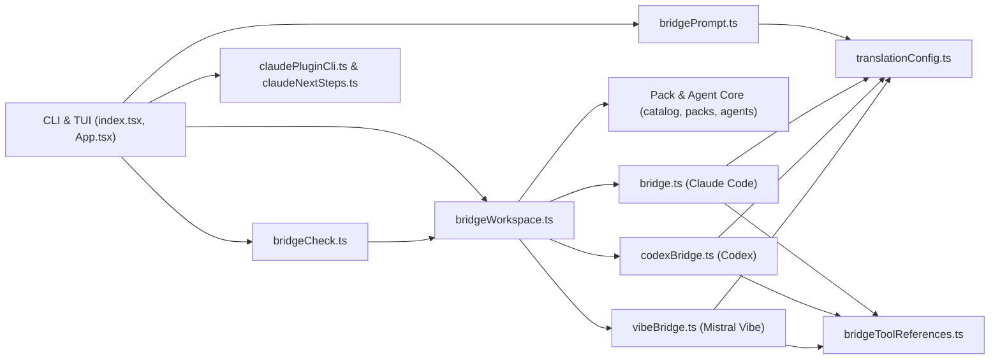

# Claude Code, Codex & Vibe Bridges

## Purpose

The *bridge* (see [Glossary](../glossary.md)) subsystem performs [cross-harness pack translation](../concepts/cross-harness-translation.md), converting canonical [OpenCode agent packs](../api/pack-contract-reference.md)—along with their transitive `requires` closure—into standalone, distributable plugins for **Claude Code** (`bridges/claude-code/<plugin>/`), **Codex** (`bridges/codex/<plugin>/`), and project layers for **Mistral Vibe** (`bridges/vibe/<plugin>/`). Source packs remain untouched: model selection, agent prefix stripping, permission adaptation, MCP/LSP translation, and tool-reference rewrites are computed in an isolated temporary workspace and mirrored deterministically to the target directory.

## Key Files

| File | Role |
|------|------|
| `src/utils/bridgeWorkspace.ts` | Resolves transitive pack closures into an isolated temp workspace (`prepareBridgeWorkspace`), orchestrates generation (`withGeneratedPackBridge`), and mirrors changed files (`bridgePack`). |
| `src/utils/translationConfig.ts` | Defines the v2 [`TranslationConfig`](../config/translation-and-release-config.md) schema, v1-to-v2 migration, validation, peer-model inference index, and the five-step `resolveModelTarget` pipeline. |
| `src/utils/bridgePrompt.ts` | [Interactive TUI](../components/authoring-and-bridge-modals.md) state management, pack filtering, tier/role draft editing, preset cycling, and live mapping preview (`buildPackBridgePreview`). |
| `src/App.tsx`, `src/index.tsx` | TUI and CLI callers that apply/persist bridge drafts, invoke `bridgePack`, and optionally run Claude CLI validation and registration. |
| `src/utils/bridge.ts` | Converts OpenCode agents, commands, skills, MCP servers, and LSP servers into a Claude Code plugin and local marketplace manifest. |
| `src/utils/codexBridge.ts` | Converts OpenCode agents, skills, and MCP servers into a Codex plugin manifest (`.codex-plugin/plugin.json`) and project-scoped `.codex/agents/*.toml` files. |
| `src/utils/vibeBridge.ts` | Converts OpenCode agents, commands, skills, and MCP servers into a native Mistral Vibe plugin package (`plugin.json`, `skills/`, `ai.mistral.vibe/agents/*.toml`, `mcp.json`), plus `src/utils/vibePluginInstall.ts` which mirrors it into the Vibe plugins root. |
| `src/utils/browserDetect.ts` | Resolves the `{browser}` MCP placeholder into the machine's Chromium-family executable (`detectBrowserExecutable`, Chromium preferred over Chrome, PATH plus fixed install locations per platform) and provides `expandBrowserToken`/`stripBrowserToken` for the installer and the verbatim-install bridges. |
| `src/utils/bridgeToolReferences.ts` | Rewrites OpenCode tool names to Claude Code or Codex equivalents, prepends idempotent runtime fallback notes for OpenCode-only tools, and extracts bash allowlists for README documentation. |
| `src/utils/bridgeCheck.ts` | Regenerates a pack bridge in memory/temp storage and compares it byte-for-byte (`compareTrees`, `checkPackBridge`) against committed bridge directories. |
| `src/utils/claudePluginCli.ts` | Invokes the external `claude` CLI for strict validation (`claude plugin validate --strict`) and local marketplace registration (`claude plugin marketplace add` + `claude plugin install`). |
| `src/utils/claudeNextSteps.ts` | Formats post-generation CLI validation and `--plugin-dir` launch commands (`claudeNextSteps`). |

## Dependencies



- **Internal**: [Agent Editing, V2 Compatibility & Git Transactions](./agent-editing-and-v2-compat.md) (`src/utils/agents.ts`: `parseAgentFile`, `extractFrontmatter`, `normalizeAgentBody`; `src/utils/v2Compat.ts`: `translatePermissionsV2ToV1`, `isKnownPermissionKey`), [Pack Validation, Catalog & Virtual Packs](./pack-validation-and-virtual-packs.md) (`src/utils/catalog.ts`: `packDir`, `packsDir`, `resolvePackClosure`; `src/utils/packs.ts`: `validatePack`, `installableFiles`, `parseJsonc`; `src/utils/pathValidation.ts`: `assertInsideRealWorkspace`, `realpathThroughExistingAncestor`, `isPathInsideWorkspace`; `src/utils/opencodeMcp.ts`: `readMcpServers`, `isServerDisabled`), and [Archetypes, Conditional Flows & User Settings](./routing-and-user-settings.md) (`src/utils/sourceCustomization.ts` for per-source bridge config and cache paths in the TUI).
- **External**: [`yaml`](../dependencies/runtime-and-tooling-stack.md) (YAML frontmatter parsing and serialization for Claude Code agents and skills), Node built-ins (`node:fs`, `node:path`, `node:os`, `node:child_process`), and the optional `claude` CLI binary for plugin validation and registration.

## Transitive Closure Staging (`bridgeWorkspace.ts`)

Packs can declare dependencies on companion packs via `requires` in [`opencode-pack.json`](../api/pack-contract-reference.md). Before invoking either target generator, `prepareBridgeWorkspace(workspaceRoot, pack)` stages the full closure into a temporary directory (`manage-agents-bridge-*` under `os.tmpdir()`):

1. **Closure resolution & validation**: Calls [`resolvePackClosure(workspaceRoot, pack)`](./pack-validation-and-virtual-packs.md) to order required packs before dependents. Each pack directory is validated with `validatePack(source)`; any validation error aborts staging and cleans up the temp directory.
2. **Installable file merging**: Copies `installableFiles(validation)` from every pack in the closure (excluding root-level files without `/` and paths containing `node_modules` or `__pycache__`). If two packs provide the same relative path, staging fails closed (`Packs '<owner>' and '<name>' both provide '<file>'`).
3. **Config merging**: Reads `opencode.json` or `opencode.jsonc` from each pack in dependency order, merging `readMcpServers(config)` and `config.lsp` (with later packs overriding earlier keys), and writes a unified `<tempRoot>/opencode.json`.
4. **Scoped agent extraction**: Parses `agents/*.md` **only** from the requested `pack` (setting `agent.category = pack`), while required packs contribute companion `skills/`, `commands/`, `plugins/`, `tools/`, MCP servers, and LSP definitions.
5. **Executable-surface tracking**: Records executable content from every pack in the closure. If an untrusted source contains executable content, confirmation is required; `withGeneratedPackBridge` refuses to proceed when executable content is present and `allowUntrustedExecutable` is not set. A pack with no requested-pack agents also fails generation, and the temporary tree is cleaned up on errors and after use.

`withGeneratedPackBridge(options, use)` places the generated output inside `<tempRoot>` at the same relative path `outputDir` occupies inside `workspaceRoot` (or `path.basename(outputDir)` when external) so relative paths rendered into `README.md` match the final destination.

`bridgePack(options)` enforces [path and symlink safety](../concepts/security-and-trust-model.md) via `assertSafeOutputDir`—rejecting output paths that contain the catalog root, sit inside `packs/` or a pack directory, or traverse symlinks—and synchronizes the generated tree into `outputDir` via `mirrorTree`, rewriting only byte-changed files and pruning stale files or symlinks.

`withGeneratedPackBridge` dispatches to `bridgeToClaudeCode`, `bridgeToCodex` or `bridgeToVibe` according to `target` and generates beneath the temporary root at the final output's relative path. `bridgePack` then mirrors that result to the requested directory, leaving unchanged files untouched and returning the final plugin directory together with generated file paths, warnings, and model-resolution preview data.

When bridging a local catalog or workspace, configuration is read from [`bridges/translation-config.json`](../config/translation-and-release-config.md) and plugins default to `bridges/<claude-code|codex|vibe>/<pluginName>`. When bridging a [registered git source](./sources-and-github.md) from the [TUI](../components/tui-shell-and-catalog.md) (`src/App.tsx`), `workspaceRoot` points to the cached source checkout, and translation settings and generated plugins are stored under [per-user config and cache directories](../config/user-and-target-files.md) (`<configDir>/translations/<source>/translation.json` and `<cacheDir>/bridges/<source>/<claude-code|codex|vibe>/<pluginName>`).

## Translation Config & Five-Step Model Resolution

### `TranslationConfig` v2 Schema (`translationConfig.ts`)

`loadTranslationConfig(workspaceRoot, configPath?, options?)` loads and validates [`bridges/translation-config.json`](../config/translation-and-release-config.md), migrating v1 files (`version === undefined || version === 1`) via `migrateV1(raw)` and rejecting symlinks or out-of-workspace paths.

```ts
export interface TranslationConfig {
  version: 2
  target: "claude" | "codex" | "vibe"
  pluginName: string            // Default: "decent-pipeline"
  prefix: string                // Default: "pipeline-"
  sourceDir: string             // Legacy pre-pack path; validated workspace-relative, ignored by pack bridges
  inference?: boolean           // Default: true
  defaultTier: string           // Default: "execution"
  tiers: Record<string, {
    description?: string
    claude: { model: string; reasoningEffort?: string }
    codex: { model: string; reasoningEffort?: string }
    vibe: { model: string }     // "inherit" -> no active_model (session model)
  }>
  roles: Record<string, string> // Stripped agent role -> tier name
  vibe: {
    overrides: Record<string, { model: string; reasoningEffort?: string }>
    modelMap?: Record<string, string>
    emitSkills?: boolean        // Default: true
    emitReadme?: boolean        // Default: true
    emitMcp?: boolean           // Default: true (when servers exist)
  }
  claude: {
    overrides: Record<string, { model: string; reasoningEffort?: string }>
    modelMap?: Record<string, string>
    emitMarketplace?: boolean   // Default: true
    emitCommands?: boolean      // Default: true
    emitSkills?: boolean        // Default: true
    autoValidate?: boolean      // Default: true
    autoRegister?: boolean      // Default: true
    marketplaceName?: string    // Default: "<pluginName>-local"
  }
  codex: {
    overrides: Record<string, { model: string; reasoningEffort?: string }>
    modelMap?: Record<string, string>
    emitSkills?: boolean        // Default: true
    emitReadme?: boolean        // Default: true
    emitMcp?: boolean           // Default: true (when servers exist)
  }
}
```

Default tiers (`DEFAULT_TIERS`) and roles (`DEFAULT_ROLES`):

| Tier | Claude Model | Codex Model | Codex `reasoningEffort` | Vibe Model | Default Assigned Roles |
|------|--------------|-------------|-------------------------|------------|------------------------|
| `planning` | `opus` | `gpt-5.6-sol` | `high` | `mistral-large-4` | `orchestrator`, `planner`, `reasoner`, `critic`, `code_reviewer` |
| `execution` | `sonnet` | `gpt-5.6-luna` | `max` | `mistral-medium-3.5` | `refactorer`, `tester`, `fast_lane` |
| `light` | `haiku` | `gpt-5.6-luna` | `max` | `mistral-medium-3.5` | `executor`, `explorer` |

`validateClaudeModelName` restricts Claude models to family aliases (`fable`, `sonnet`, `opus`, `haiku`, `inherit`) or full `claude-*` IDs. `validateMarketplaceName` rejects reserved names (`claude`, `claude-code`) and reserved prefixes (`claude-`, `anthropic-`, `anthropics-`). Vibe tier models are free-form Mistral aliases (`mistral-large-4`, `mistral-medium-3.5`, or `inherit`); validation only requires them to be non-empty, since `[[models]]` aliases are installation-specific.

### Five-Step Model Resolution Pipeline

For each agent, `resolveModelTarget(agent, index, config, target)` strips `config.prefix` and `.md` to compute the lowercase `role` (`normalizeAgentName`) and evaluates five steps in strict precedence order:

1. **Per-agent `overrides` (`source: "override"`)**: Checks `config[target].overrides[name]`. If present, returns that exact `ModelTarget`.
2. **Source `modelMap` (`source: "model-map"`)**: Normalizes the agent's source `model` into `full` (`provider/model-id` lowercased) and `bare` (substring after the last `/`), checking `modelMap[full]`, then `modelMap[bare]`, then catch-all `modelMap["*"]`. Unmatched non-`*` entries are surfaced as warnings by `unusedModelMapKeys()`.
3. **Explicit `roles` mapping (`source: "role"`)**: Looks up `config.roles[role]` and selects `config.tiers[tier][target]`.
4. **Peer `inference` (`source: "inferred"`)**: Enabled when `config.inference !== false`. `buildInferenceIndex(agents, config)` indexes the source models (`byFull` and `byBare`) of all peer agents that have an explicit `roles` tier. If an unmapped agent's source model matches peers belonging to **exactly one** tier (`matches.size === 1`), that tier is inherited and `inferredFrom` records the source model. If peers map the same source model to multiple tiers (`matches.size > 1`), inference abstains immediately.
5. **Fallback `defaultTier` (`source: "default"`)**: Uses `config.defaultTier` (or the first declared tier) and resolves `config.tiers[tier][target]`. Both `"inferred"` and `"default"` assignments append informational warnings to the bridge report.

### Interactive TUI & CLI Draft Construction (`bridgePrompt.ts`)

- **Bridge modal**: `collectBridgeablePacks` counts agents in valid packs; `filterBridgePacks`, `reconcileBridgePackQuery`, and `stepBridgePackSelection` implement query filtering and selection. `stepBridgeField` orders the draft fields as `name -> pack -> tiers -> agents -> model` for Claude and Vibe and inserts `effort` before `agents` for Codex. Users cycle Claude tier-model presets (`opus`, `sonnet`, `haiku`, `inherit`), Vibe tier-model presets (`mistral-large-4`, `mistral-medium-3.5`, `inherit`), Codex reasoning-effort presets (`low`, `medium`, `high`, `xhigh`, `max`), and per-role tier assignments (`cycleAgentRoleTier`).
- **Draft, validation, and preview**: `applyBridgeDraftToConfig` trims/sanitizes tier values, derives the pack prefix, and applies the plugin name, role tiers, and optional target-wide `modelMap["*"]` catch-all without mutating the base config. `validateDraftBridgeTiers` rejects empty tiers and missing Claude/Codex/Vibe models, and validates Claude model names when Claude is the selected target. `buildPackBridgePreview` runs the draft through the same `resolveModelTarget` logic used during generation and returns per-agent role, tier, target model, mapping source, and tier counts. The TUI persists the accepted config before invoking `bridgePack`.
- **CLI wizard and flags**: [`manage-agents bridge`](../api/cli-reference.md) supports `--pack`, `--target/-t` (`claude`, `codex`, `vibe`), `--output/-o`, `--name/-n`, `--prefix/-p`, `--config`, `--model <src=target>` (`parseKeyValueMappings`), `--map-all <target>`, `--no-validate`, `--no-register`, `--yes/-y`, `--marketplace-name`, and `--wizard/-w`. The CLI wizard prompts for target, plugin name, source prefix, and planning/execution models for every target. Model mappings and Claude automation/marketplace options are saved to the translation config for later runs; `--yes` confirms bridging untrusted executable content.

## Claude Code Bridge (`bridge.ts`, `claudePluginCli.ts`, `claudeNextSteps.ts`)

### Generated Plugin Layout

`bridgeToClaudeCode()` normalizes the plugin identifier via `normalizeClaudeAgentName` (lowercase kebab-case, max 64 chars, prefixed with `agent-` if starting with a digit) and writes `bridges/claude-code/<pluginName>/`:

The generator resolves each agent's Claude model target, builds its translated frontmatter and prompt, discovers pack companion content, and passes those artifacts plus configuration options to `writeClaudeCodePlugin`. The result includes the effective normalized plugin and marketplace names, generated files, warnings, orchestrator name, and a per-agent model preview; `bridgeWorkspace.ts` handles temporary staging and final mirroring.

- `.claude-plugin/plugin.json`: Plugin manifest (`name`, `version: "1.0.0"`, `description`, `author.name` resolved from [`AGENT_AUTHOR_NAME`](../config/user-and-target-files.md) or `DEFAULT_AUTHOR_NAME`).
- `.claude-plugin/icon.png`: Copied from engine `assets/plugin-icon.png` when available.
- `.claude-plugin/marketplace.json`: Emitted when `claude.emitMarketplace !== false`. Defines a local single-plugin marketplace (`<pluginName>-local` or `claude.marketplaceName`) with `source: "."` for in-place loading; deleted if disabled on subsequent runs.
- `agents/<name>.md`: Converted subagents (`convertAgent`). Frontmatter includes `name`, `description`, `model`, `maxTurns` (mapped from `max_steps` or `maxTurns`), and `tools`. Body `@agent` mentions are rewritten to `@<pluginName>:<canonical-agent>` (`rewriteBodyReferences`), tool names are adapted, and required MCP servers are listed under `## MCP Tools (from OpenCode bridge)`.
- `skills/<command>/SKILL.md`: Emitted from OpenCode `commands/**/*.md` when `claude.emitCommands !== false` (`writeCommandSkill`). Sets `disable-model-invocation: true` and `arguments: request`, prepends delegation instructions targeting `<pluginName>:<orchestratorName>` (the agent with `mode: "primary"`), converts inline `` !`cmd` `` shell substitutions into fenced ```` ```bash ```` blocks, rewrites `$ARGUMENTS` to `$request`, and scopes sibling `/pipeline-*` references to `/<pluginName>:<command>`.
- `skills/<skill>/SKILL.md`: Copied from companion `skills/` directories when `claude.emitSkills !== false` (`copyCompanionSkill`), rejecting any symlinks via [`assertNoSymlinksInTree`](../concepts/security-and-trust-model.md) and stripping the redundant `name` frontmatter field.
- `.mcp.json`: Generated by `buildClaudeMcpConfig` from merged `opencode.json` MCP entries. Remote servers emit `{ type: "http", url }`; stdio servers emit `{ command, args, env }` with `{env:VAR}` converted to `${VAR}`. Disabled servers are omitted unless explicitly required by an agent's permissions (which emits a warning). `{browser}` command elements are stripped with a warning because Claude Code installs committed files verbatim; the server falls back to its own browser detection. If a required server carries a server-wide `${server}_*` deny, generation aborts with an error.
- `.lsp.json`: Generated by `buildClaudeLspConfig`, mapping `command`, `args`, and `extensions` (`extensionToLanguage`).
- `README.md`: Documents setup steps, MCP server requirements, untranspiled OpenCode plugins/tools (with a hook mapping table from `tool.execute.before`/`after`, `session.idle`, and `permission.asked` to `PreToolUse`, `PostToolUse`, `Stop`, and `PermissionRequest`), non-enforced per-agent bash rules, and plugin-scoped skill invocations. Stale `agents/` and `skills/` entries are removed via `pruneStaleArtifacts`.

### Permission Translation & Warnings

Claude Code plugin agents do not support `permissionMode` or `disallowedTools` frontmatter fields. Instead, `normalizedPermissions` converts V2 `permissions` into V1 via [`translatePermissionsV2ToV1`](./agent-editing-and-v2-compat.md) (mapping `subagent` to `task`) and `buildToolsString` synthesizes an explicit `tools` allowlist:

| OpenCode Permission | Claude Code `tools` Output | Notes & Diagnostics (`collectWarnings`) |
|---------------------|----------------------------|-----------------------------------------|
| `task` / `subagent` | `Agent` or `Agent(plugin:a, plugin:b)` | Open allow emits `Agent`; structured map emits plugin-scoped subagent whitelist. `ask` entries warn and promote to allow. |
| `read`, `grep`, `glob` | `Read`, `Grep`, `Glob` | Included by default unless explicitly `"deny"` or `false`. |
| `edit`, `write`, `apply_patch`, `patch`, `multiedit` | `Write, Edit` | Emitted if `objectAllowsAny` (last-match-wins over `*`) grants access. Granular `edit` path patterns warn and collapse to the whole tool. |
| `bash`, `shell` | `Bash` | Emitted if `objectAllowsAny` grants access. Non-`*` command patterns warn and are documented in `README.md` via `collectBashAllowlist`. |
| `webfetch`, `websearch`, `skill`, `lsp`, `question`, `todowrite` | `WebFetch`, `WebSearch`, `Skill`, `LSP`, `AskUserQuestion`, `TodoWrite` | Included when `objectAllowsAny` is true. `webfetch` URL patterns warn and drop. |
| `<server>_*` / `<server>_<tool>` | `mcp__<server>__*`, `mcp__plugin_<plugin>_<server>__*` | If any tool on `<server>` is denied, server wildcards are suppressed and only explicit `<tool>` allows are emitted (with a warning). |
| `ask` rules | Tool included in `tools` | Scalar `ask` or `*: ask` on `PROMOTED_ASK_KEYS` (`websearch`, `skill`, `lsp`, `question`, `todowrite`, `edit`, `bash`, `shell`, `webfetch`) warns that `ask` is promoted to allow. |
| OpenCode-only keys | *(dropped)* | `doom_loop`, `external_directory`, `artifact`, `file-diff`, `mcp-resource`, `opencode_*`, custom tools shipped by the pack, `hidden: true`, and `temperature` emit warnings and are omitted. |

### Validation, Registration & Next Steps

- `validatePlugin(pluginDir)` (`claudePluginCli.ts`): Runs `claude plugin validate <pluginDir> --strict` and returns `PluginCliOutcome`: exit 0 is `pass`, exit 1 is `fail`, a missing executable (`ENOENT`) is `skipped`, and other exits or spawn errors are `error`.
- `registerPlugin(pluginDir, pluginName, marketplaceName)` (`claudePluginCli.ts`): Runs `claude plugin marketplace add <pluginDir>` followed by `claude plugin install <pluginName>@<marketplaceName>`. It handles each command independently, treats an `"already"` response as idempotent success for that step, and returns pass/fail/error/skipped outcomes.
- **Call flow and gates**: Both `runBridge` (`src/index.tsx`) and the TUI's `generateBridge` (`src/App.tsx`) invoke these wrappers after generation. Validation is controlled by `claude.autoValidate`; exit 1 or an unexpected/spawn error blocks registration, while a skipped validation (for example, because `claude` is missing) does not by itself block the registration attempt. Registration runs only when `claude.autoRegister` is enabled and a marketplace manifest was emitted; `--no-validate`, `--no-register`, and `claude.emitMarketplace: false` disable their respective steps. The wrappers bound `claude` invocations to 120 seconds and include only the final 300 characters of each output stream in diagnostics.
- `claudeNextSteps(pluginName, orchestratorName, pluginDir)` (`claudeNextSteps.ts`): Prints local verification hints (`claude plugin validate <pluginDir> --strict` and, when an orchestrator exists, `claude --plugin-dir <pluginDir> --agent <pluginName>:<orchestratorName>`).

## Codex Bridge (`codexBridge.ts`)

`bridgeToCodex()` / `writeCodexPlugin()` generates a [project-scoped Codex layer](../concepts/cross-harness-translation.md) under `bridges/codex/<pluginName>/`:

The Codex path resolves model and reasoning-effort targets, translates the requested pack's agents, and writes the plugin manifest and project-level configuration beneath the supplied output directory. Its result exposes the generated plugin, files, warnings, and per-agent resolution preview; the shared workspace wrapper stages and mirrors the output as described above.

- `.codex-plugin/plugin.json` points to `./.agents/skills/` and `./.mcp.json` when emitted. `.agents/plugins/marketplace.json` lists the plugin for local installation when it includes skills or MCP.
- `.codex/agents/<name>.toml`: Agent definitions rendered by `renderCodexAgentToml`:
  - `name`, `description`, `model`, and optional `model_reasoning_effort` (mapped from `ModelTarget.reasoningEffort`, such as `"high"` or `"max"`).
  - `developer_instructions`: Prompt body with `@agent` mentions rewritten to normalized Codex subagent names (`rewriteReferences`), adapted tool references, and an appended `## Delegation targets` section listing allowed `@<subagent>` targets (`appendDelegationTargets`).
  - `sandbox_mode`: Computed by `resolveSandboxMode(agent)`. Emits `"workspace-write"` if any of `write`, `edit`, `apply_patch`, `patch`, `multiedit`, `bash`, `shell`, or `execute` has an allow rule (`true`, `"allow"`, or an allowing pattern); otherwise emits `"read-only"`. (`danger-full-access` is never emitted by the bridge.)
- `.agents/skills/<name>/SKILL.md` carries each translated agent's instructions when `codex.emitSkills !== false`.
- `.codex/config.toml` supplies project settings for trusted folders. For a pack with a primary agent and additional agents, it permits the primary subagent to delegate one level deeper. The project and plugin's `.mcp.json` use the same MCP entries. The bridge translates stdio environment forwarding and HTTP authentication references, and strips `{browser}` command elements with a warning because Codex installs committed files verbatim. Explicit tool denies become session-wide `disabled_tools`. An unrepresentable deny pattern blocks export of the server and fails the bridge if a translated agent requires it.
- `README.md` documents project launch, plugin installation, MCP setup, translation warnings, and the name of the primary agent when present. The CLI and the TUI both print the project launch command.

## Mistral Vibe Bridge (`vibeBridge.ts`, `vibePluginInstall.ts`)

`bridgeToVibe()` / `writeVibePlugin()` generates a [native Vibe plugin](../concepts/cross-harness-translation.md) (Agent Plugins 1.0 with the `ai.mistral.vibe` extension) under `bridges/vibe/<pluginName>/`:

- `plugin.json`: manifest with the Agent Plugins 1.0 `$schema`, the normalized plugin name, author (AGENT_AUTHOR_NAME), and the `extensions["ai.mistral.vibe"]` gate (`schemaVersion: 1` plus `displayName`) that enables plugin agents.
- `ai.mistral.vibe/agents/<name>.toml`: Agent profiles rendered by `renderVibeAgentToml` (underscore-spelled keys — the runtime validates `schema_version`/`agent_type`/`active_model` and rejects camelCase spellings, unlike the manifest, which accepts both):
  - `schema_version = 1` and `agent_type = "subagent"` for every agent — the plugin format has no selectable primary, so even `mode: primary` agents are spawnable subagents (reported as a warning naming `<plugin>:<name>`; each primary additionally gets a main agent profile, below).
  - `description` (required, 1..300 characters — longer source descriptions are truncated on a word boundary with a warning; the bridge falls back to `Translated agent <name>`), `display_name` (humanized kebab name), and `instructions` (prompt body with `@agent` mentions rewritten to `<plugin>:<name>` references, adapted tool references, and appended `## Delegation targets` plus `## Native Vibe delegation protocol` sections for the `agents.spawn` tool: exact `config_name` values, spawn-then-`wait`, parallel waves, `send_message` reuse, no generic-substitute rule, and the capability contract of spawned subagents, which in the current runtime have no MCP or connector tools, no skill loading, no user questions and no nested delegation). Instructions over 65,536 characters are warned about because Vibe refuses such subagent profiles.
  - `safety = "safe" | "neutral"`: `safe` only when the agent denies `bash`, `write_file` and `edit`, `neutral` otherwise.
  - `active_model` from the target's tier resolution (`mistral-large-4`, `mistral-medium-3.5`, ...); omitted when the tier model is `inherit`, so the agent follows the session's model. Vibe only accepts aliases defined in its own `[[models]]` configuration — the generated README documents the alignment.
  - `[tools.<tool>] permission = "never" | "ask"` narrowing computed by `resolveToolNarrowing`: emitted for whole-group denies and catch-all-`*`-deny allowlist agents, never widening a source grant.
- `agent-profiles/<plugin>-<name>.toml`: main agent profiles for every `mode: primary` agent, rendered by `renderVibeAgentProfileToml` when `vibe.emitAgentProfiles !== false`: the same `display_name`, `description`, optional `active_model`, translated `instructions` and `[tools.<tool>]` narrowing as the subagent profile, without `agent_type` and without `safety` (a user agent file ignores it and reports a config issue). The plugin format ships spawnable subagents only, and a spawned subagent cannot delegate further, so the profile is the way to run a primary as the session's main agent.
- `skills/<name>/SKILL.md`: pack skills copied recursively (frontmatter `name` pinned to the directory identity — Vibe refuses a mismatch — `description` guaranteed and warned over 1024 chars) and commands translated into user-invocable skills (`name`, `user-invocable: true`, `disable-model-invocation: true`, `$ARGUMENTS` -> `$request`, `` !`cmd` `` -> fenced `bash` blocks, delegation header pointing at the `<plugin>-<primary>` main agent profile, or at `<plugin>:<primary>` when profiles are disabled) when `vibe.emitSkills !== false`. Name collisions between a command and a skill warn with the command winning.
- `mcp.json`: MCP servers translated from the merged `opencode.json` into `mcpServers` (`stdio` with `command`/`args`/`env` — `{env:VAR}` values become `${VAR}` with a warning, `PLUGIN_ROOT`/`PLUGIN_DATA` dropped — or `streamable-http` with `url` and static `headers` only; an `Authorization: Bearer {env:VAR}` header cannot ship in a plugin and is dropped with a warning suggesting `vibe mcp add`). Disabled servers are omitted with a warning unless an agent's permissions require them, mirroring the Claude bridge. A server gated with the optional `platform` key (`darwin`/`linux`/`win32`) still ships in the committed `mcp.json`, recorded in an `mcp-platforms.json` sidecar: `installVibePlugin` keeps gated servers only on matching machines (the Agent Plugins mcp schema has no conditions of its own), pruning `mcp.json` from the installed copy when none remain. `{browser}` command elements also ship unresolved so the committed file stays machine-independent: `installVibePlugin` expands them through `detectBrowserExecutable` (Chromium-family first, then Chrome family; PATH lookups plus fixed install locations per platform) and drops the element with a warning when the machine has no known browser.
- `ai.mistral.vibe/hooks.toml` and `ai.mistral.vibe/guard-spawn.js` (only with `vibe.emitHooks: true`): a fail-open `pre_tool` guard on `agents_spawn` that denies `config_name` values claiming the plugin's namespace without being registered, and identical repeated delegations to the same specialist (the `doom_loop` guard's equivalent). Guard state lives under `PLUGIN_DATA`; any script error lets the spawn through.
- `README.md` documents the install roots (`~/.vibe/plugins/` and `<project>/.vibe/plugins/`), `/reload-plugins`, `/plugins`, per-server setup notes, model-alias alignment, and translation warnings. `vibeNextSteps(result, install?, profilesInstall?)` prints the launch hints (installed paths or manual `cp -r`, plus the `vibe --agent <plugin>-<name>` run command per profile) in the CLI and TUI, and OpenCode plugins/tools are reported as untranspiled (Vibe loads skills, agents, hooks and MCP servers only).

After the repository transaction, `installVibePlugin(sourceDir, pluginName, env)` (`src/utils/vibePluginInstall.ts`) mirrors the generated directory into `$VIBE_HOME/plugins/<pluginName>/` (~/.vibe/plugins by default) unless `--no-install-vibe` or `vibe.autoInstall: false` is set: unchanged files are left untouched, stale entries from earlier generations are pruned with warnings, links in the source are rejected, and a linked or non-directory target is replaced rather than written through. The CLI prints the install path and an already-up-to-date note on no-op runs. `installVibeAgentProfiles(pluginDir, pluginName, env)` mirrors `agent-profiles/*.toml` into `$VIBE_HOME/agents/` unless `vibe.installAgentProfiles: false` is set, pruning only its own stale profiles (marker-checked, so hand-edited files survive) and never writing through a link.

## Prompt Tool Adaptation & Drift Checking

### Prompt Tool Adaptation (`bridgeToolReferences.ts`)

`adaptToolReferences(body, target, frontmatter, options)` translates OpenCode tool references in agent bodies without deleting fallback instructions:

- **Claude Code (`CLAUDE_TABLE`)**: Rewrites `\btodowrite\b` to `TodoWrite`, `\bTask (tool|calls?|call\(s\))` to `Agent ...`, and backticked tool identifiers so prose words remain intact: `` `question` `` -> `` `AskUserQuestion` ``, `` `task` `` -> `` `Agent` ``, `` `read` `` -> `` `Read` ``, `` `grep` `` -> `` `Grep` ``, `` `glob` `` -> `` `Glob` ``, `` `lsp` `` -> `` `LSP` ``, `` `skill` `` -> `` `Skill` ``, `` `webfetch` `` -> `` `WebFetch` ``, `` `websearch` `` -> `` `WebSearch` ``, `` `bash` `` -> `` `Bash` ``, `` `edit` `` -> `` `Edit` ``, and `` `write` `` -> `` `Write` ``.
- **Codex (`CODEX_TABLE`)**: Rewrites `\btodowrite\b` to `update_plan` and records targeted guidance bullets when prompts mention `` `question` `` (ask directly in reply), `` `task` `` / `Task tool` (delegate to subagents under `Delegation targets`), `` `read` `` / `` `grep` `` / `` `glob` `` / `` `lsp` `` (use shell commands such as `rg` or `sed -n`), or `` `edit` `` / `` `write` `` (use `apply_patch`).
- **Vibe (`VIBE_TABLE`)**: Rewrites `\btodowrite\b` to `todo`, `Task tool` to `agents.spawn`, and backticked `` `question` `` -> `` `ask_user_question` ``, `` `task` `` -> `` `agents.spawn` ``, `` `read` `` -> `` `read_file` ``, `` `write` `` -> `` `write_file` `` (Vibe keeps `bash`, `edit`, `skill` lowercase). Guidance bullets cover `` `grep` `` / `` `glob` `` / `` `lsp` `` (shell through `bash`) and `` `webfetch` `` / `` `websearch` `` (`web_search` connector when available). The MCP note names the configured servers with their Vibe `mcp_<server>.<tool>` lookup.
- **OpenCode-only custom tools & runtime note**: Matches permissions and prompt text against tool modules in the pack and its dependencies. When renames, guidance, MCP servers, or unavailable tools are present, `insertNearTop` injects a single blockquote immediately after a leading `# Heading` (or at line 1) guarded by `RUNTIME_NOTE_MARKER` (`Runtime note (OpenCode bridge)`) for idempotency.

### Byte-Exact Drift Verification (`bridgeCheck.ts`)

`checkPackBridge(options)` verifies that committed bridge directories match a clean regeneration from current pack sources and [`bridges/translation-config.json`](../config/translation-and-release-config.md):

1. Runs `withGeneratedPackBridge` into a temporary workspace without modifying `committedDir` (and in [`manage-agents bridge check`](../api/cli-reference.md), loads `translation-config.json` with `{ persistMigration: false }`).
2. Reads both the freshly generated directory and `committedDir` into `TreeSnapshot` maps (`Record<posixRelativePath, Uint8Array>`).
3. Runs `compareTrees(expected, actual)` using byte-exact comparison (`bytesEqual`) and returns `{ clean, missing, changed, extra }`.

When `clean` is `false`, `manage-agents bridge check [--pack <name>] [--target claude|codex|vibe]` prints every `missing`, `changed`, and `extra` path and sets `process.exitCode = 1`.

## Usage Example

```ts
import path from "node:path"
import { bridgePack } from "./utils/bridgeWorkspace.js"
import { checkPackBridge } from "./utils/bridgeCheck.js"
import { loadTranslationConfig } from "./utils/translationConfig.js"

const workspaceRoot = process.cwd()
const config = loadTranslationConfig(workspaceRoot, undefined, { persistMigration: false })
const outputDir = path.join(workspaceRoot, "bridges", "claude-code", config.pluginName)

// Generate and mirror the Claude Code plugin for the "pipeline" pack and its required packs
const result = bridgePack({
  workspaceRoot,
  pack: "pipeline",
  target: "claude",
  outputDir,
  config,
  pluginName: config.pluginName,
  prefix: config.prefix,
})

// Verify zero byte-level drift against the committed output directory
const check = checkPackBridge({
  workspaceRoot,
  pack: "pipeline",
  target: "claude",
  config,
  committedDir: result.pluginDir,
})
// check.clean === true
```

## Related Pages

- [Cross-Harness Pack Translation](../concepts/cross-harness-translation.md) — Architectural comparison and capability mapping across OpenCode, Claude Code, and Codex
- [Bridge Translation & Release Config Reference](../config/translation-and-release-config.md) — Schema, migration rules, and defaults for `bridges/translation-config.json`
- [Pack Validation, Catalog & Virtual Packs](./pack-validation-and-virtual-packs.md) — Transitive pack closure resolution and manifest validation
- [Agent Editing, V2 Compatibility & Git Transactions](./agent-editing-and-v2-compat.md) — Agent frontmatter parsing and V2-to-V1 permission normalization
- [Authoring, Tuning & Bridge Modals](../components/authoring-and-bridge-modals.md) — Interactive TUI Bridge modal and tier/role mapping workflow
- [CLI Command Reference](../api/cli-reference.md) — Flags and exit codes for `manage-agents bridge` and `manage-agents bridge check`
- [Security & Trust Model](../concepts/security-and-trust-model.md) — Workspace containment and symlink rejection during staging and output mirroring
