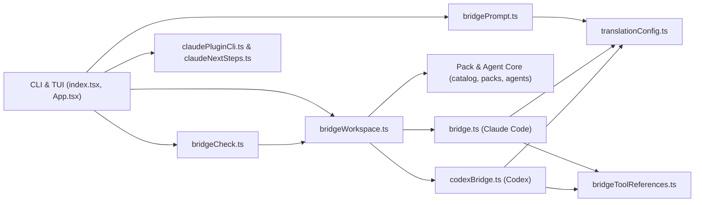

# Claude Code & Codex Bridges

## Purpose

The *bridge* (see [Glossary](../glossary.md)) subsystem performs [cross-harness pack translation](../concepts/cross-harness-translation.md), converting canonical [OpenCode agent packs](../api/pack-contract-reference.md)—along with their transitive `requires` closure—into standalone, distributable plugins for **Claude Code** (`bridges/claude-code/<plugin>/`) and **Codex** (`bridges/codex/<plugin>/`). Source packs remain untouched: model selection, agent prefix stripping, permission adaptation, MCP/LSP translation, and tool-reference rewrites are computed in an isolated temporary workspace and mirrored deterministically to the target directory.

## Key Files

| File | Role |
|------|------|
| `src/utils/bridgeWorkspace.ts` | Resolves transitive pack closures into an isolated temp workspace (`prepareBridgeWorkspace`), orchestrates generation (`withGeneratedPackBridge`), and mirrors changed files (`bridgePack`). |
| `src/utils/translationConfig.ts` | Defines the v2 [`TranslationConfig`](../config/translation-and-release-config.md) schema, v1-to-v2 migration, validation, peer-model inference index, and the five-step `resolveModelTarget` pipeline. |
| `src/utils/bridgePrompt.ts` | [Interactive TUI](../components/authoring-and-bridge-modals.md) state management, pack filtering, tier/role draft editing, preset cycling, and live mapping preview (`buildPackBridgePreview`). |
| `src/utils/bridge.ts` | Converts OpenCode agents, commands, skills, MCP servers, and LSP servers into a Claude Code plugin and local marketplace manifest. |
| `src/utils/codexBridge.ts` | Converts OpenCode agents, skills, and MCP servers into a Codex plugin manifest (`.codex-plugin/plugin.json`) and project-scoped `.codex/agents/*.toml` files. |
| `src/utils/bridgeToolReferences.ts` | Rewrites OpenCode tool names to Claude Code or Codex equivalents, prepends idempotent runtime fallback notes for OpenCode-only tools, and extracts bash allowlists for README documentation. |
| `src/utils/bridgeCheck.ts` | Regenerates a pack bridge in memory/temp storage and compares it byte-for-byte (`compareTrees`, `checkPackBridge`) against committed bridge directories. |
| `src/utils/claudePluginCli.ts` | Invokes the external `claude` CLI for strict validation (`claude plugin validate --strict`) and local marketplace registration (`claude plugin marketplace add` + `claude plugin install`). |
| `src/utils/claudeNextSteps.ts` | Formats post-generation CLI validation and `--plugin-dir` launch commands (`claudeNextSteps`). |

## Dependencies



- **Internal**: [Agent Editing, V2 Compatibility & Git Transactions](./agent-editing-and-v2-compat.md) (`src/utils/agents.ts`: `parseAgentFile`, `extractFrontmatter`, `normalizeAgentBody`; `src/utils/v2Compat.ts`: `translatePermissionsV2ToV1`, `isKnownPermissionKey`), [Pack Validation, Catalog & Virtual Packs](./pack-validation-and-virtual-packs.md) (`src/utils/catalog.ts`: `packDir`, `packsDir`, `resolvePackClosure`; `src/utils/packs.ts`: `validatePack`, `installableFiles`, `parseJsonc`; `src/utils/pathValidation.ts`: `assertInsideRealWorkspace`, `realpathThroughExistingAncestor`, `isPathInsideWorkspace`; `src/utils/opencodeMcp.ts`: `readMcpServers`, `isServerDisabled`), and [Archetypes, Conditional Flows & User Settings](./routing-and-user-settings.md) (`src/utils/sourceCustomization.ts` for per-source bridge config and cache paths in the TUI).
- **External**: [`yaml`](../dependencies/runtime-and-tooling-stack.md) (YAML frontmatter parsing and serialization for Claude Code agents and skills), Node built-ins (`node:fs`, `node:path`, `node:os`, `node:child_process`), and the optional `claude` CLI binary for plugin validation and registration.

## Transitive Closure Staging (`bridgeWorkspace.ts`)

Packs can declare dependencies on companion packs via `requires` in [`opencode-pack.json`](../api/pack-contract-reference.md). Before invoking either target generator, `prepareBridgeWorkspace(workspaceRoot, pack)` stages the full closure into a temporary directory (`manage-agents-bridge-*` under `os.tmpdir()`):

1. **Closure resolution & validation**: Calls [`resolvePackClosure(workspaceRoot, pack)`](./pack-validation-and-virtual-packs.md) to order required packs before dependents. Each pack directory is validated with `validatePack(source)`; any validation error aborts staging and cleans up the temp directory.
2. **Installable file merging**: Copies `installableFiles(validation)` from every pack in the closure (excluding root-level files without `/` and paths containing `node_modules` or `__pycache__`). If two packs provide the same relative path, staging fails closed (`Packs '<owner>' and '<name>' both provide '<file>'`).
3. **Config merging**: Reads `opencode.json` or `opencode.jsonc` from each pack in dependency order, merging `readMcpServers(config)` and `config.lsp` (with later packs overriding earlier keys), and writes a unified `<tempRoot>/opencode.json`.
4. **Scoped agent extraction**: Parses `agents/*.md` **only** from the requested `pack` (setting `agent.category = pack`), while required packs contribute companion `skills/`, `commands/`, `plugins/`, `tools/`, MCP servers, and LSP definitions.

`withGeneratedPackBridge(options, use)` places the generated output inside `<tempRoot>` at the same relative path `outputDir` occupies inside `workspaceRoot` (or `path.basename(outputDir)` when external) so relative paths rendered into `README.md` match the final destination.

`bridgePack(options)` enforces [path and symlink safety](../concepts/security-and-trust-model.md) via `assertSafeOutputDir`—rejecting output paths that contain the catalog root, sit inside `packs/` or a pack directory, or traverse symlinks—and synchronizes the generated tree into `outputDir` via `mirrorTree`, rewriting only byte-changed files and pruning stale files or symlinks.

When bridging a local catalog or workspace, configuration is read from [`bridges/translation-config.json`](../config/translation-and-release-config.md) and plugins default to `bridges/<claude-code|codex>/<pluginName>`. When bridging a [registered git source](./sources-and-github.md) from the [TUI](../components/tui-shell-and-catalog.md) (`src/App.tsx`), `workspaceRoot` points to the cached source checkout, and translation settings and generated plugins are stored under [per-user config and cache directories](../config/user-and-target-files.md) (`<configDir>/translations/<source>/translation.json` and `<cacheDir>/bridges/<source>/<claude-code|codex>/<pluginName>`).

## Translation Config & Five-Step Model Resolution

### `TranslationConfig` v2 Schema (`translationConfig.ts`)

`loadTranslationConfig(workspaceRoot, configPath?, options?)` loads and validates [`bridges/translation-config.json`](../config/translation-and-release-config.md), migrating v1 files (`version === undefined || version === 1`) via `migrateV1(raw)` and rejecting symlinks or out-of-workspace paths.

```ts
export interface TranslationConfig {
  version: 2
  target: "claude" | "codex"
  pluginName: string            // Default: "decent-pipeline"
  prefix: string                // Default: "pipeline-"
  sourceDir: string             // Legacy pre-pack path; validated workspace-relative, ignored by pack bridges
  inference?: boolean           // Default: true
  defaultTier: string           // Default: "execution"
  tiers: Record<string, {
    description?: string
    claude: { model: string; reasoningEffort?: string }
    codex: { model: string; reasoningEffort?: string }
  }>
  roles: Record<string, string> // Stripped agent role -> tier name
  claude: {
    overrides: Record<string, { model: string; reasoningEffort?: string }>
    modelMap?: Record<string, string>
    emitMarketplace?: boolean   // Default: true
    emitCommands?: boolean      // Default: true
    emitSkills?: boolean        // Default: true
    autoValidate?: boolean      // Default: true
    autoRegister?: boolean      // Default: true
    marketplaceName?: string    // Default: "<pluginName>-local"
  }
  codex: {
    overrides: Record<string, { model: string; reasoningEffort?: string }>
    modelMap?: Record<string, string>
    emitSkills?: boolean        // Default: true
    emitReadme?: boolean        // Default: true
    emitMcp?: boolean           // Default: true (when servers exist)
  }
}
```

Default tiers (`DEFAULT_TIERS`) and roles (`DEFAULT_ROLES`):

| Tier | Claude Model | Codex Model | Codex `reasoningEffort` | Default Assigned Roles |
|------|--------------|-------------|-------------------------|------------------------|
| `planning` | `opus` | `gpt-5.6-sol` | `high` | `orchestrator`, `planner`, `reasoner`, `critic`, `code_reviewer` |
| `execution` | `sonnet` | `gpt-5.6-luna` | `max` | `refactorer`, `tester`, `fast_lane` |
| `light` | `haiku` | `gpt-5.6-luna` | `max` | `executor`, `explorer` |

`validateClaudeModelName` restricts Claude models to family aliases (`fable`, `sonnet`, `opus`, `haiku`, `inherit`) or full `claude-*` IDs. `validateMarketplaceName` rejects reserved names (`claude`, `claude-code`) and reserved prefixes (`claude-`, `anthropic-`, `anthropics-`).

### Five-Step Model Resolution Pipeline

For each agent, `resolveModelTarget(agent, index, config, target)` strips `config.prefix` and `.md` to compute the lowercase `role` (`normalizeAgentName`) and evaluates five steps in strict precedence order:

1. **Per-agent `overrides` (`source: "override"`)**: Checks `config[target].overrides[name]`. If present, returns that exact `ModelTarget`.
2. **Source `modelMap` (`source: "model-map"`)**: Normalizes the agent's source `model` into `full` (`provider/model-id` lowercased) and `bare` (substring after the last `/`), checking `modelMap[full]`, then `modelMap[bare]`, then catch-all `modelMap["*"]`. Unmatched non-`*` entries are surfaced as warnings by `unusedModelMapKeys()`.
3. **Explicit `roles` mapping (`source: "role"`)**: Looks up `config.roles[role]` and selects `config.tiers[tier][target]`.
4. **Peer `inference` (`source: "inferred"`)**: Enabled when `config.inference !== false`. `buildInferenceIndex(agents, config)` indexes the source models (`byFull` and `byBare`) of all peer agents that have an explicit `roles` tier. If an unmapped agent's source model matches peers belonging to **exactly one** tier (`matches.size === 1`), that tier is inherited and `inferredFrom` records the source model. If peers map the same source model to multiple tiers (`matches.size > 1`), inference abstains immediately.
5. **Fallback `defaultTier` (`source: "default"`)**: Uses `config.defaultTier` (or the first declared tier) and resolves `config.tiers[tier][target]`. Both `"inferred"` and `"default"` assignments append informational warnings to the bridge report.

### Interactive TUI & CLI Draft Construction (`bridgePrompt.ts`)

- **TUI workflow**: `collectBridgeablePacks`, `filterBridgePacks`, `reconcileBridgePackQuery`, and `stepBridgeField` power the interactive [Bridge modal](../components/authoring-and-bridge-modals.md) (`name -> pack -> tiers -> [effort] -> agents -> model`). Users cycle `CLAUDE_TIER_MODEL_PRESETS` (`opus`, `sonnet`, `haiku`, `inherit`), `CODEX_EFFORT_PRESETS` (`low`, `medium`, `high`, `xhigh`, `max`), and per-role tier assignments (`cycleAgentRoleTier`). `applyBridgeDraftToConfig` merges sanitized draft edits into a `TranslationConfig`, and `buildPackBridgePreview` computes live agent-by-agent previews and per-tier counts.
- **CLI workflow**: [`manage-agents bridge`](../api/cli-reference.md) supports `--pack`, `--target/-t`, `--output/-o`, `--name/-n`, `--prefix/-p`, `--config`, `--model <src=target>` (`parseKeyValueMappings`), `--map-all <target>`, `--no-validate`, `--no-register`, `--marketplace-name`, and `--wizard/-w` (interactive prompt wizard). Model and marketplace CLI flags persist back to `bridges/translation-config.json`.

## Claude Code Bridge (`bridge.ts`, `claudePluginCli.ts`, `claudeNextSteps.ts`)

### Generated Plugin Layout

`bridgeToClaudeCode()` normalizes the plugin identifier via `normalizeClaudeAgentName` (lowercase kebab-case, max 64 chars, prefixed with `agent-` if starting with a digit) and writes `bridges/claude-code/<pluginName>/`:

- `.claude-plugin/plugin.json`: Plugin manifest (`name`, `version: "1.0.0"`, `description`, `author.name` resolved from [`AGENT_AUTHOR_NAME`](../config/user-and-target-files.md) or `DEFAULT_AUTHOR_NAME`).
- `.claude-plugin/icon.png`: Copied from engine `assets/plugin-icon.png` when available.
- `.claude-plugin/marketplace.json`: Emitted when `claude.emitMarketplace !== false`. Defines a local single-plugin marketplace (`<pluginName>-local` or `claude.marketplaceName`) with `source: "."` for in-place loading; deleted if disabled on subsequent runs.
- `agents/<name>.md`: Converted subagents (`convertAgent`). Frontmatter includes `name`, `description`, `model`, `maxTurns` (mapped from `max_steps` or `maxTurns`), and `tools`. Body `@agent` mentions are rewritten to `@<pluginName>:<canonical-agent>` (`rewriteBodyReferences`), tool names are adapted, and required MCP servers are listed under `## MCP Tools (from OpenCode bridge)`.
- `skills/<command>/SKILL.md`: Emitted from OpenCode `commands/**/*.md` when `claude.emitCommands !== false` (`writeCommandSkill`). Sets `disable-model-invocation: true` and `arguments: request`, prepends delegation instructions targeting `<pluginName>:<orchestratorName>` (the agent with `mode: "primary"`), converts inline `` !`cmd` `` shell substitutions into fenced ```` ```bash ```` blocks, rewrites `$ARGUMENTS` to `$request`, and scopes sibling `/pipeline-*` references to `/<pluginName>:<command>`.
- `skills/<skill>/SKILL.md`: Copied from companion `skills/` directories when `claude.emitSkills !== false` (`copyCompanionSkill`), rejecting any symlinks via [`assertNoSymlinksInTree`](../concepts/security-and-trust-model.md) and stripping the redundant `name` frontmatter field.
- `.mcp.json`: Generated by `buildClaudeMcpConfig` from merged `opencode.json` MCP entries. Remote servers emit `{ type: "http", url }`; stdio servers emit `{ command, args, env }` with `{env:VAR}` converted to `${VAR}`. Disabled servers are omitted unless explicitly required by an agent's permissions (which emits a warning). If a required server carries a server-wide `${server}_*` deny, generation aborts with an error.
- `.lsp.json`: Generated by `buildClaudeLspConfig`, mapping `command`, `args`, and `extensions` (`extensionToLanguage`).
- `README.md`: Documents setup steps, MCP server requirements, untranspiled OpenCode plugins/tools (with a hook mapping table from `tool.execute.before`/`after`, `session.idle`, and `permission.asked` to `PreToolUse`, `PostToolUse`, `Stop`, and `PermissionRequest`), non-enforced per-agent bash rules, and plugin-scoped skill invocations. Stale `agents/` and `skills/` entries are removed via `pruneStaleArtifacts`.

### Permission Translation & Warnings

Claude Code plugin agents do not support `permissionMode` or `disallowedTools` frontmatter fields. Instead, `normalizedPermissions` converts V2 `permissions` into V1 via [`translatePermissionsV2ToV1`](./agent-editing-and-v2-compat.md) (mapping `subagent` to `task`) and `buildToolsString` synthesizes an explicit `tools` allowlist:

| OpenCode Permission | Claude Code `tools` Output | Notes & Diagnostics (`collectWarnings`) |
|---------------------|----------------------------|-----------------------------------------|
| `task` / `subagent` | `Agent` or `Agent(plugin:a, plugin:b)` | Open allow emits `Agent`; structured map emits plugin-scoped subagent whitelist. `ask` entries warn and promote to allow. |
| `read`, `grep`, `glob` | `Read`, `Grep`, `Glob` | Included by default unless explicitly `"deny"` or `false`. |
| `edit`, `write`, `apply_patch`, `patch`, `multiedit` | `Write, Edit` | Emitted if `objectAllowsAny` (last-match-wins over `*`) grants access. Granular `edit` path patterns warn and collapse to the whole tool. |
| `bash`, `shell` | `Bash` | Emitted if `objectAllowsAny` grants access. Non-`*` command patterns warn and are documented in `README.md` via `collectBashAllowlist`. |
| `webfetch`, `websearch`, `skill`, `lsp`, `question`, `todowrite` | `WebFetch`, `WebSearch`, `Skill`, `LSP`, `AskUserQuestion`, `TodoWrite` | Included when `objectAllowsAny` is true. `webfetch` URL patterns warn and drop. |
| `<server>_*` / `<server>_<tool>` | `mcp__<server>__*`, `mcp__plugin_<plugin>_<server>__*` | If any tool on `<server>` is denied, server wildcards are suppressed and only explicit `<tool>` allows are emitted (with a warning). |
| `ask` rules | Tool included in `tools` | Scalar `ask` or `*: ask` on `PROMOTED_ASK_KEYS` (`websearch`, `skill`, `lsp`, `question`, `todowrite`, `edit`, `bash`, `shell`, `webfetch`) warns that `ask` is promoted to allow. |
| OpenCode-only keys | *(dropped)* | `doom_loop`, `external_directory`, `artifact`, `file-diff`, `mcp-resource`, `opencode_*`, custom `pipeline_*`/`dev_*` tools, `hidden: true`, and `temperature` emit warnings and are omitted. |

### Validation, Registration & Next Steps

- `validatePlugin(pluginDir)` (`claudePluginCli.ts`): Runs `claude plugin validate <pluginDir> --strict` (`spawnSync`, 120s timeout, 300-char stream tailing). Returns `PluginCliOutcome` with `kind: "pass"` (exit 0), `"fail"` (exit 1), `"error"` (exit 2 or spawn error), or `"skipped"` (`ENOENT` when `claude` is not on `PATH`).
- `registerPlugin(pluginDir, pluginName, marketplaceName)` (`claudePluginCli.ts`): Runs `claude plugin marketplace add <pluginDir>` followed by `claude plugin install <pluginName>@<marketplaceName>`, detecting idempotent `"already"` responses per step. Both CLI and TUI skip registration automatically if `autoValidate` fails/errors, if `emitMarketplace` is `false`, or if `--no-register` (`autoRegister: false`) is set.
- `claudeNextSteps(pluginName, orchestratorName, pluginDir)` (`claudeNextSteps.ts`): Prints local verification hints (`claude plugin validate <pluginDir> --strict` and, when an orchestrator exists, `claude --plugin-dir <pluginDir> --agent <pluginName>:<orchestratorName>`).

## Codex Bridge (`codexBridge.ts`)

`bridgeToCodex()` / `writeCodexPlugin()` generates a [project-scoped Codex layer](../concepts/cross-harness-translation.md) under `bridges/codex/<pluginName>/`:

- `.codex-plugin/plugin.json`: Codex manifest (`renderManifest`) declaring `name`, `version: "1.0.0"`, `author`, `interface` metadata (`capabilities: ["Skills", "Subagents"]` when skills are enabled), and relative pointers to `./skills/` and `./.mcp.json`.
- `.codex/agents/<name>.toml`: Agent definitions rendered by `renderCodexAgentToml`:
  - `name`, `description`, `model`, and optional `model_reasoning_effort` (mapped from `ModelTarget.reasoningEffort`, such as `"high"` or `"max"`).
  - `developer_instructions`: Prompt body with `@agent` mentions rewritten to normalized Codex subagent names (`rewriteReferences`), adapted tool references, and an appended `## Delegation targets` section listing allowed `@<subagent>` targets (`appendDelegationTargets`).
  - `sandbox_mode`: Computed by `resolveSandboxMode(agent)`. Emits `"workspace-write"` if any of `write`, `edit`, `apply_patch`, `patch`, `multiedit`, `bash`, `shell`, or `execute` has an allow rule (`true`, `"allow"`, or an allowing pattern); otherwise emits `"read-only"`. (`danger-full-access` is never emitted by the bridge.)
- `skills/<name>/SKILL.md`: Emitted for every translated agent when `codex.emitSkills !== false` (`renderCodexSkill`), wrapping `developerInstructions` with `name` and `description` frontmatter as the replacement for deprecated `~/.codex/prompts`.
- `.mcp.json`: Emitted when `codex.emitMcp !== false` and servers exist (`buildCodexMcpConfig`), translating remote servers to `{ url }` and stdio servers to `{ command, args, env }` while enforcing the same server-wide deny check as Claude Code.
- `README.md`: Emitted when `codex.emitReadme !== false` (`renderReadme`), documenting generated artifacts, MCP setup, non-enforced per-agent bash allowlists, primary orchestrator (`@orchestrator`), and translation warnings.

## Prompt Tool Adaptation & Drift Checking

### Prompt Tool Adaptation (`bridgeToolReferences.ts`)

`adaptToolReferences(body, target, frontmatter, options)` translates OpenCode tool references in agent bodies without deleting fallback instructions:

- **Claude Code (`CLAUDE_TABLE`)**: Rewrites `\btodowrite\b` to `TodoWrite`, `\bTask (tool|calls?|call\(s\))` to `Agent ...`, and backticked tool identifiers so prose words remain intact: `` `question` `` -> `` `AskUserQuestion` ``, `` `task` `` -> `` `Agent` ``, `` `read` `` -> `` `Read` ``, `` `grep` `` -> `` `Grep` ``, `` `glob` `` -> `` `Glob` ``, `` `lsp` `` -> `` `LSP` ``, `` `skill` `` -> `` `Skill` ``, `` `webfetch` `` -> `` `WebFetch` ``, `` `websearch` `` -> `` `WebSearch` ``, `` `bash` `` -> `` `Bash` ``, `` `edit` `` -> `` `Edit` ``, and `` `write` `` -> `` `Write` ``.
- **Codex (`CODEX_TABLE`)**: Rewrites `\btodowrite\b` to `update_plan` and records targeted guidance bullets when prompts mention `` `question` `` (ask directly in reply), `` `task` `` / `Task tool` (delegate to subagents under `Delegation targets`), `` `read` `` / `` `grep` `` / `` `glob` `` / `` `lsp` `` (use shell commands such as `rg` or `sed -n`), or `` `edit` `` / `` `write` `` (use `apply_patch`).
- **OpenCode-only custom tools & runtime note**: Scans permissions and prompt text for `OPENCODE_ONLY_TOOLS` (`pipeline_state`, `pipeline_commit`, `dev_verify`, `dev_smoke`, `dev_serve`, `dev_env`) and any `pipeline_<name>` identifier (`isOpenCodeCustomToolKey`). When renames, guidance, MCP servers, or unavailable tools are present, `insertNearTop` injects a single blockquote immediately after a leading `# Heading` (or at line 1) guarded by `RUNTIME_NOTE_MARKER` (`Runtime note (OpenCode bridge)`) for idempotency.

### Byte-Exact Drift Verification (`bridgeCheck.ts`)

`checkPackBridge(options)` verifies that committed bridge directories match a clean regeneration from current pack sources and [`bridges/translation-config.json`](../config/translation-and-release-config.md):

1. Runs `withGeneratedPackBridge` into a temporary workspace without modifying `committedDir` (and in [`manage-agents bridge check`](../api/cli-reference.md), loads `translation-config.json` with `{ persistMigration: false }`).
2. Reads both the freshly generated directory and `committedDir` into `TreeSnapshot` maps (`Record<posixRelativePath, Uint8Array>`).
3. Runs `compareTrees(expected, actual)` using byte-exact comparison (`bytesEqual`) and returns `{ clean, missing, changed, extra }`.

When `clean` is `false`, `manage-agents bridge check [--pack <name>] [--target claude|codex]` prints every `missing`, `changed`, and `extra` path and sets `process.exitCode = 1`.

## Usage Example

```ts
import path from "node:path"
import { bridgePack } from "./utils/bridgeWorkspace.js"
import { checkPackBridge } from "./utils/bridgeCheck.js"
import { loadTranslationConfig } from "./utils/translationConfig.js"

const workspaceRoot = process.cwd()
const config = loadTranslationConfig(workspaceRoot, undefined, { persistMigration: false })
const outputDir = path.join(workspaceRoot, "bridges", "claude-code", config.pluginName)

// Generate and mirror the Claude Code plugin for the "pipeline" pack and its required packs
const result = bridgePack({
  workspaceRoot,
  pack: "pipeline",
  target: "claude",
  outputDir,
  config,
  pluginName: config.pluginName,
  prefix: config.prefix,
})

// Verify zero byte-level drift against the committed output directory
const check = checkPackBridge({
  workspaceRoot,
  pack: "pipeline",
  target: "claude",
  config,
  committedDir: result.pluginDir,
})
// check.clean === true
```

## Related Pages

- [Cross-Harness Pack Translation](../concepts/cross-harness-translation.md) — Architectural comparison and capability mapping across OpenCode, Claude Code, and Codex
- [Bridge Translation & Release Config Reference](../config/translation-and-release-config.md) — Schema, migration rules, and defaults for `bridges/translation-config.json`
- [Pack Validation, Catalog & Virtual Packs](./pack-validation-and-virtual-packs.md) — Transitive pack closure resolution and manifest validation
- [Agent Editing, V2 Compatibility & Git Transactions](./agent-editing-and-v2-compat.md) — Agent frontmatter parsing and V2-to-V1 permission normalization
- [Authoring, Tuning & Bridge Modals](../components/authoring-and-bridge-modals.md) — Interactive TUI Bridge modal and tier/role mapping workflow
- [CLI Command Reference](../api/cli-reference.md) — Flags and exit codes for `manage-agents bridge` and `manage-agents bridge check`
- [Security & Trust Model](../concepts/security-and-trust-model.md) — Workspace containment and symlink rejection during staging and output mirroring
