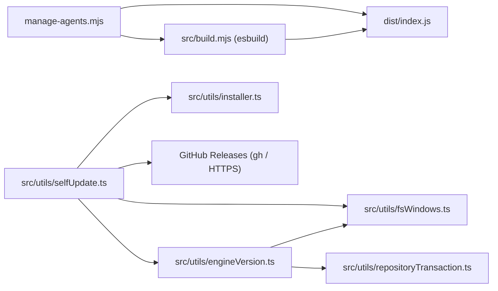

# Launcher, Build & Self-Update

## Purpose

This module group owns the execution lifecycle of the [`manage-agents` engine](../architecture.md) itself—independent of any external *[pack]* (see [Glossary](../glossary.md)) catalog or managed OpenCode target. It bootstraps the JavaScript runtime with Foreign Function Interface (FFI) support required by [OpenTUI](../dependencies/runtime-and-tooling-stack.md), automatically installs dependencies and rebuilds the TypeScript/JSX bundle when running from a source checkout, computes deterministic cryptographic hashes of the engine surface, signs and verifies GitHub release artifacts with [Ed25519](../concepts/security-and-trust-model.md), and performs atomic in-place engine self-updates with automatic rollback and Windows file-lock resilience.

## Key Files

| File | Role |
|------|------|
| `manage-agents.mjs` | Executable CLI launcher (`bin`); enforces runtime prerequisites, re-execs Node with FFI flags, auto-installs missing dependencies, triggers stale bundle rebuilds, and imports `dist/index.js`. |
| `src/build.mjs` | Programmatic `esbuild` bundler that compiles `src/index.tsx` into the ESM bundle `dist/index.js`. |
| `src/utils/engineVersion.ts` | Resolves the engine root, computes deterministic `sha256` bundle and git worktree hashes, reads/writes `.manage-agents/release-manifest.json`, and determines the active version channel. |
| `src/utils/selfUpdate.ts` | Implements Ed25519 key generation, release asset signing, trust policy resolution, GitHub Release transport, update checks, and staged atomic self-updates with rollback. |
| `src/utils/fsWindows.ts` | Provides retry-backed filesystem removal and cross-device/lock-tolerant path moves for Windows indexer and antivirus locks. |

## Bootstrap Sequence (`manage-agents.mjs`)

`manage-agents.mjs` is the package `bin` entrypoint (`#!/usr/bin/env node`). Before loading any compiled application code, it executes a five-stage bootstrap sequence:

### 1. Windows UTF-8 Codepage Pin

On `win32`, the launcher runs `chcp 65001` via `spawnSync("chcp", ["65001"], { shell: true, stdio: "ignore", windowsHide: true })` inside a `try/catch` block. While OpenTUI `>= 0.5.0` writes directly via `WriteConsoleW`, pinning codepage `65001` protects older or fallback standard-stream paths without failing startup if `chcp` is unavailable.

### 2. Runtime Verification and FFI Self-Re-Exec

OpenTUI relies on native FFI bindings. When `process.versions.bun` is not set, the launcher parses `process.versions.node` and enforces **[Node.js `>= 26.4.0`](../getting-started.md)** (matching `engines.node` in `package.json`). Older Node versions exit immediately with status `1`.

On supported Node.js versions, `manage-agents.mjs` inspects `process.execArgv` for two flags:
- `--experimental-ffi`
- `--no-warnings` or `--no-warnings=ExperimentalWarning`

If either flag is missing, the launcher synchronously spawns a child Node process (`process.execPath`) with the missing flags prepended to `process.argv.slice(1)` and `stdio: "inherit"`, forwarding signals as `128 + signalNumber` and exiting with the child's status code:

```js
const hasExperimentalFfi = process.execArgv.includes("--experimental-ffi")
const hasExperimentalWarningSuppression = process.execArgv.some(
  (arg) => arg === "--no-warnings" || arg === "--no-warnings=ExperimentalWarning",
)
if (!hasExperimentalFfi || !hasExperimentalWarningSuppression) {
  const execArgs = [...process.execArgv]
  if (!hasExperimentalFfi) execArgs.push("--experimental-ffi")
  if (!hasExperimentalWarningSuppression) execArgs.push("--no-warnings=ExperimentalWarning")
  const result = spawnSync(process.execPath, [...execArgs, ...process.argv.slice(1)], { stdio: "inherit", windowsHide: true })
  // ... signal & exit propagation
}
```

### 3. Semver Dependency Verification and Auto-Install

Before importing external packages, `dependenciesMatch(managerDir, includeDevDependencies)` reads `package.json` using lightweight built-in helpers (`parseCoreSemver()`, `cmpCoreSemver()`, and `satisfiesSimpleSpec()` supporting exact, `^`, `~`, `>=`, and `*` ranges) and checks every required `node_modules/<pkg>/package.json`. `devDependencies` (such as `esbuild`) are checked only when `src/` exists and a rebuild is needed (`hasSources && needsBuild`).

When [`MANAGE_AGENTS_SKIP_AUTO_INSTALL`](../config/user-and-target-files.md) `!== "1"`, `(hasSources || existsSync(package-lock.json))` holds, and `dependenciesMatch()` returns `false`, the launcher automatically installs dependencies with lifecycle scripts disabled:
- **Bun with `bun.lock`**: `bun install --frozen-lockfile --ignore-scripts`
- **Bun without `bun.lock`**: `bun install --ignore-scripts`
- **Node with `package-lock.json`**: `npm ci --ignore-scripts --no-audit --no-fund`
- **Node without `package-lock.json`**: `npm install --ignore-scripts --no-audit --no-fund`

### 4. Source Mtime Comparison and Auto-Build

`newestSourceMtime(directory)` recursively scans `src/` and compares the newest file `mtimeMs` (along with `package.json`'s `mtimeMs`) against `dist/index.js`:

```js
const hasSources = existsSync(srcDir)
const newestSource = hasSources
  ? Math.max(newestSourceMtime(srcDir), existsSync(packageJsonPath) ? statSync(packageJsonPath).mtimeMs : 0)
  : 0
const needsBuild = hasSources ? !existsSync(distPath) || statSync(distPath).mtimeMs < newestSource : !existsSync(distPath)
```

Published npm packages distribute `dist/` without `src/` (per `package.json` `"files"`), so `needsBuild` evaluates to `false` in production installs. In git checkouts where `needsBuild` is `true`, the launcher runs `bun run build` or `npm run build` (executing `node src/build.mjs`).

### 5. Bundle Execution

Once `dist/index.js` is up to date, `manage-agents.mjs` transfers control via dynamic ESM import:

```js
await import(pathToFileURL(distPath).href)
```

## Bundling Pipeline (`src/build.mjs`)

`src/build.mjs` invokes `esbuild` from the resolved repository root (`managerRoot`) so builds succeed regardless of the caller's current working directory:

```js
const managerRoot = join(dirname(fileURLToPath(import.meta.url)), "..")
await build({
  bundle: true,
  platform: "node",
  format: "esm",
  external: ["@opentui/core", "yaml"],
  absWorkingDir: managerRoot,
  logLevel: "info",
  entryPoints: ["src/index.tsx"],
  outfile: "dist/index.js",
})
```

`esbuild` automatically reads `tsconfig.json` from `absWorkingDir`, inheriting `"target": "ES2022"` and `"jsx": "react-jsx"` while bundling React, `react-reconciler`, `@opentui/react`, `semver`, and internal TypeScript modules into a single ESM file.

Two runtime dependencies are intentionally kept in `external`:
- **[`@opentui/core`](../dependencies/runtime-and-tooling-stack.md)**: Loads platform-specific optional native FFI packages (`@opentui/core-darwin-arm64`, `@opentui/core-linux-x64`, `@opentui/core-win32-x64`, etc.) relative to `node_modules` at runtime and maintains singleton terminal renderer state shared across modules.
- **`yaml`**: Ships its Node entrypoint (`./dist/index.js`) as CommonJS (`"type": "commonjs"`). Keeping `yaml` external lets Node's native ESM-to-CJS loader resolve it cleanly rather than emitting broken dynamic `require()` shims inside an ESM bundle.

## Engine Version & Bundle Hashing (`src/utils/engineVersion.ts`)

### Path Isolation and Root Discovery

`resolveEngineRoot(overrideRoot?)` walks up to 6 parent directories from `import.meta.url` to locate the directory containing both `manage-agents.mjs` and `package.json`, resolving outer `npm link` symlinks via `fs.realpathSync()`. All subsequent reads and writes inside the engine root pass through `assertSafeEnginePath(engineRoot, target)`, which rejects paths outside `engineRoot`, symlinked engine roots, and any symlink or non-directory intermediate path component.

### Deterministic Bundle Hashing

`computeEngineBundleHash(overrideRoot?)` calculates a deterministic `sha256:<64-hex>` digest across the engine's published runtime and contract surface:
- Root files: `package.json`, `package-lock.json`, `bun.lock`, `manage-agents.mjs`, `README.md`, `GUIDA.md`, `LICENSE`, `.gitignore`, and `dist/index.js`.
- Directories: `assets/`, `contract/`, `runtime/` (excluding `*.test.{c,m}{j,t}s`), and `src/` when present (excluding `*.test.{c,m}{j,t}sx?`).
- Exclusions: `EXCLUDED_DIRS` (`node_modules`, `.git`, `dist`, `build`, `.manage-agents`, `.agent-manager`, `.opencode`, `artifacts`, `backups`, `coverage`, `.cache`), symlinks, `*.log`, `.DS_Store`, and `Thumbs.db`.

Files are sorted lexicographically by normalized POSIX relative path and fed into SHA-256 with length-prefixed framing (`<pathByteLen>:<posixPath>:<contentByteLen>:<rawBytes>`) to prevent boundary-collision ambiguities.

### Release Manifest (`.manage-agents/release-manifest.json`)

CI builds stamp `.manage-agents/release-manifest.json` (`ENGINE_MANIFEST_RELATIVE_PATH`) via `writeEngineReleaseManifest()` ([`manage-agents version --write-manifest`](../api/cli-reference.md)). Validated by `isEngineReleaseManifest()`, the schema (`schemaVersion: 1`) records:
- `version`, `packageVersion`, `tag` (`string | null`), `commit` (40-hex SHA), `shortCommit` (7-char prefix), `dirty`, `channel` (`"release"` or `"ci-snapshot"`), `bundleHash`, and ISO-8601 `builtAt`.
- Optional git overlay stamps (`appliedOverGitHead` and `appliedWorktreeStateHash`) populated by `stampAppliedEngineManifest()` when `applyEngineUpdate()` installs a release over a local git checkout. `computeEngineGitWorktreeHash()` hashes `git status --porcelain=v1 -z --untracked-files=normal` (ignoring `.manage-agents/`) together with file SHA-256 contents so subsequent modifications to tracked or untracked files are immediately detected.

### Version Resolution Channels

`resolveEngineVersion(overrideRoot?)` inspects the current `bundleHash`, `.manage-agents/release-manifest.json`, `.git` state, and `package.json`, returning an `EngineVersionInfo` object classified into one of five `EngineVersionChannel` values:

| Channel | Condition | Resulting `version` / `dirty` |
|---------|-----------|-------------------------------|
| `release` | Valid release manifest whose `bundleHash` matches disk, either without `.git`, on a clean matching `HEAD === manifest.commit`, or with matching `appliedOverGitHead` + `appliedWorktreeStateHash`. | `<tag>` (e.g. `v1.2.0`), `dirty: false` |
| `ci-snapshot` | Non-git installation with a matching `ci-snapshot` manifest (or tampered manifest where `manifest.bundleHash !== bundleHash` in a non-git install, preserving `manifest.channel`). | `sha-<shortCommit>-dirty`, `dirty: true` |
| `git-tag` | Clean `.git` checkout whose `HEAD` has an exact tag (`git describe --tags --exact-match HEAD`). | `<exactGitTag>`, `dirty: false` |
| `git` | `.git` checkout without a matching release manifest or exact clean tag. | `sha-<shortCommit>` or `sha-<shortCommit>-dirty` |
| `package` | Fallback when neither `.git` nor a release manifest exists. | `v<packageVersion>`, `dirty: false` |

## Release Signing & Atomic Self-Update (`src/utils/selfUpdate.ts`)

### Ed25519 Key Management and Release Signing

Cryptographic authenticity is governed by [`release-signing.json`](../config/translation-and-release-config.md) (`RELEASE_SIGNING_CONFIG_FILENAME`) at the engine root:
- **`generateReleaseSigningKeypair()`** ([`manage-agents release keygen`](../api/cli-reference.md)): Generates an Ed25519 keypair via `crypto.generateKeyPairSync("ed25519")`, derives a deterministic key identifier `ed25519-<12-hex>` from the first 12 hex characters of the SPKI DER SHA-256 (`computePublicKeyId()`), atomically updates `release-signing.json` (`0o644`), and optionally writes the PKCS#8 private key PEM with `0o600` permissions.
- **`signReleaseAssets()`** (`manage-agents release sign`): Verifies `manage-agents-<tag>.tar.gz` (`releaseArchiveName(tag)`), computes its byte size and `sha256:<hex>` digest, and writes `release-metadata.json` (`RELEASE_METADATA_ASSET_NAME`). When an Ed25519 private key is provided (`options.privateKeyPem` or `RELEASE_SIGNING_PRIVATE_KEY`), it verifies the key matches `release-signing.json` (if configured), signs the exact `release-metadata.json` bytes using `crypto.sign(null, metadataBytes, privateKey)`, and writes base64 `release-metadata.json.sig` (`RELEASE_SIGNATURE_ASSET_NAME`).
- **`resolveReleaseTrustPolicy()` & `verifyEngineReleaseMetadata()`**: Combines `release-signing.json` and optional [`MANAGE_AGENTS_RELEASE_PUBLIC_KEY`](../config/user-and-target-files.md) (PEM or base64 SPKI DER, checking against key-ID collisions). Whenever at least one public key is configured—or `requireSignature: true` is passed—Ed25519 verification of `release-metadata.json.sig` is mandatory (`verificationMode: "ed25519"`). Only when no public keys are configured does verification operate in unsigned digest mode (`verificationMode: "sha256"`).

### GitHub Release Transport

`createDefaultReleaseTransport()` validates repository slugs strictly against `^[A-Za-z0-9_.-]+\/[A-Za-z0-9_.-]+$` (`validReleaseRepository()`) and fetches `releases/latest` and `releases/assets/<id>` using a two-tier strategy:
1. **GitHub CLI (`gh api`)**: Runs inside [`cleanGitEnvironment(env)`](./agent-editing-and-v2-compat.md) with a 120s timeout and 128 MiB max buffer, retrying up to 3 times (`GH_MAX_ATTEMPTS`) on transient network errors (`isTransientTransportError()`). Retries inject `GODEBUG=http2client=0` via `withHttp1Godebug()` to work around Go HTTP/2 connection resets.
2. **Direct HTTPS Fallback**: If `gh` is unavailable or fails, issues HTTPS requests directly to `https://api.github.com/repos/<repository>/<resource>` using `GITHUB_TOKEN`, `GH_TOKEN`, or a cached token from [`gh auth token`](./sources-and-github.md).

### Update Discovery (`checkForEngineUpdate`)

`checkForEngineUpdate()` downloads `release-metadata.json` and `release-metadata.json.sig` (when present or required), verifies repository/tag binding and Ed25519 signature via `verifyEngineReleaseMetadata()`, ensures the release contains a unique archive asset matching `metadata.archive.name`, and compares versions with `compareReleaseTags()` (via `semver`). It returns `EngineUpdateCheckResult` containing `updateAvailable`, `downgrade`, `localGitDirty` (`hasUncommittedEngineChanges()`), and `targetReconcileNeeded` (true when the [target lockfile](./resolver-and-lock.md) tracks at least one installed pack).

### Atomic Self-Update & Rollback (`applyEngineUpdate`)

`applyEngineUpdate()` (`manage-agents self-update` or `manage-agents update --self`) executes a multi-stage transactional update:

1. **Dirty Checkout & Downgrade Guards**: Calls `hasUncommittedEngineChanges(engineRoot)` and refuses to overwrite uncommitted git modifications unless `options.force` (`--force`) is set. Similarly refuses version downgrades (`checkResult.downgrade`) without `options.force`.
2. **Archive Integrity Verification**: Downloads `manage-agents-<tag>.tar.gz` and verifies both `archiveBuffer.byteLength === metadata.archive.size` and `sha256` equality before writing to disk.
3. **Isolated Staging & Symlink Audit**: Creates a `0o700` temporary directory (`manage-agents-self-update-*`), extracts the tarball via `tar -xzf`, and walks the entire extracted tree with [`assertNoSymlinkTree()`](../concepts/security-and-trust-model.md) to reject symlinks, non-regular entries, or path traversal outside the extraction root.
4. **Manifest & Bundle Hash Verification**: Resolves the extracted package root (`resolveExtractedEngineDir()`), verifies all `ENGINE_REQUIRED_TARGETS` (`manage-agents.mjs`, `package.json`, `dist`, `assets`, `contract`, `runtime`), and runs `validateStagedEngineManifest()`—confirming `.manage-agents/release-manifest.json` matches `metadata.tag` and `metadata.commit`, is on the `"release"` channel, is clean, and matches `computeEngineBundleHash(stagedRoot)`.
5. **Staged Dependency Installation**: Compares SHA-256 digests of `package.json`, `package-lock.json`, and `bun.lock` between `engineRoot` and `stagedRoot`. If any changed (or `engineRoot/node_modules` is missing), `runDependencyInstallSync()` installs dependencies inside `stagedRoot` (`npm ci --ignore-scripts --no-audit --no-fund`, `npm install --ignore-scripts --no-audit --no-fund`, or `bun install [--frozen-lockfile] --ignore-scripts`) before touching the live installation.
6. **Backup, Swap, Mtime Touch & Rollback**: Copies existing required targets, `ENGINE_OPTIONAL_TARGETS` (`package-lock.json`, `bun.lock`, `src`, `README.md`, `GUIDA.md`, `LICENSE`, `.gitignore`), and `node_modules` (when updated) to `tempRoot/backup`. Each target in `engineRoot` is validated via `assertSafeEnginePath()`, removed with `removePathWithRetry()`, and replaced from `stagedRoot`. It then touches `dist/index.js` (`fs.utimesSync`) so `manage-agents.mjs` never sees a stale bundle timestamp relative to extracted `src/`, stamps `.manage-agents/release-manifest.json` via `stampAppliedEngineManifest()`, and verifies `resolveEngineVersion(engineRoot)` resolves cleanly to `stagedManifest.tag` on `"release"`. If any step throws, every attempted target is restored in reverse order from `tempRoot/backup` (preserving `tempRoot/backup` on disk if rollback itself encounters an error).
7. **Target Router Plugin Reconciliation**: When `options.reconcile !== false` and `checkResult.targetReconcileNeeded` is true, runs [`changeTarget(..., "reconcile", ...)`](./target-installer.md) so the managed OpenCode target's [router plugin](./runtime-router-plugin.md) stays synchronized with the updated engine.

## Windows File-Lock Resilience (`src/utils/fsWindows.ts`)

Windows file indexers and antivirus scanners transiently lock files during rapid rename or delete operations. `src/utils/fsWindows.ts` centralizes synchronous retry and fallback primitives used across manifest writes, staging cleanup, and engine swaps:

- **`TRANSIENT_WINDOWS_LOCK_CODES`**: `Set(["EPERM", "EACCES", "EBUSY"])`, checked via `isTransientWindowsLockError(error)`.
- **`removePathWithRetry(target, rmImpl?, sleep?)`**: Calls `fs.rmSync` with `WINDOWS_SAFE_RM_OPTIONS` (`{ recursive: true, force: true, maxRetries: 5, retryDelay: 50 }`), plus outer backoff retries across `MOVE_RETRY_DELAYS_MS` (`[10, 25, 50, 100]` ms) using `Atomics.wait` (falling back to a bounded spin loop if `SharedArrayBuffer` is unavailable).
- **`movePathWithRetry(source, target, ops?)`**:
  1. Retries `fs.renameSync(source, target)` across `MOVE_RETRY_DELAYS_MS` when `isTransientWindowsLockError()` matches.
  2. Breaks immediately to the copy-and-swap fallback on `EXDEV` (cross-filesystem/cross-drive move) or when rename retries are exhausted.
  3. Copies `source` to `<target>.stage-<pid>-<hex>` first so an existing `target` is never deleted before the copy succeeds, backs up any existing `target` to `<target>.bak-<pid>-<hex>`, removes `target`, moves/copies staged content into `target` (restoring from `.bak` if replacement fails), and cleans up `.bak` and `source`.

## Public API

| Symbol | Source File | Description |
|--------|-------------|-------------|
| `resolveEngineRoot(overrideRoot?)` | `src/utils/engineVersion.ts` | Locates the real filesystem root of the running `manage-agents` engine. |
| `assertSafeEnginePath(engineRoot, target)` | `src/utils/engineVersion.ts` | Asserts `target` stays within `engineRoot` and traverses no symlink components. |
| `computeEngineBundleHash(overrideRoot?)` | `src/utils/engineVersion.ts` | Computes deterministic `sha256:<hex>` over the engine's published runtime and contract files. |
| `writeEngineReleaseManifest(overrideRoot, input)` | `src/utils/engineVersion.ts` | Atomically writes `.manage-agents/release-manifest.json` for a tag or CI commit. |
| `readEngineReleaseManifest(overrideRoot?)` | `src/utils/engineVersion.ts` | Reads and validates `.manage-agents/release-manifest.json`, returning `null` if absent or invalid. |
| `stampAppliedEngineManifest(overrideRoot, manifest)` | `src/utils/engineVersion.ts` | Records `appliedOverGitHead` and `appliedWorktreeStateHash` after applying a release over git. |
| `resolveEngineVersion(overrideRoot?)` | `src/utils/engineVersion.ts` | Resolves `EngineVersionInfo` (`release`, `ci-snapshot`, `git-tag`, `git`, or `package`). |
| `generateReleaseSigningKeypair(overrideEngineRoot?, options?)` | `src/utils/selfUpdate.ts` | Generates an Ed25519 keypair and updates `release-signing.json`. |
| `signReleaseAssets(overrideEngineRoot, options)` | `src/utils/selfUpdate.ts` | Produces `release-metadata.json` and optional Ed25519 `release-metadata.json.sig`. |
| `resolveReleaseTrustPolicy(overrideEngineRoot?, options?)` | `src/utils/selfUpdate.ts` | Loads repository and Ed25519 public-key policy from `release-signing.json` and environment variables. |
| `verifyEngineReleaseMetadata(rawBytes, rawSig, policy, tag?)` | `src/utils/selfUpdate.ts` | Validates metadata schema and verifies its Ed25519 signature against trusted keys. |
| `checkForEngineUpdate(overrideEngineRoot?, options?)` | `src/utils/selfUpdate.ts` | Queries GitHub Releases, verifies metadata, and reports update/downgrade/dirty status. |
| `applyEngineUpdate(overrideEngineRoot?, options?)` | `src/utils/selfUpdate.ts` | Downloads, verifies, stages, swaps, rolls back on failure, and reconciles target state. |
| `movePathWithRetry(source, target, ops?)` | `src/utils/fsWindows.ts` | Moves paths with Windows lock retries and staged cross-device (`EXDEV`) fallback. |
| `removePathWithRetry(target, rmImpl?, sleep?)` | `src/utils/fsWindows.ts` | Removes files or trees with transient Windows lock retries. |

## Dependencies



- **Internal**: [`src/utils/installer.ts`](./target-installer.md) (`changeTarget`, `reconcileChange`), [`src/utils/lock.ts`](./resolver-and-lock.md) (`defaultTarget`, `readLock`), [`src/utils/pathValidation.ts`](./pack-validation-and-virtual-packs.md) (`realpathThroughExistingAncestor`), [`src/utils/repositoryTransaction.ts`](./agent-editing-and-v2-compat.md) (`cleanGitEnvironment`), [`src/utils/sources.ts`](./sources-and-github.md) (`loadSources`), and `src/utils/terminalText.ts` (`terminalSafeText`).
- **External**: [`esbuild`](../dependencies/runtime-and-tooling-stack.md) (dev/source-checkout bundler), `semver` (release tag comparison), Node built-in `node:crypto` (SHA-256 and Ed25519 signing/verification), external `gh` CLI / GitHub REST API, and `tar` (release archive extraction).

## Usage Examples

### CLI Release Signing and Self-Update

From `src/index.tsx`, release maintainers generate signing keys, stamp manifests, sign release tarballs, and users check or apply updates:

```bash
# Generate Ed25519 keypair (writes public key to release-signing.json and private key to .release-key.pem)
manage-agents release keygen --out .release-key.pem

# Stamp .manage-agents/release-manifest.json inside the built package root
manage-agents version --write-manifest --ref-type tag --ref-name v1.2.0 --sha 0123456789abcdef0123456789abcdef01234567

# Generate release-metadata.json and Ed25519 release-metadata.json.sig
manage-agents release sign --tag v1.2.0 --sha 0123456789abcdef0123456789abcdef01234567 --assets-dir ./release-assets

# Check for updates or apply the latest verified release non-interactively
manage-agents self-update --check
manage-agents self-update --yes
```

### Programmatic Version Resolution and Update Check

```ts
import { resolveEngineVersion } from "./utils/engineVersion.js"
import { checkForEngineUpdate, applyEngineUpdate } from "./utils/selfUpdate.js"

const current = resolveEngineVersion()
// e.g. { version: "v1.0.0", channel: "release", bundleHash: "sha256:...", dirty: false, ... }

const checkResult = await checkForEngineUpdate(current.engineRoot)
if (checkResult.updateAvailable && !checkResult.localGitDirty) {
  await applyEngineUpdate(current.engineRoot, { checkResult, reconcile: true })
}
```

## Related Pages

- [System Architecture](../architecture.md) — Bootstrap layer placement and end-to-end engine lifecycle
- [Getting Started](../getting-started.md) — Runtime prerequisites, auto-build behavior, and `self-update` usage
- [Bridge Translation & Release Config Reference](../config/translation-and-release-config.md) — Configuration schema for `release-signing.json` and `release-metadata.json`
- [Security & Trust Model](../concepts/security-and-trust-model.md) — Ed25519 signature verification, symlink rejection, and bundle integrity checks
- [Transactional Target Installer](./target-installer.md) — Target router reconciliation triggered after engine updates
- [Runtime & Tooling Dependencies](../dependencies/runtime-and-tooling-stack.md) — Details on `@opentui/core` FFI requirements, `esbuild`, and `semver`
