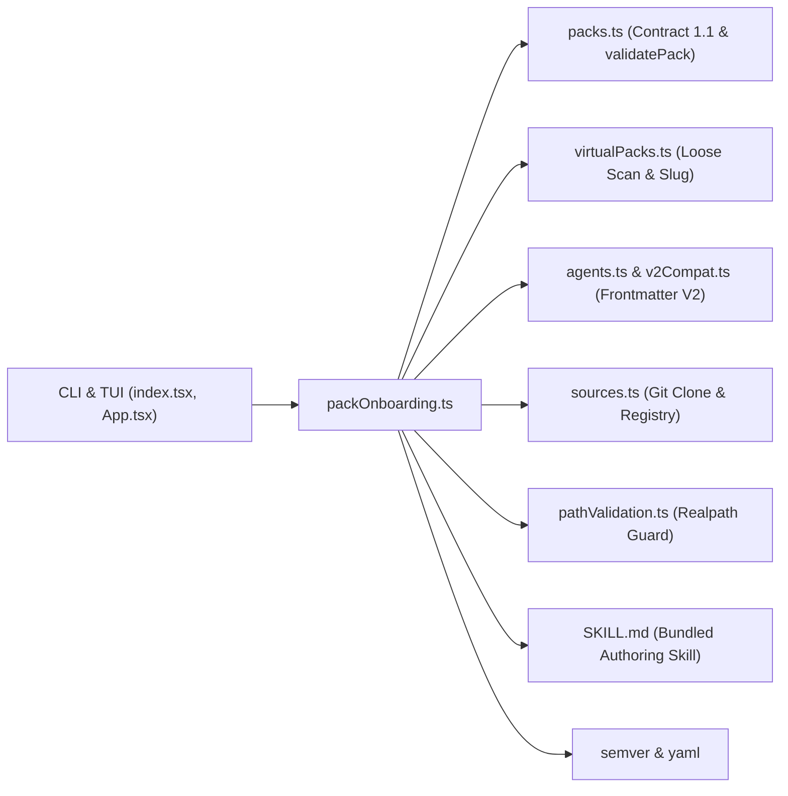

# Pack Onboarding, Doctor & Scaffolding

## Purpose

The `packOnboarding` module (`src/utils/packOnboarding.ts`) automates the lifecycle of authoring and maintaining OpenCode *[packs]* (see [Glossary](../glossary.md)) against [Contract `1.1`](../api/pack-contract-reference.md). It converts raw folders of Markdown agents, project-local `.opencode/` trees, mixed application repositories, and read-only [remote Git sources](./sources-and-github.md) into validated packs with an `opencode-pack.json` manifest. Once a pack is initialized, the module provides diagnostic inspection, automated drift repair ([`pack doctor --fix`](../api/cli-reference.md)), semantic version bumping, compliant V2 resource scaffolding (`pack add`), and repository-local authoring helpers.

## Key Files

| File | Role |
|------|------|
| `src/utils/packOnboarding.ts` | Candidate inspection, Contract `1.1` onboarding, remote source cloning, Pack Doctor inspection/auto-repair, semver bumping, resource scaffolding, and authoring kit installation |
| `contract/skills/opencode-pack-authoring/SKILL.md` | Bundled OpenCode authoring checklist copied into `.opencode/skills/opencode-pack-authoring/SKILL.md` when installing the authoring kit |
| `contract/examples/minimal-pack/opencode-pack.json` | Canonical reference manifest illustrating minimal pack fields (`contract`, `name`, `version`, `description`, `archetype`, `routingDefaults`) |

## Public API

| Symbol | Signature | Responsibility |
|--------|-----------|----------------|
| `inspectOnboardingCandidate` | `(repoRoot: string, options?: { name?: string }) => OnboardingInspection` | Builds a non-destructive preview of discovered agents, commands, skills, config keys, V1 frontmatter count, inferred archetype, and recommended pack layout |
| `suggestCloneDestination` | `(source: Source, env?: NodeJS.ProcessEnv) => string` | Suggests a writable local directory (`~/dev/<pack-slug>`) for cloning a remote Git source |
| `cloneGitSourceForOnboarding` | `(params: { source, destDir, registry, env?, gitOptions? }) => { localRoot, localSource }` | Clones a Git source to a writable local path, registers it as a local source, and switches the active source |
| `applyPackOnboarding` | `(repoRoot: string, options?: InitPackOptions) => InitPackResult` | Organizes loose, legacy, and `.opencode/` files into a Contract `1.1` pack (`root` or `subpack`), upgrades V1 frontmatter, strips user config keys, and writes `opencode-pack.json` |
| `initPackManifest` | `(packRoot: string, options?: InitPackOptions) => InitPackResult` | Backward-compatible onboarding wrapper that defaults `layout` to `"root"` |
| `resolveEditablePackDir` | `(workspaceRoot: string, preferredPackName?: string) => string \| null` | Locates an existing `opencode-pack.json` at `<workspaceRoot>` or inside `<workspaceRoot>/packs/<name>` while enforcing workspace path boundaries |
| `inspectPackDoctor` | `(packDir: string, repoRoot?: string) => PackDoctorReport` | Combines `validatePack()` contract checks with V1 frontmatter, contract version, archetype, and authoring kit diagnostics |
| `fixPackDoctor` | `(packDir: string, options?: { repoRoot?: string; authoringKit?: boolean }) => PackDoctorFixResult` | Automatically repairs legacy directories, V1 agent frontmatter, missing skill descriptions, un-namespaced files, disallowed config keys, and Contract `1.0` manifests |
| `bumpPackVersion` | `(packDir: string, release: "patch" \| "minor" \| "major") => { previousVersion, nextVersion, manifestPath }` | Increments the `version` field in `opencode-pack.json` using strict semver |
| `scaffoldPackResource` | `(packDir: string, spec: ScaffoldResourceSpec) => ScaffoldResourceResult` | Generates a starter V2 `agent`, `skill`, or `command` file after collision and path validation |
| `installPackAuthoringKit` | `(repoRoot: string, packDir: string, manifest: PackManifest) => string[]` | Installs `.opencode/skills/opencode-pack-authoring/SKILL.md`, `.github/workflows/validate-pack.yml`, and a starter `README.md` |

## Candidate Inspection & Layout Heuristics

Before mutating a directory, `inspectOnboardingCandidate(repoRoot, options)` scans the target folder to construct an `OnboardingInspection` summary.

### Manifest Detection vs. Raw Trees

- **Existing manifests**: `applyPackOnboarding()` calls `hasAnyManifestWithinDepth(root)` first and throws if `opencode-pack.json` already exists at the root or within discovery depth. Existing packs are instead resolved via `resolveEditablePackDir(workspaceRoot, preferredPackName)` and maintained with `inspectPackDoctor()` / `fixPackDoctor()`.
- **Loose & `.opencode/` discovery**: For manifest-free repositories, `inspectOnboardingCandidate()` delegates to `scanLooseAgentFiles(root)` and `scanVirtualExtras(root)` (see [Pack Validation, Catalog & Virtual Packs](./pack-validation-and-virtual-packs.md)) to locate:
  - Markdown agents at the repository root (identified by OpenCode YAML frontmatter keys), under `agents/`, inside legacy singular directories (`agent/`, `mode/`, `modes/`), or inside `.opencode/` agent folders.
  - Slash commands (`commands/`, `command/`, `.opencode/command(s)/`), skills (`skills/`, `skill/`, `.opencode/skill(s)/`), `.opencode/AGENTS.md`, and `opencode.json` / `opencode.jsonc`.
- **Frontmatter & config classification**: Each discovered agent's YAML frontmatter is checked with `detectFrontmatterVersion(fm)` (from [Agent Editing, V2 Compatibility & Git Transactions](./agent-editing-and-v2-compat.md)) to count legacy V1 files (`v1AgentCount`). Agents inside `mode/` or `modes/` without an explicit `mode` default to `mode: "primary"`. If an `opencode.json(c)` file is found, its top-level keys (excluding `$schema`) are partitioned into `configPackKeys` (keys in `CONFIG_KEYS`) and `configUserKeys` (user-owned settings).

### Automatic `root` vs. `subpack` Layout Inference

`inspectOnboardingCandidate()` inspects top-level entries (ignoring `.git*`, `.DS_Store`, and `.opencode`) to recommend an `EffectiveOnboardingLayout` (`"root"` or `"subpack"`):

1. **Application markers (`APP_PROJECT_MARKERS`)**: Case-insensitive check against known project manifests, lockfiles, build files, and source directories:
   - Manifests & lockfiles: `package.json`, `package-lock.json`, `pnpm-lock.yaml`, `yarn.lock`, `bun.lock`, `bun.lockb`, `tsconfig.json`, `cargo.toml`, `pyproject.toml`, `requirements.txt`, `go.mod`, `pom.xml`, `build.gradle`, `build.gradle.kts`, `gemfile`, `composer.json`, `makefile`, `cmakelists.txt`, `dockerfile`
   - Application directories: `src`, `app`, `apps`, `packages`, `lib`, `cmd`, `internal`, `server`, `client`, `backend`, `frontend`
2. **Mixed top-level files**: Any top-level file that neither matches allowed pack root documentation (`ROOT_FILE_RE`, such as `README.md`, `LICENSE`, `AGENTS.md`) nor corresponds to a loose top-level agent `.md` file is recorded in `mixedProjectFiles`. Unrecognized subdirectories that do not hold discovered loose agents (and are not in `NATIVE_DIRS`, `LEGACY_DIRS`, `resources`, or `packs`) are recorded as `<dir>/`.
3. **Layout rule**:

```ts
const recommendedLayout: EffectiveOnboardingLayout =
  hasAppMarker || mixedProjectFiles.some(item => !item.endsWith("/")) ? "subpack" : "root"
```

When `"subpack"` is chosen, onboarding isolates the pack inside `packs/<name>/` so host application files remain untouched. Attempting `applyPackOnboarding()` with `layout: "root"` and `organize: true` on a repository containing `APP_PROJECT_MARKERS` throws an error instructing the caller to use `--layout subpack`.

## Onboarding Pipeline

`applyPackOnboarding(repoRoot, options)` executes the full migration into a Contract `1.1` pack (`manage-agents pack onboard` defaults `layout` to `"auto"`; `initPackManifest` / `manage-agents pack init` defaults `layout` to `"root"`).

### Pre-Flight Validation & Filesystem Safety

- Verifies `repoRoot` is a regular, non-symlink directory with no existing `opencode-pack.json`, validates `name` against `PACK_NAME_RE` (`lowercase`, digits, hyphens, max 64 chars; derived via `derivePackSlug()` when omitted) and `version` via `semver.valid()` (default `"0.1.0"`).
- When `organize: false` (`--no-organize`), rejects `subpack` layout and rejects any agent outside `agents/<id>.md`.
- Performs a case-fold-aware pre-flight collision scan (`NFC` + lowercase via `foldKey()` and `hasCaseFoldCollisionOnDisk()`) across every target agent, command, skill file, and `opencode.json` before writing any file.
- Writes every file through `ensureSafeDirWithin()` and `atomicWriteRestrictedFile()`, refusing to traverse symlinked directories, overwrite symlinks, or escape `realpathSync(repoRoot)` (see [Security & Trust Model](../concepts/security-and-trust-model.md)).

### Resource Relocation & V1-to-V2 Migration

When `organize !== false` (the default), resources are moved to their canonical pack paths (prefixed with `packs/<name>/` in `subpack` layout) and emptied legacy directories are removed (`pruneEmptyDirs()`):

- **Agents & V1 frontmatter upgrade**: Loose root agents, `.opencode/` agents, and legacy `agent/`, `mode/`, and `modes/` files move to `agents/<id>.md`. Agents sourced from `mode/` or `modes/` receive `mode: "primary"` if unset. Whenever `detectFrontmatterVersion(fm) === "v1"` or the file came from `mode(s)/`, the file is re-rendered in [OpenCode V2 format](./agent-editing-and-v2-compat.md) via `renderAgentFile(fm, body, "v2")`.
- **Commands & skills**: Files from `command/` or `.opencode/command(s)/` move to `commands/<id>.md`. Skill trees from `skill/` or `.opencode/skill(s)/` move to `skills/<id>/...`, preserving executable mode bits (`0o755` vs `0o644`) on supporting scripts.
- **Pack instructions**: `.opencode/AGENTS.md` moves to `AGENTS.md` at the pack root if no `AGENTS.md` exists there.

### `opencode.json(c)` User-Key Stripping & Path Rewriting

If `opencode.json` or `opencode.jsonc` is discovered, keys are filtered against `CONFIG_KEYS` (`$schema`, `plugins`, `mcp`, `skills`, `instructions`, `agents`, `commands`, `formatter`, `lsp`, `experimental`):

- **User key backup**: Disallowed user-specific keys (such as `model`, `default_agent`, `providers`, `permissions`) are stripped and merged into `.opencode/opencode.user-backup.json` with `0o600` permissions (`saveUserConfigBackup()`), and `opencode.user-backup.json` is appended to `.opencode/.gitignore` so stripped credentials or personal preferences are never committed.
- **Root app config protection**: In `subpack` layout, if the config sits at the repository root rather than `.opencode/` (`isRootAppConfig`), the root file is left intact while pack-eligible keys are written to `packs/<name>/opencode.json`.
- **Path rewriting**: `rewriteMovedConfigPaths()` rewrites moved paths in `skills` and `instructions` arrays (`.opencode/skills/*`, `.opencode/skill/*`, `skill/*` -> `./skills/*`, and `.opencode/AGENTS.md` -> `AGENTS.md`).

### Non-Native Directory Namespacing

In `root` layout, `namespaceNonNativeDirs()` walks top-level directories that are not in `APP_PROJECT_MARKERS`, `RESERVED_DIRS` (`instructions`, `.manage-agents`), `LEGACY_DIRS`, `.opencode`, `node_modules`, or `NATIVE_DIRS` (with `tools/` included so un-namespaced helper modules are checked). Any file not already under `<dir>/<pack-name>/...` (and, in `tools/`, not prefixed with `_<pack-name>_`) is relocated to `<dir>/<pack-name>/<rest>`.

### Manifest Generation & Archetype Inference

`inferArchetypeFromAgents()` inspects the pack's agents: if at least one non-`subagent` caller and at least one `subagent` exist, it produces `{ callers, reference: callers[0] }` (unless `inferArchetype: false`). Compare the minimal manifest shape in `contract/examples/minimal-pack/opencode-pack.json` (which targets `"1.0"` with `archetype` and `routingDefaults`):

```json
{
  "$schema": "../../opencode-pack.schema.json",
  "contract": "1.0",
  "name": "minimal-pack",
  "version": "1.0.0",
  "description": "Smallest pack that exercises every part of contract 1.0",
  "archetype": { "callers": ["minimal-lead"], "reference": "minimal-lead" },
  "routingDefaults": {
    "opencode": { "minimal-scout": "opencode/example-small-model" }
  }
}
```

`applyPackOnboarding()` writes `opencode-pack.json` targeting the current engine contract (`"1.1"`, which adds [conditional `flowDefaults`](../concepts/conditional-routing-and-archetypes.md) support alongside `archetype` and `routingDefaults`) and runs [`validatePack(packDir)`](./pack-validation-and-virtual-packs.md) to return any remaining contract issues.

## Remote Clone-and-Onboard Flow

Cached Git sources under [`$XDG_CACHE_HOME/manage-agents/sources/`](../config/user-and-target-files.md) are managed read-only checkouts and cannot be edited in place. When onboarding a remote Git repository (`manage-agents pack onboard --clone-source <name> [<dest>]` or from the [TUI](../components/authoring-and-bridge-modals.md) on a read-only Git source):

1. **Destination suggestion**: `suggestCloneDestination(source, env)` derives a default writable path at `<HOME>/dev/<pack-slug>` from the repository URL tail (stripping `.git`).
2. **Safe working-tree clone**: `cloneGitSourceForOnboarding()` invokes `cloneSourceToWorkingTree(source, destDir, env, gitOptions)` from [`sources.ts`](./sources-and-github.md), which:
   - Rejects non-Git sources, credentials embedded in URLs, `file://` URLs (unless explicitly enabled in tests), and invalid Git refs.
   - Walks every path segment with `fs.lstatSync` to reject symlinked directories (allowing standard macOS root symlinks `/var`, `/tmp`, `/etc`) and refuses non-empty target directories.
   - Clones the repository with `-c protocol.file.allow=never` (plus GitHub CLI credential helper arguments when applicable) and checks out `source.ref` if configured.
3. **Local source registration**: If `SourceRegistry` does not already have a `local` entry pointing to `localRoot`, `cloneGitSourceForOnboarding()` derives a unique source name (`<source.name>-local` via `deriveSourceName()`), registers it via `addSource()` inheriting `trusted: source.trusted`, sets `registry.active = localSource.name`, and saves `sources.json` via `saveSources()`.
4. **Onboarding execution**: `applyPackOnboarding(localRoot, ...)` then runs directly against the writable clone.

## Pack Doctor

Pack Doctor inspects and repairs initialized packs in both single-pack repositories and `packs/<name>` workspaces (resolved via `resolveEditablePackDir()`).

### Diagnostic Categories (`inspectPackDoctor`)

`inspectPackDoctor(packDir, repoRoot)` runs `validatePack(packDir)` and enriches its `PackIssue` list into `DoctorFinding` items (`error`, `warning`, or `suggestion`), marking issues with `autoFixable: true` when supported:

| Finding Code | Level | Auto-Fixable | Condition |
|--------------|-------|--------------|-----------|
| `legacy-directory` | `error` | Yes (`agent`, `mode`, `modes`, `command`, `skill`) | Files sit in legacy singular directories instead of plural `NATIVE_DIRS` |
| `namespace` | `error` | Yes | Files in non-native directories or `tools/` lack `<dir>/<pack-name>/` namespacing |
| `config-key` | `error` | Yes | `opencode.json(c)` contains user-only keys outside `CONFIG_KEYS` |
| `skill-description` | `error` / `warning` | Yes | `skills/<id>/SKILL.md` is missing a non-empty `description` frontmatter field |
| `agent-deprecated-key` | `warning` | Yes | Agent frontmatter uses deprecated keys (`tools`, `permission`, `name`) |
| `agent-v1-frontmatter` | `warning` | Yes | Agent frontmatter uses other legacy V1 keys (`max_steps`, `prompt`, `options`, etc.) detected by `detectFrontmatterVersion()` |
| `contract-upgrade` | `suggestion` | Yes | `opencode-pack.json` declares `"contract": "1.0"` instead of `"1.1"` |
| `archetype-missing` | `suggestion` | Yes | Pack contains both caller (`primary` / non-`subagent`) and `subagent` roles without an `"archetype"` declaration |
| Other `validatePack` codes | `error` / `warning` | No | Structural issues requiring author judgment (e.g., broken references, legacy single-file `plugin/`, invalid JSON/YAML) |

The report also exposes `autoFixableCount`, `hasAuthoringSkill` (`.opencode/skills/opencode-pack-authoring/SKILL.md`), and `hasCiWorkflow` (`.github/workflows/validate-pack.yml`).

### Auto-Repair Rules (`fixPackDoctor`)

Running `fixPackDoctor(packDir, { repoRoot, authoringKit })` (`manage-agents pack doctor --fix`) executes six deterministic repair stages in order:

1. **Legacy directory relocation**: Moves files from `agent/`, `mode/`, `modes/`, `command/`, and `skill/` into `agents/`, `commands/`, and `skills/` (skipping destinations that already exist). Markdown files moved from `mode/` or `modes/` receive `mode: "primary"` (if missing) and are rendered as V2 frontmatter. (`plugin/` and `tool/` are intentionally not auto-migrated here when `nativeDir` is outside `agents`/`commands`/`skills`, though `tools/` un-namespaced files are handled in stage 4.)
2. **V1 agent frontmatter upgrade**: Walks `agents/**/*.md`; any agent with `detectFrontmatterVersion(parsed) === "v1"` or containing `tools`, `permission`, or `name` has `name` deleted and its frontmatter rewritten to V2 via `renderAgentFile(fmCopy, body, "v2")`.
3. **Missing skill descriptions**: Walks `skills/**/SKILL.md`; if `description` is missing or blank, sets `name` (if absent) to the skill's leaf directory name and injects `description: "Instructions and workflow for <skillId>"`.
4. **Directory namespacing**: Calls `namespaceNonNativeDirs()` using `manifest.name` to move un-namespaced files under `<dir>/<pack-name>/...` and prunes emptied directories.
5. **Config key stripping**: Parses `opencode.json` and `opencode.jsonc`, backs up keys outside `CONFIG_KEYS` to `.opencode/opencode.user-backup.json` (`0o600`, gitignored), writes remaining valid pack keys to `opencode.json` (removing `opencode.jsonc`), or deletes the config file if only `$schema` remained.
6. **Manifest upgrade & archetype inference**: Upgrades `"contract": "1.0"` to `"1.1"` and populates `archetype` via `inferArchetypeFromAgents()` when undefined. If `options.authoringKit` is true, installs the authoring kit before re-running `inspectPackDoctor()` for the final report.

### Semver Version Bumping (`bumpPackVersion`)

`bumpPackVersion(packDir, release)` (`manage-agents pack doctor --bump patch|minor|major`) validates that `opencode-pack.json` has a canonical semver string, computes `semver.inc(previousVersion, release)`, atomically writes the updated manifest, and returns `{ previousVersion, nextVersion, manifestPath }`. The bundled authoring skill says to bump the version for every shipped change and gives these release-size guidelines:
- `patch`: bug or prompt fixes with no structural changes.
- `minor`: new agents, commands, skills, or additive features.
- `major`: removing or renaming agents, commands, skills, plugins, or paths referenced by other packs.

## Resource Scaffolding & Authoring Kit

### Resource Scaffolding (`scaffoldPackResource`)

`scaffoldPackResource(packDir, spec)` (CLI: `manage-agents pack add agent|skill|command <id> --dir <pack-dir>`) requires an initialized `opencode-pack.json`, strips leading/trailing slashes and `.md` suffixes from `spec.id`, validates `id` against `RESOURCE_ID_RE` (alphanumeric segments with `._-` and optional `/` namespaces, rejecting `..`), and checks `hasCaseFoldCollisionOnDisk()` to prevent overwriting existing files:

- **`agent`**: Writes `agents/<id>.md` via `renderAgentFile({ description, mode }, body, "v2")`, where `mode` defaults to `"subagent"` (`"primary"` | `"subagent"` | `"all"`).
- **`skill`**: Writes `skills/<id>/SKILL.md` with YAML frontmatter `{ name: basename(id), description }` and a starter workflow section.
- **`command`**: Writes `commands/<id>.md` with YAML frontmatter `{ description }` and a prompt body referencing `$ARGUMENTS`.

After writing the file, `scaffoldPackResource()` runs `validatePack(realPack)` and returns `{ kind, id, relativePath, fullPath, validation }`.

### Authoring Kit (`installPackAuthoringKit`)

Triggered via `--authoring-kit` during `pack onboard`, `pack init`, or `pack doctor`, `installPackAuthoringKit(repoRoot, packDir, manifest)` installs up to three repository-local helpers (note that `.opencode/` and `.github/` are ignored by the [pack installer](./target-installer.md) and never shipped to end-user targets):

1. **`.opencode/skills/opencode-pack-authoring/SKILL.md`**: Copies the bundled `contract/skills/opencode-pack-authoring/SKILL.md` (resolved relative to `packOnboarding.ts` in both source and bundled `dist/` layouts) into the repository's `.opencode/skills/` tree. This gives AI coding agents working inside the pack repository immediate rules on canonical paths, pack-relative references, `CONFIG_KEYS`, `archetype` / `flowDefaults`, semver rules, and executable surface changes.
2. **`.github/workflows/validate-pack.yml`**: Created if missing; configures a GitHub Actions workflow on `ubuntu-latest` (Node `26`) running `npx --yes github:lorecanc/manage-agents pack validate <relativePackDir> --git` on pushes to `main`/`master` and pull requests.
3. **`README.md` (inside `packDir`)**: Created only when `packDir` lacks `README.md`, `README`, `README.txt`, or `README.rst`; documents installation (`source add`, `install`) and local validation (`pack doctor --fix`, `pack validate`).

### Authoring Checklist in the Bundled Skill

The copied `opencode-pack-authoring` skill guides changes made in the pack repository:

1. **Establish the pack and its baseline**: Find the nearest ancestor containing `opencode-pack.json` (or onboard a raw folder first), read `name`, `requires`, `archetype`, and `flowDefaults`, then run `pack doctor` or `pack validate` to distinguish existing warnings from newly introduced ones.
2. **Use canonical locations**: Put agents in `agents/<id>.md`, commands in `commands/<id>.md`, skills in `skills/<id>/SKILL.md`, plugins in `plugins/<name>/index.ts`, plugin helper modules in `tools/<pack-name>/` (or `tools/_<pack-name>_<file>`), other content in `<dir>/<pack-name>/`, and pack-wide guidance in the root `AGENTS.md`. Skills need a `description`; plugins use `Plugin.define` from `@opencode/plugin` and are registered in `opencode.json` as `./plugins/<name>`. The skill forbids creating legacy singular directories, single-file plugins, other root files, `instructions/`, `.manage-agents/`, or `node_modules/`. Repository-local `.opencode/` authoring files and `.github/` workflows are ignored by the installer and are not shipped.
3. **Keep references portable**: Use pack-root-relative paths in `opencode.json` fields such as `skills`, `instructions`, and `{file:...}`, and importer-relative paths in code. Do not write absolute user config paths. For files in another pack, declare that pack in `requires` with a semver range and refer to its in-pack path. Plugins may import only `@opencode/plugin`, Node built-ins, and pack files; vendor other dependencies.
4. **Preserve routing and configuration boundaries**: Pack config may define `plugins`, `mcp` (under `mcp.servers.<name>`), `skills`, `instructions`, `agents`, `commands`, `formatter`, `lsp`, and `experimental`, not user settings such as `model`, `default_agent`, `providers`, or `permissions`. To route subagent models and policies from the caller, declare `archetype` with `callers` and a `reference`, then use optional `routingDefaults` or Contract `1.1` `flowDefaults`. Pin a subagent's `model` only when needed (for example, for image input); pinned models bypass routing.
5. **Validate the shipped change**: Bump semver for every shipped change: patch for fixes, minor for additions, and major for removing or renaming agents, commands, skills, plugins, or paths referenced by other packs. Changes to plugins, tool modules, skill scripts, or MCP servers alter the executable surface, so mention that in the change description; users are asked to confirm executable-surface changes. Finish with `pack validate` exiting successfully, no new warnings (or a justification for each), and no unresolved references unless a pack in `requires` provides them. `pack doctor --fix` can repair common V1, layout, and namespace drift.

## Dependencies



- **Internal**:
  - [`src/utils/packs.ts`](./pack-validation-and-virtual-packs.md): Contract constants (`CONTRACT_VERSION`, `MANIFEST_FILE`, `CONFIG_KEYS`, `NATIVE_DIRS`, `LEGACY_DIRS`, `RESERVED_DIRS`, `PACK_NAME_RE`, `ROOT_FILE_RE`), `parseJsonc`, `validatePack`, and `hasErrors`.
  - `src/utils/virtualPacks.ts`: `derivePackSlug`, `hasAnyManifestWithinDepth`, `scanLooseAgentFiles`, and `scanVirtualExtras` (also re-exports `initPackManifest`).
  - [`src/utils/agents.ts` & `src/utils/v2Compat.ts`](./agent-editing-and-v2-compat.md): `extractFrontmatter`, `renderAgentFile`, `atomicWriteRestrictedFile`, and `detectFrontmatterVersion`.
  - [`src/utils/sources.ts`](./sources-and-github.md): `cloneSourceToWorkingTree`, `deriveSourceName`, `addSource`, and `saveSources`.
  - `src/utils/pathValidation.ts`: `assertInsideRealWorkspace` and `realpathThroughExistingAncestor` (see [Security & Trust Model](../concepts/security-and-trust-model.md)).
- **External** (see [Runtime & Tooling Dependencies](../dependencies/runtime-and-tooling-stack.md)):
  - `semver`: Strict semantic version validation (`semver.valid`) and release increments (`semver.inc`).
  - `yaml`: Parsing and stringifying agent, skill, and command YAML frontmatter.

## Usage Example

From `src/index.tsx` ([CLI `pack onboard`, `pack doctor`, and `pack add` flows](../api/cli-reference.md)):

```ts
// 1. Clone a read-only Git source into ~/dev/<slug> and onboard as a Contract 1.1 pack
const registry = loadSources()
const src = findSource(registry, "team-agents")
const cloned = cloneGitSourceForOnboarding({
  source: src,
  destDir: suggestCloneDestination(src),
  registry,
})

const onboarded = applyPackOnboarding(cloned.localRoot, {
  layout: "auto",
  organize: true,
  authoringKit: true,
})

// 2. Scaffold a new V2 subagent inside an existing workspace (root or packs/<name>)
const targetPackDir = resolveEditablePackDir(cloned.localRoot) ?? cloned.localRoot
scaffoldPackResource(targetPackDir, {
  kind: "agent",
  id: "ops-verifier",
  description: "Verifies deployments and runtime health",
  mode: "subagent",
})

// 3. Auto-repair drift and bump minor version
fixPackDoctor(targetPackDir, { repoRoot: cloned.localRoot, authoringKit: true })
bumpPackVersion(targetPackDir, "minor")
```

## Related Pages

- [OpenCode Pack Contract 1.1 Reference](../api/pack-contract-reference.md) — Manifest schema, directory layout rules, and `CONFIG_KEYS` boundaries enforced during onboarding and Pack Doctor checks.
- [Pack Validation, Catalog & Virtual Packs](./pack-validation-and-virtual-packs.md) — Underlying `validatePack` rules and loose/virtual agent scanning helpers.
- [Agent Editing, V2 Compatibility & Git Transactions](./agent-editing-and-v2-compat.md) — V1-to-V2 frontmatter translation and restricted atomic file writes.
- [Sources & GitHub Integration](./sources-and-github.md) — Read-only Git source caching and safe working-tree clones for remote onboarding.
- [Authoring, Tuning & Bridge Modals](../components/authoring-and-bridge-modals.md) — Interactive TUI dialogs for onboarding, scaffolding, and Pack Doctor repairs.
- [CLI Command Reference](../api/cli-reference.md) — Command-line flags and usage for `pack init`, `pack onboard`, `pack doctor`, and `pack add`.
