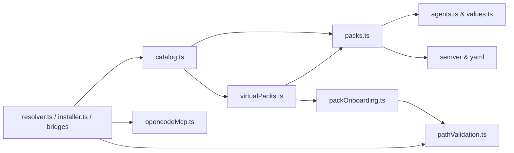

# Pack Validation, Catalog & Virtual Packs

## Purpose

This module group enforces the [OpenCode pack contract (`1.1`)](../api/pack-contract-reference.md), inventories [executable content](../concepts/security-and-trust-model.md) before installation, resolves pack locations and transitive dependency closures within workspace catalogs, synthesizes in-memory *[virtual packs]* (see [Glossary](../glossary.md)) for manifest-free agent repositories, guards workspace paths against symlink escapes, and normalizes OpenCode V1/V2 MCP server configurations. Together, these modules ensure that untrusted or raw external repositories can be inspected, validated, routed, and installed safely without hardcoding catalog-specific assumptions.

## Key Files

| File | Role |
|------|------|
| `src/utils/packs.ts` | Contract `1.1` manifest parser, read-only pack validator (`validatePack`), JSONC parser, static reference/import scanner, and `ExecutableSurface` inventory. |
| `src/utils/catalog.ts` | Workspace catalog lookup (`packDir`, `packsDir`, `readManifest`) and depth-first transitive dependency ordering (`resolvePackClosure`). |
| `src/utils/virtualPacks.ts` | Zero-manifest agent/command/skill discovery (`scanLooseAgentFiles`, `scanVirtualExtras`) and in-memory V2 virtual pack synthesis (`validateVirtualPack`). |
| `src/utils/pathValidation.ts` | Lexical and `realpath`-based workspace containment checks (`realpathThroughExistingAncestor`, `assertInsideRealWorkspace`). |
| `src/utils/opencodeMcp.ts` | Unified accessor and normalizer for OpenCode V1 flat `mcp` maps and V2 nested `mcp.servers` configurations. |

## Contract 1.1 Validation Engine (`src/utils/packs.ts`)

`validatePack(packRoot, options)` performs a strictly read-only inspection of a pack directory against `CONTRACT_VERSION` (`{ major: 1, minor: 1 }`) and returns a `PackValidation` object containing parsed metadata, discovered IDs (`PackIds`), executable assets (`ExecutableSurface`), cross-pack `UnresolvedReference` entries, and `PackIssue` diagnostics (`error` or `warning`).

### Manifest Validation

`readPackManifest()` and the internal `readManifest()` verify [`opencode-pack.json`](../api/pack-contract-reference.md) (`MANIFEST_FILE`) as a regular file (rejecting symlinks and directories) and enforce exact schema rules:

- **`contract`**: Must match `"MAJOR.MINOR"`. Major versions other than `1` abort early with `contract-unsupported`. Minor versions newer than `1.1` emit a `contract-newer-minor` warning while ignoring newer optional features.
- **`name`, `version`, `description`**: `name` must match `PACK_NAME_RE` (`/^[a-z0-9](?:[a-z0-9-]{0,62}[a-z0-9])?$/`), `version` must be a strict full semver string (`semver.valid(v) === v`), and `description` must be non-empty. Unknown top-level keys emit `manifest-invalid`.
- **`requires`**: Maps dependency pack names to valid `semver` ranges. Self-dependencies fail validation, and wildcard `"*"` ranges are rejected when `options.sourceKind === "git"` (allowed only for local sources).
- **`archetype`, `routingDefaults`, `flowDefaults`**:
  - [`archetype`](../concepts/conditional-routing-and-archetypes.md) requires a non-empty list of distinct `callers` and a `reference` included in `callers`.
  - `routingDefaults` requires `archetype` and maps valid provider or `provider/model` triggers to `{ [agentId]: "provider/model[#variant]" | "inherit" }`.
  - `flowDefaults` requires `contract` `"1.1"` or newer plus `archetype`, validating each entry via `validateConditionalRule()`.
  - After scanning files, `checkArchetype()` verifies that callers exist in the pack and are not `mode: "subagent"`, and that routed/delegated targets are subagents of the pack (emitting `archetype` errors on mismatches and `archetype-pinned` warnings when a routed subagent pins a fixed `model` in frontmatter).

### Directory Layout, Namespaces, and Filesystem Safety

`walk()` traverses the pack relative to `fs.realpathSync(root)` and enforces filesystem boundaries before checking layout rules:

- **Ignored & Reserved Paths**: `.DS_Store`, `.opencode`, and `.git*` are skipped; `node_modules` is skipped with a `node-modules` warning reminding authors to bundle plugin dependencies. `RESERVED_DIRS` (`instructions`, `.manage-agents`) fail with `reserved-path`, and V1 singular/legacy directories (`LEGACY_DIRS`: `agent`, `mode`, `modes`, `command`, `skill`, `plugin`, `tool`) fail with `legacy-directory`. Uppercase variants of native, reserved, or legacy directories fail with `directory-case`.
- **Symlink Escape Rejection**: Broken symlinks (`symlink-broken`), symlinks resolving outside `realRoot` (`symlink-escape`), symlinked directories (`symlink-directory`), and non-regular files (`symlink-special`) are all rejected as errors.
- **NFC + Lowercase Collision Detection**: Every relative path is normalized with `rel.normalize("NFC").toLowerCase()`. Any two files folding to the same key produce a `case-collision` error so packs behave identically on case-insensitive filesystems.
- **Root Files**: Only `opencode-pack.json`, `opencode.json` or `opencode.jsonc` (having both triggers `config-duplicate`), `AGENTS.md`, `README`, `LICENSE`/`LICENCE`, and `CHANGELOG` (`.md`, `.txt`, `.rst`) may sit at the pack root (`ROOT_FILE_RE`); anything else emits `root-file`. [`installableFiles(validation)`](./target-installer.md) later strips `*.test.*`, `opencode-pack.json`, and root `README`/`LICENSE`/`CHANGELOG` during installation.
- **Native OpenCode Directories vs. Pack Namespace**:
  - `agents/` and `commands/`: Markdown `.md` files only (`not-markdown`). [Agent YAML frontmatter](./agent-editing-and-v2-compat.md) is checked for valid mappings (`frontmatter-invalid`), valid `mode` (`primary`, `subagent`, `all` -> `agent-mode`), and V1 keys (`tools`, `permission`, `name` -> `agent-deprecated-key` warning).
  - `skills/`: Every file must live beneath a `<skill-dir>/SKILL.md` root (`skill-orphan`). Missing `description` frontmatter in `SKILL.md` raises a `skill-description` warning.
  - `plugins/`: Must be directory plugins under `plugins/<name>/` (`plugin-single-file`) containing `index.(ts|js|mjs)`, `server.(ts|js|mjs)`, or `package.json` (`plugin-entry`).
  - `themes/`: Flat `<name>.json` files only (`theme-file`).
  - **Mandatory Namespace Rule**: Any file in a non-native top-level directory (such as `resources/`) or inside `tools/` must be namespaced under `<dir>/<pack-name>/**`—or `tools/_<pack-name>_*` for top-level tool modules—otherwise validation fails with `namespace`.

### `opencode.json(c)` Keys, Static Scanning, and Cross-Pack References

`parseJsonc()` strips `//` and `/* ... */` comments and trailing commas outside string literals without touching string contents. When `opencode.json` or `opencode.jsonc` is present, `validateConfig()` enforces:

- **Pack-Allowed vs. User-Only Keys**: Only `CONFIG_KEYS` (`$schema`, `plugins`, `mcp`, `skills`, `instructions`, `agents`, `commands`, `formatter`, `lsp`, `experimental`) are permitted. User-owned settings (such as `model`, `theme`, or `provider`) fail with `config-key`.
- **Bounded File Scanning (`MAX_SCANNED_BYTES`)**: Because packs may come from [untrusted sources](../concepts/security-and-trust-model.md), `readText()` refuses to read files exceeding `MAX_SCANNED_BYTES` (`2 * 1024 * 1024`, i.e. 2 MiB) and records a `file-too-large` warning.
- **Static `{file:...}` & Import Scanning**:
  - Every string in `opencode.json(c)` is scanned via `FILE_REF_RE` (`/\{file:([^{}]*)\}/g`), and `skills`, `instructions`, and local `plugins` paths are resolved within the pack. Backslashes (`reference-backslash`), absolute/`~` paths (`absolute-path`), and `..` escapes (`reference-escape`) are errors.
  - Non-test JS/TS files under `plugins/` and `tools/` have comments stripped (`stripJsComments`) and static `import`/`from`/`require()` specifiers matched (`IMPORT_RE`). Relative imports are checked against pack files (supporting `.js`/`.mjs`/`.cjs` to `.ts`/`.mts`/`.cts` resolution). Unbundled external packages (anything except `node:*`, Node `builtinModules`, and `@opencode/plugin`) trigger an `import-dependency` warning.
  - Text files are also checked against `ABSOLUTE_CONFIG_RE` (`~/.config/opencode`, `$XDG_CONFIG_HOME/opencode`, `/.config/opencode/`), emitting an `absolute-config-path` warning with file and line number.
- **Cross-Pack `UnresolvedReference` Tracking**: When a local `plugin`, `skill`, `instruction`, `file`, or relative `import` target is missing from the current pack:
  - If `manifest.requires` is empty, `validatePack()` records a `reference-missing` error immediately.
  - If `manifest.requires` is non-empty, it appends `{ from, kind, target }` to `validation.unresolved` so the [multi-pack resolver](./resolver-and-lock.md) can verify that a required dependency supplies the target.

## Executable Surface Scanner (`ExecutableSurface`)

Both `validatePack()` and `validateVirtualPack()` return an `ExecutableSurface` summary used by [install/update confirmation gates and trust checks](../concepts/security-and-trust-model.md) whenever a pack introduces or modifies runnable code. `validatePack()` inventories applicable fields from pack files and config; virtual-pack synthesis currently populates `skillScripts` from discovered skills, leaving the other executable-surface arrays empty.

| Field | How It Is Inventoried |
|-------|-----------------------|
| `plugins` | Sorted directory plugin IDs discovered under `plugins/<name>/` with a valid entry file or `package.json`. |
| `pluginPackages` | Non-local package specifiers declared in `opencode.json(c)` under `"plugins"` (e.g. `"my-npm-plugin"` or `{"package": "..."}`). |
| `toolModules` | Non-test `.ts`, `.mts`, `.cts`, `.js`, `.mjs`, and `.cjs` files under `tools/`. |
| `skillScripts` | Non-test files inside `skills/<id>/` (other than `SKILL.md`) matching `.sh`, `.bash`, `.zsh`, `.py`, `.rb`, `.pl`, `.ts`, `.mts`, `.js`, `.mjs`, `.cjs` or carrying any POSIX execute bit (`mode & 0o111`). |
| `mcpServers` | Validated `mcp.servers.<name>` entries in `opencode.json(c)`, recording `{ name, type: "local", command }` or `{ name, type: "remote", url? }`. |
| `externalCommands` | Deduplicated, sorted binary/command names (`command[0]`) extracted from local `mcp.servers`, `formatter.<id>.command`, and `lsp.<id>.command`. |

## Workspace Catalog & Closure Resolution (`src/utils/catalog.ts`)

`catalog.ts` treats any local workspace or cloned source tree uniformly—whether it is a multi-pack catalog, a single-pack root, or a manifest-free virtual pack directory.

### Pack Discovery (`packDir` and `readManifest`)

`packDir(workspaceRoot, name)` validates `name` against `PACK_NAME_RE` before touching disk, then resolves the pack directory in four steps:

1. **Single-Pack Root**: If `<workspaceRoot>/opencode-pack.json` exists, returns `workspaceRoot` only if its `manifest.name === name` (never falling through to nested `packs/` directories).
2. **Standard Multi-Pack Layout**: Checks `<workspaceRoot>/packs/<name>` (`packsDir(workspaceRoot)`). If the directory is a symlink (`lstatSync`), it returns `null` to prevent pulling content from outside the catalog; if `opencode-pack.json` exists inside it, returns that path.
3. **Nested Discovery**: Recursively searches subdirectories up to `DISCOVERY_DEPTH` (`4`), skipping symlinks and `SKIPPED_DIRS` (`.git`, `node_modules`, `.opencode`), returning the first directory with an `opencode-pack.json` whose `name` matches.
4. **Virtual Pack Fallback**: If no manifest-bearing pack matches, checks whether `derivePackSlug(path.basename(path.resolve(workspaceRoot))) === name` and `isVirtualPackRoot(resolvedRoot)` is true, returning `workspaceRoot`.

`readManifest(dir)` parses `<dir>/opencode-pack.json` when present, or synthesizes a minimal contract `"1.1"` manifest (`version: "0.0.0-virtual"`, `requires: {}`) when `dir` is a virtual pack root.

### Transitive Closure Resolution (`resolvePackClosure`)

`resolvePackClosure(workspaceRoot, name)` computes the ordered installation/inspection closure for `name`:

- Traverses `Object.keys(readManifest(dir).requires ?? {}).sort()` depth-first so output order is deterministic.
- Tracks active ancestors in a `visiting` set and throws `Error("dependency cycle through <pack>")` on direct or transitive cycles.
- Throws `Error("<from> requires <pack>, which is not in the catalog")` (or `"no pack <pack> in the catalog"` for the root request) when a dependency is missing.
- Emits dependencies before dependents in topological post-order (while semver range syntax is validated by `validatePack()` and cross-source version range satisfaction is enforced by the [multi-source resolver](./resolver-and-lock.md)).

## Zero-Manifest Virtual Packs (`src/utils/virtualPacks.ts`)

Raw agent repositories often start as plain Markdown collections or `.opencode/` project trees without `opencode-pack.json`. `virtualPacks.ts` synthesizes standard `PackValidation` structures in memory (`VIRTUAL_PACK_VERSION = "0.0.0-virtual"`) so users can [browse agents in the TUI](../components/tui-shell-and-catalog.md), [configure routing or conditional IF/OR flows](./routing-and-user-settings.md), and [install them into targets](./target-installer.md) before optionally running [`pack onboard`](./pack-onboarding-and-doctor.md) (`initPackManifest`, re-exported from `packOnboarding.ts`) to materialize a permanent `opencode-pack.json`.

### Safe Slug Derivation & Guards

- **`derivePackSlug(raw)`**: Normalizes directory or source names via Unicode `NFKD`, strips combining marks, lowercases, collapses non-alphanumeric runs to `-`, trims leading/trailing hyphens, caps length at 64 characters, and falls back to `"agents-pack"` if the result does not satisfy `PACK_NAME_RE`.
- **Manifest Precedence**: `hasAnyManifestWithinDepth(root)` scans up to `DISCOVERY_DEPTH`; if any `opencode-pack.json` exists in the tree, `scanLooseAgentFiles()` returns empty so real packs are never shadowed as virtual packs.
- **Symlink Isolation**: Neither `scanLooseAgentFiles()` nor `scanVirtualExtras()` follows symlinks; encountered symlinks are recorded in `skippedLinks` and surfaced as `symlink-skipped` warnings.

### Supported Raw Layouts

1. **Explicit Agent Containers (`scanLooseAgentFiles`)**: Inside `agents/`, `agent/`, `mode/`, or `modes/`—either at the repository root or directly inside `.opencode/` (e.g. `.opencode/agents/`)—every non-test `.md` file (excluding documentation names matching `NON_AGENT_MD_RE` such as `README.md`, `AGENTS.md`, `CLAUDE.md`, `GUIDA.md`, `SKILL.md`) is discovered as an agent. Files under `mode/` or `modes/` with a missing or falsy `mode` value are normalized to `mode: "primary"` during synthesis.
2. **Loose Markdown Agents (`hasAgentFrontmatter`)**: Outside container directories (walking unignored subdirectories up to `DISCOVERY_DEPTH`, skipping files larger than `MAX_SCANNED_BYTES`), a `.md` file is treated as an agent only if its YAML frontmatter contains at least one recognized OpenCode agent key (`AGENT_FRONTMATTER_KEYS`, including `description`, `mode`, `model`, `permissions`, `permission`, `tools`, `steps`, `max_steps`, `temperature`, `top_p`, `variant`, `reasoningEffort`, `options`, `prompt`, `hidden`, `color`, `disabled`, `request`).
3. **Optional Commands, Skills, Instructions & Config (`scanVirtualExtras`)**: When at least one agent is found, `scanVirtualExtras()` also collects:
   - `commands/` or `command/` (at root or under `.opencode/`) -> mapped to `commands/<id>.md`.
   - `skills/` or `skill/` (at root or under `.opencode/`) grouped by nearest `<id>/SKILL.md` -> mapped to `skills/<id>/**`, flagging executable scripts into `executable.skillScripts`.
   - `AGENTS.md` (root preferred over `.opencode/AGENTS.md`) -> mapped to `AGENTS.md`.
   - `opencode.json` or `opencode.jsonc` (root preferred over `.opencode/`).

### In-Memory V2 Synthesis (`validateVirtualPack`)

`validateVirtualPack(packRoot, options)` builds a `PackValidation` with `manifest.version = "0.0.0-virtual"` and populates `validation.virtualFiles` (`Record<string, VirtualFileEntry>`), mapping each canonical pack path (`agents/<id>.md`, `commands/<id>.md`, `skills/<id>/...`) to `{ sourceRel, content? }`:

- If a discovered agent uses [legacy V1 frontmatter](./agent-editing-and-v2-compat.md) (`detectFrontmatterVersion(frontmatter) === "v1"`, such as `max_steps` or `permission`) or comes from a `mode/` directory with a missing or falsy `mode`, `renderAgentFile(frontmatter, body, "v2")` rewrites the file in memory into `VirtualFileEntry.content` (`Buffer`) without modifying the user's source files on disk.
- Canonical target paths are checked for NFC + lowercase collisions (`case-collision`), and `virtualManifestHash(manifest)` computes a SHA-256 digest of the synthesized manifest for [lockfile tracking](./resolver-and-lock.md).

## Path Validation & MCP Normalization

### Workspace Path Validation (`src/utils/pathValidation.ts`)

Used across [pack onboarding](./pack-onboarding-and-doctor.md), [agent file editing](./agent-editing-and-v2-compat.md), [self-update](./launcher-and-build.md), and [Claude/Codex bridge generators](./bridges.md) to prevent directory traversal and symlink escapes:

- `isWorkspaceRelativePath(value)`: Returns `true` only when `value` is relative and contains no `".."` path segments on POSIX or Windows separators.
- `isPathInsideWorkspace(workspaceRoot, candidate)`: Checks lexical containment against `path.resolve(workspaceRoot)`.
- `realpathThroughExistingAncestor(target)`: Resolves `target` even when leaf directories or files do not exist yet by walking upward (`path.dirname`) to the nearest existing ancestor, resolving symlinks via `fs.realpathSync()`, and appending the non-existent tail segments.
- `assertInsideRealWorkspace(workspaceRoot, resolvedCandidate, originalPath)`: Verifies `path.relative(fs.realpathSync(workspaceRoot), resolvedCandidate)` neither starts with `".."` nor is absolute, throwing `Invalid plugin output path outside workspace: <originalPath>` on violation.

### V1/V2 MCP Config Helpers (`src/utils/opencodeMcp.ts`)

OpenCode V1 stored MCP servers flat under `mcp.<name>` with `enabled: false`, whereas OpenCode V2 nests them under `mcp.servers.<name>` with `disabled: true`. `opencodeMcp.ts` provides a single compatibility layer:

- `readMcpServers(config)`: Returns `config.mcp.servers` when it is a plain object (V2); otherwise extracts flat server entries from `config.mcp` while skipping any non-object `"servers"` key (V1).
- `readMcpServerNames(config)`: Returns sorted server keys from `readMcpServers(config)`.
- `isServerDisabled(server)` / `setServerDisabled(server, disabled)`: Treats either `server.disabled === true` or `server.enabled === false` as disabled, and writes back normalized V2 state (`disabled: true` when disabled, deleting both `enabled` and `disabled` when enabled).
- `normalizeMcpConfig(config)`: Produces a shallow copy of `config` rewritten to the canonical V2 `{ mcp: { servers: { ... } } }` shape.
- `isLocalServer(server)`: Returns `true` when `server.type === "local"`.

## Dependencies



- **Internal**: `packs.ts` depends on `values.ts` (trigger, model-ref, and conditional flow rule validation) and [`agents.ts`](./agent-editing-and-v2-compat.md) (`extractFrontmatter`). `virtualPacks.ts` builds on `packs.ts`, `agents.ts` (`renderAgentFile`), `v2Compat.ts` (`detectFrontmatterVersion`), and re-exports `initPackManifest` from [`packOnboarding.ts`](./pack-onboarding-and-doctor.md) (which uses `pathValidation.ts`). Downstream consumers ([`resolver.ts`](./resolver-and-lock.md), [`installer.ts`](./target-installer.md), [`sources.ts`](./sources-and-github.md), `agents.ts`, [`bridge.ts`](./bridges.md), `codexBridge.ts`) rely on these five modules for validation, workspace safety, and MCP introspection.
- **External**: Node built-ins (`node:fs`, `node:path`, `node:crypto`, `node:module`), [`semver`](../dependencies/runtime-and-tooling-stack.md) (version and range validation), and `yaml` (agent and skill frontmatter parsing).

## Usage Example

Validating a standard Contract `1.1` pack versus synthesizing and inspecting a manifest-free virtual pack (adapted from `src/utils/packs.test.ts` and `src/utils/virtualPacks.test.ts`):

```ts
import { hasErrors, installableFiles, validatePack } from "./packs.js"
import { packDir, resolvePackClosure } from "./catalog.js"
import { isVirtualPackRoot, validateVirtualPack } from "./virtualPacks.js"

// 1. Validate a manifest-bearing pack and inspect its executable surface
const packResult = validatePack("contract/examples/minimal-pack")
if (!hasErrors(packResult)) {
  const toCopy = installableFiles(packResult)
  console.log(packResult.ids.agents, packResult.executable.skillScripts, toCopy)
}

// 2. Resolve transitive dependencies in a workspace catalog
const closure = resolvePackClosure("/path/to/catalog", "my-pack")
const rootDir = packDir("/path/to/catalog", closure[0])

// 3. Synthesize an in-memory V2 pack from a raw folder of Markdown agents
if (isVirtualPackRoot("/path/to/raw-agents")) {
  const virtual = validateVirtualPack("/path/to/raw-agents")
  // virtual.manifest?.version === "0.0.0-virtual"
  // virtual.virtualFiles maps canonical "agents/<id>.md" -> { sourceRel, content? }
}
```

## Related Pages

- [OpenCode Pack Contract 1.1 Reference](../api/pack-contract-reference.md) — Normative `opencode-pack.json` manifest schema, allowed config keys, and namespace rules
- [Pack Onboarding, Doctor & Scaffolding](./pack-onboarding-and-doctor.md) — Converting virtual packs into permanent Contract `1.1` packs and repairing drift
- [Dependency Resolver & Lockfile](./resolver-and-lock.md) — Cross-source SemVer resolution, unresolved reference verification, and `executableHash` locking
- [Security & Trust Model](../concepts/security-and-trust-model.md) — Symlink containment, bounded scanning, and executable surface approval gates
- [Agent Editing, V2 Compatibility & Git Transactions](./agent-editing-and-v2-compat.md) — Frontmatter parsing, V1-to-V2 normalization, and safe local edits
- [Claude Code & Codex Bridges](./bridges.md) — Downstream consumers of `resolvePackClosure`, `pathValidation`, and `opencodeMcp`
