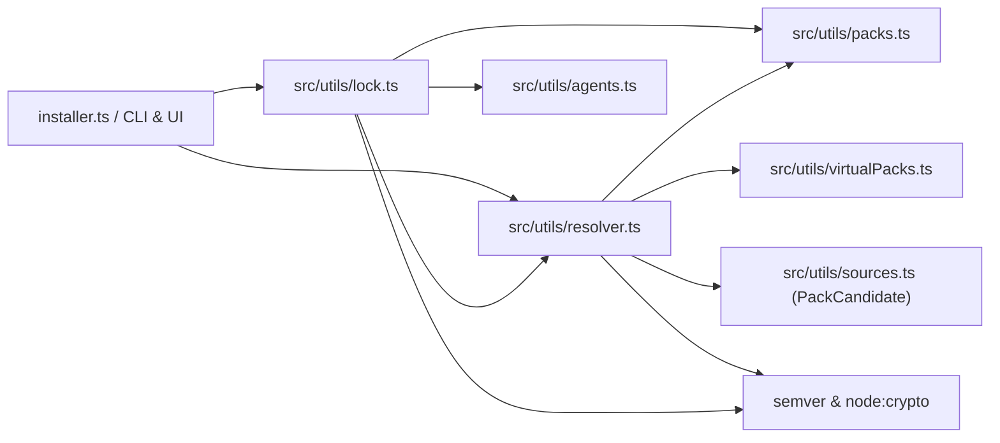

# Dependency Resolver & Lockfile

## Purpose

The resolver and lockfile modules turn user root requests and [discovered pack candidates](./sources-and-github.md) into a deterministic, side-effect-free installation order (`src/utils/resolver.ts`) and persist or compare the exact byte and executable state of installed packs in [`<target>/.manage-agents/lock.json`](../config/user-and-target-files.md) (`src/utils/lock.ts`). Together they enforce three core guarantees:

- **No silent tie-breaking**: When multiple sources or multiple versions satisfy a request, resolution fails with an actionable disambiguation error rather than picking "newest wins".
- **Sticky lock stability**: Installing a new pack or partially updating selected packs preserves locked sources and versions of untouched packs unless explicitly updated (see [Pack Lifecycle & Target Safety](../concepts/pack-lifecycle-and-target-safety.md)).
- **Executable surface accountability**: Separate SHA-256 digests track installable content (`contentHash`) versus executable code and structured MCP/command definitions (`executableHash`), gating untrusted or changed *[executable surfaces]* (see [Glossary](../glossary.md)) behind explicit confirmation (see [Security & Trust Model](../concepts/security-and-trust-model.md)).

## Key Files

| File | Role |
|------|------|
| `src/utils/resolver.ts` | Parses pack request specs, resolves transitive `requires` constraints to a fixpoint, verifies cross-pack references, computes streaming SHA-256 hashes, and orders packs topologically. |
| `src/utils/lock.ts` | Defines the `PackLock` v1 schema, validates and atomically writes `lock.json`, diffs lock snapshots (`diffLocks`), and computes user confirmation triggers (`confirmationsNeeded`). |

## Public API

### `src/utils/resolver.ts`

| Export | Kind | Description |
|--------|------|-------------|
| `PackRequest` | `interface` | Parsed request `{ name: string; source?: string; range?: string }`. |
| `ResolvedPack` | `interface` | Fully validated pack candidate enriched with revision, SHA-256 hashes, `root` flag, `requiredBy` dependents, `executable` summary, and `PackValidation`. |
| `Resolution` | `interface` | Output of `resolvePacks`: `{ roots, packs, problems, warnings }`, where `packs` is ordered dependencies-first. |
| `ResolveOptions` | `interface` | Optional `{ prefer, revisionOf, pins }` inputs controlling source preference, git commit lookup, and sticky lock pins. |
| `parsePackRequest(spec)` | `function` | Parses and validates a `[source/]name[@range]` request string. |
| `formatRequest(request)` | `function` | Serializes a `PackRequest` back to canonical `[source/]name[@range]` text. |
| `hashFile(file)` | `function` | Computes a streaming SHA-256 hex digest using a 64 KiB buffer (`1 << 16` bytes). |
| `packContent(validation)` | `function` | Computes `{ fileHashes, contentHash, executableHash }` across a pack's installable files and executable config. |
| `describeExecutable(validation)` | `function` | Returns sorted one-line human-readable labels describing plugins, tool modules, skill scripts, MCP servers, and external commands. |
| `resolvePacks(roots, candidates, options?)` | `function` | Pure deterministic dependency resolver returning a `Resolution` without touching the target filesystem. |
| `orderByRequires(names, requiresOf)` | `function` | Post-order topological sort placing dependencies first and breaking ties alphabetically. |

### `src/utils/lock.ts`

| Export | Kind | Description |
|--------|------|-------------|
| `LockedPack` | `interface` | Per-pack lock record storing source, kind, relative path, version, git revision, SHA-256 hashes, trust flag, `requires`, and `executable` surface. |
| `PackLock` | `interface` | Top-level v1 lockfile (`{ lockVersion: 1, contract, roots, packs }`). |
| `LockChange` | `interface` | High-level pack transition (`added`, `removed`, `source`, `upgrade`, `downgrade`, `revision`, `content`). |
| `ExecutableChange` | `interface` | Executable surface delta (`{ name, added, removed, changed: true }`) when `executableHash` changes. |
| `defaultTarget(env?)` | `function` | Resolves the default OpenCode target directory (typically `$XDG_CONFIG_HOME/opencode`). |
| `targetStateDir(target)` | `function` | Returns `<target>/.manage-agents`, where `lock.json` resides. |
| `buildLock(resolution)` | `function` | Builds a deterministically sorted `PackLock` from a problem-free `Resolution` (throws if `resolution.problems` is non-empty). |
| `serializeLock(lock)` | `function` | Formats a `PackLock` as 2-space indented JSON with a trailing newline. |
| `readLock(target)` | `function` | Reads and strictly validates `<target>/.manage-agents/lock.json`, returning `null` when absent. |
| `writeLock(target, lock)` | `function` | Atomically writes `lock.json` with `0o644` permissions via `atomicWriteRestrictedFile`. |
| `diffLocks(previous, next)` | `function` | Compares two locks and returns `{ changes, executable }`. |
| `confirmationsNeeded(next, previous)` | `function` | Lists human-readable security confirmation prompts required before applying `next`. |

## Pack Request Specification (`[source/]name[@range]`)

`parsePackRequest(spec)` (`src/utils/resolver.ts:53-58`) parses root install specs matching `/^(?:([a-z0-9-]+)\/)?([a-z0-9-]+)(?:@(.+))?$/`:

1. **Identifier validation**: Both `name` and the optional `source` prefix must match `PACK_NAME_RE` (`/^[a-z0-9](?:[a-z0-9-]{0,62}[a-z0-9])?$/`). Path traversal or uppercase tokens (such as `../flow`) throw `invalid pack request "<spec>": use [source/]name[@range]`.
2. **Semver range & exact pin validation**: When `@<range>` is present, `semver.validRange(range)` validates standard ranges (`^2.0.0`, `~1.4.0`, `*`), exact version pins (`2.0.0`), and prerelease ranges (`^1.1.0-beta`). Invalid ranges throw `invalid version range in "<spec>"`. Standard `semver.satisfies` semantics apply during matching, meaning prerelease versions (such as `1.1.0-beta.1`) only match un-ranged requests or ranges that explicitly include a prerelease tag on that version tuple.
3. **Virtual `0.0.0-virtual` pack handling**: Manifest-free agent folders discovered from sources carry synthesized version `VIRTUAL_PACK_VERSION` (`"0.0.0-virtual"` from [`src/utils/virtualPacks.ts`](./pack-validation-and-virtual-packs.md)). Because `"0.0.0-virtual"` is valid semver (`semver.valid("0.0.0-virtual") === "0.0.0-virtual"`), un-ranged requests (`flow` or `source/flow`) and exact pins (`flow@0.0.0-virtual`) select them cleanly, and `readLock()` accepts them as valid locked versions. When `resolvePacks()` detects `candidate.manifest.version === "0.0.0-virtual"` without an on-disk [`opencode-pack.json`](../api/pack-contract-reference.md) (`src/utils/resolver.ts:207-210`), it validates the candidate with `validateVirtualPack()` instead of `validatePack()` and computes `manifestHash` via `virtualManifestHash(validation.manifest)` (`sha256(JSON.stringify(manifest))`).

## Deterministic Resolution Algorithm (`resolvePacks`)

`resolvePacks(roots, candidates, options)` (`src/utils/resolver.ts:176-245`) is a pure function that selects at most one `PackCandidate` per pack name across the transitive dependency closure.

### 1. Fixpoint Constraint Propagation

Starting from `roots` and an empty `selected` map, `constraintsFor(roots, selected)` (`src/utils/resolver.ts:129-145`) builds a `Constraint` per pack name holding:
- `sources`: explicit `request.source` prefixes from root requests.
- `ranges`: `{ range, by }` pairs contributed by root requests (`by: "request"`) and by `candidate.manifest.requires` of every currently selected pack.
- `root`: `true` if directly requested in `roots`.

Each iteration visits constrained pack names in alphabetical order, runs `choose()` for each name, recomputes `nextConstraints` from the newly selected candidates, and terminates once `constraintKey(nextConstraints) === constraintKey(constraints)` (`src/utils/resolver.ts:184-200`). The loop is bounded by `maxRounds = uniqueCandidateNames + roots.length + 2`; failing to converge aborts with `problems: ["dependency resolution does not converge"]`.

### 2. Candidate Selection, Sticky Pins, and Disambiguation (`choose`)

For each pack `name`, `choose()` (`src/utils/resolver.ts:150-173`) narrows `candidates` step by step without guessing:

1. **Existence**: Filters candidates by `manifest.name === name`. If empty, records `pack "<name>" is not offered by any source` (listing requiring packs when applicable).
2. **Single-source rule**: If `constraint.sources.size > 1` (for example, `a/flow` and `b/flow`), fails with `pack "<name>" is requested from several sources (...); a pack name can come from only one`.
3. **Source precedence**: Resolves `pinnedSource = [...constraint.sources][0] ?? pin?.source ?? prefer[name]`. An explicit `source/name` request overrides a sticky lock pin, which in turn overrides `options.prefer[name]` ([`manage-agents source prefer`](../api/cli-reference.md)). If that source does not offer `name`, fails with `pack "<name>" is not offered by source "<pinnedSource>"`.
4. **Sticky lock pins (`options.pins`)**: When `pin` (`{ source, version }`) is supplied and no explicit source prefix was requested (`!constraint.sources.size`), the candidate pool is restricted to `pin.version` provided it satisfies all active `constraint.ranges`. If the locked version vanished or violates a new range, resolution fails with instructions to run ``manage-agents update <name>`` (`src/utils/resolver.ts:159-163`). Callers in [`src/utils/installer.ts`](./target-installer.md) populate `pins` from `lock.json` for all non-requested packs during `install` and for unselected packs from unpulled sources during partial `update`.
5. **Range filtering**: Keeps candidates whose `manifest.version` satisfies every `{ range }` in `constraint.ranges`. If none match, reports all conflicting ranges alongside every offered `source/name@version (relativeDir)`.
6. **Refusal on ambiguity**: If `satisfying.length > 1`, `choose()` refuses to pick silently:
   - Across multiple sources: advises `request <s1>/<name> or <s2>/<name>, or run \`manage-agents source prefer <name> <source>\``.
   - Within a single source (multiple versions matching the range): advises `narrow the version range`.

### 3. Cycle Detection, Validation, and Topological Ordering

Once the fixpoint settles:
- **Cycle detection**: `findCycle(selected)` (`src/utils/resolver.ts:247-268`) runs a three-color DFS (`unvisited` / `"visiting"` / `"done"`) in alphabetical order over `selected` and each manifest's `requires`. Any cycle appends `dependency cycle: a -> b -> a` to `problems`.
- **Pack validation**: Every selected pack is validated (`validatePack` or `validateVirtualPack`). Validation issues with `level === "error"` become resolution `problems` (`<source>/<name>: [<code>] <path>: <message>`). Local packs using `"*"` in `requires` emit a warning (`"<name>: \"*\" in requires accepts any version; pin a range before publishing"`, `src/utils/resolver.ts:241`).
- **Deterministic topological order**: When cycle-free, `topologicalOrder(resolved)` delegates to `orderByRequires(names, requiresOf)` (`src/utils/resolver.ts:275-287`), a post-order DFS that sorts both root names and dependency lists alphabetically. Dependencies always precede the packs that require them, and independent packs are ordered alphabetically.

## Cross-Pack Unresolved Reference Verification

During single-pack validation ([`validatePack()`](./pack-validation-and-virtual-packs.md) in `src/utils/packs.ts:331-338`), references that stay inside managed scopes (`/` forward slashes, no `..` escape outside the pack) but whose targets do not exist inside the pack itself are recorded in `validation.unresolved` as `UnresolvedReference` items whenever [`manifest.requires`](../api/pack-contract-reference.md) is non-empty (packs with empty `requires` fail immediately with `reference-missing`):

```ts
export interface UnresolvedReference {
  from: string
  kind: "plugin" | "skill" | "instruction" | "file" | "import"
  target: string
}
```

After validating all selected packs in the transitive `requires` closure, `resolvePacks()` (`src/utils/resolver.ts:236-240`) verifies every `UnresolvedReference` against the packs declared in that pack's direct `pack.requires` map (preventing undeclared phantom dependencies on transitive packs). A required provider satisfies `ref` when `providesTarget(provider.validation, ref)` (`src/utils/resolver.ts:115-121`) returns `true`:

| Reference `kind` | Origin in Pack | `providesTarget` Matching Rule |
|------------------|----------------|--------------------------------|
| `"plugin"` | Local plugin specifier in `opencode.json(c)` | `validation.ids.plugins.includes(target.slice("plugins/".length))` |
| `"file"` | `{file:...}` prompt/config interpolation | Exact match in `validation.files` |
| `"import"` | Relative JS/TS import in `plugins/` or `tools/` | Exact match in `validation.files`, or `.js`/`.mjs`/`.cjs` mapped to `.ts`/`.mts`/`.cts` in `validation.files` |
| `"skill"` | Skill path reference | Exact match in `validation.files` or directory prefix `${target}/` in `validation.files` |
| `"instruction"` | `instructions` entry in `opencode.json(c)` | Exact match in `validation.files` or directory prefix `${target}/` in `validation.files` |

If no directly required pack provides `ref.target`, `resolvePacks()` records:
`<pack>: <from> references <kind> "<target>", which no required pack (<requires...>) provides`.

## Content & Executable Hashing & Confirmation Triggers

### Streaming SHA-256 Digest Calculation

All digests use Node's `crypto.createHash("sha256")` and produce 64-character lowercase hex strings (`src/utils/resolver.ts:63-101`):

- **`hashFile(file)`**: Opens the file descriptor synchronously and streams bytes through an uninitialized 64 KiB buffer (`Buffer.allocUnsafe(1 << 16)`), ensuring large assets never load into heap memory at once.
- **`combineHashes(fileHashes, extra = "")`**: Seeds SHA-256 with `extra`, sorts relative file paths lexicographically, and feeds `${file}\0${fileHashes[file]}\0` per entry so path/digest boundaries are unambiguous.
- **`manifestHash`**: `hashFile(<dir>/opencode-pack.json)` for standard packs, or `sha256(JSON.stringify(manifest))` (`virtualManifestHash`) for `0.0.0-virtual` packs.
- **`contentHash`**: Computed by `packContent(validation)` across `installableFiles(validation)` (excluding pack-root documentation such as `README.md`, `LICENSE`, `CHANGELOG`, and `opencode-pack.json`). Virtual pack entries hash `virtual.content` buffers directly when synthesized in memory or stream `virtual.sourceRel` from disk.
- **`executableHash`**: Filters `fileHashes` down to executable code files (`file.startsWith("plugins/")`, `executable.toolModules`, and `executable.skillScripts`) and passes the structured configuration object as `extra`:

```ts
executableHash: combineHashes(
  code,
  JSON.stringify({
    packages: executable.pluginPackages,
    mcp: executable.mcpServers,
    commands: executable.externalCommands,
  }),
)
```

Hashing the structured JSON alongside code bytes ensures that argv boundary mutations—such as changing an MCP command from `["tool", "arg one"]` to `["tool", "arg", "one"]`—alter `executableHash` even though `describeExecutable()` renders both as `"mcp db: tool arg one"`. Packs with validation errors skip `packContent()` and receive empty `""` hashes because failed resolutions cannot be locked.

### Confirmation Triggers (`confirmationsNeeded`)

`confirmationsNeeded(next, previous)` (`src/utils/lock.ts:155-167`) inspects a candidate `PackLock` against the existing lock (`null` on first install) and returns every reason requiring interactive approval or `--yes` (see [Security & Trust Model](../concepts/security-and-trust-model.md)):

1. **Untrusted source carrying executable content**: For each pack in `next.packs` where `!pack.trusted && pack.executable.length > 0`, a prompt `<name>: source "<source>" is not trusted and the pack carries executable content` is emitted unless `previous?.packs[name]` already accepted the exact same `(trusted, source, executableHash)` tuple.
2. **New executable surface**: For each entry in `diffLocks(previous, next).executable` with `change.added.length > 0`, emits `<name>: new executable surface: <added...>`.
3. **Modified executable code or config**: When `executableHash` changed without adding new surface labels (`change.added.length === 0`) and `next.packs[name].executable.length > 0`, emits `<name>: executable code changed in: <current executable...>`. Removing all executable items from a pack (`next.packs[name].executable.length === 0`) does not trigger confirmation.

## Lockfile Schema & Diffing (`src/utils/lock.ts`)

### `PackLock` v1 Structure

`buildLock(resolution)` (`src/utils/lock.ts:79-95`) constructs sorted `roots`, `packs` keys, and `requires` maps. `serializeLock(lock)` (`src/utils/lock.ts:97`) then applies `JSON.stringify(lock, null, 2)` and appends a newline; it does not reorder or normalize an arbitrary `PackLock`. `writeLock(target, lock)` (`src/utils/lock.ts:125-130`) writes those serialized bytes atomically to `<target>/.manage-agents/lock.json` with `0o644` permissions. Thus the stable ordering comes from `buildLock`, while serialization preserves the supplied lock's property order:

```json
{
  "lockVersion": 1,
  "contract": "1.1",
  "roots": [
    "official/flow@^2.0.0"
  ],
  "packs": {
    "flow": {
      "source": "official",
      "sourceKind": "git",
      "path": "packs/flow",
      "version": "2.1.0",
      "revision": "a1b2c3d4e5f6a1b2c3d4e5f6a1b2c3d4e5f6a1b2",
      "manifestHash": "0123456789abcdef0123456789abcdef0123456789abcdef0123456789abcdef",
      "contentHash": "fedcba9876543210fedcba9876543210fedcba9876543210fedcba9876543210",
      "trusted": true,
      "requires": {},
      "executable": [
        "plugin guard"
      ],
      "executableHash": "89abcdef0123456789abcdef0123456789abcdef0123456789abcdef01234567"
    }
  }
}
```

`buildLock()` copies each resolved pack's `revision`, `manifestHash`, `contentHash`, and `executableHash` into the lock; it does not recalculate those values. When `readLock(target)` (`src/utils/lock.ts:113-123`) loads an existing lockfile, `lockProblem()` verifies every entry's shape and digest format, but does not recompute hashes or validate them against pack files:
- Pack key and `source` match `PACK_NAME_RE`; `sourceKind` is `"local"` or `"git"`; `path` is a string.
- `version` equals `semver.valid(pack.version)` (canonical semver only).
- `revision` is either `null` or a 40-to-64-character lowercase hex digest (`/^[0-9a-f]{40,64}$/`); it records the resolved source revision, when available.
- `manifestHash`, `contentHash`, and `executableHash` each match `/^[0-9a-f]{64}$/`.
- `trusted` is boolean, `requires` is a string-to-string plain object, and `executable` is a `string[]`.

The lock stores all four revision/hash values, but `diffLocks()` uses only `revision` and `contentHash` for its primary pack change and checks `executableHash` separately for executable-surface changes. `manifestHash` is persisted and format-validated but is not itself a diff criterion.

### Lockfile Diffing (`diffLocks`)

`diffLocks(previous, next)` (`src/utils/lock.ts:132-152`) iterates the sorted union of pack names in `previous?.packs` and `next.packs` and produces two parallel arrays:

1. **`changes: LockChange[]`** — At most one primary change per pack, evaluated in strict precedence order:
   - `"added"`: Absent in `previous`, present in `next` (`to: "<source>@<version>"`).
   - `"removed"`: Present in `previous`, absent in `next` (`from: "<source>@<version>"`).
   - `"source"`: `old.source !== now.source` (`from`, `to`).
   - `"upgrade"` / `"downgrade"`: `old.version !== now.version`, classified with `semver.gt(now.version, old.version)`.
   - `"revision"`: `old.revision !== now.revision` (`from` / `to`, using `"none"` for `null`). This takes precedence over a simultaneous content-hash change.
   - `"content"`: `old.contentHash !== now.contentHash` (for example, edited local pack files at the same version), when no earlier primary change matched.
   Only the first matching primary change is emitted. Fields such as `manifestHash`, `sourceKind`, `path`, `trusted`, `requires`, and root requests do not produce a `LockChange` on their own; in particular a source/version change masks later revision/content changes in this array.
2. **`executable: ExecutableChange[]`** — Recorded independently when `now` is present, `now.executableHash !== old?.executableHash`, and at least one of the old or new `executable` label arrays is non-empty. Each entry carries `{ name, added, removed, changed: true }`, tracking both added/removed `describeExecutable()` labels and silent code/config edits where `added` and `removed` are empty. If both label arrays are empty, an executable-hash difference alone does not produce an entry.

## Dependencies



- **Internal**: [`src/utils/packs.ts`](./pack-validation-and-virtual-packs.md) (`validatePack`, `installableFiles`, `CONTRACT_VERSION`, `MANIFEST_FILE`, `PACK_NAME_RE`), `src/utils/virtualPacks.ts` (`validateVirtualPack`, `VIRTUAL_PACK_VERSION`, `virtualManifestHash`), [`src/utils/sources.ts`](./sources-and-github.md) (`PackCandidate`), [`src/utils/agents.ts`](./agent-editing-and-v2-compat.md) (`atomicWriteRestrictedFile`, `getExportDestination`). Consumed by [`src/utils/installer.ts`](./target-installer.md), `src/index.tsx`, and [`src/ui/SourcesTargetWorkspace.tsx`](../components/workspaces-flows-and-sources.md).
- **External**: [`semver`](../dependencies/runtime-and-tooling-stack.md) (range validation, satisfaction, and upgrade/downgrade comparison), `node:crypto` (SHA-256 hashing), `node:fs`, `node:path`.

## Usage Example

In [`src/utils/installer.ts`](./target-installer.md) and [`src/index.tsx`](../api/cli-reference.md), root specs are parsed with `parsePackRequest`, resolved with sticky lock `pins` and source `prefer` mappings, converted into a `PackLock`, and diffed against the previous target lock to compute changes and security confirmations:

```ts
import { buildLock, confirmationsNeeded, diffLocks, readLock } from "./lock.js"
import { parsePackRequest, resolvePacks } from "./resolver.js"
import { discoverAllPacks, findSource, sourceRevision } from "./sources.js"

const previousLock = readLock(target)
const requested = new Set(rawRequests.map(req => parsePackRequest(req).name))

// Keep already-locked packs pinned at their current source and version during install
const pins = Object.fromEntries(
  Object.entries(previousLock?.packs ?? {})
    .filter(([name]) => !requested.has(name))
    .map(([name, pack]) => [name, { source: pack.source, version: pack.version }]),
)

const { candidates } = discoverAllPacks(registry)
const resolution = resolvePacks(rawRequests.map(parsePackRequest), candidates, {
  prefer: registry.prefer,
  pins,
  revisionOf: name => sourceRevision(findSource(registry, name)),
})

if (resolution.problems.length === 0) {
  const nextLock = buildLock(resolution)
  const diff = diffLocks(previousLock, nextLock)
  const prompts = confirmationsNeeded(nextLock, previousLock)
}
```

## Related Pages

- [Sources & GitHub Integration](./sources-and-github.md) — Discovers `PackCandidate` entries, tracks `prefer` rules, and provides immutable Git revision snapshots.
- [Transactional Target Installer](./target-installer.md) — Drives `resolvePacks`, `buildLock`, `diffLocks`, and `confirmationsNeeded` during `install`, `uninstall`, `update`, and `reconcile`.
- [Pack Validation, Catalog & Virtual Packs](./pack-validation-and-virtual-packs.md) — Produces `PackValidation`, `installableFiles`, `executable` surface inventories, and `UnresolvedReference` lists.
- [OpenCode Pack Contract 1.1 Reference](../api/pack-contract-reference.md) — Specification for `requires` semver maps and cross-pack reference rules.
- [Pack Lifecycle & Target Safety](../concepts/pack-lifecycle-and-target-safety.md) — Conceptual guide to sticky lock pins, deterministic resolution, and target state files.
- [Security & Trust Model](../concepts/security-and-trust-model.md) — Details on `executableHash` verification and untrusted source confirmation gates.
