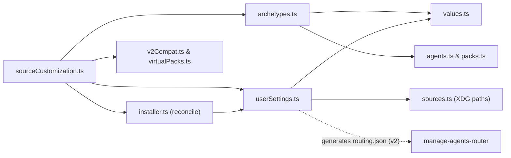

# Archetypes, Conditional Flows & User Settings

## Purpose

This module group implements `manage-agents`'s multi-layer configuration, subagent routing, conditional policy evaluation, and non-destructive customization of external packs. Together, these modules allow packs to declare suggested model routes and conditional `IF / OR` rules in [`opencode-pack.json`](../api/pack-contract-reference.md) while letting users override frontmatter fields, pin or unpin subagent models, redefine *[caller]* (see [Glossary](../glossary.md)) agents, and layer global or per-target [conditional routing](../concepts/conditional-routing-and-archetypes.md) rules without mutating [cached Git checkouts](./sources-and-github.md).

During [target reconciliation](./target-installer.md), these layers are compiled into patched Markdown files and a synthesized `version: 2` `routing.json` payload consumed at runtime by the [`manage-agents-router` OpenCode plugin](./runtime-router-plugin.md).

## Key Files

| File | Role |
|------|------|
| `src/utils/archetypes.ts` | Inspects pack agents, callers, static permission denials, `routingDefaults`, and Contract `1.1` `flowDefaults`; exports edited flows back to `opencode-pack.json`. |
| `src/utils/userSettings.ts` | Loads, validates, prunes, and saves scoped `routing.json` and `overrides.json` files; patches Markdown frontmatter; compiles `RuntimeRouting` for `manage-agents-router`. |
| `src/utils/sourceCustomization.ts` | Intercepts TUI/CLI edits on read-only sources via `runWithOverrideWriter`, persists minimal frontmatter diffs and user flows under lock, and triggers automatic target reconciliation. |
| `src/utils/values.ts` | Provides prototype-safe property accessors (`own`, `setOwn`, `ownChild`), model/trigger regex validators, and `validateConditionalRule()`. |
| `src/App.tsx` | Connects the TUI flow workspace and pack-folder action to settings-backed flow inspection, editing, export, and reconciliation. |
| `src/ui/PackFlowsModal.tsx` | Renders the flow list, caller chooser, model editor, and tool, permission, and delegation policy subviews. |

## Module Dependencies



- **Internal consumers**: [`src/index.tsx`](../api/cli-reference.md) (`models` and `override` CLI subcommands), `src/App.tsx` (the [TUI flow editor](../components/workspaces-flows-and-sources.md), opened from the Flows workspace or with `M` on a focused configurable pack folder, and [agent frontmatter modals](../components/authoring-and-bridge-modals.md)), and [`src/utils/installer.ts`](./target-installer.md) (target staging and router plugin installation).
- **External packages**: Node built-ins (`node:fs`, `node:path`, `node:util`) and [`yaml`](../dependencies/runtime-and-tooling-stack.md) for lossless frontmatter serialization.

---

## 1. Pack Archetypes & Flow Inspection (`src/utils/archetypes.ts`)

Historically, `describeArchetype()` and `setArchetypeConfig()` operated only on packs declaring an explicit `archetype` block in `opencode-pack.json`. `describePackFlows()` generalizes inspection to **any** pack or [virtual `.md` directory](./pack-validation-and-virtual-packs.md) in a workspace (`isConfigurablePack()`), whether or not `opencode-pack.json` exists or declares `archetype`.

### Caller Resolution & Agent Partitioning

When `describePackFlows(workspaceRoot, id, options)` inspects a pack, it discovers all `agents/*.md` files (or loose `.md` agent files via `scanLooseAgentFiles()` when no manifest exists) and determines active **caller** agents using the selected non-empty source (`PackFlowsView["callerSource"]`):

1. **`"user"`**: Non-empty `options.userCallers` from `routing.json` (`$callers`; configured target callers take precedence over global callers), filtered to existing agents whose `mode !== "subagent"`.
2. **`"manifest"`**: If no non-empty user caller list was supplied, `manifest.archetype.callers` from `opencode-pack.json`, filtered to existing non-subagent entries.
3. **`"inferred"`**: Explicit `mode === "primary"` agents first; otherwise any agent with `mode !== "subagent"`; otherwise the first discovered agent.

If the selected user or manifest caller list contains no discovered non-subagent after filtering, `describePackFlows()` falls back to inference rather than trying the next source. The UI's `callerCandidates` are non-subagent agents, or all discovered agents when none qualify.

During target reconciliation, `resolveEffectiveCallers()` reads explicit `$callers` in target, global, then manifest scope. Without a non-empty explicit list, it infers callers only when user routes, user `$rules`, or manifest `flowDefaults` exist. `inferPackCallers()` normally requires at least one subagent; a rule with `then.tools` or `then.permissions` permits a single caller even without subagents.

Once callers are selected, `describePackFlows()` classifies every discovered agent (`ArchetypeAgent`, with short role computed via `roleOfPackAgent(pack, agent)` by stripping any `<pack>-` prefix):

- **`callers`**: Primary/orchestrator agents whose active model triggers routing rules. The `reference` caller (`$reference` -> `manifest.archetype.reference` -> `callers[0]`) is placed first.
- **`subagents`**: All non-caller agents whose `mode !== "primary"`.
- **`related`**: Routable subagents (`!agent.model`) whose models can be dynamically assigned by routes or rules.
- **`pinned`**: Subagents with a fixed `model` string in their effective frontmatter; dynamic model routing skips them.

### TUI Pack-Flow Editor

`App.tsx` opens the editor only when `isConfigurablePack()` finds at least one agent, so the flow workflow is not restricted to packs with a manifest `archetype`; it also supports manifestless virtual `.md` folders. The `M` action on a focused pack folder and the Flows workspace both open `PackFlowsModal`.

The modal presents the unified routes and rules, active caller source, pinned agents, and editors for model assignments plus tool, permission, and delegation policies. App handlers save caller or flow changes to user `routing.json` and request target reconciliation. Writable packs can initialize a missing manifest or export the configured flow view to `opencode-pack.json`; the export controls are hidden for read-only Git sources, which remain settings-backed.

### Static Denials & Resource Discovery

`collectStaticDenials()` inspects caller frontmatter across both [OpenCode V2 permission arrays and V1 permission maps](./agent-editing-and-v2-compat.md) (`permissions: [{ action, resource, effect: "deny" }]` and `permissions` / `permission` objects, normalizing `shell` <-> `bash` and `edit` -> `write`) to compute:

- `staticDeniedTools`: Tools statically denied by caller frontmatter (`effect: "deny"` with `resource: "*"` or `undefined`).
- `staticDeniedDelegations`: Subagents statically denied under `subagent` or `task` permission actions.

`describePackFlows()` combines built-in tools (`bash`, `edit`, `write`, `webfetch`, `websearch`) with `discoverAgentResources()` (`tool`, `tool-family`, and `mcp` permission keys) into `availableTools: FlowResourceOption[]`, marking each entry with `staticallyDeniedByCaller` so UI editors can warn when a flow rule attempts to allow a statically blocked capability.

### `routingDefaults` vs. Contract `1.1` `flowDefaults`

Packs can ship two kinds of routing declarations in [`opencode-pack.json`](../api/pack-contract-reference.md):

1. **`routingDefaults` (Contract `1.0+`)**: A two-level map `trigger -> subagentId -> model | "inherit"`, where `trigger` is either a provider ID (`"anthropic"`) or an exact `"provider/model"` string (excluding `"*"` and `$`-prefixed keys).
2. **`flowDefaults` (Contract `1.1+`)**: An array of `ConditionalRule` objects supporting multi-trigger `OR` matching, wildcard `"*"` triggers, caller scoping, and tool/permission/delegation policies:

```ts
export interface ConditionalPolicy {
  models?: Record<string, string>              // subagentId -> "provider/model[#variant]" | "inherit"
  tools?: Record<string, PolicyEffect>         // tool or "<prefix>_*" | "*" -> "allow" | "ask" | "deny"
  permissions?: Record<string, PolicyEffect>   // permission action -> "allow" | "ask" | "deny"
  delegations?: Record<string, DelegationEffect> // subagentId | "*" -> "allow" | "deny"
}

export interface ConditionalRule {
  callers?: string[]   // Optional subset of caller agent IDs (evaluated in OR)
  triggers: string[]   // Non-empty list of "*", "provider", or "provider/model" (evaluated in OR)
  then: ConditionalPolicy
}
```

Inside `PackFlowsView.flows`, `describePackFlows()` normalizes merged `routingDefaults`/user routes and conditional rules into `UnifiedFlowItem` records, assigning each a stable UI key (`"route:<trigger>"`, `"pack-rule:<i>"`, `"global-rule:<i>"`, or `"user-rule:<i>"`) and `origin` (`"pack"`, `"global"`, or `"user"`).

### Exporting Flows & Synthesizing `RuntimeRouting`

- **Exporting to local manifests**: `exportFlowsToPackManifest(workspaceRoot, view)` writes active callers (`manifest.archetype = { callers, reference }`), plain single-trigger model routes (`manifest.routingDefaults`), and rich rules (`manifest.flowDefaults`) back into `<pack>/opencode-pack.json`. If `flowDefaults` is non-empty and `manifest.contract === "1.0"`, it upgrades `contract` to `"1.1"`. The manifest is written via `atomicWriteRestrictedFile` and validated with [`validatePack()`](./pack-validation-and-virtual-packs.md); on any validation error, the previous manifest bytes are restored atomically.
- **Synthesizing runtime configuration**: During [`reconcile`](./target-installer.md), `buildRuntimeRouting(packs, settings, target)` in `src/utils/userSettings.ts` compiles effective routes and rules into `<target>/plugins/manage-agents-router/routing.json` (`RuntimeRouting`, `version: 2`, consumed by [`manage-agents-router`](./runtime-router-plugin.md)):

```ts
export interface CompiledRule extends ConditionalRule {
  layer: 0 | 1 | 2
}

export interface RoutingArchetype {
  callers: string[]
  pinned: string[]
  routes: Routes
  rules?: CompiledRule[]
}

export interface RuntimeRouting {
  version: 2
  generatedBy: string
  archetypes: Record<string, RoutingArchetype>
}
```

When any compiled rule for a pack specifies `then.models`, `buildRuntimeRouting()` also mirrors layer-1 (`default`) and layer-2 (`target`) plain `routes` entries into `compiledRules` with `layer: 1` and `layer: 2`. This guarantees that higher-scope plain user routes always override lower-scope `flowDefaults` model assignments in `manage-agents-router`.

---

## 2. Multi-Layer Scoped User Settings (`src/utils/userSettings.ts`)

User customizations are stored outside both pack repositories and OpenCode target directories, under [`$XDG_CONFIG_HOME/manage-agents/`](../config/user-and-target-files.md) (resolved by `engineConfigDir(env)`):

- `routing.json` (`RoutingSettings`): Per-pack trigger routes plus optional `$callers`, `$reference`, and `$rules`.
- `overrides.json` (`OverrideSettings`): Per-pack frontmatter patches for `agents` and `commands`.

### Scoped File Structure & 3-Layer Precedence

Both files share the `Scoped<T>` envelope (`version: 1`; `loadScoped()` accepts `version` `1` or `2` on read and normalizes to `1` on write):

```json
{
  "version": 1,
  "default": {
    "flow": {
      "$callers": ["flow-build", "flow-plan"],
      "$reference": "flow-build",
      "anthropic": { "flow-explore": "anthropic/claude-haiku-4-5" },
      "$rules": [
        {
          "triggers": ["*"],
          "then": { "tools": { "websearch": "ask" } }
        }
      ]
    }
  },
  "targets": {
    "/Users/alice/.config/opencode": {
      "flow": {
        "anthropic": { "flow-explore": "inherit" }
      }
    }
  }
}
```

`saveScoped()` recursively prunes empty objects and empty arrays, sorts keys lexicographically, validates that every key under `targets` is an absolute path (`realpath` resolved by the caller), and writes atomically with mode `0o644`.

Settings resolve across three layers in strict ascending precedence:

| Layer | Source | Scope Selector | Precedence |
|-------|--------|----------------|------------|
| **Layer 0** | Pack defaults (`opencode-pack.json` & `.md` frontmatter) | Built into pack | Lowest (base defaults) |
| **Layer 1** | Global user scope (`settings.default`) | `scopeOf(settings, null)` (`--global`) | Overrides Layer 0 |
| **Layer 2** | Target user scope (`settings.targets[realpath]`) | `scopeOf(settings, target)` (default) | Highest; overrides Layers 0 and 1 field-by-field and trigger-by-trigger |

### `$callers`, `$reference`, and `$rules` Extensions

Inside `routing.json`, each pack entry (`PackFlowEntry`) mixes plain trigger keys with three reserved metadata keys (`RESERVED_FLOW_KEYS`):

- `$callers`: Non-empty deduplicated array of agent IDs acting as `OR` callers for the pack (`setPackCallers()`).
- `$reference`: Primary caller ID displayed first in UI comparisons; must belong to `$callers` when `$callers` is present.
- `$rules`: Array of validated `ConditionalRule` items (`setPackRules()`).

`routesOfEntry(entry)` extracts only the plain `trigger -> { subagent: model }` maps while ignoring `$callers`, `$reference`, and `$rules`.

### Subagent Pinning & Unpinning

Subagent pinning is implemented by coupling `overrides.json` with `buildRuntimeRouting()`:

- **Pin (`models pin <pack>/<agent> <provider/model[#variant]>`)**: Calls `setOverride(scope, pack, "agents", agent, { model: "<ref>" })`. During reconciliation, the installed agent receives that fixed `model` in its frontmatter, causing `buildRuntimeRouting()` to list the agent in `archetypes[pack].pinned` so `manage-agents-router` skips it.
- **Unpin (`models unpin <pack>/<agent>`)**: Calls `setOverride(scope, pack, "agents", agent, { model: null })`. Setting `model: null` strips `model` from the installed frontmatter—even when the pack's own `.md` file originally hardcoded a model—turning the subagent into a routable (`related`) agent controlled by `routing.json`.

### Config Overrides (`override config-set` / `config-unset` / `config-remove`)

`checkOverrides()` additionally accepts a `config` kind for the object sections a pack contributes (`CONFIG_SECTIONS`: `mcp.servers`, `lsp`, `formatter`, `experimental`; `agents`/`commands` stay frontmatter overrides):

- `setConfigOverride(scope, pack, section, key, fields)` deep-merges `fields` into the entry's patch: target fields win over default fields, nested objects merge, `null` is kept and means "remove the field from the pack's entry" (the same semantics as `models unpin`). Well-known `mcp.servers` fields (`type`, `command`, `url`, `disabled`, `enabled`) are shape-checked, and all keys/values must be control-character free.
- `removeConfigEntry(scope, pack, section, key)` stores `null` at the key: the pack contributes no such entry at all.
- `unsetConfigOverride(scope, pack, section, key, fields)` drops overridden fields (dotted names address nested fields) or the whole entry override when no field is named.

At reconcile, `patchedConfigSections(config, overrides.config, pack)` applies the layered patches to the pack's parsed `opencode.json(c)` — cloned, never shared: entries deep-merge (`deepPatchEntry`), `null` keys remove entries, unknown keys create them, and a patched `mcp.servers` entry that stops satisfying the minimal server schema fails the change. The result feeds both `packContribution()` (so a patched entry identical to the user's existing config is claimed `"kept"`, with no conflict and no `--adopt`) and `prepareBridgeWorkspace()` (which layers the `default` scope plus the default OpenCode target's scope — exactly what `override config-set` writes without `--global` — so re-exported bridges show the patched MCP servers too). The TUI pack flows modal exposes the pack's MCP servers with an `[ON]/[OFF]` toggle writing `{ "disabled": true }` / `{ "disabled": null }` via `saveConfigOverride()`; entries that match the user's `opencode.json` stay the user's and are never updated or removed by the pack again — overrides are for diverging consciously.

### Frontmatter Overrides & `patchFrontmatter()`

`checkOverrides()` restricts `overrides.json` patches to an explicit allowlist of frontmatter keys:

- **`AGENT_FIELDS`**: `description`, `mode`, `model`, `permissions`, `hidden`, `color`, `steps`, `disabled`, `request`, `temperature`, `top_p`
- **`COMMAND_FIELDS`**: `description`, `agent`, `model`, `subagent`

During installation and reconciliation ([`src/utils/installer.ts`](./target-installer.md)), `effectiveOverrides(settings, target, pack)` merges `settings.default[pack]` and `settings.targets[target][pack]` field-by-field, and `patchFrontmatter(text, patch)` applies the resulting `FieldPatch` to each Markdown file:

```ts
export function patchFrontmatter(text: string, patch: FieldPatch): string {
  const { yamlText, body } = extractFrontmatter(text)
  const parsed = yamlText === null ? {} : YAML.parse(yamlText) ?? {}
  if (!isObject(parsed)) throw new Error("frontmatter is not a mapping")
  for (const [field, value] of Object.entries(patch)) {
    if (value === null) delete parsed[field]
    else setOwn(parsed, field, value)
  }
  return Object.keys(parsed).length ? `---\n${YAML.stringify(parsed).trimEnd()}\n---\n${body}` : body
}
```

Setting a field to `null` deletes it from the YAML mapping (dropping the `---` frontmatter block entirely if no keys remain), while preserving `body` byte-for-byte. Because `installer.ts` verifies the SHA-256 hash of the unpatched source file against [`lock.json`](./resolver-and-lock.md) before calling `patchFrontmatter()`, upstream source tampering remains detectable even when user overrides are active.

---

## 3. Customizing Read-Only Sources (`src/utils/sourceCustomization.ts`)

Packs installed from Git repositories reside in [read-only engine caches](./sources-and-github.md) (`$XDG_CACHE_HOME/manage-agents/sources/...`). Editing those files in place would dirty the cached working tree and break lockfile hash checks. `src/utils/sourceCustomization.ts` bridges the TUI/CLI editing workflows to `overrides.json` and `routing.json`.

### Concurrency Control (`withSettingsLock`)

All read-modify-write operations on user settings in `sourceCustomization.ts` run inside `withSettingsLock(env, fn)`, which acquires an exclusive lockfile at `<engineConfigDir>/.settings.lock` (`fs.openSync(lockFile, "wx", 0o600)`). If the lockfile already exists, it reads the recorded PID and probes `process.kill(ownerPid, 0)`—automatically unlinking stale locks left behind by dead processes (`ESRCH`) before retrying once.

### Virtualized Source Views

To show users the effective state of read-only sources in the TUI without modifying cached files on disk:

- `buildSourceContentTransform(workspaceRoot, target, env)` returns a `(filePath, rawContent) => string` transform that resolves `{ pack, id }` via `agentPackIdentity()`, normalizes legacy V1 frontmatter to V2 ([`normalizeRawAgentToV2()`](./agent-editing-and-v2-compat.md)), and applies `effectiveOverrides()` via `patchFrontmatter()`.
- `loadSourceAgents()`, `describeSourceArchetype()`, and `describeConfiguredPackFlows()` pass this transform and user `routing.json` layers into `findAgentFiles()`, `describeArchetype()`, and `describePackFlows()`.

### Intercepting Edits with `runWithOverrideWriter()`

TUI modals and bulk repair helpers (`overrideAgentsModel()`, `overrideRepairAgentModels()`) expect a writer with the signature of `saveAgentFile`. `runWithOverrideWriter(workspaceRoot, fn, options)` supplies an in-memory collector and persists only minimal frontmatter diffs:

1. Collects all `(filePath, frontmatter)` writes emitted by `fn(writer)` in memory without touching disk or prompt bodies.
2. Acquires `.settings.lock` and loads `overrides.json`.
3. Reconstructs each agent's baseline V2 frontmatter by layering any global `settings.default` patch onto `readBaseV2Frontmatter(filePath)`.
4. Normalizes the desired frontmatter to V2 (`translateFrontmatterV1ToV2(composeModelVariant(...))`) and compares every key in `AGENT_FIELDS` against the baseline using `isDeepStrictEqual`:
   - Field removed in desired state (`!hasDesired && hasBase`): emits `patch[field] = null`.
   - Field added or changed (`!isDeepStrictEqual(desired[field], baseline[field])`): emits `patch[field] = desired[field]`.
   - Field equal to baseline: omitted from `patch`, automatically cleaning up redundant overrides when a user resets a value back to the pack default.
5. Replaces the target-scope override entry (`unsetOverride` followed by `setOverride` if `patch` is non-empty) and saves `overrides.json`.

### Saving User Flows & Automatic Reconciliation

- **`saveUserPackFlow(workspaceRoot, id, draft, options)`**: Persists flow edits from the TUI into `routing.json` for any pack or virtual `.md` folder:
  - Plain single-trigger model assignments without extra policies are stored directly as trigger keys in `routing.json` (`"route:<trigger>"`). Deleting a route that masks a pack or global trigger neutralizes it by setting all `related` subagents to `"inherit"`.
  - Flows with multiple `OR` triggers, `"*"` wildcard triggers, custom `callers`, `tools`, `permissions`, or `delegations` (or single-agent packs without subagents) are saved in `$rules` (`"user-rule:<i>"`).
  - Attempting to delete a `"pack-rule:<i>"` or `"global-rule:<i>"` from target scope throws an actionable error guiding the user to override the trigger or run [`manage-agents models rule-unset --global`](../api/cli-reference.md).
- **Exporting to writable packs**: When working in a local writable pack workspace, users can promote configured flows from `PackFlowsView` into `opencode-pack.json` via `exportFlowsToPackManifest()` (`manage-agents models export-pack <pack>`).
- **Automatic target reconciliation**: `reconcileTargetIfInstalled(command, options)` checks [`readLock(target)`](./resolver-and-lock.md) and, if the target has an active installation, runs [`changeTarget(target, command, registry, reconcileChange, { env })`](./target-installer.md) so edits to `routing.json` or `overrides.json` take effect immediately in `<target>`. `formatReconcileLines()` formats human-readable status lines for TUI banners.

---

## 4. Prototype-Safe Map & Value Helpers (`src/utils/values.ts`)

Because pack manifests, agent IDs, tool names, and trigger strings originate from external repositories and user JSON files, naive bracket assignment (`obj[key] = val`) or property lookup (`obj[key]`) on keys like `"__proto__"`, `"constructor"`, or `"prototype"` could pollute or read from `Object.prototype` (see [Security & Trust Model](../concepts/security-and-trust-model.md)). `src/utils/values.ts` centralizes safe map operations and structural validators.

### Prototype-Safe Accessors & Object Guards

| Helper | Behavior |
|--------|----------|
| `own(object, key)` | Returns `object[key]` only when `object && Object.hasOwn(object, key)`; unsafe keys like `"__proto__"`, `"constructor"`, and `"prototype"` never resolve to `Object.prototype` properties. |
| `setOwn(object, key, value)` | Uses `Object.defineProperty(object, key, { value, enumerable: true, writable: true, configurable: true })` so even `"__proto__"` is defined as an inert own data property rather than mutating the receiver's prototype. |
| `ownChild(object, key)` | Ensures `Object.hasOwn(object, key)` holds—initializing an empty `{}` via `setOwn` if absent—and returns `object[key]`. |
| `isPlain` / `isObject` | Guards plain key-value mappings via `typeof value === "object" && value !== null && !Array.isArray(value)` before iterating keys. |

### Model, Trigger & Policy Validators

- **`isModelRef(value)`**: Matches `/^[^\s/#]+\/[^\s#]+(?:#[^\s#]+)?$/` (OpenCode V2 `"provider/model"` or `"provider/model#variant"`).
- **`isTrigger(value)`**: Matches `/^(?!\$)[^\s/#]+(?:\/[^\s#]+)?$/` and rejects `WILDCARD_TRIGGER` (`"*"`). The negative lookahead `(?!\$)` reserves `$callers`, `$reference`, and `$rules` in `routing.json`.
- **`isFlowTrigger(value)`**: Accepts `WILDCARD_TRIGGER` (`"*"`) or `isTrigger(value)`.
- **`parseTriggerList(raw)`**: Splits comma-separated trigger strings (such as `"anthropic,openai/gpt-5.4"` or `"*"`), trims whitespace, validates every token with `isFlowTrigger()`, and deduplicates while preserving order.
- **`isPolicyEffect(value)`**: Accepts `"allow" | "ask" | "deny"`.
- **`isDelegationEffect(value)`**: Accepts `"allow" | "deny"`.
- **`isResourceKey(value)`**: Matches `/^[^\s]+$/` for non-whitespace tool, permission, or subagent identifiers.
- **`validateConditionalRule(raw, where)`**: Validates untrusted rule objects against `RULE_KEYS` (`callers`, `triggers`, `then`) and `POLICY_KEYS` (`models`, `tools`, `permissions`, `delegations`), rejecting unknown keys, duplicate triggers or callers, invalid model/effect values, or empty `then` policies, and copying validated maps through `setOwn()`.

## Related Pages

- [Conditional Routing & Archetypes](../concepts/conditional-routing-and-archetypes.md) — Conceptual guide to 3-layer precedence, `IF / OR` trigger rules, and caller/subagent roles.
- [Runtime Router Plugin](./runtime-router-plugin.md) — OpenCode V2 runtime plugin that evaluates compiled `version: 2` `routing.json` rules during live sessions.
- [Transactional Target Installer](./target-installer.md) — Applies `patchFrontmatter()` overrides and installs `manage-agents-router` during target reconciliation.
- [Agent Editing, V2 Compatibility & Git Transactions](./agent-editing-and-v2-compat.md) — V1-to-V2 frontmatter translation used when customizing agents on read-only sources.
- [Flows & Data Sources Workspaces](../components/workspaces-flows-and-sources.md) — Interactive TUI flow editor backed by `describeConfiguredPackFlows` and `saveUserPackFlow`.
- [User Settings, Target State & Environment Variables](../config/user-and-target-files.md) — Reference for `$XDG_CONFIG_HOME/manage-agents/routing.json` and `overrides.json`.
