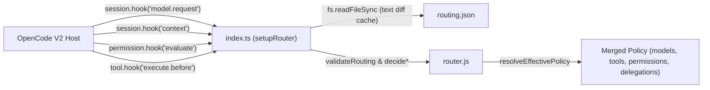

# Runtime Router Plugin

## Purpose

The `manage-agents-router` module is an OpenCode V2 host plugin copied into `<target>/plugins/manage-agents-router/` and registered in [`<target>/opencode.json`](../config/user-and-target-files.md) whenever [`manage-agents reconcile`](../api/cli-reference.md) detects active subagent model routes or [conditional `IF / OR` flow rules](../concepts/conditional-routing-and-archetypes.md) for a *[target]* (see [Glossary](../glossary.md)). At runtime inside OpenCode, it tracks each session's active caller agent and model, dynamically rewrites subagent model assignments, strips denied tools from prompt context, overrides permission evaluations, and enforces defense-in-depth tool and delegation blocks before execution.

## Key Files

| File | Role |
|------|------|
| `runtime/plugins/manage-agents-router/index.ts` | OpenCode V2 `@opencode/plugin` entry point (`id: "manage-agents-router"`); manages the kill switch, cached `routing.json` reloads, bounded session state, and host hook registrations. |
| `runtime/plugins/manage-agents-router/router.js` | Pure, dependency-free ES module implementing `routing.json` validation, model parsing, multi-layer `IF / OR` rule merging, wildcard policy matching, and per-hook decision functions. |
| `<target>/plugins/manage-agents-router/routing.json` | Target-specific runtime policy artifact synthesized from [archetype and user routing settings](./routing-and-user-settings.md) during `manage-agents reconcile` and read sibling to `index.ts` (never edited by hand). |

## Module Dependencies



- **Internal consumers**: Installed into managed OpenCode targets by [`src/utils/installer.ts`](./target-installer.md); `router.js` is also imported directly by engine and runtime test suites (`runtime/plugins/manage-agents-router/router.test.mjs`, [`src/utils/userSettings.test.ts`](./routing-and-user-settings.md)).
- **External packages**: [`@opencode/plugin`](../dependencies/runtime-and-tooling-stack.md) (host plugin wrapper in `index.ts`) and Node built-ins (`node:fs`, `node:url`). `router.js` has zero external or Node built-in imports.

---

## 1. Architecture & Two-File Split

The plugin deliberately separates [host integration from policy evaluation](../architecture.md) across two files installed side-by-side in `<target>/plugins/manage-agents-router/`:

- **Host Adapter (`index.ts`)**: Imports `Plugin` from `@opencode/plugin` and exports `Plugin.define({ id: "manage-agents-router", setup: setupRouter })` alongside the named `setupRouter(ctx, options)` initializer. It owns all impure concerns: reading environment variables, reading `./routing.json` from disk, maintaining the in-memory `sessions` map, binding optional OpenCode V2 hook domains (`ctx.session`, `ctx.permission`, `ctx.tool`), mutating host event objects, and returning a deterministic disposer closure.
- **Pure Decision Engine (`router.js`)**: Written in plain JavaScript with zero dependencies so it runs unchanged under both OpenCode's plugin loader and [`node --test`](../dependencies/runtime-and-tooling-stack.md) without mocking `@opencode/plugin`. Every exported decision helper takes the validated `routing` object and plain input parameters and returns an immutable decision value (or `null` / `[]` when no rule applies).

Hook registration in `index.ts` is wrapped in `keep(registrationPromise)`, which awaits `ctx.<domain>?.hook?.(...)`, collects either function disposers or `{ dispose() }` handles into `disposers`, and swallows registration errors if a particular hook domain is absent in an older host version. Invoking the teardown function returned by `setupRouter()` drains `disposers.splice(0)` inside individual `try/catch` guards and clears `sessions`.

---

## 2. Configuration Loading, Hot Reloading & Kill Switch

### Kill Switch

At the start of `setupRouter(ctx, options = {})`, the plugin checks both programmatic options and the process environment:

```ts
if (options.disabled === true || String(process.env.OPENCODE_AGENT_ROUTER ?? "").toLowerCase() === "off") return () => {}
```

Setting [`OPENCODE_AGENT_ROUTER=off`](../config/user-and-target-files.md) (case-insensitive) or passing `{ disabled: true }` bypasses file resolution and hook registration entirely, returning a no-op cleanup function.

### Content-Diff Hot Reloading

`index.ts` resolves sibling `./routing.json` via `fileURLToPath(new URL("./routing.json", import.meta.url))` and evaluates a lightweight lazy loader on every hook invocation:

```ts
let cached = { text: null, routing: null }
const routing = () => {
  try {
    const text = fs.readFileSync(routingPath, "utf8")
    if (text !== cached.text) cached = { text, routing: validateRouting(JSON.parse(text)) }
  } catch {
    cached = { text: null, routing: null }
  }
  return cached.routing
}
```

Because `routing.json` is only a few kilobytes, reading its UTF-8 text on each hook call allows edits applied by [`manage-agents reconcile`](../api/cli-reference.md) to take effect immediately in already-running OpenCode sessions without file watchers, while `text !== cached.text` avoids redundant `JSON.parse()` and `validateRouting()` work when unchanged. If `./routing.json` is missing, unreadable, invalid JSON, or rejected by schema validation, `cached` resets to `{ text: null, routing: null }` and `routing()` returns `null`, causing all decision functions to become no-ops.

### Schema Validation (`validateRouting`)

`validateRouting(value)` validates the parsed payload and throws an `Error` prefixed with `routing.json: ` on the first violation:

- **Supported versions**: Requires `value.version === 2` (`ROUTING_VERSION = 2`) or `value.version === 3`. Legacy `version: 1` or unknown versions are rejected.
- **Archetype shape**: `value.archetypes` must be a plain object where each [archetype](../concepts/conditional-routing-and-archetypes.md) defines `callers` (string array of agent IDs), `pinned` (string array of subagent IDs exempt from dynamic model routing), `routes` (object mapping trigger keys to `{ [subagent]: "inherit" | "provider/model[#variant]" }`), and an optional `rules` array.
- **Trigger & model syntax**:
  - `TRIGGER_RE = /^(?:\*|(?!\$)[^\s/#]+(?:\/[^\s#]+)?)$/` accepts `"*"`, `"provider"`, or `"provider/model"` (disallowing leading `$` reserved keys, `#variant` suffixes in triggers, and whitespace).
  - `MODEL_RE = /^[^\s/#]+\/[^\s#]+(?:#[^\s#]+)?$/` validates explicit model references (`isModelRef()`).
- **Rule validation (`validateRule`)**: Restricts rule keys to `callers`, `triggers`, `then`, and `layer` (`0 | 1 | 2`), requires a non-empty `triggers` list, and validates `then` sub-maps (`models`, `tools`, `permissions`, `delegations`):
  - `then.tools` and `then.permissions` values must be in `POLICY_EFFECTS` (`"allow" | "ask" | "deny"`).
  - `then.delegations` values must be in `DELEGATION_EFFECTS` (`"allow" | "deny"`).
  - Resource keys must contain no whitespace (`RESOURCE_KEY_RE = /^[^\s]+$/`).

---

## 3. Bounded Session & Caller Context Tracking

Permission evaluation (`permission.hook("evaluate")`) and pre-execution tool hooks (`tool.hook("execute.before")`) receive a session identifier (`event.sessionID || event.sessionId`) and optional `event.agent`, but rely on session state to know which model the caller is currently running on. `index.ts` tracks active sessions in `const sessions = new Map()` via `recordSession`:

```ts
const MAX_SESSIONS = 1000
// Hidden system agents run on their own small model inside a session; they must not hide the owner's model.
const INTERNAL_AGENTS = new Set(["title", "summary", "compaction"])

const recordSession = (id, agent, model) => {
  if (!id || typeof agent !== "string" || INTERNAL_AGENTS.has(agent)) return
  if (sessions.size >= MAX_SESSIONS && !sessions.has(id)) sessions.delete(sessions.keys().next().value)
  sessions.set(id, { agent, model })
}
```

Key behaviors of session tracking:

- **Internal host agent filtering**: OpenCode runs built-in housekeeping agents (`title`, `summary`, `compaction`) inside the user's session using small utility models. Ignoring `INTERNAL_AGENTS` (along with non-`"primary"` `event.kind` values in `model.request`) prevents background housekeeping turns from overwriting the primary caller's `{ agent, model }`.
- **Bounded FIFO eviction**: `sessions` is capped at `MAX_SESSIONS = 1000`. Updating an already-tracked `id` overwrites its entry in place; inserting a new session ID at capacity deletes `sessions.keys().next().value` (the oldest inserted session in `Map` iteration order).
- **Caller-to-subagent handoff**: When a tracked caller invokes a subagent tool (`subagent` or `task`), `tool.hook("execute.before")` looks up the caller session's `{ agent, model }` in `sessions` using the parent's `sessionID` / `sessionId` and evaluates delegation and target-model rules against that caller's context before the child subagent session is spawned.

---

## 4. OpenCode V2 Hook Lifecycle

`setupRouter` attaches handlers to four OpenCode V2 lifecycle hooks:

### `session.hook("model.request")`

Captures the caller session's active agent and model before primary model inference:

1. Skips auxiliary requests when `event?.kind` is present and `event.kind !== "primary"`.
2. Calls `recordSession(event?.sessionID || event?.sessionId, event?.agent, event?.model)`.

### `session.hook("context")`

Filters visible tool definitions before the host serializes the tool catalog into the model's prompt:

1. Updates session state via `recordSession(id, event?.agent, event?.model)`.
2. If `event?.tools` is an object, passes `Object.keys(event.tools)` to `decideSessionTools(routing(), { agent, model, toolNames })`.
3. Deletes every returned tool name from `event.tools` (`delete event.tools[name]`).

`decideSessionTools` marks a tool for removal when any of three conditions holds under the resolved policy:
- `matchPolicyMap(policy.tools, name) === "deny"`
- `isToolDeniedByPermissions(policy.permissions, name)` returns `true` — matching direct `permissions[name] === "deny"` as well as [cross-domain aliases](./agent-editing-and-v2-compat.md) (`bash` when `shell` is `"deny"`, `shell` when `bash` is `"deny"`, and `write` when `edit` is `"deny"`).
- `SUBAGENT_TOOLS.has(name)` (`"subagent"` or `"task"`) when wildcard delegation is denied (`policy.delegations["*"] === "deny"`) and no entry in `policy.delegations` has effect `"allow"`.

### `permission.hook("evaluate")`

Overrides host permission prompts and decisions for actions governed by conditional flows:

1. Looks up `session = sessions.get(event.sessionID || event.sessionId)`.
2. Calls `decidePermission(routing(), { agent: event.agent || session?.agent, model: session?.model, action: event.action })`.
3. `decidePermission` resolves the effect by checking, in order:
   - `matchPolicyMap(policy.permissions, action)`
   - `matchPolicyMap(policy.permissions, altAction)` (where `altAction` swaps `"shell"` and `"bash"`)
   - `matchPolicyMap(policy.tools, action)`
   - `matchPolicyMap(policy.tools, altAction)`
4. When a matching effect (`"allow" | "ask" | "deny"`) is found, mutates `event.effect = decision.effect` and, for `"ask"` or `"deny"`, sets `event.message` to `Conditional flow (<agent> on <provider/model>) sets "<action>" to <effect>.`.

### `tool.hook("execute.before")`

Provides [defense-in-depth enforcement](../concepts/security-and-trust-model.md) immediately prior to tool execution and performs dynamic subagent model routing:

```ts
await keep(ctx.tool?.hook?.("execute.before", async (event) => {
  let decision = null
  try {
    const session = sessions.get(event?.sessionID || event?.sessionId)
    decision = decideToolExecution(routing(), {
      callerAgent: typeof event?.agent === "string" && event.agent ? event.agent : session?.agent,
      callerModel: session?.model,
      tool: event?.tool,
      input: event?.input,
    })
    if (decision && !decision.blocked && decision.model && event?.input && typeof event.input === "object") {
      event.input.model = decision.model
    }
  } catch {
    /* fail open on unexpected internal errors */
  }
  if (decision?.blocked) throw new Error(decision.reason)
}))
```

Inside `decideToolExecution(routing, { callerAgent, callerModel, tool, input })`:

1. **Tool & permission block**: If `matchPolicyMap(policy.tools, tool) === "deny"` or `isToolDeniedByPermissions(policy.permissions, tool)` is `true`, returns `{ blocked: true, reason }` even if the model attempted to call a hidden tool.
2. **Subagent inspection**: If `SUBAGENT_TOOLS.has(tool)` (`"subagent"` or `"task"`) and `input` is a plain object, extracts `targetAgent = input.agent ?? input.subagent_type`.
3. **Delegation block**: If `matchPolicyMap(policy.delegations, targetAgent) === "deny"`, returns `{ blocked: true, reason }`.
4. **Subagent model routing (`decideSubagentModel`)**: Computes the target model when delegating to `targetAgent`:
   - Leaves `event.input.model` untouched (`null`) if `input.model` (`requestedModel`) is already a non-empty string, `targetAgent` is empty, `policy.archetype.pinned.includes(targetAgent)` (skipping `pinned` subagents), the mapped target is `"inherit"` (fails `isModelRef`), or the target string already equals `policy.parsedModel?.full`.
   - Otherwise returns `{ blocked: false, model }`, replacing `event.input.model` with the complete `"provider/model[#variant]"` target string (so any caller `#variant` is not inherited when switching to a routed model unless explicitly specified on the route target).

---

## 5. Pure Decision Engine (`router.js`)

### Public Exports

| Export | Signature / Value | Purpose |
|--------|-------------------|---------|
| `ROUTING_VERSION` | `2` | Canonical schema version constant accepted alongside `3` by `validateRouting`. |
| `SUBAGENT_TOOLS` | `Set(["subagent", "task"])` | Tool names treated as subagent delegation entry points. |
| `isModelRef(value)` | `(value) => boolean` | Tests whether `value` matches `provider/model` or `provider/model#variant`. |
| `modelOf(ref)` | `(ref) => { provider, model, full } \| null` | Parses either a `"provider/model[#variant]"` string or a hook model object (`{ providerID \| provider, id \| modelID \| model, variant }`), stripping `#variant` from `model` for trigger matching while preserving it in `full`. |
| `validateRouting(value)` | `(value) => Routing` | Validates `routing.json` structure and throws on malformed fields. |
| `matchTriggerSpecificity(triggers, parsedModel)` | `(triggers, parsedModel) => 2 \| 1 \| 0 \| -1` | Scores an `OR` trigger array against `parsedModel`. |
| `matchPolicyMap(map, name)` | `(map, name) => string \| null` | Resolves exact keys, longest `<prefix>*` wildcards, or `"*"` fallback. |
| `archetypeOf(routing, agent)` | `(routing, agent) => Archetype \| null` | Finds the first archetype whose `callers` or `rules[*].callers` contains `agent`. |
| `routeFor(archetype, callerModel)` | `(archetype, callerModel) => Record<string, string> \| null` | Merges `archetype.routes` across `"*"`, `provider`, and `provider/model`. |
| `resolveEffectivePolicy(routing, ctx)` | `(routing, { callerAgent, callerModel }) => Policy \| null` | Computes the merged `{ archetype, models, tools, permissions, delegations, parsedModel }` policy. |
| `decideSubagentModel(routing, ctx)` | `(routing, { callerAgent, callerModel, targetAgent, requestedModel }) => { model } \| null` | Selects a model override for unpinned subagent calls without an explicit `requestedModel`. |
| `decideSessionTools(routing, ctx)` | `(routing, { agent, model, toolNames }) => string[]` | Lists tool names to strip from `event.tools` in `session.hook("context")`. |
| `decidePermission(routing, ctx)` | `(routing, { agent, model, action }) => { effect, message? } \| null` | Resolves permission overrides for `permission.hook("evaluate")`. |
| `decideToolExecution(routing, ctx)` | `(routing, { callerAgent, callerModel, tool, input }) => { blocked, reason?, model? } \| null` | Evaluates blocks and subagent model injection for `tool.hook("execute.before")`. |

### Multi-Layer Policy Resolution (`resolveEffectivePolicy`)

Given `{ callerAgent, callerModel }`, `resolveEffectivePolicy` locates the owning archetype via `archetypeOf()`, normalizes `callerModel` via `modelOf()`, and merges policy maps using prototype-safe `setOwn` (`Object.defineProperty`) and `own` (`Object.hasOwn`) helpers so keys like `__proto__` or `constructor` cannot pollute `Object.prototype`:

1. **Base `routes` table**: If `archetype.callers.includes(callerAgent)`, `routeFor(archetype, callerModel)` merges `archetype.routes` in ascending specificity order: `"*"` -> `model.provider` -> `${model.provider}/${model.model}`.
2. **Rule filtering & trigger specificity**: Each entry in `archetype.rules` applies to `rule.callers ?? archetype.callers`. If `callerAgent` is listed, `matchTriggerSpecificity(rule.triggers, parsedModel)` scores the rule's `OR` trigger list:
   - `2`: exact `"provider/model"` match
   - `1`: `"provider"` match
   - `0`: wildcard `"*"` match
   - `-1`: no match (rule is discarded)
3. **Layer & specificity ordering**: Matched rules are sorted in ascending order so higher-precedence rules overwrite lower-precedence ones:
   ```js
   .sort((a, b) => a.layer - b.layer || a.specificity - b.specificity || a.index - b.index)
   ```
   - **Layer (`0 < 1 < 2`)**: `0` = pack [`flowDefaults`](../api/pack-contract-reference.md) (default when `rule.layer` is omitted), `1` = [global user settings](./routing-and-user-settings.md), `2` = [target-scoped user settings](../config/user-and-target-files.md). A target rule on `"*"` (`layer: 2, specificity: 0`) always overrides a pack rule on `"provider/model"` (`layer: 0, specificity: 2`).
   - **Specificity (`0 < 1 < 2`)**: Within the same layer, exact `"provider/model"` overrides `"provider"`, which overrides `"*"`.
   - **Rule index**: Preserves declaration order when both `layer` and `specificity` are equal.
4. **`then` map merging**: Iterates through sorted rules and applies `rule.then.models`, `rule.then.tools`, `rule.then.permissions`, and `rule.then.delegations` onto their respective accumulators.

### Wildcard Pattern Matching (`matchPolicyMap`)

When evaluating `tools`, `permissions`, or `delegations` maps against a concrete name (for example, `"slide_export"` against `{ "slide_*": "deny", "slide_render": "allow", "*": "allow" }`), `matchPolicyMap(map, name)` resolves in three tiers:

1. **Exact key**: `Object.hasOwn(map, name)` wins immediately (`"slide_render"` -> `"allow"`).
2. **Longest `<prefix>*` wildcard**: Scans keys ending with `*` (excluding `"*"`) where `name.startsWith(prefix)` and picks the longest matching `prefix.length` (`"slide_*"` -> `"deny"`).
3. **Global `"*"` fallback**: Returns `map["*"]` if present, otherwise `null`.

### Fail-Open Error Handling vs. Explicit `"deny"` Enforcement

`manage-agents-router` distinguishes sharply between internal plugin errors and policy denials:

- **Fail-open on unexpected errors**: Missing hook APIs (`keep`), missing or invalid `routing.json` (`routing()`), malformed hook event shapes, and unexpected exceptions inside hook bodies are caught and ignored. A broken config file or host API mismatch never crashes an OpenCode session.
- **Strict enforcement on explicit `"deny"`**: In `tool.hook("execute.before")`, `decision = decideToolExecution(...)` runs inside `try/catch`, whereas `if (decision?.blocked) throw new Error(decision.reason)` executes *outside* the `try/catch`. Combined with tool stripping in `session.hook("context")` and `event.effect = "deny"` in `permission.hook("evaluate")`, any tool or subagent delegation explicitly set to `"deny"` is enforced across three independent host boundaries.

---

## Usage Example

The example below (adapted from `runtime/plugins/manage-agents-router/router.test.mjs`) validates a `version: 2` routing configuration with layered `IF / OR` rules and evaluates session tools, permissions, delegations, and subagent model routing:

```js
import {
  decidePermission,
  decideSessionTools,
  decideSubagentModel,
  decideToolExecution,
  validateRouting,
} from "./router.js"

const routing = validateRouting({
  version: 2,
  archetypes: {
    slides: {
      callers: ["slides-agent", "slides-lead"],
      pinned: ["slides-eye"],
      routes: {},
      rules: [
        {
          triggers: ["*"],
          layer: 0,
          then: {
            models: { "slides-writer": "openai/gpt-5-mini" },
            tools: { bash: "ask", "slide_*": "allow" },
            delegations: { "*": "allow" },
          },
        },
        {
          triggers: ["anthropic", "openai/gpt-5.4"],
          layer: 1,
          then: {
            models: { "slides-writer": "google/gemini-4#high", "slides-eye": "ignored/pinned" },
            tools: { bash: "deny", "slide_*": "deny", slide_render: "allow" },
            permissions: { edit: "ask" },
            delegations: { "slides-heavy": "deny" },
          },
        },
      ],
    },
  },
})

// Subagent model routing (variant stripped on caller trigger match; pinned subagent skipped)
decideSubagentModel(routing, {
  callerAgent: "slides-lead",
  callerModel: "openai/gpt-5.4#high",
  targetAgent: "slides-writer",
}) // => { model: "google/gemini-4#high" }

decideSubagentModel(routing, {
  callerAgent: "slides-lead",
  callerModel: "openai/gpt-5.4#high",
  targetAgent: "slides-eye",
}) // => null (pinned)

// Context tool filtering (exact "slide_render: allow" overrides "slide_*: deny")
decideSessionTools(routing, {
  agent: "slides-agent",
  model: "anthropic/claude-sonnet-4-5",
  toolNames: ["read", "bash", "slide_export", "slide_render", "subagent"],
}) // => ["bash", "slide_export"]

// Pre-execution defense-in-depth block for denied subagent delegation
decideToolExecution(routing, {
  callerAgent: "slides-agent",
  callerModel: "anthropic/claude-sonnet-4-5",
  tool: "subagent",
  input: { agent: "slides-heavy" },
}) // => { blocked: true, reason: 'Delegation to "slides-heavy" is disabled by manage-agents conditional flow when slides-agent runs on anthropic/claude-sonnet-4-5.' }

// Runtime permission evaluation
decidePermission(routing, {
  agent: "slides-agent",
  model: "anthropic/claude-sonnet-4-5",
  action: "edit",
}) // => { effect: "ask", message: 'Conditional flow (slides-agent on anthropic/claude-sonnet-4-5) sets "edit" to ask.' }
```

---

## Related Pages

- [Conditional Routing & Archetypes](../concepts/conditional-routing-and-archetypes.md) — Conceptual model for caller archetypes, `IF / OR` triggers, and multi-layer policy precedence.
- [Archetypes, Conditional Flows & User Settings](./routing-and-user-settings.md) — Engine-side archetype resolution, user settings persistence, and `routing.json` synthesis.
- [Transactional Target Installer](./target-installer.md) — Installs `manage-agents-router` into `<target>/plugins/` and registers it in `opencode.json` during `reconcile`.
- [Flows & Data Sources Workspaces](../components/workspaces-flows-and-sources.md) — Interactive TUI workspace for authoring conditional flow rules.
- [User Settings, Target State & Environment Variables](../config/user-and-target-files.md) — File layout and environment variable reference for `routing.json`, `opencode.json`, and `OPENCODE_AGENT_ROUTER`.
- [OpenCode Pack Contract 1.1 Reference](../api/pack-contract-reference.md) — Manifest schema for pack-defined `archetype`, `routingDefaults`, and `flowDefaults`.
