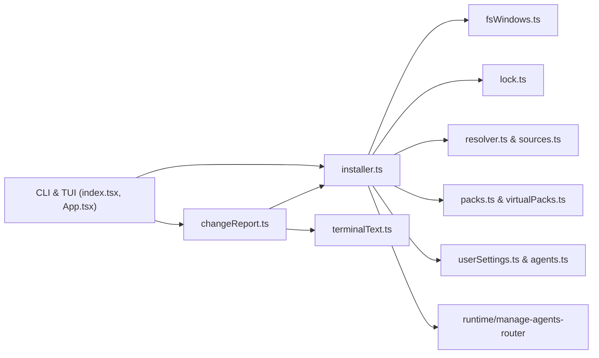

# Transactional Target Installer

## Purpose

The Transactional Target Installer reconciles an OpenCode *[target]* (see [Glossary](../glossary.md)) directory (such as `$XDG_CONFIG_HOME/opencode` or a project `.opencode/` folder) against a [resolved graph of packs](./resolver-and-lock.md). It separates side-effect-free reconciliation planning (`planReconcile`) from journaled execution with interrupted-transaction recovery (`applyPlan`), surgically merges pack contributions into `<target>/opencode.json` (or `opencode.jsonc`) without clobbering user configuration, enforces ownership and conflict boundaries with optional `--adopt` backups (see [Pack Lifecycle & Target Safety](../concepts/pack-lifecycle-and-target-safety.md)), prevents concurrent target corruption via process locks, and formats terminal-safe change summaries for both the [CLI](../api/cli-reference.md) and [TUI](../components/tui-shell-and-catalog.md).

## Key Files

| File | Role |
|------|------|
| `src/utils/installer.ts` | Target state readers, locked pack verification, `opencode.json` surgical merge planner, conflict and drift detection, crash-safe journaled staging, concurrency locking, backup restoration, and lifecycle compute functions. |
| `src/utils/changeReport.ts` | Terminal-safe human-readable change formatter (`describeChangeResult`, `formatLockChange`) shared across CLI and TUI workflows. |
| `src/utils/fsWindows.ts` | Cross-platform path replacement and removal helpers (`movePathWithRetry`, `removePathWithRetry`) that retry transient Windows file-indexer/AV locks and fall back to staged copies across filesystems. |

## Public API

### `src/utils/installer.ts`

| Symbol | Kind | Description |
|--------|------|-------------|
| `readDesired(target)` | Function | Reads `<target>/.manage-agents/desired.json`, validating each root specifier with `parsePackRequest`. Returns `{ desiredVersion: 1, roots: [] }` when absent. |
| `readInstalled(target)` | Function | Reads `<target>/.manage-agents/installed.json` and validates relative path containment (`isSafeRel`) for all recorded file entries. |
| `loadLockedPacks(lock, registry, env?)` | Function | Resolves every pack in `lock` (checking out git sources at their locked commit snapshot via `revisionSnapshot`), validates contract compliance (standard or virtual packs), and verifies `manifestHash`, `contentHash`, `executableHash`, and config SHA-256 against the lock. |
| `packContribution(pack, target, overrides?)` | Function | Computes a single pack's `Contribution` to `opencode.json`, normalizing plugin specs, auto-registering shipped plugins, rewriting `skills` and `instructions` paths to `<target>`, adding `instructions/<pack>.md` when `AGENTS.md` is present, patching overridden `agents`/`commands` entries, and applying config overrides (`patchedConfigSections`) to the `mcp.servers`/`lsp`/`formatter`/`experimental` sections. |
| `planReconcile(target, lock, registry, options?)` | Function | Pure read-only planner returning a `ReconcilePlan` (scheduled writes, deletes, released files, conflicts, warnings, adopted items, merged `configText`, TOCTOU `expected` hashes, and next `InstalledState`). |
| `applyPlan(plan, state)` | Function | Applies a conflict-free `ReconcilePlan` as a journaled target transaction using `<target>/.manage-agents/txn/<id>/`, `.manage-agents/journal.json`, and optional `.manage-agents/backups/<id>/`; individual paths are replaced sequentially, with recovery data retained until the journal is removed. |
| `rollbackInterrupted(target)` | Function | Reverses an interrupted operation recorded in `.manage-agents/journal.json` using saved pre-images, removing newly created files only when their hash still matches the journal. Returns `true` when recovery occurred. |
| `withTargetLock(target, command, fn)` | Function | Serializes target mutations via `<target>/.manage-agents/install.lock`, reclaiming locks left behind by dead local processes. |
| `changeTarget(target, command, registry, compute, options?)` | Function | Shared lifecycle orchestrator: locks the target, rolls back interrupted transactions unless dry-running, computes target state changes, plans reconciliation, prompts for untrusted/executable confirmations, and applies or dry-runs the plan. |
| `installChange(registry, requests, env?)` | Function | `Compute` factory that adds or updates requested root specs while pinning already-locked non-requested packs to their locked source and version. |
| `uninstallChange(names)` | Function | `Compute` factory that removes root requests (rejecting direct removal of packs still required as dependencies) and prunes unreachable packs via `pruneLock`. |
| `updateChange(registry, names, env?, gitOptions?)` | Function | `Compute` factory that pulls git sources for selected packs (or all locked packs when `names` is empty) and re-resolves unpinned packs. |
| `reconcileChange` | Constant | `Compute` function that rebuilds the target directly from the existing `desired.json` and `lock.json` without re-resolving versions. |
| `pruneLock(lock, roots)` | Function | Traverses `requires` edges from `roots` and drops unreachable packs from `lock.packs` without changing locked versions. |
| `targetStatus(target, registry, env?)` | Function | Read-only inspection reporting pending interrupted journals, git source checkout/fetch drift, missing or locally modified managed files, and pending reconcile path counts. |
| `restoreBackup(target, backupId)` | Function | Restores files and `opencode.json` entries saved during an `--adopt` operation and releases them back to unmanaged status. |

### `src/utils/changeReport.ts`

| Symbol | Kind | Description |
|--------|------|-------------|
| `formatLockChange(change)` | Function | Formats a single `LockChange` (`added`, `removed`, `upgrade`, `downgrade`, `source`, `revision`, `content`) with `terminalSafeText` escaping. |
| `describeChangeResult(target, result)` | Function | Produces human-readable output lines summarizing rollback recovery, pack changes, file write/delete counts, dry-run paths, warnings, errors, and final status (including backup undo instructions). |

### `src/utils/fsWindows.ts`

| Symbol | Kind | Description |
|--------|------|-------------|
| `WINDOWS_SAFE_RM_OPTIONS` | Constant | Standard `fs.rmSync` options (`{ recursive: true, force: true, maxRetries: 5, retryDelay: 50 }`). |
| `isTransientWindowsLockError(error)` | Function | Checks whether an error carries `EPERM`, `EACCES`, or `EBUSY`. |
| `removePathWithRetry(target, rmImpl?, sleep?)` | Function | Retries recursive deletion across `[10, 25, 50, 100]` ms backoff intervals on transient lock errors. |
| `movePathWithRetry(source, target, ops?)` | Function | Attempts `renameSync` with backoff retries and falls back on `EXDEV` or persistent locks to a staged copy-and-swap (`.stage-<suffix>` and `.bak-<suffix>`) preserving symlinks verbatim. |

## Target State Trio & Legacy Migration

All engine metadata for a managed target lives under [`<target>/.manage-agents/`](../config/user-and-target-files.md). Three JSON files form the authoritative target state. `applyPlan()` stages all three and includes them with content changes in one journaled transaction; it replaces paths sequentially rather than atomically swapping the entire set:

1. **`desired.json` (`DesiredState`)**: Stores `{ desiredVersion: 1, roots: string[] }`, recording only the user's top-level pack requests (such as `"flow"`, `"source/pack@^1.2.0"`), sorted lexicographically on disk. Transitive dependencies are omitted so `uninstall` can cleanly prune orphaned dependencies when a root is removed.
2. **[`lock.json`](./resolver-and-lock.md) (`PackLock`)**: Stores `{ lockVersion: 1, contract: "1.0", roots: string[], packs: Record<string, LockedPack> }`. Each `LockedPack` pins `source`, `sourceKind` (`"local" | "git"`), `path`, `version`, git `revision`, `manifestHash`, `contentHash`, `executable` summary, `executableHash`, `trusted`, and `requires`. During `loadLockedPacks()`, every pack's manifest, installable files, and `opencode.json(c)` bytes are re-hashed and verified against these digests before planning proceeds.
3. **`installed.json` (`InstalledState`)**: Tracks the exact footprint currently owned by `manage-agents` on disk:
   - `installedVersion: 1`
   - `files`: Maps relative target paths (`rel`) to `{ hash: string, owner: string }`, where `owner` is either a pack name or `":engine"` (for synthesized runtime router files). Every key read back from disk must pass `isSafeRel()`, which rejects empty strings, backslashes, NUL bytes, POSIX/Windows absolute paths, and `.` or `..` segments.
   - `config`: Maps each pack name (and `":engine"` when active) to its `Contribution` (`plugins`, `skills`, `instructions`, and `objects`) as written into `<target>/opencode.json`.
   - `createdSections` (optional `string[]`): Dotted object paths (such as `["mcp", "mcp.servers"]`) that did not exist in the user's `opencode.json` before `manage-agents` created them.

### Legacy `.resource-export-manifest.json` Migration

Targets previously populated by the legacy `manage-agents export` workflow contain `<target>/.resource-export-manifest.json` with `{ "owner": "manage-agents", "resources": [...] }`. During planning, `readLegacyResources(target)` loads all `isSafeRel`-validated paths from that manifest (and derives `./plugins/<id>` plugin keys from `plugins/*` paths). Both `planReconcile()` and `planConfig()` treat legacy paths and plugin entries as pre-owned by `manage-agents`, adopting them into `installed.json` without requiring `--adopt`—while still backing up any replaced content whose bytes or config values differ from the incoming pack.

## Reconciliation Planning & Surgical `opencode.json` Merging

`planReconcile(target, lock, registry, options)` computes the complete transition from the current target filesystem to the desired lock state without writing a single byte.

### Pack File Mapping, `AGENTS.md` Rewriting & Frontmatter Overrides

Packs are processed in topological dependency order ([`orderByRequires`](./resolver-and-lock.md)). For each loaded pack:

- **Cross-pack resource ID checks**: Every agent, command, skill, and plugin ID in `pack.validation.ids` is checked case-insensitively (`${kind}:${fold(id)}`). Duplicate IDs across two packs produce an immediate conflict (`agent "<id>" is provided by both <packA> and <packB>`).
- **`AGENTS.md` rewriting**: A pack's root `opencode.json` / `opencode.jsonc` is never copied directly; instead, its contents are merged via `planConfig()`. A pack's root `AGENTS.md` is rewritten to `<target>/instructions/<pack>.md`, and its absolute path is appended to the pack's `instructions` array in `opencode.json`.
- **File permissions**: Executable bit presence on the source file (`mode & 0o111`) maps to target mode `0o755`; all other files receive `0o644`.
- **User frontmatter overrides**: `loadOverrideSettings(env)` loads global and per-target overrides from [user settings (`overrides.json`)](./routing-and-user-settings.md). For markdown files under `agents/*.md` and `commands/*.md`, `patchFrontmatter()` patches YAML frontmatter in memory (producing `PlannedWrite.content` with a fresh SHA-256 digest) after verifying the source file still matches `pack.fileHashes[rel]`. Matching structured entries under `opencode.json` `agents` and `commands` are patched in `packContribution()` (where `null` deletes a field and non-null values set it). Overrides targeting uninstalled packs or unknown agent/command IDs emit non-blocking `plan.warnings`.
- **User config overrides**: the `config` kind patches the object sections the pack contributes (`mcp.servers`, `lsp`, `formatter`, `experimental`) in `packContribution()` via `patchedConfigSections()` — no pack file or lock entry is touched. An entry patched to match what the user already has in `opencode.json` is claimed `"kept"`: it stays the user's, with no conflict and no `--adopt`, and the pack never updates or removes it again.

### Runtime Router Plugin Synthesis

`planReconcile()` loads [user routing configuration](./routing-and-user-settings.md) (`loadRoutingSettings(env)`), validates that configured packs, callers, and routable subagents exist (emitting `plan.warnings` when rules have no effect), and invokes `buildRuntimeRouting()`. Whenever archetype defaults or conditional `$rules` produce an active runtime routing table:

1. `engineRuntimeDir()` walks upward from `installer.ts` (supporting both `src/` and bundled `dist/` layouts) to locate [`runtime/plugins/manage-agents-router/`](./runtime-router-plugin.md).
2. `plugins/manage-agents-router/index.ts` and `plugins/manage-agents-router/router.js` are scheduled as managed writes under owner `":engine"`.
3. `plugins/manage-agents-router/routing.json` is synthesized in memory (`JSON.stringify(routing, null, 2) + "\n"`) under owner `":engine"`.
4. `./plugins/manage-agents-router` is injected into `opencode.json`'s `plugins` array under `installed.config[":engine"]`.

When all routed packs are uninstalled or routing rules no longer apply, `buildRuntimeRouting()` returns `null`, causing the router files and `./plugins/manage-agents-router` plugin entry to be cleanly removed like any other managed pack contribution.

### Surgical `opencode.json` / `opencode.jsonc` Merging

`planConfig()` selects `opencode.jsonc` if present in `<target>`, falling back to `opencode.json`. If the config file is a symbolic link, planning aborts with a conflict rather than writing through the link. When no config file exists yet, it starts from `{ "$schema": "https://opencode.ai/config.json" }`.

Merging proceeds in four stages so unmanaged top-level keys (such as `theme`, `model`, `keybinds`, or `provider`) and user-authored array/object entries remain untouched:

1. **Subtract previous managed contributions**: `current` is deep-cloned into `unmanaged`. Using `previous.config` from `installed.json`:
   - Across `ARRAY_SECTIONS` (`plugins`, `skills`, `instructions`), entries matching `isDeepStrictEqual` are spliced out of `unmanaged`.
   - Across `OBJECT_SECTIONS` (`mcp.servers`, `agents`, `commands`, `formatter`, `lsp`, `experimental`), keys whose current value matches `isDeepStrictEqual(object[key], value)` are deleted (marking the section in `emptiedSections`), while keys whose value differs are flagged in `changedLocally` (`${section}\0${key}`).
2. **Compute normalized pack contributions**: In `packContribution()`:
   - `plugins` normalizes relative `file:` and `./` specs via `normalizePluginSpec()`. Every plugin directory shipped in `pack.validation.ids.plugins` is auto-registered as `./plugins/<id>` (`implicitPlugins`). If another pack explicitly configures that plugin (for example as `{ package: "./plugins/<id>", ... }`), `explicitPlugins` suppresses the duplicate implicit string entry.
   - `skills` and `instructions` resolve non-HTTP(S) paths relative to `<target>`, plus `<target>/instructions/<pack>.md` if the pack ships `AGENTS.md`.
3. **Claim entries and detect collisions**: Each entry across `ARRAY_SECTIONS` and `OBJECT_SECTIONS` is passed through `claim(section, key, value, pack, existing)`:
   - If another pack already claimed `section` + `key` with a non-equal value, a conflict is recorded (`<configFile>: <section> "<key>" is set differently by <packA> and <packB>`).
   - If `unmanaged` already contains `key`:
     - With `--adopt` or `legacy`, non-identical existing values are pushed to `plan.adopted.config`, removed from `unmanaged`, and claimed as `"managed"`.
     - Without `--adopt`, if the existing user value is `isDeepStrictEqual` to the pack's value, `claim` returns `"kept"`—leaving the entry in `unmanaged` and omitting it from `installed.config` so uninstalling the pack will never delete the user's pre-existing entry.
     - Otherwise, `claim` records a conflict distinguishing locally modified managed entries (`was changed locally`) from pre-existing unmanaged entries (`exists and is not managed by manage-agents`).
4. **Reassemble and prune `createdSections`**:
   - Remaining `unmanaged` array items come first, followed by `managedArrays[section]`; empty arrays are deleted from `next`.
   - Before populating `managedObjects`, any missing dotted prefix (e.g., `"mcp"`, then `"mcp.servers"`) is added to `created`.
   - Sections in `emptiedSections` are walked bottom-up (`mcp.servers` -> `mcp`): if a section is empty and listed in `created`, it is deleted from `next`. Empty sections originally authored by the user are preserved.
   - If `next` differs from `current` and the original file used JSONC comments or trailing commas (`!isPlainJson(text)`), `planConfig()` emits a warning that comments/trailing commas are not preserved and adds `configFile` to `plan.adopted.files` so the raw JSONC file is backed up automatically before writing formatted JSON.

## Ownership, Conflict Detection, `--adopt` Backups & `restoreBackup()`

### File Ownership Rules & Conflict Categories

`planReconcile()` compares every planned write (folded with `rel.normalize("NFC").toLowerCase()` for case-insensitive filesystem safety) against `previous.files` and the live target disk state via `currentHash()`:

| Target Disk State | Previously Managed (`owned`)? | Default Outcome | Outcome with `--adopt` (or Legacy Export) |
|-------------------|-------------------------------|-----------------|-------------------------------------------|
| Missing (`null`) | Any | Scheduled as `kind: "create"`; recorded in `installed.files`. | Same (`kind: "create"`). |
| Directory or special file (`"not-a-file"`) | Any | Hard conflict (`a directory or special file is in the way`). | Hard conflict (never auto-deleted). |
| Regular file matching `write.hash` | Yes | No disk write needed; kept in `installed.files` under new owner. | Same. |
| Regular file matching `write.hash` | No | No disk write; **omitted** from `installed.files` so user retains ownership on uninstall. | Recorded in `installed.files` (ownership adopted). |
| Regular file matching `owned.hash` (`!== write.hash`) | Yes | Scheduled as `kind: "update"`. | Same (`kind: "update"`). |
| Regular file or symlink differing from `owned.hash` | Yes | Conflict (`<rel> was changed locally; rerun with --adopt...`). | Scheduled as `kind: "adopt"`; added to `plan.adopted.files`. |
| Regular file or symlink (`!== write.hash`) | No | Conflict (`<rel> exists and is not managed by manage-agents; rerun with --adopt...`). | Scheduled as `kind: "adopt"`; added to `plan.adopted.files`. |

### Uninstallation & Locally Edited "Released" Files

When a previously managed file in `previous.files` has no successor in the new plan (accounting for case-only renames via `sameFile` device/inode comparison):

- If `currentHash` still matches `owned.hash`, the file is added to `plan.deletes` (and its hash is recorded in `plan.expected`). After removal, `removeEmptyParents()` walks up to `<target>` removing empty directories.
- If the user modified the file locally (`currentHash !== owned.hash`), the installer **never deletes user work**: the path is added to `plan.released`, a warning is emitted (`<rel> was changed locally and no pack provides it any more: left in place, no longer managed`), and the file is dropped from `installed.files`.

### Timestamped Backups & `restoreBackup()`

Whenever `plan.adopted.files` or `plan.adopted.config` is non-empty, `applyPlan()` creates a backup directory at `<target>/.manage-agents/backups/<id>/`, where `<id>` is `<ISO-timestamp>-<8-hex-chars>`:

- Every path in `plan.adopted.files` (including `opencode.jsonc` when JSONC comments were present) is copied to `backups/<id>/files/<rel>`. If the user path was a symbolic link, `fs.symlinkSync(fs.readlinkSync(source), destination)` preserves the link text verbatim without following it.
- `backups/<id>/backup.json` is written atomically via `atomicWriteRestrictedFile` containing `{ id, created, configFile, files, config }`.

`restoreBackup(target, backupId)` reverses an adoption under `withTargetLock(target, "restore", ...)`:

1. Validates `backupId` (`/^[\w-]+$/`) and checks every path in `backup.files` with `isSafeRel()`.
2. Refuses to overwrite `configFile` if it was turned into a symlink.
3. Deletes each restored file from `installed.files` and schedules a `PlannedWrite` from `backups/<id>/files/<rel>` (setting `PlannedWrite.link` for symlinks so `applyPlan()` recreates the link without dereferencing it).
4. If the entire `configFile` was backed up in `backup.files`, restores its raw text verbatim and resets `installed.config = {}` and `installed.createdSections`. Otherwise, splices each `AdoptedConfigEntry` back into `configFile` and removes those keys from every pack's `installed.config` contribution.
5. Commits the restoration transactionally through `applyPlan()`, leaving the restored files and config entries unmanaged. Calling `manage-agents status` afterward reports the resulting drift against the still-locked packs.

## Journaled Transactions, Symlink Guards & Concurrency Control

### Target Lock & Stale Lock Recovery (`withTargetLock`)

Only one mutating CLI or TUI operation may run against `<target>` at a time. `withTargetLock(target, command, fn)` creates `<target>/.manage-agents/install.lock` with `{ flag: "wx" }` (`O_CREAT | O_EXCL`), writing `{ pid, host, command, started }`:

- If `install.lock` already exists (`EEXIST`), `withTargetLock` parses the holder metadata. If the lock cannot be parsed and is younger than `STALE_LOCK_GRACE_MS` (`10_000` ms), or if `holder.host !== os.hostname()`, or if `pidAlive(holder.pid)` returns `true` (`process.kill(pid, 0)` succeeds or throws `EPERM`), it throws a lock contention error naming the active command, PID, host, and timestamp.
- If the local holder PID is dead, `withTargetLock` reclaims the stale lock without race conditions: it atomically renames `install.lock` to `install.lock.stale-<pid>-<rand>`, re-reads the renamed file to confirm its contents still equal `raw` (if a third process had already replaced `install.lock`, it relinks the file back via `fs.linkSync` and aborts), removes the `.stale-*` file, and retries `{ flag: "wx" }` once.
- On completion, the `finally` block removes `install.lock` only if the recorded `pid` still matches `process.pid`.

### Symlink Containment & Atomic Restricted Writes

The installer enforces strict containment so [untrusted packs](../concepts/security-and-trust-model.md) or crafted target directories cannot trick `manage-agents` into reading or writing outside `<target>`:

- Every state-derived relative path is checked by `isSafeRel()`; state paths also disallow a symlink at the leaf. Filesystem type checks use `fs.lstatSync()` so managed leaf symlinks are identified and moved or backed up as links rather than dereferenced. A symlink `opencode.json`/`opencode.jsonc` is a planning conflict.
- `backup.json` and `journal.json` are written with [`atomicWriteRestrictedFile()`](./agent-editing-and-v2-compat.md). The `installed.json`, `lock.json`, and `desired.json` state snapshots are instead staged as operations in the transaction below; `install.lock` is created exclusively with `{ flag: "wx" }`.

### Journaled Apply and Interrupted-Transaction Recovery (`applyPlan` & `rollbackInterrupted`)

`applyPlan(plan, state)` applies file writes, deletes, `opencode.json` updates, and `.manage-agents/{installed,lock,desired}.json` state updates in five phases. This is a journaled, recoverable sequence—not one atomic multi-path replacement. Staging normally shares the target filesystem; if a destination is on another volume, `movePathWithRetry()` handles `EXDEV` with a copy fallback.

1. **Target-local staging (`txn/<id>/new/`)**: Stages every `PlannedWrite`, `configText`, and the three `.manage-agents/*.json` files under `<target>/.manage-agents/txn/<id>/new/<rel>`. Pack writes with an expected content hash are checked after staging, so source changes detected during the copy abort before target paths are changed.
2. **Pre-journal TOCTOU check**: Every path recorded in `plan.expected` is re-hashed on `<target>` (`currentHash(targetFile(target, op.rel)) !== plan.expected[op.rel]`). If any target file changed while the user was reading an interactive confirmation prompt, `txn/<id>` is removed and nothing is written.
3. **Backup & Write-Ahead Journal**: Copies adopted files into `.manage-agents/backups/<id>/` (when adopting) and atomically writes `<target>/.manage-agents/journal.json` containing `{ id, ops: [{ rel, existed, hash }] }` before replacing target paths. The journal records whether each path existed and, for staged writes, the new content hash.
4. **Pre-image move & per-path replacement (`txn/<id>/prev/`)**: Iterates `ops` in order:
   - If `op.existed`, moves the live target path into `txn/<id>/prev/<rel>` via `movePathWithRetry()` and re-checks `currentHash(previous) === plan.expected[op.rel]` when the path is covered by `plan.expected`.
   - If `op.staged` is non-null, verifies nothing unexpectedly appeared at `full` and moves the staged path into place via `movePathWithRetry()`.
   - Because operations are sequential, an intermediate state can be visible until recovery completes. Any error inside this loop invokes `rollbackInterrupted(target)` before rethrowing.
5. **Journal teardown & directory cleanup**: Once all operations are applied, removes `journal.json`, deletes `txn/<id>` via `removePathWithRetry()`, and prunes empty parent directories left by `plan.deletes`. A crash after journal removal leaves the new state applied; it can leave only transaction-directory cleanup unfinished.

Before the journal is created, live target paths have not yet been replaced; an abrupt stop can leave staged data and possibly an adoption backup without a journal to trigger automatic cleanup. If the process stops after the write-ahead journal is created but before it is removed, `.manage-agents/journal.json` remains on disk. The next non-dry-run `changeTarget()` operation or `restoreBackup()` call runs `rollbackInterrupted(target)` first; `targetStatus()` only reports the pending recovery, and dry runs do not perform it. Recovery validates the journal, iterates `journal.ops` in **reverse** order, restores each available pre-image from `txn/<id>/prev/<rel>`, and unlinks a newly created file only if its current hash still matches `op.hash`. If an operation marked as previously existing has no saved pre-image, its current path is left as-is. After a successful rollback, it removes the journal and transaction directory. This describes process-interruption recovery; the code does not establish a power-loss durability guarantee.

### Windows File-Lock Resilience (`src/utils/fsWindows.ts`)

On Windows, search indexers and antivirus scanners can transiently lock paths with `EPERM`, `EACCES`, or `EBUSY`. `movePathWithRetry()` and `removePathWithRetry()` retry those errors; moves also handle cross-device `EXDEV` failures:

- `removePathWithRetry()` invokes `fs.rmSync` with `WINDOWS_SAFE_RM_OPTIONS` and retries transient lock codes with synchronous `[10, 25, 50, 100]` ms waits (`Atomics.wait` on a `SharedArrayBuffer`, with a deadline-spin fallback).
- `movePathWithRetry()` makes up to five `renameSync` attempts, waiting `[10, 25, 50, 100]` ms between retries for transient lock errors. On `EXDEV` or exhausted lock retries, it copies the source to `<target>.stage-<suffix>` (preserving symlink text), copies any existing destination to `<target>.bak-<suffix>`, then removes and replaces the destination. If replacement fails, it attempts to restore the backup; if restoration also fails, it retains the backup and reports its path. On success it removes the backup (best-effort) and original source. This copy fallback is recoverable but not an atomic rename across filesystems.

## Lifecycle Operations & Change Reporting

### Lifecycle Operations (`changeTarget` + `Compute` Strategies)

Rather than duplicating locking, confirmation, and transaction plumbing across separate functions, the [CLI (`src/index.tsx`)](../api/cli-reference.md) and [TUI (`src/App.tsx`)](../components/workspaces-flows-and-sources.md) drive all four mutating pack commands through `changeTarget(target, command, registry, compute, options)` paired with a command-specific `Compute` callback:

| CLI / TUI Operation | `Compute` Callback | Resolution & Pinning Behavior |
|---------------------|--------------------|-------------------------------|
| `install <requests...>` | `installChange(registry, requests, env)` | Replaces matching pack names in `desired.roots` with the new requests, discovers all packs across `registry`, and calls `resolvePacks` with `pins` locking every already-installed pack *not* in `requests` to its current `source` and `version`. |
| `uninstall <names...>` | `uninstallChange(names)` | Verifies each name is in `desired.roots` (failing with `<name> is installed as a dependency of <dependents>; uninstall that instead` if only present transitively), removes it from `desired.roots`, and calls `pruneLock()` without re-resolving remaining packs. |
| `update [<names...>]` | `updateChange(registry, names, env, gitOptions)` | Fails if nothing is locked or any named pack is not installed. Calls [`pullSource()`](./sources-and-github.md) once per git source backing the selected packs (or all locked packs when `names` is empty), unpins both `selected` packs and packs from pulled git sources (since a git source moves at repository granularity), and re-resolves `desired.roots`. |
| `reconcile` | `reconcileChange` | Keeps `desired` and `lock` unchanged, re-running `planReconcile()` to materialize user `overrides.json` / `routing.json` edits or repair missing target files. |

Inside `changeTarget()`, once `compute` returns a problem-free `TargetChange`:

1. `diffLocks(previousLock, change.lock)` computes pack-level `LockChange[]` entries.
2. [`confirmationsNeeded(change.lock, previousLock)`](./resolver-and-lock.md) checks whether untrusted sources or changed executable surfaces require explicit user consent (`options.confirm`, satisfied by `--yes` or interactive prompt).
3. `planReconcile()` builds the `ReconcilePlan`. If nothing in `writes`, `deletes`, `configText`, `lock`, `desired`, or `installed` changed, `changeTarget` returns `status: "unchanged"`.
4. If `options.dryRun` is `true`, it returns `status: "dry-run"` without prompting or writing.
5. If confirmations are required and `options.confirm` resolves `false`, it returns `status: "declined"`.
6. Otherwise, `applyPlan()` commits the transaction and `changeTarget` returns `status: "applied"` with any `backupId`.

### Drift Detection (`targetStatus`)

`targetStatus(target, registry, env)` performs a strictly read-only health check and populates `drift: string[]`:

- Pending crash recovery: checks `fs.existsSync(journalPath(target))` (`interrupted: true`); status inspection does not run recovery.
- Git source drift: compares each locked git source's `sourceRevision()` (working checkout) and `lastFetchedRevision()` against `locked.revision`, advising `manage-agents update <pack>`.
- Managed file drift: hashes every file in `installed.files`, reporting missing files (`run manage-agents reconcile`) and locally modified files (`manage-agents reconcile --adopt restores the pack version and keeps a backup`).
- Unapplied settings or conflicts: runs `planReconcile()` against the current lock (deduplicating already-reported paths) and reports conflicts or the count of paths `reconcile` would change, plus unlocked `desired.roots` requests.

### Change Reporting (`describeChangeResult` in `changeReport.ts`)

`describeChangeResult(target, result)` converts a `ChangeResult` into sanitized lines ready for terminal display, passing every external identifier, path, warning, and error message through `terminalSafeText()` to strip terminal control sequences from untrusted packs:

1. Prepends `"Rolled back an interrupted transaction first."` when `result.recovered` is `true`.
2. Lists `Packs:` lines formatted via `formatLockChange()` (`added`, `removed`, `upgrade`, `downgrade`, `source`, `revision`, `content`).
3. Summarizes file counts (`Files: X new, Y updated, Z adopted, W removed; opencode.json updated.`) when no problems occurred, expanding per-file `create`/`update`/`adopt`/`remove` lines when `result.status === "dry-run"`.
4. Appends `warning: ...` and `ERROR: ...` lines from both resolution and planning.
5. Appends the terminal outcome line (`applied`, `unchanged`, `dry-run`, `failed`, or `declined`), including `Replaced content was saved; undo with \`manage-agents restore <backupId>\`.` whenever `result.backupId` is present.

## Dependencies



- **Internal**:
  - [`src/utils/lock.ts`](./resolver-and-lock.md) (`buildLock`, `confirmationsNeeded`, `diffLocks`, `readLock`, `serializeLock`, `targetStateDir`)
  - [`src/utils/packs.ts` and `src/utils/virtualPacks.ts`](./pack-validation-and-virtual-packs.md) (`validatePack`, `validateVirtualPack`, `installableFiles`, `parseJsonc`, `virtualManifestHash`)
  - `src/utils/resolver.ts` and [`src/utils/sources.ts`](./sources-and-github.md) (`resolvePacks`, `orderByRequires`, `packContent`, `parsePackRequest`, `hashFile`, `discoverAllPacks`, `pullSource`, `revisionSnapshot`, `sourceRevision`, `lastFetchedRevision`)
  - [`src/utils/userSettings.ts`](./routing-and-user-settings.md) and [`src/utils/agents.ts`](./agent-editing-and-v2-compat.md) (`loadOverrideSettings`, `effectiveOverrides`, `patchFrontmatter`, `loadRoutingSettings`, `buildRuntimeRouting`, `atomicWriteRestrictedFile`)
  - `src/utils/terminalText.ts` (see [TUI Shell, Catalog Tree & Inspector](../components/tui-shell-and-catalog.md)) and `src/utils/values.ts` (`terminalSafeText`, `own`, `setOwn`)
  - [`runtime/plugins/manage-agents-router/`](./runtime-router-plugin.md) (`index.ts`, `router.js`)
- **External** (see [Runtime & Tooling Dependencies](../dependencies/runtime-and-tooling-stack.md)):
  - Node.js built-ins (`node:crypto`, `node:fs`, `node:os`, `node:path`, `node:url`, `node:util`)

## Usage Example

In [`src/index.tsx`](../api/cli-reference.md), the CLI target command dispatcher wires `install`, `uninstall`, `update`, `reconcile`, `status`, and `restore` directly onto `installer.ts` and `changeReport.ts`:

```ts
const options = {
  adopt: parsed.flags.has("--adopt"),
  dryRun: parsed.flags.has("--dry-run"),
  confirm: (reasons: string[]) => confirmInTerminal(reasons, parsed.flags.has("--yes")),
}

const compute = command === "install" ? installChange(registry, names)
  : command === "uninstall" ? uninstallChange(names)
    : command === "update" ? updateChange(registry, names)
      : reconcileChange

const result = await changeTarget(target, command, registry, compute, options)
for (const line of describeChangeResult(target, result)) {
  console.log(line)
}
```

## Related Pages

- [Pack Lifecycle & Target Safety](../concepts/pack-lifecycle-and-target-safety.md) — Architectural overview of `install`, `uninstall`, `update`, `reconcile`, `--adopt` backups, and journaled crash recovery.
- [Dependency Resolver & Lockfile](./resolver-and-lock.md) — Deterministic pack resolution, SHA-256 content/executable digests, and `lock.json` diffing.
- [Sources & GitHub Integration](./sources-and-github.md) — Git source pulls and immutable commit `revisionSnapshot` checkouts consumed by `loadLockedPacks`.
- [Archetypes, Conditional Flows & User Settings](./routing-and-user-settings.md) — User frontmatter overrides (`overrides.json`) and `buildRuntimeRouting` compilation applied during `planReconcile`.
- [Runtime Router Plugin](./runtime-router-plugin.md) — OpenCode V2 router plugin installed under `:engine` ownership when routing rules are active.
- [User Settings, Target State & Environment Variables](../config/user-and-target-files.md) — Schema reference for `desired.json`, `lock.json`, `installed.json`, `journal.json`, and `backups/`.
