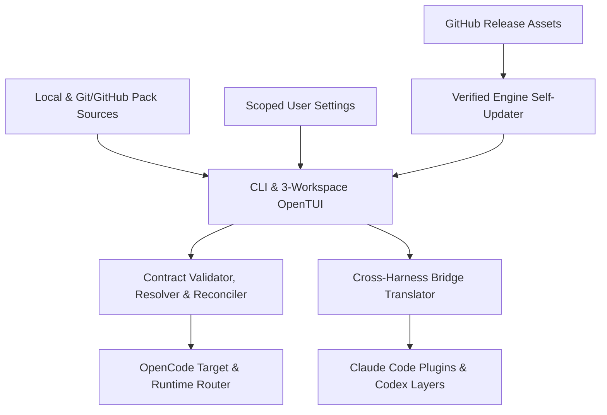

# Project Overview

`manage-agents` is a catalog-agnostic [CLI engine](./api/cli-reference.md) and [interactive OpenTUI terminal application](./components/tui-shell-and-catalog.md) for packaging, validating, onboarding, resolving, editing, routing, and installing OpenCode V2 agent *[packs]* (see [Glossary](./glossary.md)) from local directories or Git/GitHub repositories. Beyond managing native OpenCode configuration targets (`~/.config/opencode`), it provides live agent and flow customization over read-only remote sources, dynamic runtime routing via an embedded [OpenCode V2 router plugin](./modules/runtime-router-plugin.md), and automated [translation bridges](./concepts/cross-harness-translation.md) to Claude Code plugins and Codex layers.

## Purpose and Design Philosophy

`manage-agents` enforces a strict architectural boundary between the **engine** and **pack catalogs**:

- **Catalog Independence**: The engine contains zero hardcoded pack names, companion rules, categories, or catalog-specific heuristics. External repositories (such as `lorecanc/agents` or team-internal catalogs) interact with `manage-agents` exclusively through the versioned [OpenCode Pack Contract `1.1`](./api/pack-contract-reference.md) (`contract/CONTRACT.md` and `contract/opencode-pack.schema.json`). Pack authors require no build step or engine library inside their repositories.
- **Target Safety and Ownership Tracking**: An OpenCode configuration directory is shared with the user. `install`, `uninstall`, `update`, and `reconcile` track engine-owned files and config keys in [`<target>/.manage-agents/`](./config/user-and-target-files.md), preserve unmanaged `opencode.json` keys and user-authored files, detect conflicts before touching disk, never follow symlinks inside managed scopes, and [stage mutations atomically](./concepts/pack-lifecycle-and-target-safety.md) through a crash-recoverable journal (`journal.json`) with conflict backups under `.manage-agents/backups/<id>/`.
- **Untrusted Pack Hygiene**: Pack contents are treated as [untrusted input](./concepts/security-and-trust-model.md). Terminal views strip/escape control characters, Git source registration rejects embedded URL credentials, and installing or updating packs whose executable surface changes (plugins, custom tool modules, skill scripts, MCP servers, or external formatter/LSP commands) requires explicit user confirmation (`--yes` in non-interactive runs).
- **Non-Destructive Customization**: Model routing rules (`routing.json`) and agent/command frontmatter patches (`overrides.json`) live in [user settings](./modules/routing-and-user-settings.md) (`$XDG_CONFIG_HOME/manage-agents/`) with global and per-target scopes. Reconciling applies them without mutating source checkouts, allowing full customization of read-only Git sources.

## Key Capabilities

- **Pack Validation, Onboarding, and Doctor**: [`pack validate`](./modules/pack-validation-and-virtual-packs.md) checks directory layout, V2 frontmatter, mandatory `<dir>/<pack>/` namespaces, static imports, symlink safety, and executable surfaces against Contract `1.1` (while retaining backward compatibility with `1.0` packs and [migrating V1 agent fields to V2](./modules/agent-editing-and-v2-compat.md) on write). [`pack init|onboard`](./modules/pack-onboarding-and-doctor.md) turns raw agent folders, `.opencode/` directories, or cloned Git sources into compliant packs; its TUI wizard can choose root or subpack layout, organize files, and install the authoring kit. Selecting a virtual pack can prompt onboarding, while `I` starts it directly; for a read-only Git source the wizard clones a local editable copy first. `pack doctor` (TUI `D`) reports contract drift, can apply fixes, install the authoring skill and CI workflow, and bump SemVer. `pack add` (TUI `N`) scaffolds agents, skills, and slash commands.
- **Source Registry and GitHub Integration**: [`source` commands](./modules/sources-and-github.md) attach local directories, arbitrary Git URLs, or GitHub `owner/repo` shorthands (`sources.json`), caching clean Git checkouts under `$XDG_CACHE_HOME/manage-agents/sources/<name>`. Built-in GitHub CLI (`gh`) integration (`source login`, `source auth`) authenticates HTTPS pulls via `gh auth git-credential` without persisting tokens on disk.
- **Deterministic Dependency Resolution and Transactional Reconciliation**: [`resolve`](./modules/resolver-and-lock.md) computes a deterministic install order across pack `requires` semver ranges without silently picking newer versions when multiple sources offer the same pack name (`source prefer` or `<source>/<pack>` disambiguates). `install`, `uninstall`, `update`, `reconcile`, `status`, and `restore` [manage `<target>/opencode.json` and installed files transactionally](./modules/target-installer.md).
- **Interactive 3-Workspace OpenTUI Application**: Launching `manage-agents` without a command opens a full-screen React 19 + OpenTUI interface; `Tab`/`Shift+Tab`, clickable top-bar tabs, or the `Ctrl+K`/`Ctrl+P` Command Palette switch workspaces and actions:
  1. **[Catalog & Inspector](./components/tui-shell-and-catalog.md)**: Collapsible pack/agent tree with live filtering and batch selection, [inline authoring controls](./components/authoring-and-bridge-modals.md), and a six-tab inspector for pack/agent info, prompts, naming, permissions, delegations, and resources.
  2. **[Flows & Call Graph](./components/workspaces-flows-and-sources.md)**: Interactive topology explorer for caller-to-subagent delegations and conditional `IF / OR` routing policies, with an inspector for flow details and unresolved references.
  3. **Sources & OpenCode Target**: Unified local/Git source manager with GitHub login and repository browsing, pull and trust controls, plus a live installed-pack and drift dashboard with one-key target reconciliation and engine self-update.
  The shared interface also provides contextual shortcuts, a keyboard/mouse guide, resizable list/inspector panes, and a reduced-motion preference.
- **Dynamic `IF / OR` Conditional and Archetype Routing**: For packs declaring [`archetype` metadata or user-configured flows](./concepts/conditional-routing-and-archetypes.md) (`models` CLI or `m` in the TUI), `reconcile` installs [`plugins/manage-agents-router/`](./modules/runtime-router-plugin.md) into the target and compiles layered `routing.json` rules (`routingDefaults` + `flowDefaults` -> global settings -> target settings). At runtime, matching caller and model triggers (`*`, `provider`, or `provider/model`) dynamically assign subagent models and enforce narrowable `tools`, `permissions`, and `delegations` policies while respecting pinned subagent models.
- **Claude Code and Codex Bridges**: [`bridge` and `bridge check`](./modules/bridges.md) translate a pack and its transitive `requires` dependencies into a standalone Claude Code plugin (`.claude-plugin/plugin.json`, `marketplace.json`, skills, `.mcp.json`, `.lsp.json`, optional `claude plugin validate --strict` and user-scope registration) or a Codex layer, using persisted tier mappings (`planning`, `execution`, `light`, and Codex `reasoningEffort`) in [`bridges/translation-config.json`](./config/translation-and-release-config.md).
- **Engine Versioning, Self-Update, and Release Signing**: [`version`](./modules/launcher-and-build.md) reports the engine version, channel, dirty state, and bundle hash; `self-update --check` inspects GitHub releases, while `self-update` (also `update --self`) or TUI `Shift+U` applies an update. The updater verifies the release archive SHA-256 and bundle hash, plus an Ed25519 signature when `release-signing.json` is configured, and uses a journaled backup/recovery path; applying an update can also synchronize dependencies and reconcile the OpenCode target/router. Maintainers can create signing keys with `release keygen`, write release metadata with `version --write-manifest`, and sign staged release assets with `release sign` (or explicitly produce unsigned SHA-256 metadata).

## Tech Stack

| Layer | Technology |
|-------|------------|
| Runtime | [Node.js `>=26.4.0` (`--experimental-ffi`) or Bun `>=1.3.0`](./dependencies/runtime-and-tooling-stack.md) (ESM) |
| Language | TypeScript `^5.8.2` + JavaScript ([`.mjs` launcher, build script](./modules/launcher-and-build.md), and router runtime) |
| Terminal UI | `@opentui/core` `0.5.7`, `@opentui/react` `0.5.7`, `react` `^19.0.0` |
| Manifest & Parsing | `semver` `^7.8.6`, `yaml` `^2.4.5`, built-in JSONC parser |
| Bundler & Test Runner | `esbuild` `^0.28.1` (`dist/index.js`), `tsx` + `node:test` |

## Core Domain Model

| Concept | Definition |
|---------|------------|
| **Pack** | Self-contained unit mirrored after `~/.config/opencode/` (`agents/`, `commands/`, `skills/`, `plugins/`, `themes/`, `tools/<pack>/`, optional `opencode.json(c)` and `AGENTS.md`) governed by an [`opencode-pack.json` manifest](./api/pack-contract-reference.md). |
| **Virtual Pack** | [Synthesized in-memory pack view](./modules/pack-validation-and-virtual-packs.md) built automatically from manifest-free directories containing `.md` agent definitions or project `.opencode/` layouts prior to formal Contract `1.1` onboarding. |
| **Catalog** | Multi-pack repository or directory exposing `packs/<name>/opencode-pack.json` (or nested packs at any depth) with zero engine dependencies. |
| **Workspace** | Editable local catalog or single pack targeted by the TUI and authoring commands (`create`, `lint`, `fix-names`, `audit`, `tune`, `bridge`), resolved via `--workspace`, `$MANAGE_AGENTS_WORKSPACE`, or ancestor discovery. |
| **Source** | Named local directory or Git/GitHub repository registered in [`$XDG_CONFIG_HOME/manage-agents/sources.json`](./modules/sources-and-github.md). Git sources are fetched into read-only caches under `$XDG_CACHE_HOME/manage-agents/sources/<name>`. |
| **Target** | Managed OpenCode configuration directory (default `$XDG_CONFIG_HOME/opencode`) tracking `desired.json`, `lock.json`, and `installed.json` inside [`<target>/.manage-agents/`](./concepts/pack-lifecycle-and-target-safety.md). |
| **Archetype** | Pack pattern (`archetype.callers` and `archetype.reference`) where primary orchestrator agents delegate work to specialized subagents whose models and policies [vary dynamically based on the active caller model](./concepts/conditional-routing-and-archetypes.md). |
| **Bridge** | [Deterministic translation output](./concepts/cross-harness-translation.md) under `bridges/claude-code/<name>` or `bridges/codex/<name>` adapting a pack's agents, commands, skills, MCP servers, and LSP servers to external coding harnesses. |

## System Overview



`manage-agents` ingests packs from local workspaces or cached Git sources, combines them with [scoped user settings](./config/user-and-target-files.md), validates and resolves their [dependency graph](./modules/resolver-and-lock.md) under Contract `1.1`, and either reconciles them into an [OpenCode target](./modules/target-installer.md) with [`manage-agents-router`](./modules/runtime-router-plugin.md) or translates them into [Claude Code and Codex artifacts](./modules/bridges.md). Separately, the version and release commands check and install verified engine bundles from GitHub Releases, with optional signing and target reconciliation.

## Repository Directory Map

```text
manage-agents/
├── manage-agents.mjs                    # CLI launcher: enforces runtime requirements, synchronizes dependencies, rebuilds checkout dist/, and recovers interrupted engine updates
├── package.json                         # Package manifest, scripts (start, build, typecheck, test, validate), and published files list
├── src/
│   ├── build.mjs                        # esbuild bundler compiling src/index.tsx -> dist/index.js (ESM)
│   ├── index.tsx                        # CLI dispatcher for pack/source/target/workspace/version/release commands and OpenTUI startup
│   ├── App.tsx                          # Root OpenTUI coordinator for workspaces, authoring/doctor modals, target status, and engine updates
│   ├── ui/                              # Workspaces and modals (Flows, Sources/Target, onboarding, doctor/scaffolding, bridge, palette, help, tuning)
│   └── utils/                           # Engine modules and colocated tests, including packOnboarding, engineVersion, selfUpdate, resolver, installer, sources, and bridges
├── runtime/
│   └── plugins/manage-agents-router/    # OpenCode V2 runtime router plugin (index.ts, router.js) and unit tests (router.test.mjs) copied into managed targets on reconcile
├── contract/
│   ├── CONTRACT.md                      # Normative OpenCode Pack Contract 1.1 specification
│   ├── opencode-pack.schema.json        # JSON Schema for opencode-pack.json manifests
│   ├── examples/minimal-pack/           # Reference valid pack verified during npm run validate
│   └── skills/opencode-pack-authoring/  # Distributable SKILL.md for AI agents authoring compliant packs
├── assets/                              # Static runtime assets (such as plugin icons emitted by the Claude Code bridge)
└── test/
    └── helpers.ts                       # Shared fixtures for constructing temporary packs, Git repos, and targets in node:test suites
```

## Related Pages

- [System Architecture](./architecture.md) — Five-layer engine architecture, safety invariants, filesystem boundaries, and end-to-end data flows
- [Getting Started](./getting-started.md) — Runtime prerequisites, installation, CLI/TUI quickstart, and contributor validation workflow
- [CLI Command Reference](./api/cli-reference.md) — Complete subcommand and flag reference for `manage-agents`
- [OpenCode Pack Contract 1.1 Reference](./api/pack-contract-reference.md) — Normative manifest, directory layout, and namespace rules
- [Pack Onboarding and Doctor](./modules/pack-onboarding-and-doctor.md) — Pack conversion, repair, authoring kit, and resource scaffolding workflows
- [Launcher, Build, and Self-Update](./modules/launcher-and-build.md) — Runtime bootstrap, build behavior, versioning, and verified engine updates
- [Glossary](./glossary.md) — Core terminology across packs, virtual packs, sources, targets, archetypes, and bridges
